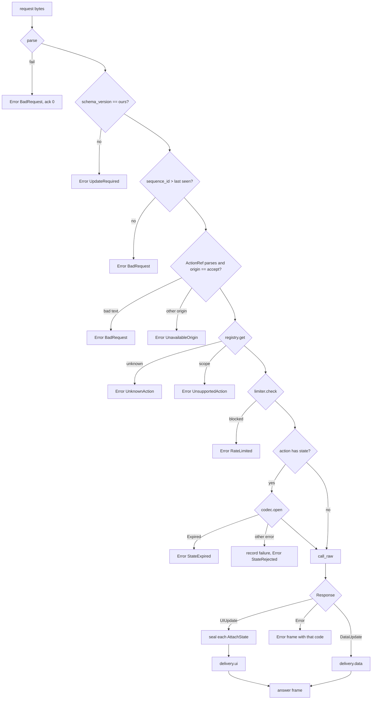

# Feature 07: The dispatcher and the handshake

_Written in ASD-STE100 Simplified Technical English (STE). Code and identifiers stay as they
are._

**Abbreviations in this file.** user interface (UI); hypertext transfer protocol (HTTP);
WebAssembly (WASM); random number generator (RNG); identifier (id); AeroSpace and Defence
Industries Association of Europe (ASD), the owner of the STE standard ASD-STE100.

## 1. Goal

`foundation_ui_runtime::dispatch` is the one implementation of the action lifecycle. It
takes the bytes of an `ActionRequest` and returns the bytes of one `Frame`. It holds no
per-user memory, so any server replica can run it. The same code runs in WASM and on a
device with a plain state codec. A handshake turns a `ClientHello` into the capabilities of
one connection.

## 2. Story

- **S1**: "A client says hello, and the server answers with its capabilities."
- **S2**: "A client sends an action request, and a replica that never saw this user answers
  with a frame."
- **S3**: "An action returns data, and the delivery handler picks the body type."
- **S4**: "An old app says hello with a registry hash that the server knows from a release
  table."
- **S5**: "An app says hello with a registry hash that the server does not know."
- **S6**: "A client sends a request with a forged state."
- **S7**: "A client sends a `native:` reference to a server."
- **S8**: "An action fails."
- **S9**: "A device runs the dispatcher locally for a `native:` action."

| # | Use case | Actor | Trigger | Result |
|---|---|---|---|---|
| U1 | Handshake | Client | `ClientHello` bytes | `HelloOutcome::Accepted` with a `Connection` and a `ServerCaps` frame, or `UpdateRequired` |
| U2 | Dispatch | Client | `ActionRequest` bytes | One `Frame`: the answer, or an `Error` |
| U3 | Deliver | Dispatcher | A `Response` | The delivery handler returns frame bytes |
| U4 | Local dispatch | `ActionManager` | `ActionTransport::send` | The same as U2, with no network |

## 3. Bounded context

**Inside this feature:** `Dispatcher`, `DispatcherBuilder`, `Connection`, `HelloOutcome`,
`DeliveryHandler`, `DefaultDelivery`, `LocalDispatcher`, `attach_state`, the mapping from
internal errors to wire `ErrorCode` values.

**Outside:**

| Thing | Owner |
|---|---|
| `read_*`, `finish_*`, `WireLimits`, `SCHEMA_VERSION` | Feature 01 |
| `VOCABULARY_VERSION`, `vocab_version` | Feature 02 |
| `write_ops`, `write_error`, `write_caps`, `write_messagepack`, `ClientCaps`, `StreamSequencer`, `WriterConfig` | Feature 03 |
| `StateCodec`, `FailureLimiter`, `Session`, `Expect`, `UnsealedState` | Feature 04 |
| `ActionRegistry`, `ErasedAction`, `Context`, `Response`, `ActionRef`, `ActionTransport`, `ComponentState` | Feature 05 |
| The network: how bytes arrive and leave; how the host finds the session and the address | The host (D25) |
| The domain data, single use, authorization of the user for a row | The action (D13, D14) |
| The live mode (`App`, `Broadcaster`) | `foundation_wasm_ui::server` (feature 11). The dispatcher does not replace it (D15) |

| Entity | Meaning | Owner (the one writer) |
|---|---|---|
| `Connection` | The capabilities, the session and the frame counter of one client connection | `Dispatcher::hello` creates it; `dispatch` advances its counters |
| Answer frame | The bytes that `dispatch` returns | `dispatch` |
| Known registries | Hash to action reference set, for released app versions | The host, at build time of the dispatcher |

| Verb | Kind | Trigger | Effect |
|---|---|---|---|
| `hello` | story | `ClientHello` bytes | Checks versions and the hash; makes a `Connection` |
| `dispatch` | story | `ActionRequest` bytes | The lifecycle of section 6.4 |
| `ui`, `data` | entity | `dispatch` | Encode one response |

**Words.** "Answer" is the frame with `ack_action` equal to the request `sequence_id`.
"Accept origin" is the one origin that a dispatcher runs: `Server` on a server, `Native` in
WASM and on a device.

## 4. Rules

### 4.1 Law worksheets

```
Entity: Answer frame
Conserved value:         exactly one frame for each dispatch call
Bound:                   its length <= WireLimits::max_frame_bytes
Inverse pairs:           none
Idempotent verbs:        none (the framework does not make an action idempotent; the domain does, D14)
Ordering pairs:          checks before the action; the action before seal; seal before encode
Monotone values:         frame sequence_id of one Connection strictly increases
Freeze points:           none
Links to other entities: ack_action == request.sequence_id (0 when the request did not parse)
```

```
Entity: Connection
Conserved value:         caps, surface, session and stream_id never change after hello
Bound:                   none
Inverse pairs:           none
Idempotent verbs:        none
Ordering pairs:          hello comes before dispatch
Monotone values:         the frame counter; the highest request sequence_id seen
Freeze points:           caps freeze at hello
Links to other entities: caps.known_actions comes from the registry hash rule
```

```
Entity: Known registries
Conserved value:         none
Bound:                   a hash is 32 bytes
Inverse pairs:           none
Idempotent verbs:        none
Ordering pairs:          none
Monotone values:         none
Freeze points:           immutable after the dispatcher is built
Links to other entities: none
```

### 4.2 Invariants

| # | Invariant |
|---|---|
| I1 | `dispatch` returns exactly one valid `Frame` for every input, also for bytes that are not a request. It never panics. |
| I2 | The action function runs only after: the request parsed, the schema version matched, the origin was the accept origin, the registry found the action for the surface, the limiter allowed the sender, and (for an action with state) the codec opened the state. |
| I3 | A dispatcher never runs a reference whose origin is not its accept origin. |
| I4 | Every `AttachState` in the answer was sealed by the codec of this dispatcher for the session of this connection. |
| I5 | A failed state check records one failure in the limiter, except `Expired`. |
| I6 | The answer never holds a form that the mount surface of the connection must not receive (the gate of feature 03 runs in the delivery handler). |
| I7 | Two dispatchers with the same registry, key ring and clock give the same body for the same request and connection. (Any replica can answer.) |
| I8 | Nothing that a dispatch call reads from the request stays reachable after the call returns, except the two counters of the `Connection` and the limiter record. |
| I9 | `hello` accepts a client only if the schema versions are equal and the registry hash is the server's own hash for that surface or is in the known registries. |
| I10 | For a `Connection` from `hello`, a request whose `sequence_id` is not greater than the highest one seen gives `BadRequest` and does not run the action. |

### 4.3 Must have

- `DeliveryHandler` as a trait, with `DefaultDelivery` (D16).
- `LocalDispatcher`, which implements `ActionTransport` (D29, D38).
- `attach_state`, the one helper that makes an unsealed `AttachState` op.

### 4.4 Must do

- Answer every failure with an `Error` frame that has a wire `ErrorCode`.
- Clone the inner `foundation_context::Ctx` for the call; do not share request values through it.
- Use the client's `Expect` from the action signature, never from the request.

### 4.5 Must not

- Do not keep a session table, a state cache or a per-user map (D15).
- Do not choose a transport or frame the bytes for one (D25).
- Do not tell the client which state check failed. The wire has `StateRejected` and
  `StateExpired` only.
- Do not add a nonce or used-id store (D14).
- Do not remove or change `App`, `Broadcaster` or `BroadcastSink` (D15, D40).

## 5. Acceptance scenarios

Fixtures: registry with `Increment` (feature 05 test action; state `Counter`,
`COMPONENT_TYPE` 7) under `Origin::Server`; `HmacStateCodec` with key id 1; session
`"sess-A"`; address `"10.0.0.1"`; clock at 1 000 000 s. `Increment` returns
`UIUpdate([SetText(42, next), attach_state(40, &next)])`.

```gherkin
Feature: Dispatcher and handshake

  Scenario: A hello with the current registry is accepted
    Given a ClientHello for a web mount with schema_version 1 and the registry hash for WEB
    When the host calls hello
    Then the outcome is Accepted
    And the caps frame has body Capabilities with status Ok and a stream_id that is not 0
    And connection.caps().known_actions is None

  Scenario: A hello with a known old registry gets its action set
    Given the dispatcher was built with known_registry(H, {"server:increment_counter"})
    And a ClientHello with action_registry_hash H
    When the host calls hello
    Then the outcome is Accepted
    And connection.caps().known_actions is Some({"server:increment_counter"})

  Scenario: A hello with an unknown registry needs an update
    Given a ClientHello with a registry hash of 32 bytes 0xAB that the server does not know
    When the host calls hello
    Then the outcome is UpdateRequired
    And the caps frame has status UpdateRequired

  Scenario: A hello with another schema version needs an update
    Given a ClientHello with schema_version 2
    When the host calls hello
    Then the outcome is UpdateRequired

  Scenario: An action runs on a replica that never saw the user
    Given dispatcher A sealed Counter { current: 1 } for "sess-A" on root 40
    And dispatcher B was built separately with the same registry, key ring and clock
    And a Connection from B.hello
    When the host calls B.dispatch with ActionRequest(seq 5, "server:increment_counter", node 42, that state)
    Then the answer has ack_action 5 and body Ops
    And the ops are SetText(42, "2") and one AttachState for root 40
    And opening that AttachState with B's codec for "sess-A" gives Counter { current: 2 }

  Scenario: A forged state is rejected and counted
    Given a sealed state whose body byte is changed
    When the host calls dispatch with it
    Then the answer has body Error with code StateRejected
    And the Probe inside the action did not run
    And the limiter has 1 failure for { session: "sess-A", address: "10.0.0.1" }

  Scenario: An expired state asks for a reload and is not counted
    Given a state sealed at 1000000 s and the clock at 1086400 s
    When the host calls dispatch with it
    Then the answer has body Error with code StateExpired
    And the limiter has 0 failures for that sender

  Scenario: A blocked sender gets RateLimited
    Given 5 recorded failures for the sender
    When the host calls dispatch with a valid request
    Then the answer has body Error with code RateLimited
    And the action did not run

  Scenario: A server refuses a native reference
    Given a dispatcher with accept origin Server
    When the host calls dispatch with action "native:increment_counter"
    Then the answer has body Error with code UnavailableOrigin

  Scenario: An unknown action is a typed error
    When the host calls dispatch with action "server:nope"
    Then the answer has body Error with code UnknownAction

  Scenario: Bytes that are not a request get an error frame
    When the host calls dispatch with 16 bytes of 0xFF
    Then the answer has ack_action 0 and body Error with code BadRequest

  Scenario: A repeated sequence id is refused
    Given a Connection that answered request sequence 5
    When the host calls dispatch with another request with sequence 5
    Then the answer has body Error with code BadRequest
    And the action did not run

  Scenario: An action error becomes an error frame
    Given an action that returns Response::failed("no stock")
    When the host calls dispatch
    Then the answer has ack_action equal to the request sequence and body Error
      with code ActionFailed and message "no stock"

  Scenario: A data update becomes a MessagePack body by default
    Given an action that returns Response::DataUpdate([0x91, 0x01])
    When the host calls dispatch with node_id 42
    Then the answer has body MessagePack with target_node 42 and bytes [0x91, 0x01]

  Scenario: A native connection gets no web form in the answer
    Given a Connection for a native mount
    And an action that returns UIUpdate([SetText(42,"x"), HtmlMorph(node 40, "<b>x</b>")])
    When the host calls dispatch
    Then the answer holds SetText(42,"x") only

  Scenario: A local dispatcher answers through the transport trait
    Given a LocalDispatcher with accept origin Native, PlainStateCodec and Toggle under Origin::Native
    When an ActionManager triggers "native:toggle"
    Then trigger returns a frame with body Ops
```

## 6. Technical breakdown

### 6.1 Files

```
backends/foundation_ui_runtime/src/dispatch/
├── mod.rs
├── dispatcher.rs   Dispatcher, DispatcherBuilder, dispatch
├── hello.rs        Connection, HelloOutcome, Dispatcher::hello
├── delivery.rs     DeliveryHandler, DefaultDelivery
├── local.rs        LocalDispatcher
├── state_op.rs     attach_state, seal_ops
└── errors.rs       error_frame helpers, StateError -> ErrorCode
backends/foundation_ui_runtime/tests/{dispatch_hello_tests.rs,dispatch_tests.rs,dispatch_errors_tests.rs,dispatch_delivery_tests.rs,dispatch_local_tests.rs,dispatch_fuzz_tests.rs}
```

### 6.2 Public API

```rust
pub trait DeliveryHandler: Send + Sync {
    /// Encodes a view update for one client. It must call the gate (use `write_ops`).
    fn ui(&self, ops: Vec<OpT>, caps: &ClientCaps, header: FrameHeader)
        -> Result<Vec<u8>, WriteError>;
    /// Encodes a data update for one client. `target_node` is the node of the request.
    fn data(&self, bytes: Vec<u8>, target_node: u32, caps: &ClientCaps, header: FrameHeader)
        -> Result<Vec<u8>, WriteError>;
}

/// `ui` calls `write_ops`. `data` calls `write_messagepack`.
#[derive(Clone, Debug, Default)]
pub struct DefaultDelivery { /* config: WriterConfig */ }
impl DefaultDelivery { #[must_use] pub fn new(config: WriterConfig) -> Self; }
impl DeliveryHandler for DefaultDelivery {}

pub struct DispatcherBuilder { /* … */ }
impl DispatcherBuilder {
    /// `accept` is the one origin that this dispatcher runs.
    #[must_use] pub fn new(accept: Origin, registry: Arc<ActionRegistry>,
        codec: Arc<dyn StateCodec>) -> Self;
    #[must_use] pub fn limiter(self, limiter: Arc<dyn FailureLimiter>) -> Self;   // default InMemoryFailureLimiter::new(FailureLimits::default())
    #[must_use] pub fn delivery(self, delivery: Arc<dyn DeliveryHandler>) -> Self; // default DefaultDelivery
    #[must_use] pub fn writer_config(self, config: WriterConfig) -> Self;          // used for error and caps frames, and limits
    /// The action references of a released app version, by its registry hash.
    #[must_use] pub fn known_registry(self, hash: [u8; 32], refs: BTreeSet<String>) -> Self;
    #[must_use] pub fn build(self) -> Dispatcher;
}

pub struct Dispatcher { /* private */ }
impl Dispatcher {
    pub fn hello(&self, ctx: &Ctx, hello: &[u8], session: Session, address: &str)
        -> Result<HelloOutcome, WireError>;
    /// Runs one action. Always returns the bytes of one frame.
    pub async fn dispatch(&self, ctx: &Ctx, connection: &Connection, request: &[u8]) -> Vec<u8>;
}

pub enum HelloOutcome {
    Accepted { connection: Connection, caps_frame: Vec<u8> },
    UpdateRequired { caps_frame: Vec<u8> },
}

pub struct Connection { /* caps: ClientCaps, surface: Surface, session: Session,
    address: String, sequencer: Mutex<StreamSequencer>, last_request: AtomicU64,
    check_request_order: bool */ }
impl Connection {
    /// For a transport with no handshake state between requests (one HTTP request for each
    /// action). It does not check request order (I10 does not apply).
    #[must_use] pub fn stateless(caps: ClientCaps, surface: Surface, session: Session,
        address: &str, stream_id: u64) -> Self;
    #[must_use] pub fn caps(&self) -> &ClientCaps;
    #[must_use] pub fn surface(&self) -> Surface;
    #[must_use] pub fn session(&self) -> &Session;
    #[must_use] pub fn stream_id(&self) -> u64;
}

/// A dispatcher behind the transport trait, for `native:` actions.
pub struct LocalDispatcher { /* dispatcher: Dispatcher, ctx: Ctx, connection: Connection */ }
impl LocalDispatcher {
    #[must_use] pub fn new(dispatcher: Dispatcher, ctx: Ctx, connection: Connection) -> Self;
}
impl ActionTransport for LocalDispatcher { /* send = dispatch; never returns Err */ }

/// Makes the op that carries the state of a component, not yet sealed.
/// `flags` bit 0 follows `S::PRIVATE`; key_id, times, binding and tag are empty.
#[must_use]
pub fn attach_state<S: ComponentState>(root_node: u32, state: &S) -> OpT;
```

### 6.3 `hello`, in order

1. `read_client_hello(hello, limits)`; an error returns `Err`.
2. `hello.schema_version() != SCHEMA_VERSION` gives `UpdateRequired`.
3. `hello.vocabulary_version() == 0` gives `UpdateRequired`. Else
   `vocab = min(hello.vocabulary_version(), VOCABULARY_VERSION)`.
4. `surface = Surface { platform, mount }`.
5. The hash must have 32 bytes; else `UpdateRequired`. If it equals
   `registry.hash_for(surface)`: `known_actions = None`. Else if it is a key of the known
   registries: `known_actions = Some(set)`. Else `UpdateRequired`.
6. `stream_id`: if `hello.stream_id() != 0`, keep it and start the sequencer with
   `StreamSequencer::resume(stream_id, hello.resume_from())`. Else take a `u64` from
   `ctx.rng()`; if it is 0, use 1.
7. Build `ServerCapsT { status: Ok, schema_version: SCHEMA_VERSION, vocabulary_version: vocab,
   stream_id, resume_from: hello.resume_from() }` and `write_caps` with
   `FrameHeader { stream_id, sequence_id: 0, ack_action: 0 }`. A caps frame has sequence 0:
   it is not part of the ordered stream.
8. Return `Accepted` with `check_request_order = true`.

For `UpdateRequired`, the caps frame has `status: UpdateRequired`, the server versions,
`stream_id: 0` and sequence 0.

### 6.4 `dispatch`, in order



_The diagram shows the fixed order of one dispatch. Every exit is one frame._

Details:

1. **Parse.** `read_action_request(request, limits)`.
2. **Version.** `request.schema_version() != SCHEMA_VERSION`.
3. **Order.** Only when `check_request_order`: compare with `last_request`; on success
   store the new value (`fetch_max`).
4. **Reference.** `ActionRef::parse(request.action())`.
5. **Look-up.** `registry.get(origin, name, connection.surface())`.
6. **Limiter.** `FailureKey { session: session.id(), address }`.
7. **State.** If `action.expect()` is `Some(expect)`: an absent or empty `state` gives
   `BadRequest`. `codec.open(ctx.inner(), session, bytes, expect)`. On an error other than
   `Expired`: `limiter.record_failure`.
8. **Run.** `Context::new(ctx.clone(), session.clone(), surface, input.unpack())`, then
   `with_state_root(verified.root_node)` when a state was opened;
   `RawInteraction { node_id, event_name: input.event_name, input_value: input.value,
   state_body }`; `action.call_raw(&context, raw).await`.
9. **Header.** After the action returns: lock the sequencer, `header(request.sequence_id())`,
   unlock. The lock is never held across an `.await`.
10. **Seal** (`seal_ops`). For each `AttachState` op, at any depth of `ReplaceSubtree`: read
    the nested bytes with `read_signed_state`; build `UnsealedState { format_version,
    component_type, root_node, body, private: flags & 1 == 1 }`; `codec.seal`; replace the
    bytes. A read error or a seal error gives an `Error` frame with code `ActionFailed` and
    the message `"state could not be sealed"`.
11. **Deliver.** `delivery.ui` or `delivery.data`. A `WriteError` gives an `Error` frame
    with code `ActionFailed` and the message of the error.
12. **Error frames.** `write_error` with the same header. If `write_error` itself fails
    (the message makes the frame too large), write it again with an empty message.

**Wire codes**

| Internal result | `ErrorCode` | Message on the wire |
|---|---|---|
| Parse failure; bad reference text; missing state; repeated sequence | `BadRequest` | `"bad request"` |
| Other schema version | `UpdateRequired` | `"update required"` |
| Origin is not the accept origin | `UnavailableOrigin` | `"origin not available"` |
| `LookupError::UnknownAction` | `UnknownAction` | `"unknown action"` |
| `LookupError::UnsupportedAction` | `UnsupportedAction` | `"action not supported on this surface"` |
| `StateError::RateLimited` | `RateLimited` | `"too many failures"` |
| `StateError::Expired` | `StateExpired` | `"state expired"` |
| Every other `StateError` from `open` | `StateRejected` | `"state rejected"` |
| `Response::Error(e)` | `e.code` | `e.message` |
| Seal or delivery failure | `ActionFailed` | as above |

### 6.5 Fault tables

**`dispatch`**

| Step that fails | What the system does | What the caller sees | What is left behind |
|---|---|---|---|
| 1 to 6 | Stops before the action | An `Error` frame | nothing (step 3 stored the sequence id only on success) |
| 7 (state) | Stops before the action | `StateRejected` or `StateExpired` | One limiter failure, except for `Expired` |
| 8 (the action returns `Error`) | Encodes it | An `Error` frame with the action's code | What the action changed in the domain data. The action owns its own atomicity ("one action is one unit of work", research 10) |
| 8 (the action panics) | The dispatcher does not catch it | The host's task fails; the client gets no frame and its transport reports an error | What the action changed before the panic. The frame counter did not move |
| 10 (seal) | Drops the response | `ActionFailed` | The domain change of the action stays; the client keeps its old state, which is still valid; the next action reads the truth from the backend (D13) |
| 11 (delivery) | Drops the response | `ActionFailed` | The same as step 10 |

**`hello`**

| Step that fails | What the system does | What the caller sees | What is left behind |
|---|---|---|---|
| 1 | Stops | `Err(WireError)`; the host closes the connection | nothing |
| 2, 3, 5 | Builds the caps frame | `UpdateRequired` | nothing |

### 6.6 How a host uses it (not code of this feature)

```rust
// one HTTP request for each action, any replica
let connection = Connection::stateless(caps, surface, session, &address, stream_id);
let frame = dispatcher.dispatch(&ctx, &connection, &body).await;
// the host writes `frame` to its response; framing is the transport's business (D25)
```

A sync caller wraps the call with valtron (`block_on_future`), as rule 6 says. The
dispatcher has no sync twin.

## 7. Tests

All in `backends/foundation_ui_runtime/tests/`. Reuse the test actions and `test_ctx` of
features 04 and 05. Add `Probe`-wrapped variants to see if an action ran.

| Law or scenario | Test | Oracle |
|---|---|---|
| I1; Scenario: bytes that are not a request | `dispatch_fuzz_tests.rs::every_input_gives_one_valid_frame` (each prefix of a valid request, each single bit flip of its first 128 bytes, and 200 seeded random buffers; `read_frame` must accept each answer) | property |
| I2 | `dispatch_errors_tests.rs::action_never_runs_when_a_check_fails` (one case for each exit of steps 1 to 7; the `Probe` stays false) | fault |
| I3; Scenario: a server refuses a native reference | `dispatch_errors_tests.rs::server_refuses_native_reference`, `::local_refuses_server_reference` | expected outcome |
| I4, I7; Scenario: a replica that never saw the user | `dispatch_tests.rs::any_replica_answers` | metamorphic |
| I5; Scenarios: forged state, expired state | `dispatch_errors_tests.rs::forged_state_is_rejected_and_counted`, `::expired_state_is_not_counted` | expected outcome |
| I6; Scenario: native connection gets no web form | `dispatch_delivery_tests.rs::native_answer_has_no_web_form` | example |
| I8 | Review item in "Done when", plus `dispatch_tests.rs::dispatcher_has_no_per_user_map` (after 100 dispatches for 100 sessions with valid states, the dispatcher's public `debug_entry_count()`—a `#[doc(hidden)]` function that returns the limiter record count—is 0) | property |
| I9; Scenarios: four hello cases | `dispatch_hello_tests.rs::current_registry_is_accepted`, `::known_old_registry_gets_its_set`, `::unknown_registry_needs_update`, `::other_schema_version_needs_update`, `::resume_keeps_stream_and_sequence` | example |
| I10; Scenario: repeated sequence id | `dispatch_errors_tests.rs::repeated_sequence_is_refused`, `::stateless_connection_does_not_check_order` | expected outcome |
| Scenarios: blocked sender, unknown action, action error, data update | `dispatch_errors_tests.rs::blocked_sender_gets_rate_limited`, `::unknown_action_is_typed`, `::action_error_becomes_error_frame`; `dispatch_delivery_tests.rs::data_update_is_messagepack_by_default`, `::custom_delivery_is_used` | example |
| Scenario: local dispatcher | `dispatch_local_tests.rs::manager_triggers_local_action` | example |
| Fault: seal fails | `dispatch_errors_tests.rs::seal_failure_gives_action_failed` (an action that returns an `AttachState` with a body of 5000 bytes) | fault |
| Frame sequence increases | `dispatch_tests.rs::answers_have_increasing_sequence` | property |
| `attach_state` makes an unsealed op that the writer refuses and the dispatcher seals | `dispatch_tests.rs::attach_state_is_unsealed_until_dispatch` | example |

## 8. Tasks

- [ ] 1. `state_op.rs`: `attach_state`, `seal_ops`, and their test.
- [ ] 2. `delivery.rs` and its tests.
- [ ] 3. `errors.rs`: the wire code table as one function, with a table test.
- [ ] 4. `hello.rs` and its tests.
- [ ] 5. `dispatcher.rs`: steps 1 to 7 and the error tests.
- [ ] 6. Steps 8 to 12 and the success tests.
- [ ] 7. `local.rs` and its test.
- [ ] 8. The fuzz-style test of I1.
- [ ] 9. Bump `foundation_ui_runtime` to `0.0.3`.
- [ ] 10. Update `progress.md` and `learnings.md`.

## 9. Verify

```bash
cargo fmt --all -- --check
cargo check  -p foundation_ui_runtime --profile uat
cargo clippy -p foundation_ui_runtime --profile uat --no-deps -- -D warnings
cargo test   -p foundation_ui_runtime --profile uat
cargo check  -p foundation_ui_runtime --profile uat --target wasm32-unknown-unknown
python3 scripts/ci/check_time_sources.py
```

## 10. Done when

- [ ] All tasks are complete and every command of section 9 passes with no warning.
- [ ] Each invariant and each scenario has a passing test (section 7).
- [ ] A reviewer confirms that `Dispatcher` has no field that grows with the number of
      users, except the limiter behind its trait (I8).
- [ ] No lock is held across an `.await`.
- [ ] `backends/foundation_wasm_ui/src/server/mod.rs` is unchanged.
- [ ] No `TODO`, `FIXME`, `todo!()` or `unimplemented!()` is in the module.
- [ ] The check list of the `story-driven-specification` skill passes.

---

_Created: 2026-11-13_
