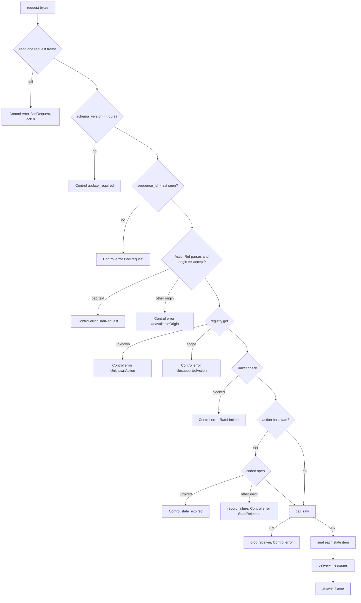

# Feature 07: The dispatcher and the handshake

_Written in ASD-STE100 Simplified Technical English (STE). Code and identifiers stay as they
are._

**Abbreviations in this file.** user interface (UI); hypertext transfer protocol (HTTP);
WebAssembly (WASM); random number generator (RNG); identifier (id); AeroSpace and Defence
Industries Association of Europe (ASD), the owner of the STE standard ASD-STE100.

## 1. Goal

`foundation_ui_runtime::dispatch` is the one implementation of the action lifecycle. It takes
the bytes of one request frame and returns the bytes of one message frame. It holds no
per-user memory, so any server replica can run it. The same code runs in WASM and on a device
with a plain state codec. A handshake turns the `hello` field of a request frame into the
capabilities of one connection. The hello checks the schema and the vocabulary versions only
(D54). The answer lists the `server:` actions that the server has for the surface (D54).

## 2. Story

- **S1**: "A client says hello, and the server answers with its capabilities and its action
  list."
- **S2**: "A client sends an action request, and a replica that never saw this user answers
  with a frame."
- **S3**: "An action writes data, and the delivery handler picks the encoding."
- **S4**: "A client says hello with an old schema version."
- **S5**: "A client says hello with a vocabulary version that the server does not have."
- **S6**: "A client sends a request with a forged state."
- **S7**: "A client sends a `host:` reference to a server."
- **S8**: "An action fails."
- **S9**: "A device runs the dispatcher locally for a `host:` action."

| # | Use case | Actor | Trigger | Result |
|---|---|---|---|---|
| U1 | Handshake | Client | A request frame whose `hello` is set | `HelloOutcome::Accepted` with a `Connection` and a caps frame, or `UpdateRequired` |
| U2 | Dispatch | Client | A request frame whose `action` is set | One `Frame`: the messages, or one `Control` message |
| U3 | Deliver | Dispatcher | A receiver and its items | The delivery handler returns frame bytes |
| U4 | Local dispatch | `ActionManager` | `ActionTransport::send` | The same as U2, with no network |

## 3. Bounded context

**Inside this feature:** `Dispatcher`, `DispatcherBuilder`, `Connection`, `HelloOutcome`,
`HelloError`, `DeliveryHandler`, `DefaultDelivery`, `LocalDispatcher`, `attach_state`,
`seal_items`, the mapping from internal errors to `Control` messages.

**Outside:**

| Thing | Owner |
|---|---|
| `read_frame`, `finish_frame`, `expect_kind`, `FrameKindName`, `WireLimits`, `SCHEMA_VERSION` | Feature 01 |
| `VOCABULARY_VERSION`, `vocab_version` | Feature 02 |
| `write_messages`, `write_error`, `write_caps`, `write_messagepack`, `ClientCaps`, `StreamSequencer`, `WriterConfig` | Feature 03 |
| `StateCodec`, `FailureLimiter`, `Session`, `Expect`, `UnsealedState` | Feature 04 |
| `ActionRegistry`, `ErasedAction`, `Context`, `ActionReceiver`, `ReceiverItem`, `ActionRef`, `ActionTransport`, `ComponentState`, `ServerActionT` | Feature 05 |
| The network: how bytes arrive and leave; how the host finds the session and the address | The host (D25) |
| The domain data, single use, authorization of the user for a row | The action (D13, D14) |
| The live mode (`App`, `Broadcaster`) | `foundation_wasm_ui::server` (feature 11). The dispatcher does not replace it (D15) |

| Entity | Meaning | Owner (the one writer) |
|---|---|---|
| `Connection` | The capabilities, the session and the frame counter of one client connection | `Dispatcher::hello` creates it; `dispatch` advances its counters |
| Answer frame | The bytes that `dispatch` returns | `dispatch` |
| `ServerCaps.actions` | The `server:` actions for one surface, sorted by name | `Dispatcher::hello` builds it from the registry |

| Verb | Kind | Trigger | Effect |
|---|---|---|---|
| `hello` | story | A request frame whose `hello` is set | Checks the two versions; makes a `Connection`; lists the actions |
| `dispatch` | story | A request frame whose `action` is set | The lifecycle of section 6.4 |
| `messages` | entity | `dispatch` | Encode the answer messages |

**Words.** "Answer" is the frame with kind `FrameMessage` whose `ack` equals the request
frame's `sequence_id`. "Accept origin" is the one origin that a dispatcher runs: `Server` on
a server, `Host` in WASM and on a device. "Caps frame" is a frame with one `Control{caps}`
message; it has sequence 0 and ack 0.

## 4. Rules

### 4.1 Law worksheets

```
Entity: Answer frame
Conserved value:         exactly one frame for each dispatch call
Bound:                   its length <= WireLimits::max_frame_bytes
Inverse pairs:           none
Idempotent verbs:        none (the framework does not make an action idempotent; the domain does, D14)
Ordering pairs:          checks before the action; the action before seal; seal before encode
Monotone values:         frame sequence_id of one Connection strictly increases
Freeze points:           none
Links to other entities: ack == request.sequence_id (0 when the frame could not be read)
```

```
Entity: Connection
Conserved value:         caps, surface, session and stream_id never change after hello
Bound:                   none
Inverse pairs:           none
Idempotent verbs:        none
Ordering pairs:          hello comes before dispatch
Monotone values:         the frame counter; the highest request sequence_id seen
Freeze points:           caps freeze at hello
Links to other entities: caps.actions is the sorted server action list for the surface (D54)
```

### 4.2 Invariants

| # | Invariant |
|---|---|
| I1 | `dispatch` returns exactly one valid `Frame` for every input, also for bytes that are not a request. It never panics. |
| I2 | The action function runs only after: the request frame was read, the schema version matched, the origin was the accept origin, the registry found the action for the surface, the limiter allowed the sender, and (for an action with state) the codec opened the state. |
| I3 | A dispatcher never runs a reference whose origin is not its accept origin. |
| I4 | Every `AttachState` in the answer was sealed by the codec of this dispatcher for the session of this connection. |
| I5 | A failed state check records one failure in the limiter, except `Expired`. |
| I6 | The answer never holds a field that the mount surface of the connection must not receive (the gate of feature 03 runs in the delivery handler). |
| I7 | Two dispatchers with the same registry, key ring and clock give the same body for the same request and connection. (Any replica can answer.) |
| I8 | Nothing that a dispatch call reads from the request stays reachable after the call returns, except the two counters of the `Connection` and the limiter record. |
| I9 | `hello` accepts a client only if the schema versions are equal and `vocab_version` gives a row for the client vocabulary version. |
| I10 | For a `Connection` from `hello`, a request whose `sequence_id` is not greater than the highest one seen gives `BadRequest` and does not run the action. |
| I11 | `ServerCaps.actions` lists every `server:` action whose scope includes the surface, and every action with no origin limit, sorted by name, each with `action_hash(origin, name, scope)` (D54). |
| I12 | On `Err` from the action, the answer holds one `Control{error}` message and no operation or data from the receiver (D52). |
| I13 | `Control.update_required` and `Control.state_expired` are their own tables. The dispatcher does not send them as an `ActionError` (D45). |

### 4.3 Must have

- `DeliveryHandler` as a trait, with `DefaultDelivery` (D16).
- `LocalDispatcher`, which implements `ActionTransport` (D29, D38).
- `attach_state`, the one helper that makes an unsealed `AttachState` operation.
- `seal_items`, the one step that seals every state item of the receiver.

### 4.4 Must do

- Answer every failure with one `Control` message that has a `Control.error`,
  `Control.state_expired` or `Control.update_required` field.
- Clone the inner `foundation_context::Ctx` for the call; do not share request values through
  it.
- Use the client's `Expect` from the action signature, never from the request.
- Drop the receiver on `Err`, so a failed action leaves no half update (D52).

### 4.5 Must not

- Do not keep a session table, a state cache or a per-user map (D15).
- Do not choose a transport or frame the bytes for one (D25).
- Do not send an action registry hash, a known-registry table or a client action list (D54).
- Do not tell the client which state check failed. The wire has `ActionError` code
  `StateRejected` and the `StateExpired` control table only.
- Do not add a nonce or used-id store (D14).
- Do not remove or change `App`, `Broadcaster` or `BroadcastSink` (D15, D40).

## 5. Acceptance scenarios

Fixtures: registry with `Increment` (feature 05 test action; state `Counter`,
`COMPONENT_TYPE` 7) under `Origin::Server`; `HmacStateCodec` with key id 1; session
`"sess-A"`; address `"10.0.0.1"`; clock at 1 000 000 s. `Increment` writes
`SetText(42, next)` and `receiver.state(40, &next)`.

```gherkin
Feature: Dispatcher and handshake

  Scenario: A hello with the current versions is accepted
    Given a request frame with schema_version 1 whose hello holds vocabulary_version 2 for a web mount
    When the host calls hello
    Then the outcome is Accepted
    And the caps frame has one Control{caps} message with status Ok and a stream_id that is not 0
    And caps.actions == [{ hash: action_hash(Server, "increment_counter", All),
      name: "increment_counter" }]

  Scenario: A hello with an unknown vocabulary version needs an update
    Given a request frame with the current schema version whose hello holds vocabulary_version 3
    When the host calls hello
    Then the outcome is UpdateRequired
    And the caps frame has status UpdateRequired
    And caps.actions is empty

  Scenario: A hello with another schema version needs an update
    Given a request frame with schema_version 2 whose hello holds the current vocabulary version
    When the host calls hello
    Then the outcome is UpdateRequired

  Scenario: An action runs on a replica that never saw the user
    Given dispatcher A sealed Counter { current: 1 } for "sess-A" on root 40
    And dispatcher B was built separately with the same registry, key ring and clock
    And a Connection from B.hello
    When the host calls B.dispatch with a request frame with sequence 5 whose action is
      "server:increment_counter" for node 42 with that state
    Then the answer has ack 5
    And messages holds one Message whose operation.ui is SetText(42, "2")
    And messages holds one Message whose operation.ui is AttachState for root 40
    And opening that AttachState with B's codec for "sess-A" gives Counter { current: 2 }

  Scenario: A forged state is rejected and counted
    Given a sealed state whose body byte is changed
    When the host calls dispatch with it
    Then the answer has one Control{error} message with code StateRejected
    And the Probe inside the action did not run
    And the limiter has 1 failure for { session: "sess-A", address: "10.0.0.1" }

  Scenario: An expired state asks for a reload and is not counted
    Given a state sealed at 1000000 s and the clock at 1086400 s
    When the host calls dispatch with it
    Then the answer has one Control{state_expired} message
    And the answer has no Control{error} message
    And the limiter has 0 failures for that sender

  Scenario: A blocked sender gets RateLimited
    Given 5 recorded failures for the sender
    When the host calls dispatch with a valid request
    Then the answer has one Control{error} message with code RateLimited
    And the action did not run

  Scenario: A server refuses a host reference
    Given a dispatcher with accept origin Server
    When the host calls dispatch with action "host:increment_counter"
    Then the answer has one Control{error} message with code UnavailableOrigin

  Scenario: An unknown action is a typed error
    When the host calls dispatch with action "server:nope"
    Then the answer has one Control{error} message with code UnknownAction

  Scenario: Bytes that are not a request get an error frame
    When the host calls dispatch with 16 bytes of 0xFF
    Then the answer has ack 0 and one Control{error} message with code BadRequest

  Scenario: A repeated sequence id is refused
    Given a Connection that answered request sequence 5
    When the host calls dispatch with another request with sequence 5
    Then the answer has one Control{error} message with code BadRequest
    And the action did not run

  Scenario: An action error becomes one error control message
    Given an action that returns Err with ActionError code ActionFailed and message "no stock"
    And the action wrote one SetText to the receiver before the error
    When the host calls dispatch
    Then the answer has ack equal to the request sequence
    And the answer has one Control{error} message with code ActionFailed and message "no stock"
    And the answer holds no operation from the receiver

  Scenario: Data goes in a data message by default
    Given an action that calls receiver.data(42, [0x91, 0x01])
    When the host calls dispatch with node_id 42
    Then the answer holds one Message whose data.msgpack is target_node 42 with bytes [0x91, 0x01]

  Scenario: A native connection gets no web field in the answer
    Given a Connection for a native mount
    And an action that pushes one Operation with ui SetText(42, "x") and web HtmlMorph(node 40, "<b>x</b>")
    When the host calls dispatch
    Then the answer holds one Message whose operation.ui is SetText(42, "x")
    And no Message holds a web field

  Scenario: A local dispatcher answers through the transport trait
    Given a LocalDispatcher with accept origin Host, PlainStateCodec and Toggle under Origin::Host
    When an ActionManager triggers "host:toggle"
    Then trigger returns a frame with one Message that holds the action result
```

## 6. Technical breakdown

### 6.1 Files

```
backends/foundation_ui_runtime/src/dispatch/
├── mod.rs
├── dispatcher.rs   Dispatcher, DispatcherBuilder, dispatch
├── hello.rs        Connection, HelloOutcome, Dispatcher::hello
├── delivery.rs     DeliveryHandler, DefaultDelivery
├── local.rs        LocalDispatcher
├── state_op.rs     attach_state, seal_items
└── errors.rs       error_control helpers, StateError -> Control
backends/foundation_ui_runtime/tests/{dispatch_hello_tests.rs,dispatch_tests.rs,dispatch_errors_tests.rs,dispatch_delivery_tests.rs,dispatch_local_tests.rs,dispatch_fuzz_tests.rs}
```

### 6.2 Public API

```rust
pub trait DeliveryHandler: Send + Sync {
    /// Encodes the answer messages, in order, for one client. It must call the gate
    /// (use `write_messages`).
    fn messages(&self, messages: Vec<MessageT>, caps: &ClientCaps, header: FrameHeader)
        -> Result<Vec<u8>, WriteError>;
}

/// `messages` calls `write_messages`.
#[derive(Clone, Debug, Default)]
pub struct DefaultDelivery { /* config: WriterConfig */ }
impl DefaultDelivery { #[must_use] pub fn new(config: WriterConfig) -> Self; }
impl DeliveryHandler for DefaultDelivery {}

pub struct DispatcherBuilder { /* … */ }
impl DispatcherBuilder {
    /// `accept` is the one origin that this dispatcher runs.
    #[must_use] pub fn new(accept: Origin, registry: Arc<ActionRegistry>,
        codec: Arc<dyn StateCodec>) -> Self;
    #[must_use] pub fn limiter(self, limiter: Arc<dyn FailureLimiter>) -> Self;   // default InMemoryFailureLimiter::new(FailureLimits::default())
    #[must_use] pub fn delivery(self, delivery: Arc<dyn DeliveryHandler>) -> Self; // default DefaultDelivery
    #[must_use] pub fn writer_config(self, config: WriterConfig) -> Self;          // used for control frames, the caps frame and limits
    #[must_use] pub fn build(self) -> Dispatcher;
}

pub struct Dispatcher { /* private */ }
impl Dispatcher {
    /// Reads one request frame whose `hello` is set. A frame of another kind is
    /// `HelloError::Wire`; a request with `action` and no `hello` is `NotAHello`.
    pub fn hello(&self, ctx: &Ctx, hello: &[u8], session: Session, address: &str)
        -> Result<HelloOutcome, HelloError>;
    /// Runs one action. Always returns the bytes of one frame.
    pub async fn dispatch(&self, ctx: &Ctx, connection: &Connection, request: &[u8]) -> Vec<u8>;
    /// The `server:` actions for `surface`, sorted by name (D54).
    #[must_use] pub fn server_actions(&self, surface: Surface) -> Vec<ServerActionT>;
}

/// A hello that the dispatcher cannot read.
#[derive(Debug, Clone, PartialEq, Eq)]
pub enum HelloError {
    /// `read_frame` or `expect_kind` failed.
    Wire(WireError),
    /// The frame is a request, but it holds no `hello` field.
    NotAHello,
}
impl From<WireError> for HelloError { /* gives `Wire` */ }

pub enum HelloOutcome {
    Accepted { connection: Connection, caps_frame: Vec<u8> },
    UpdateRequired { caps_frame: Vec<u8> },
}

pub struct Connection { /* caps: ClientCaps, surface: Surface, session: Session,
    address: String, sequencer: Mutex<StreamSequencer>, last_request: AtomicU64,
    check_request_order: bool */ }
impl Connection {
    /// For a transport with no handshake state between requests (one HTTP request for each
    /// action). It does not check request order (I10 does not apply).
    #[must_use] pub fn stateless(caps: ClientCaps, surface: Surface, session: Session,
        address: &str, stream_id: u64) -> Self;
    #[must_use] pub fn caps(&self) -> &ClientCaps;
    #[must_use] pub fn surface(&self) -> Surface;
    #[must_use] pub fn session(&self) -> &Session;
    #[must_use] pub fn stream_id(&self) -> u64;
}

/// A dispatcher behind the transport trait, for `host:` actions.
pub struct LocalDispatcher { /* dispatcher: Dispatcher, ctx: Ctx, connection: Connection */ }
impl LocalDispatcher {
    #[must_use] pub fn new(dispatcher: Dispatcher, ctx: Ctx, connection: Connection) -> Self;
}
impl ActionTransport for LocalDispatcher { /* send = dispatch; never returns Err */ }

/// Makes the operation that carries the state of a component, not yet sealed.
/// `flags` bit 0 follows `S::PRIVATE`; key_id, times, binding and tag are empty.
#[must_use]
pub fn attach_state<S: ComponentState>(root_node: u32, state: &S) -> OperationT;
```

### 6.3 `hello`, in order

Let `frame` be the read `Frame`, and `client_hello` its `FrameRequest.hello`.

1. `read_frame(hello, limits)` with `?`; then `expect_kind(&frame, FrameKindName::Request)`
   with `?`. A frame whose kind is `Message` or `NONE` is a wire fault (`WrongKind` or
   `NoKind`). The `hello` field of the `FrameRequest` must be set; a request that holds
   `action` and no `hello` gives `HelloError::NotAHello`.
2. `frame.schema_version() != SCHEMA_VERSION` gives `UpdateRequired`.
3. `vocab_version(client_hello.vocabulary_version())` of `None` gives `UpdateRequired`. Else
   `vocab = min(client_hello.vocabulary_version(), VOCABULARY_VERSION)`.
4. `surface = Surface { platform, mount }`; the connection caps are
   `ClientCaps { platform, mount, vocabulary_version: vocab }`.
5. `actions = registry.server_actions(surface)`; the list is sorted by name and each entry
   carries `action_hash` (D54). There is no registry hash to check.
6. `stream_id`: if `frame.stream_id() != 0`, keep it and start the sequencer with
   `StreamSequencer::resume(stream_id, client_hello.resume_from())`. Else take a `u64` from
   `ctx.rng()`; if it is 0, use 1.
7. Build `ServerCapsT { status: Ok, schema_version: SCHEMA_VERSION, vocabulary_version: vocab,
   stream_id, resume_from: client_hello.resume_from(), actions }` and `write_caps` with
   `FrameHeader { stream_id, sequence_id: 0, ack: 0 }`. A caps frame has sequence 0:
   it is not part of the ordered stream.
8. Return `Accepted` with `check_request_order = true`.

For `UpdateRequired`, the caps frame has `status: UpdateRequired`, the server versions,
`stream_id: 0`, sequence 0 and the same `actions` list. The list is a declaration of the
server at any status, so a client that needs to show what it supports can read it in both
cases. The client must not send a request after an `UpdateRequired`.

### 6.4 `dispatch`, in order



_The diagram shows the fixed order of one dispatch. Every exit is one frame._

Details:

1. **Read.** `read_frame(request, limits)`, then `expect_kind(&frame,
   FrameKindName::Request)`. A message-kind frame, a frame with `NONE` kind, or a request
   that holds no `action` gives one `Control{error}` message with code `BadRequest` and
   `ack 0` when the sequence is unknown. Let `action_request` be the `FrameRequest.action`;
   `input`, `state` and `node_id` are its fields.
2. **Version.** `frame.schema_version() != SCHEMA_VERSION` gives a
   `Control{update_required}` message.
3. **Order.** Only when `check_request_order`: compare `frame.sequence_id()` with
   `last_request`; on success store the new value (`fetch_max`).
4. **Reference.** `ActionRef::parse(action_request.action())`.
5. **Look-up.** `registry.get(origin, name, connection.surface())`.
6. **Limiter.** `FailureKey { session: session.id(), address }`.
7. **State.** If `action.expect()` is `Some(expect)`: an absent or empty `state` gives
   `BadRequest`. `codec.open(ctx.inner(), session, bytes, expect)`. On an error other than
   `Expired`: `limiter.record_failure`.
8. **Run.** `Context::new(ctx.clone(), session.clone(), surface, input.unpack())`, then
   `with_state_root(verified.root_node)` when a state was opened;
   `RawInteraction { node_id, event_name: input.event_name, input_value: input.value,
   state_body }`; `action.call_raw(&context, raw).await`. An `Err` drops the whole receiver
   and returns one `Control{error}` message (D52).
9. **Header.** After the action returns with `Ok(())`: lock the sequencer,
   `header(frame.sequence_id())`, unlock. The lock is never held across an `.await`.
10. **Seal** (`seal_items`). Take `context.into_receiver()`. For each
    `ReceiverItem::State { root_node, component_type, format_version, private, bytes }`: build
    `UnsealedState { format_version, component_type, root_node, body: bytes, private }`;
    `codec.seal`; make an `Operation` with a sealed `AttachState` and push a
    `Message{operation}`. A seal error gives a `Control{error}` message with code
    `ActionFailed` and the message `"state could not be sealed"`.
11. **Build the messages.** `ReceiverItem::Operation(op)` gives `Message{operation: op}`.
    `ReceiverItem::Data { target_node, bytes }` gives
    `Message{data: Data{target_node, msgpack}}`. The message order is the receiver order.
12. **Deliver.** `delivery.messages(messages, caps, header)`. A `WriteError` gives a
    `Control{error}` message with code `ActionFailed` and the message of the error.
13. **Control messages.** `write_error`, `write_caps` or a helper for `state_expired` and
    `update_required` with the same header. If the message makes the frame too large, write
    it again with an empty message.

**Control mapping**

| Internal result | `Control` field |
|---|---|
| Read failure; bad reference text; missing state; repeated sequence | `error: ActionError{ code: BadRequest, message: "bad request" }` |
| The frame kind is not a request, or the request holds no action | `error: ActionError{ code: BadRequest, message: "bad request" }` |
| Other schema version or unknown vocabulary version | `update_required: UpdateRequired{ client_schema_version, server_schema_version }` |
| Origin is not the accept origin | `error: ActionError{ code: UnavailableOrigin, message: "origin not available" }` |
| `LookupError::UnknownAction` | `error: ActionError{ code: UnknownAction, message: "unknown action" }` |
| `LookupError::UnsupportedAction` | `error: ActionError{ code: UnsupportedAction, message: "action not supported on this surface" }` |
| `StateError::RateLimited` | `error: ActionError{ code: RateLimited, message: "too many failures" }` |
| `StateError::Expired` | `state_expired: StateExpired{ token_issued_at }` |
| Every other `StateError` from `open` | `error: ActionError{ code: StateRejected, message: "state rejected" }` |
| `Err(ErrorTrace<ActionErrorT>)` from the action | `error` with the `ActionError` of the trace; the full stack goes to the server log only |
| Seal or delivery failure | `error: ActionError{ code: ActionFailed, message: "<short reason>" }` |

### 6.5 Fault tables

**`dispatch`**

| Step that fails | What the system does | What the caller sees | What is left behind |
|---|---|---|---|
| 1 to 7 | Stops before the action | One `Control` message | nothing (step 3 stored the sequence id only on success) |
| 7 (state) | Stops before the action | `StateRejected` or `state_expired` | One limiter failure, except for `Expired` |
| 8 (the action returns `Err`) | Drops the receiver | One `Control{error}` message with the action's code | What the action changed in the domain data. The action owns its own atomicity ("one action is one unit of work", research 10) |
| 8 (the action panics) | The dispatcher does not catch it | The host's task fails; the client gets no frame and its transport reports an error | What the action changed before the panic. The frame counter did not move |
| 10 (seal) | Drops the messages | One `Control{error}` message with code `ActionFailed` | The domain change of the action stays; the client keeps its old state, which is still valid; the next action reads the truth from the backend (D13) |
| 12 (delivery) | Drops the messages | One `Control{error}` message with code `ActionFailed` | The same as step 10 |

**`hello`**

| Step that fails | What the system does | What the caller sees | What is left behind |
|---|---|---|---|
| 1 | Stops | `Err(HelloError)` (a wire fault or `NotAHello`); the host closes the connection | nothing |
| 2, 3 | Builds the caps frame | `UpdateRequired` | nothing |

### 6.6 How a host uses it (not code of this feature)

```rust
// one HTTP request for each action, any replica
let connection = Connection::stateless(caps, surface, session, &address, stream_id);
let frame = dispatcher.dispatch(&ctx, &connection, &body).await;
// the host writes `frame` to its response; framing is the transport's business (D25)
```

A sync caller wraps the call with valtron (`block_on_future`), as rule 6 says. The
dispatcher has no sync twin.

## 7. Tests

All in `backends/foundation_ui_runtime/tests/`. Reuse the test actions and `test_ctx` of
features 04 and 05. Add `Probe`-wrapped variants to see if an action ran.

| Law or scenario | Test | Oracle |
|---|---|---|
| I1; Scenario: bytes that are not a request | `dispatch_fuzz_tests.rs::every_input_gives_one_valid_frame` (each prefix of a valid request, each single bit flip of its first 128 bytes, and 200 seeded random buffers; `read_frame` must accept each answer) | property |
| I2 | `dispatch_errors_tests.rs::action_never_runs_when_a_check_fails` (one case for each exit of steps 1 to 7; the `Probe` stays false) | fault |
| I3; Scenario: a server refuses a host reference | `dispatch_errors_tests.rs::server_refuses_host_reference`, `::local_refuses_server_reference` | expected outcome |
| I4, I7; Scenario: a replica that never saw the user | `dispatch_tests.rs::any_replica_answers` | metamorphic |
| I5; Scenarios: forged state, expired state | `dispatch_errors_tests.rs::forged_state_is_rejected_and_counted`, `::expired_state_is_not_counted` | expected outcome |
| I6; Scenario: native connection gets no web field | `dispatch_delivery_tests.rs::native_answer_has_no_web_field` | example |
| I8 | Review item in "Done when", plus `dispatch_tests.rs::dispatcher_has_no_per_user_map` (after 100 dispatches for 100 sessions with valid states, the dispatcher's public `debug_entry_count()`—a `#[doc(hidden)]` function that returns the limiter record count—is 0) | property |
| I9; Scenarios: three hello cases | `dispatch_hello_tests.rs::current_versions_are_accepted`, `::unknown_vocabulary_needs_update`, `::other_schema_version_needs_update`, `::resume_keeps_stream_and_sequence` | example |
| I10; Scenario: repeated sequence id | `dispatch_errors_tests.rs::repeated_sequence_is_refused`, `::stateless_connection_does_not_check_order` | expected outcome |
| I11; Scenario: hello lists the actions | `dispatch_hello_tests.rs::caps_actions_are_sorted_and_hashed` | example |
| I12; Scenario: action error | `dispatch_errors_tests.rs::action_error_drops_the_receiver` | expected outcome |
| I13; Scenario: expired state | `dispatch_errors_tests.rs::expired_state_sends_state_expired` (asserts `control.state_expired.is_some()` and `control.error.is_none()`) | expected outcome |
| Scenarios: blocked sender, unknown action, data message | `dispatch_errors_tests.rs::blocked_sender_gets_rate_limited`, `::unknown_action_is_typed`; `dispatch_delivery_tests.rs::data_goes_in_a_data_message`, `::custom_delivery_is_used` | example |
| Scenario: local dispatcher | `dispatch_local_tests.rs::manager_triggers_local_action` | example |
| Fault: seal fails | `dispatch_errors_tests.rs::seal_failure_gives_action_failed` (an action that writes a state of 5000 bytes) | fault |
| Frame sequence increases | `dispatch_tests.rs::answers_have_increasing_sequence` | property |
| `attach_state` makes an unsealed operation that the writer refuses and the dispatcher seals | `dispatch_tests.rs::attach_state_is_unsealed_until_dispatch` | example |

## 8. Tasks

- [ ] 1. `state_op.rs`: `attach_state`, `seal_items`, and their test.
- [ ] 2. `delivery.rs` and its tests.
- [ ] 3. `errors.rs`: the control mapping table as one function, with a table test.
- [ ] 4. `hello.rs`, the action list and its tests.
- [ ] 5. `dispatcher.rs`: steps 1 to 7 and the error tests.
- [ ] 6. Steps 8 to 13 and the success tests.
- [ ] 7. `local.rs` and its test.
- [ ] 8. The fuzz-style test of I1.
- [ ] 9. Bump `foundation_ui_runtime` to `0.0.3`.
- [ ] 10. Update `progress.md` and `learnings.md`.

## 9. Verify

```bash
cargo fmt --all -- --check
cargo check  -p foundation_ui_runtime --profile uat
cargo clippy -p foundation_ui_runtime --profile uat --no-deps -- -D warnings
cargo test   -p foundation_ui_runtime --profile uat
cargo check  -p foundation_ui_runtime --profile uat --target wasm32-unknown-unknown
python3 scripts/ci/check_time_sources.py
```

## 10. Done when

- [ ] All tasks are complete and every command of section 9 passes with no warning.
- [ ] Each invariant and each scenario has a passing test (section 7).
- [ ] A reviewer confirms that `Dispatcher` has no field that grows with the number of
      users, except the limiter behind its trait (I8).
- [ ] No lock is held across an `.await`.
- [ ] `backends/foundation_wasm_ui/src/server/mod.rs` is unchanged.
- [ ] No `TODO`, `FIXME`, `todo!()` or `unimplemented!()` is in the module.
- [ ] The check list of the `story-driven-specification` skill passes.

---

_Created: 2026-11-13_
_Revised: 2026-11-14 (D41 to D59)_
