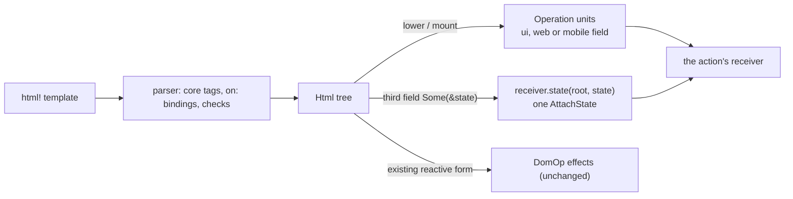

# Feature 08: `html!` in the core vocabulary

_Written in ASD-STE100 Simplified Technical English (STE). Code and identifiers stay as they
are._

**Abbreviations in this file.** user interface (UI); HyperText Markup Language (HTML);
Cascading Style Sheets (CSS); JavaScript (JS); identifier (id); AeroSpace and Defence
Industries Association of Europe (ASD), the owner of the STE standard ASD-STE100.

## 1. Goal

A developer writes one template for every platform. `html!` accepts the ten core elements
(`<Stack>`, `<Text>`, …) with checked properties, and `on:` bindings that name an action
struct, so a wrong name is a compile error. A lowering function turns the `Html` tree into
operation units of the frame schema (D42, D44). `html!` has three forms (D51): pure,
reactive, and reactive with a state field. The macro writes to a receiver, which collects the
operations; there is no `Response` type (D52). A behaviour marker lowers to one shared
`UiBehaviour` or one web `WebBehaviour`, and not to a script node (D56).

## 2. Story

- **S1**: "A developer writes a core template, and it becomes operations that every platform
  applies."
- **S2**: "A developer binds a tap to an action by its struct."
- **S3**: "A developer binds a click to a page JavaScript function by its `host:` name."
- **S4**: "An action writes the new view of its component and the new state to its receiver."
- **S5**: "A developer keeps an HTML template, and it becomes web operations."
- **S6**: "A developer misspells an action, a property or an event, and the code does not
  compile."
- **S7**: "A dynamic property value has the wrong shape at run time."

| # | Use case | Actor | Trigger | Result |
|---|---|---|---|---|
| U1 | Core template | Developer | `html! { <Stack padding="8">…</Stack> }` | An `Html` tree with core tags |
| U2 | Bind an action | Developer | `on:tap={increment_counter}` | The attribute `ewe:on:tap="server:increment_counter"`, or `host:` for a host action |
| U3 | Lower | Runtime code | `lower(&html, &options)` | `Vec<OperationT>`, or `LowerError` |
| U4 | View with state | Action | `html! { ctx, receiver, Some(&next), … }` | The template operations and one unsealed `AttachState`, all in the receiver |
| U5 | Mount | Page render code | `mount(&html, &options, parent, state)` | Operation units that create the root and append it to `parent` |

## 3. Bounded context

**Inside this feature:** the `on:` attribute and the core-tag checks in the `html!` parser;
the state field of the reactive form; `foundation_ui_runtime::view` (`lower`, `mount`,
`LowerOptions`, `LowerError`); the behaviour marker row of `lower`.

**Outside:**

| Thing | Owner |
|---|---|
| The pure form `html! { <…> }` and the reactive form `html! { ctx, receiver, <…> }`; `primal:on*` local handlers; `primal-id` numbering; scoped styles and scripts | `foundation_macros::html_macro` (spec 39). Their `DomOp` output does not change (D40); feature 12 moves it |
| `Html`, `HtmlTag`, `AttrName`, `TAG_NAMES`, `ATTR_NAMES` | `foundation_ui_traits` |
| Core names, `PropKind`, `TokenTable`, `web_form` rules, the three operation unions | Feature 02 |
| `Action::NAME`, `Action::origin()`, `Context`, `ComponentState` | Feature 05 |
| The receiver (`ctx.receiver()`), its `state` method, the sealing of the state | Features 05 and 07 |
| Behaviour names, the marker text, the shared and web sets | Feature 02 (section 6.7) |
| Applying the operations | Features 09, 14, 15 |

| Entity | Meaning | Owner (the one writer) |
|---|---|---|
| `Html` tree | The in-memory view description | `html!` |
| Lowered operations | `Vec<OperationT>` for one tree; each unit sets its `ui` or `web` field | `view::lower` |
| Node ids of a lowered tree | `id_base + primal-id` | `view::lower`, from `LowerOptions::id_base` |

| Verb | Kind | Trigger | Effect |
|---|---|---|---|
| `lower` | entity | Runtime code | A pure function from a tree to operation units |
| `mount` | entity | Page render | `lower`, plus the root append and the state |
| state field (of `html!`) | entity | The reactive form with `Some(&state)` | The template operations, then one unsealed `AttachState` in the receiver |

`lower` and `mount` are pure functions of their arguments. None has a fault table. Their
failures are `LowerError` values. The state field of `html!` writes to a receiver and
propagates a `LowerError` as the action error (section 6.5).

**Words.** "Core element" is an element whose tag is one of the ten core names. "Web
element" is any other element. "Lower" is to turn a tree into operation units. "Receiver" is
the collector of the operations of one action response (D52).

## 4. Rules

### 4.1 Law worksheet

```
Entity: Lowered operations
Conserved value:         one creating unit for each node of the tree; one AppendChild for each parent-child pair
Bound:                   node ids are id_base + n, with n below the node count of the tree
Inverse pairs:           none
Idempotent verbs:        lower (the same tree and options give the same units)
Ordering pairs:          a node is created before any unit names it; a child is created before it is appended
Monotone values:         none
Freeze points:           none
Links to other entities: a core element gives a `ui` unit only; AttachState.root_node is the root id
```

```
Entity: Html tree
Conserved value:         the two existing forms give the same tree as before this feature, for every template that compiled before
Bound:                   none
Inverse pairs:           none
Idempotent verbs:        none
Ordering pairs:          none
Monotone values:         none
Freeze points:           none
Links to other entities: an on: attribute value equals action_reference(Action::origin(), Action::NAME)
```

### 4.2 Invariants

| # | Invariant |
|---|---|
| I1 | Every template that compiled before this feature still compiles and gives an equal `Html` value. |
| I2 | A tree of only core elements lowers to `ui` units only, and every member is one of the twelve shared types (D59). |
| I3 | In the units of `lower`, each node id is created exactly one time, and before the first unit that names it. |
| I4 | `lower` gives the same units for the same tree and options. |
| I5 | An `on:` binding with a path compiles only if the path is a type that implements `Action`; its value at run time is `action_reference(Action::origin(), Action::NAME)`, so `server:name`, `host:name`, or `host:name` when the action has no limit (D50 (8)). |
| I6 | An `on:` binding with a string compiles only for the `host:` origin. |
| I7 | A core element accepts only the property names of section 6.3, `on:` bindings and `key`; any other attribute is a compile error. |
| I8 | A static property value of the wrong shape is a compile error. A dynamic one gives `LowerError::BadProp` and no units. |
| I9 | The form `html! { ctx, receiver, Some(&state), … }` writes the template units to the receiver, then one `AttachState` for `ctx.state_root()`. A missing root gives `LowerError::NoComponentRoot`, and the action returns `Err`. Without a state, the form writes only the template units. |
| I10 | The `AttachState` from the state field and from `mount` is unsealed (empty tag). Only the dispatcher seals it. |
| I11 | A shared behaviour marker gives one `UiBehaviour` and no `ScriptNode`. A web-only behaviour gives one `WebBehaviour` and no `ScriptNode`. A plain scoped script still gives `ScriptNode` (D56). |

### 4.3 Must have

- The module `backends/foundation_ui_runtime/src/view/`.
- The parser case for `on:` and the check for core tags in
  `backends/foundation_macros/src/html_macro/parser.rs`.
- The optional state field of the reactive form in
  `backends/foundation_macros/src/html_macro/mod.rs`.

### 4.4 Must do

- Keep the string `primal:on<event>` attributes and the `primal:setter` path as they are.
- Put each new compile error on the span of the wrong token.
- Write the state field as a receiver item, not as a returned value (D52).

### 4.5 Must not

- Do not sign state in the template (research 10 section 3.5).
- Do not change `html! { ctx, receiver, <…> }` or its `DomOp` output. Feature 12 moves it.
- Do not give a core element a web twin (D36). `<Stack>` is always `CreateNode(STACK)`.
- Do not allow a free-form attribute on a core element (D10: the core has no free-form names).
- Do not send a `ScriptNode` for a standard behaviour (D56, feature 02).

## 5. Acceptance scenarios

`TokenTable`: color 1 is `"--color-primary"`. `options = LowerOptions { id_base: 40, tokens: &table }`.

```gherkin
Feature: html! in the core vocabulary

  Scenario: A core template lowers to cross-platform forms
    Given html! { <Stack padding="8" axis="horizontal"><Text>"0"</Text></Stack> }
    When the caller calls lower with id_base 40
    Then the ops are
      | CreateNode(40, STACK)                       |
      | SetProp(40, PADDING, Length 8 Point)        |
      | SetProp(40, AXIS, Axis Horizontal)          |
      | CreateNode(41, TEXT)                        |
      | SetText(41, "0")                            |
      | AppendChild(40, 41)                         |

  Scenario: A tap binds to an action by its struct
    Given #[action(server)] async fn increment_counter
    And html! { <Button on:tap={increment_counter}>"Add"</Button> }
    When the caller calls lower with id_base 40
    Then the units hold BindAction(40, TAP, "server:increment_counter") in the `ui` field

  Scenario: A misspelled action does not compile
    Given html! { <Button on:tap={incremnt_counter}>"Add"</Button> }
    Then the build fails with an error that names `incremnt_counter`

  Scenario: A string binding is for page JavaScript only
    Given html! { <Button on:tap="server:increment_counter">"Add"</Button> }
    Then the build fails with "html!: a string action reference must start with `host:`"

  Scenario: A click binds to a page function
    Given html! { <button on:tap="host:open_picker">"Pick"</button> }
    When the caller calls lower with id_base 40
    Then the units hold BindAction(40, TAP, "host:open_picker") in the `web` field

  Scenario: A shared behaviour marker gives one shared operation and no script
    Given html! { <Stack><div data-ewe-behaviour="scroll_lock"></div></Stack> }
    When the caller calls lower with id_base 40
    Then the units hold UiBehaviour(40, SCROLL_LOCK, []) in the `ui` field
    And the units hold no ScriptNode

  Scenario: A plain scoped script still gives a script node
    Given html! { <script scoped primal:script>"start()"</script> }
    When the caller calls lower with id_base 40
    Then the units hold ScriptNode(40, parent 0, "start()") in the `web` field

  Scenario: An unknown property on a core element does not compile
    Given html! { <Stack class="row"></Stack> }
    Then the build fails with "html!: `class` is not a property of <Stack>"

  Scenario: A bad static length does not compile
    Given html! { <Stack padding="8px"></Stack> }
    Then the build fails with "html!: `padding` needs a number, a percent such as \"50%\" or \"auto\""

  Scenario: A bad dynamic length fails at lower
    Given let p = "wide"; and html! { <Stack padding={p}></Stack> }
    When the caller calls lower
    Then the call fails with LowerError::BadProp { node_id: 40, prop: "padding", value: "wide" }

  Scenario: A colour property takes a token name
    Given html! { <Text color="--color-primary">"x"</Text> }
    When the caller calls lower
    Then the ops hold SetProp(40, COLOR, ColorToken 1)

  Scenario: An unknown token is an error
    Given html! { <Text color="--nope">"x"</Text> }
    When the caller calls lower
    Then the call fails with LowerError::UnknownToken { node_id: 40, name: "--nope" }

  Scenario: An HTML template lowers to web operations
    Given html! { <div class="card"><span>"hi"</span></div> }
    When the caller calls lower with id_base 40
    Then the units are
      | WebElement(40, tag div, class "card")   |
      | WebRegisterNode(40)                     |
      | WebSetAttribute(40, primal-id, "40")    |
      | WebElement(41, tag span, class "")      |
      | WebRegisterNode(41)                     |
      | WebSetAttribute(41, primal-id, "41")    |
      | WebText(42, "hi")                       |
      | WebRegisterNode(42)                     |
      | AppendChild(41, 42)                     |
      | AppendChild(40, 41)                     |

  Scenario: The third field attaches the state to the receiver
    Given a Context whose state_root is 40
    And let receiver = ctx.receiver()
    And let next = Counter { current: 2 };
    When the action evaluates
      html! { ctx, receiver, Some(&next), <Button on:tap={increment_counter}>"Count: " {next.current}</Button> }
    Then the receiver holds BindAction(40, TAP, "server:increment_counter") and SetText(40, "Count: 2")
    And the receiver then holds one AttachState for root 40 whose unsealed body decodes to Counter { current: 2 }
    And the action returns Ok(())

  Scenario: The third field with no state root is an action error
    Given a Context whose state_root is None
    When an action evaluates the same form
    Then the action returns Err with an ActionError of code ActionFailed and message "view has no component root"
    And the dispatcher sends only the error and no operation

  Scenario: None in the third field equals the two-field form
    Given html! { ctx, receiver, None, <div><span>{count.get()}</span></div> }
    Then the receiver holds the same items as the two-field form

  Scenario: The existing reactive form is unchanged
    Given html! { ctx, receiver, <div><span>{count.get()}</span></div> }
    Then the existing tests of backends/foundation_wasm_ui/tests/html_macro_tests.rs pass with no change
```

## 6. Technical breakdown



_The diagram shows the two ways from a template to operation units, and the existing
reactive form, which does not change._

### 6.1 Measured facts

| Fact | Source |
|---|---|
| `html!` picks its form by the first token: `<` is the pure form; else it splits `ctx, receiver, <template>` at two top-level commas | `backends/foundation_macros/src/html_macro/mod.rs:40-56`, `:68-101` |
| `ParsedAttr` has `Static`, `Dynamic`, `StaticDynamic`, `Event` | `html_macro/parser.rs:79-95` |
| The parser reads compound names such as `primal:onclick`; `primal:` allows only `on*`, `style`, `script` | `html_macro/parser.rs:510`, `:563-594` |
| The pure form writes `primal-id` as the compile-time element id (root element = 0, depth-first over elements only); static attributes are `Cow::Borrowed`; a dynamic attribute goes through `IntoAttrValue` and `None` omits it | `html_macro/codegen.rs:22-23`, `:465-510` |
| `Html` has `tag`, `attributes`, `children`, `text`, `parts`, `runtime_id` | `backends/foundation_ui_traits/src/html.rs:397-411` |
| A scoped script is an `Html` node with tag `script` and the attributes `primal:script="true"` and `scoped` | `backends/foundation_ui_components/src/machinery/mod.rs:46-61` |

### 6.2 Parser changes (`html_macro/parser.rs`)

1. **Core tags.** `const CORE_TAGS: &[&str] = ["Stack", "Text", "Image", "Button",
   "TextInput", "Toggle", "List", "Scroll", "Spacer", "Overlay"]`. They are case-sensitive.
   `Fragment`, `Show` and `For` keep their current meaning.
2. **`on:` attributes.** In `parse_attributes`, before the `primal:` branch: a name that
   starts with `on:` has the event `rest`. `rest` must be one of `tap`, `change`, `submit`,
   `focus`, `blur`; else the error
   ``html!: unknown event `<rest>`; use tap, change, submit, focus or blur``. Then `=` and:
   - a brace group whose tokens are one Rust path: push
     `ParsedAttr::Action { event, target: ActionTarget::Path(tokens) }`. The origin comes
     from the action struct at run time (`Action::origin()`), so the template writes no
     origin prefix (D50);
   - a brace group with any other shape: the error
     ``html!: a brace action is a Rust action path, for example on:tap={add_todo}``;
   - a string literal that starts with `host:` and whose rest matches `[A-Za-z0-9_]{1,128}`:
     `ActionTarget::Host(name)`;
   - another string literal: the error
     ``html!: a string action reference must start with `host:` ``.
3. **Core attribute check**, after the attributes of a core element are parsed: each
   attribute must be an `Action`, or have the name `key` or a property name of section 6.3;
   else ``html!: `<name>` is not a property of <Tag>``. A `ParsedAttr::Event`
   (`primal:on*`) on a core element is the error
   ``html!: use on:<event> on a core element, not primal:on<event>``.
4. **Static value check** for a `Static` property on a core element, by the `PropKind` of
   section 6.3. The messages:

| Kind | Accepts | Message |
|---|---|---|
| Length | a decimal number, a decimal number followed by `%`, or `auto` | ``html!: `<name>` needs a number, a percent such as "50%" or "auto"`` |
| Alignment | `start`, `center`, `end`, `stretch` | ``html!: `<name>` needs start, center, end or stretch`` |
| Axis | `vertical`, `horizontal` | ``html!: `<name>` needs vertical or horizontal`` |
| Bool | `true`, `false` | ``html!: `<name>` needs true or false`` |
| ColorToken, FontToken, Text | any text | — |

### 6.3 The property names of a core element

The attribute name is the lower-case `PropId` name: `padding`, `spacing`, `align`, `color`,
`font`, `enabled`, `a11y_label`, `axis`, `value`, `checked`, `source`, `placeholder`,
`background`, `width`, `height`, `hidden`. Every core element accepts every property in
version 1. The kinds are those of feature 02 section 6.3.

### 6.4 Codegen changes (`html_macro/codegen.rs`)

For `ParsedAttr::Action`, in both modes, push one attribute:

- Core element: name `ewe:on:<event>`.
- Web element: name `primal:on<dom event>`, with the DOM event of feature 02 section 6.5
  (`tap` gives `primal:onclick`).
- Value for `ActionTarget::Path`:
  `Cow::Owned(#rt::action_reference(<#path as #rt::Action>::origin(),
  <#path as #rt::Action>::NAME))`, with `#rt` from `foundation_ui_runtime_path()`. A plain
  `#[action]` gives `host:name`; the host tries it first and the manager falls forward to
  the server (D50 (7), (8)).
- Value for `ActionTarget::Host(name)`: `Cow::Borrowed("host:<name>")`.

`collect_handler_bindings` and the `__cb` counter skip `Action` attributes; they are not
local handlers. The reactive form therefore carries the attribute through its existing
`SetAttribute` path with no other change.

### 6.5 The forms of `html!` (`html_macro/mod.rs`)

The macro counts the top-level fields before the template (D51):

| Input | Form | Result |
|---|---|---|
| `<template>` as the first token | Pure | The existing pure `Html` value |
| one field, then `<template>` | — | The existing error for a bad form |
| `ctx, receiver, <template>` | Reactive | The existing reactive output (D40) |
| `ctx, receiver, None, <template>` | Reactive | The same as the two-field form |
| `ctx, receiver, Some(&state), <template>` | Reactive with state | The reactive output, then `receiver.state(root, &state)` |

Detection, before the reactive split: if the first token is `<`, it is the pure form. Else
split at top-level commas; there must be two or three fields before the template. Any other
count gives ``html!: expected `ctx, receiver, <template>` or `ctx, receiver,
Some(&state), <template>` ``.

Expansion for the state field, with `ctx_expr` and `state_expr` from the fields and
`TEMPLATE` the rest:

```rust
// The existing reactive expansion for ctx_expr, receiver_expr and TEMPLATE, then:
#receiver.state(
    #ctx.state_root().ok_or(#rt::view::LowerError::NoComponentRoot)?,
    #state_expr,
)?;
```

`receiver.state(root, &state)` records one unsealed `AttachState` unit as the next item of
the receiver. It does not change the view. The `?` propagates a `LowerError` as an
`ErrorTrace<ActionErrorT>` through the impl of section 6.6. On `Err`, the caller sends only
the error (D52). The state expression is evaluated one time.

The pure `lower` and `mount` functions remain for a page render (section 6.6). They are not
used by the state field.

### 6.6 `foundation_ui_runtime::view`

Add `foundation_ui_traits` and `foundation_ui_wire` as dependencies of
`foundation_ui_runtime`.

```rust
#[derive(Clone, Copy, Debug)]
pub struct LowerOptions<'a> {
    /// The node id of the root element. Element n of the template gets id_base + n.
    pub id_base: u32,
    pub tokens: &'a TokenTable,
}

#[derive(Clone, Debug, PartialEq, Eq)]
pub enum LowerError {
    /// An element has no primal-id attribute, or it is not a number.
    MissingId,
    BadProp { node_id: u32, prop: String, value: String },
    UnknownToken { node_id: u32, name: String },
    /// A tree whose root is a text node or a fragment.
    NoRootElement,
    /// The state field was used with a context that has no state root.
    NoComponentRoot,
    /// id_base + n does not fit in a u32.
    IdOverflow,
}
impl core::fmt::Display for LowerError { /* one short sentence for each case */ }
impl core::error::Error for LowerError {}

/// A lowering failure inside an action is an action failure (D52). The code is
/// `ActionFailed`; the message is the short sentence of `Display`, never a Rust detail.
impl From<LowerError> for ErrorTrace<ActionErrorT> {
    fn from(error: LowerError) -> Self {
        ErrorTrace::new(ActionErrorT {
            code: ErrorCode::ActionFailed,
            message: Some(error.to_string()),
            row_index: 0,
        })
    }
}

/// The operation units that create the tree. Each unit sets its `ui` or `web` field.
/// The root is not appended to anything.
pub fn lower(html: &Html, options: &LowerOptions<'_>) -> Result<Vec<OperationT>, LowerError>;

/// `lower`, then `AppendChild(parent, root)`, then the unsealed state if one is given.
pub fn mount<S: ComponentState>(html: &Html, options: &LowerOptions<'_>, parent: u32,
    state: Option<&S>) -> Result<Vec<OperationT>, LowerError>;
```

**`lower` rules.** Walk the tree depth-first. `n` is the `primal-id` of an element as a
number. A node with no `primal-id` (a static text node) gets the next free id:
`id_base + element_count + k`, where `element_count` is the number of elements in the tree
and `k` counts the text nodes of web elements in walk order, from 0.

| Node | Units, in this order |
|---|---|
| Core element | `CreateNode(id, kind)`; one `SetProp` for each property attribute, in attribute order; one `BindAction(id, event, value)` for each `ewe:on:<event>` attribute; if it has text children: one `SetText(id, text)` with the texts joined in order; then each element child (its own units, then `AppendChild(id, child)`). Every member is in the `ui` field |
| Behaviour marker `data-ewe-behaviour="<name>"` | Feature 02 section 6.7 gives the name table. A shared name gives one `UiBehaviour{node_id: parent, behaviour: id}` in `ui`; a web name gives one `WebBehaviour{node_id: parent, behaviour: UNKNOWN, custom: name}` in `web`. An unknown name gives `LowerError::BadProp`. No `ScriptNode`. The marker element is not sent |
| Web element with `primal:script` | `ScriptNode { node_id: id, parent_id: id of the parent element (0 for a root), body: the joined text children }` in `web`. No other unit |
| Other web element | `WebElement(id, tag, class)` with the value of the `class` attribute or `""` in `web`; `WebRegisterNode(id)`; one `WebSetAttribute` for each other attribute, in order, with `primal-id` rewritten to the decimal text of `id`; one `BindAction(id, event, value)` in `ui` for each `on:` attribute; then each child: an element child (its units, then `AppendChild`), or a text child (`WebText(tid, text)`, `WebRegisterNode(tid)`, `AppendChild(id, tid)`) |
| Fragment (`tag == None`, no text) under an element | Its children are treated as children of that element |
| Fragment or text at the root | `NoRootElement` |

The `key` attribute of a core element is not lowered in version 1; it is kept for list
identity in native renderers (features 14 and 15 read nothing from it yet).

Property text to value: `Length`: a number gives `Point`; `N%` gives `Percent`; `auto`
gives `Auto` with value 0. `ColorToken` and `FontToken`: `tokens.color_id(text)` or
`font_id`; `None` gives `UnknownToken`. The other kinds parse as in section 6.2 item 4. A
dynamic attribute that evaluated to `None` is not in the tree, so it gives no unit.

**`mount` rules.** `ops = lower(html, options)`, then one `AppendChild(parent, root)` unit in
`ui`, then `AttachState { root_node: root }` in `ui` when the state is `Some`. The state is
unsealed.

`ReplaceSubtree` semantics, which features 09, 14 and 15 implement: remove every
descendant of `node_id` from the id table and from the view; keep `node_id`; then apply the
nested units.

## 7. Tests

| Law or scenario | Test | Oracle |
|---|---|---|
| I1; Scenario: the reactive form is unchanged | The existing suites `backends/foundation_wasm_ui/tests/html_macro_tests.rs`, `reactive_structure_tests.rs` and `backends/foundation_ui_components/tests/components_tests.rs` pass with no edit | expected outcome |
| I2 | `backends/foundation_ui_runtime/tests/view_lower_tests.rs::core_tree_lowers_to_ui_units_only` (a tree with all ten core elements; each unit sets only the `ui` field, and every member is in the twelve shared types) | property |
| I3 | `view_lower_tests.rs::each_node_is_created_once_before_use` (walk the units of five trees: core, web, mixed, deep, wide) | property |
| I4 | `view_lower_tests.rs::lower_is_deterministic` | metamorphic |
| Scenario: core template; colour token; HTML template | `view_lower_tests.rs::core_template_units`, `::color_takes_a_token`, `::html_template_units` | example |
| I5; Scenario: tap binds by struct | `view_bind_tests.rs::tap_binds_to_action_name` | example |
| I5, I6, I7, I8 (compile time); Scenarios: misspelled action, string binding, unknown property, bad static length | `backends/foundation_ui_runtime/tests/view_fail_tests.rs` with `trybuild` files `tests/trybuild/view/fail_*.rs`: `fail_unknown_action.rs`, `fail_string_not_host.rs`, `fail_brace_not_path.rs`, `fail_unknown_event.rs`, `fail_unknown_prop.rs`, `fail_bad_length.rs`, `fail_bad_align.rs`, `fail_bad_axis.rs`, `fail_bad_bool.rs`, `fail_primal_on_core.rs`, `fail_form_fields.rs` | expected outcome |
| Scenario: a click binds to a page function | `view_bind_tests.rs::host_binding_on_web_element_is_primal_onclick` | example |
| I8 (run time); Scenarios: bad dynamic length, unknown token | `view_lower_tests.rs::bad_dynamic_prop_fails_with_no_units`, `::unknown_token_fails` | expected outcome |
| I9, I10; Scenarios: third field, no state root, `None` third field | `view_state_tests.rs::third_field_attaches_state`, `::none_third_field_equals_two_fields`, `::third_field_without_root_is_action_error`, `::attached_state_is_unsealed` | example |
| The error conversion of section 6.6 | `view_state_tests.rs::lower_error_becomes_an_action_error` (`from(LowerError::NoComponentRoot)` gives code `ActionFailed` and the `Display` message) | example |
| `mount` appends the root and attaches the state | `view_state_tests.rs::mount_appends_root_and_state` | example |
| I11; Scenarios: behaviour marker, scoped script | `view_lower_tests.rs::shared_behaviour_is_one_ui_unit`, `::web_behaviour_is_one_web_unit`, `::scoped_script_is_script_node` | example |
| End to end with the dispatcher | `view_state_tests.rs::dispatch_seals_the_view_state` (the `#[action]` of the scenario, run through `Dispatcher::dispatch`; the answer opens to `Counter { current: 2 }`) | example |

## 8. Tasks

- [ ] 1. Write the `trybuild` fail files (they fail to match now).
- [ ] 2. Parser: `on:` attributes and `ParsedAttr::Action`.
- [ ] 3. Parser: the core tag list, the core attribute check, the static value check.
- [ ] 4. Codegen: the `Action` attribute in both modes.
- [ ] 5. `mod.rs`: the optional third field and `receiver.state`.
- [ ] 6. `view::lower` for core elements and the behaviour marker, with tests.
- [ ] 7. `view::lower` for web elements and scripts, with tests.
- [ ] 8. `view::mount`, with tests.
- [ ] 9. Bump `foundation_macros` and `foundation_ui_runtime`, and the consumers.
- [ ] 10. Update `progress.md` and `learnings.md`.

## 9. Verify

```bash
cargo fmt --all -- --check
cargo clippy -p foundation_macros --profile uat --no-deps -- -D warnings
cargo test   -p foundation_macros --profile uat
cargo clippy -p foundation_ui_runtime --profile uat --no-deps -- -D warnings
cargo test   -p foundation_ui_runtime --profile uat
cargo test   -p foundation_wasm_ui --profile uat
cargo test   -p foundation_ui_components --profile uat
cargo check  -p foundation_ui_runtime --profile uat --target wasm32-unknown-unknown
```

## 10. Done when

- [ ] All tasks are complete and every command of section 9 passes with no warning.
- [ ] Each invariant and each scenario has a passing test (section 7).
- [ ] No existing test file of `foundation_wasm_ui` or `foundation_ui_components` changed.
- [ ] No `TODO`, `FIXME`, `todo!()` or `unimplemented!()` is in the new code.
- [ ] The check list of the `story-driven-specification` skill passes.

---

_Created: 2026-11-13_
