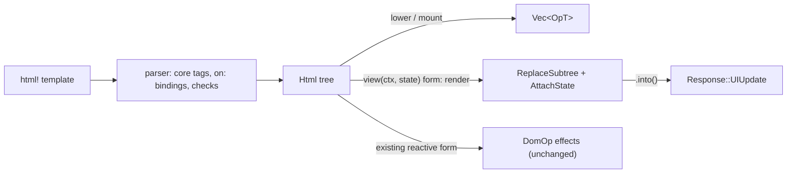

# Feature 08: `html!` in the core vocabulary

_Written in ASD-STE100 Simplified Technical English (STE). Code and identifiers stay as they
are._

**Abbreviations in this file.** user interface (UI); HyperText Markup Language (HTML);
Cascading Style Sheets (CSS); JavaScript (JS); identifier (id); AeroSpace and Defence
Industries Association of Europe (ASD), the owner of the STE standard ASD-STE100.

## 1. Goal

A developer writes one template for every platform. `html!` accepts the ten core elements
(`<Stack>`, `<Text>`, …) with checked properties, and `on:` bindings that name an action
struct, so a wrong name is a compile error. A lowering function turns the `Html` tree into
schema ops. A view form, `html! { view(ctx, Some(&state)), … }`, gives the ops of a component
with its state attached, ready for `Response`. The two existing forms of `html!` do not
change.

## 2. Story

- **S1**: "A developer writes a core template, and it becomes ops that every platform
  applies."
- **S2**: "A developer binds a tap to a server action by its struct."
- **S3**: "A developer binds a click to a page JavaScript function by its name."
- **S4**: "An action returns the new view of its component with the new state."
- **S5**: "A developer keeps an HTML template, and it becomes web forms."
- **S6**: "A developer misspells an action, a property or an event, and the code does not
  compile."
- **S7**: "A dynamic property value has the wrong shape at run time."

| # | Use case | Actor | Trigger | Result |
|---|---|---|---|---|
| U1 | Core template | Developer | `html! { <Stack padding="8">…</Stack> }` | An `Html` tree with core tags |
| U2 | Bind an action | Developer | `on:tap={server:increment_counter}` | The attribute `ewe:on:tap="server:increment_counter"` |
| U3 | Lower | Runtime code | `lower(&html, &options)` | `Vec<OpT>`, or `LowerError` |
| U4 | View with state | Action | `html! { view(ctx, Some(&next)), … }.into()` | `Response::UIUpdate` with a `ReplaceSubtree` and an `AttachState` |
| U5 | Mount | Page render code | `mount(&html, &options, parent, state)` | Ops that create the root and append it to `parent` |

## 3. Bounded context

**Inside this feature:** the `on:` attribute and the core-tag checks in the `html!` parser;
the `view(...)` form; `foundation_ui_runtime::view` (`lower`, `mount`, `render`,
`LowerOptions`, `LowerError`, `ViewResult`).

**Outside:**

| Thing | Owner |
|---|---|
| The pure form `html! { <…> }` and the reactive form `html! { ctx, receiver, <…> }`; `primal:on*` local handlers; `primal-id` numbering; scoped styles and scripts | `foundation_macros::html_macro` (spec 39). They do not change (D40) |
| `Html`, `HtmlTag`, `AttrName`, `TAG_NAMES`, `ATTR_NAMES` | `foundation_ui_traits` |
| Core names, `PropKind`, `TokenTable`, `web_form` rules | Feature 02 |
| `Action::NAME`, `Context`, `Response`, `ComponentState` | Feature 05 |
| `attach_state` | Feature 07 |
| Applying the ops | Features 09, 14, 15 |

| Entity | Meaning | Owner (the one writer) |
|---|---|---|
| `Html` tree | The in-memory view description | `html!` |
| Lowered ops | `Vec<OpT>` for one tree | `view::lower` |
| Node ids of a lowered tree | `id_base + primal-id` | `view::lower`, from `LowerOptions::id_base` |

| Verb | Kind | Trigger | Effect |
|---|---|---|---|
| `lower` | entity | Runtime code | A pure function from a tree to ops |
| `mount` | entity | Page render | `lower`, plus the root append and the state |
| `render` | entity | The view form | `lower` as a subtree replace of the component root, plus the state |

All verbs are pure functions of their arguments. None has a fault table. Their failures are
`LowerError` values.

**Words.** "Core element" is an element whose tag is one of the ten core names. "Web
element" is any other element. "Lower" is to turn a tree into ops.

## 4. Rules

### 4.1 Law worksheet

```
Entity: Lowered ops
Conserved value:         one creating op for each node of the tree; one AppendChild for each parent-child pair
Bound:                   node ids are id_base + n, with n below the node count of the tree
Inverse pairs:           none
Idempotent verbs:        lower (the same tree and options give the same ops)
Ordering pairs:          a node is created before any op names it; a child is created before it is appended
Monotone values:         none
Freeze points:           none
Links to other entities: a core element gives only Cross forms; AttachState.root_node is the root id
```

```
Entity: Html tree
Conserved value:         the two existing forms give the same tree as before this feature, for every template that compiled before
Bound:                   none
Inverse pairs:           none
Idempotent verbs:        none
Ordering pairs:          none
Monotone values:         none
Freeze points:           none
Links to other entities: an on: attribute value equals origin + ":" + Action::NAME
```

### 4.2 Invariants

| # | Invariant |
|---|---|
| I1 | Every template that compiled before this feature still compiles and gives an equal `Html` value. |
| I2 | A tree of only core elements lowers to `Cross` forms only. |
| I3 | In the ops of `lower`, each node id is created exactly one time, and before the first op that names it. |
| I4 | `lower` gives the same ops for the same tree and options. |
| I5 | An `on:` binding with a path compiles only if the path is a type that implements `Action`; its value at run time is `"<origin>:<Action::NAME>"`. |
| I6 | An `on:` binding with a string compiles only for the `js:` origin. |
| I7 | A core element accepts only the property names of section 6.3, `on:` bindings and `key`; any other attribute is a compile error. |
| I8 | A static property value of the wrong shape is a compile error. A dynamic one gives `LowerError::BadProp` and no ops. |
| I9 | `render` gives exactly `[ReplaceSubtree { node_id: root, ops }, AttachState { root_node: root }]` when a state is given, and only the `ReplaceSubtree` when it is not. `root` is `ctx.state_root()`. |
| I10 | The `AttachState` from `render` and `mount` is unsealed (empty tag). Only the dispatcher seals it. |

### 4.3 Must have

- The module `backends/foundation_ui_runtime/src/view/`.
- The parser case for `on:` and the check for core tags in
  `backends/foundation_macros/src/html_macro/parser.rs`.
- The `view(...)` form in `backends/foundation_macros/src/html_macro/mod.rs`.

### 4.4 Must do

- Keep the string `primal:on<event>` attributes and the `primal:setter` path as they are.
- Put each new compile error on the span of the wrong token.

### 4.5 Must not

- Do not sign state in the template (research 10 section 3.5).
- Do not change `html! { ctx, receiver, <…> }` or its `DomOp` output. Feature 12 moves it.
- Do not give a core element a web twin (D36). `<Stack>` is always `CreateNode(STACK)`.
- Do not allow a free-form attribute on a core element (D10: the core has no free-form names).

## 5. Acceptance scenarios

`TokenTable`: color 1 is `"--color-primary"`. `options = LowerOptions { id_base: 40, tokens: &table }`.

```gherkin
Feature: html! in the core vocabulary

  Scenario: A core template lowers to cross-platform forms
    Given html! { <Stack padding="8" axis="horizontal"><Text>"0"</Text></Stack> }
    When the caller calls lower with id_base 40
    Then the ops are
      | CreateNode(40, STACK)                       |
      | SetProp(40, PADDING, Length 8 Point)        |
      | SetProp(40, AXIS, Axis Horizontal)          |
      | CreateNode(41, TEXT)                        |
      | SetText(41, "0")                            |
      | AppendChild(40, 41)                         |

  Scenario: A tap binds to a server action by its struct
    Given html! { <Button on:tap={server:increment_counter}>"Add"</Button> }
    When the caller calls lower with id_base 40
    Then the ops hold BindAction(40, TAP, "server:increment_counter")

  Scenario: A misspelled action does not compile
    Given html! { <Button on:tap={server:incremnt_counter}>"Add"</Button> }
    Then the build fails with an error that names `incremnt_counter`

  Scenario: A string binding is for page JavaScript only
    Given html! { <Button on:tap="server:increment_counter">"Add"</Button> }
    Then the build fails with "html!: a string action reference must start with `js:`"

  Scenario: A click binds to a page function
    Given html! { <button on:tap="js:open_picker">"Pick"</button> }
    When the caller calls lower with id_base 40
    Then the ops hold WebAttr(40, custom_attr "primal:onclick", value "js:open_picker")

  Scenario: An unknown property on a core element does not compile
    Given html! { <Stack class="row"></Stack> }
    Then the build fails with "html!: `class` is not a property of <Stack>"

  Scenario: A bad static length does not compile
    Given html! { <Stack padding="8px"></Stack> }
    Then the build fails with "html!: `padding` needs a number, a percent such as \"50%\" or \"auto\""

  Scenario: A bad dynamic length fails at lower
    Given let p = "wide"; and html! { <Stack padding={p}></Stack> }
    When the caller calls lower
    Then the call fails with LowerError::BadProp { node_id: 40, prop: "padding", value: "wide" }

  Scenario: A colour property takes a token name
    Given html! { <Text color="--color-primary">"x"</Text> }
    When the caller calls lower
    Then the ops hold SetProp(40, COLOR, ColorToken 1)

  Scenario: An unknown token is an error
    Given html! { <Text color="--nope">"x"</Text> }
    When the caller calls lower
    Then the call fails with LowerError::UnknownToken { node_id: 40, name: "--nope" }

  Scenario: An HTML template lowers to web forms
    Given html! { <div class="card"><span>"hi"</span></div> }
    When the caller calls lower with id_base 40
    Then the ops are
      | WebElement(40, tag div, class "card")  |
      | WebRegistry(40, register)              |
      | WebAttr(40, primal-id, "40")           |
      | WebElement(41, tag span, class "")     |
      | WebRegistry(41, register)              |
      | WebAttr(41, primal-id, "41")           |
      | WebText(42, "hi")                      |
      | WebRegistry(42, register)              |
      | AppendChild(41, 42)                    |
      | AppendChild(40, 41)                    |

  Scenario: The view form replaces the component and attaches the state
    Given a Context whose state_root is 40
    And let next = Counter { current: 2 };
    When an action evaluates
      html! { view(ctx, Some(&next)), <Button on:tap={server:increment_counter}>"Count: " {next.current}</Button> }.into()
    Then the Response is UIUpdate with exactly two ops
    And op 0 is ReplaceSubtree(40, [BindAction(40, TAP, "server:increment_counter"), SetText(40, "Count: 2")])
    And op 1 is AttachState for root 40 whose unsealed body decodes to Counter { current: 2 }

  Scenario: The view form with no state root is an error response
    Given a Context whose state_root is None
    When an action evaluates the same view form and calls .into()
    Then the Response is Error with code ActionFailed and message "view has no component root"

  Scenario: The existing reactive form is unchanged
    Given html! { ctx, receiver, <div><span>{count.get()}</span></div> }
    Then the existing tests of backends/foundation_wasm_ui/tests/html_macro_tests.rs pass with no change
```

## 6. Technical breakdown



_The diagram shows the two new ways from a template to ops, beside the existing reactive
form, which does not change._

### 6.1 Measured facts

| Fact | Source |
|---|---|
| `html!` picks its form by the first token: `<` is the pure form; else it splits `ctx, receiver, <template>` at two top-level commas | `backends/foundation_macros/src/html_macro/mod.rs:40-56`, `:68-101` |
| `ParsedAttr` has `Static`, `Dynamic`, `StaticDynamic`, `Event` | `html_macro/parser.rs:79-95` |
| The parser reads compound names such as `primal:onclick`; `primal:` allows only `on*`, `style`, `script` | `html_macro/parser.rs:510`, `:563-594` |
| The pure form writes `primal-id` as the compile-time element id (root element = 0, depth-first over elements only); static attributes are `Cow::Borrowed`; a dynamic attribute goes through `IntoAttrValue` and `None` omits it | `html_macro/codegen.rs:22-23`, `:465-510` |
| `Html` has `tag`, `attributes`, `children`, `text`, `parts`, `runtime_id` | `backends/foundation_ui_traits/src/html.rs:397-411` |
| A scoped script is an `Html` node with tag `script` and the attributes `primal:script="true"` and `scoped` | `backends/foundation_ui_components/src/machinery/mod.rs:46-61` |

### 6.2 Parser changes (`html_macro/parser.rs`)

1. **Core tags.** `const CORE_TAGS: &[&str] = ["Stack", "Text", "Image", "Button",
   "TextInput", "Toggle", "List", "Scroll", "Spacer", "Overlay"]`. They are case-sensitive.
   `Fragment`, `Show` and `For` keep their current meaning.
2. **`on:` attributes.** In `parse_attributes`, before the `primal:` branch: a name that
   starts with `on:` has the event `rest`. `rest` must be one of `tap`, `change`, `submit`,
   `focus`, `blur`; else the error
   ``html!: unknown event `<rest>`; use tap, change, submit, focus or blur``. Then `=` and:
   - a brace group whose tokens are `IDENT ':' PATH`, where `IDENT` is `server` or `native`
     and `PATH` is a Rust path: push
     `ParsedAttr::Action { event, origin, target: ActionTarget::Path(tokens) }`;
   - a brace group with origin `js`: the error
     ``html!: a `js:` action is a page function; write it as a string, for example on:tap="js:name"``;
   - a brace group with another first identifier: the error
     ``html!: unknown action origin `<ident>`; use server, native or js``;
   - a string literal that starts with `js:` and whose rest matches `[A-Za-z0-9_]{1,128}`:
     `ActionTarget::Js(name)`;
   - another string literal: the error
     ``html!: a string action reference must start with `js:` ``.
3. **Core attribute check**, after the attributes of a core element are parsed: each
   attribute must be an `Action`, or have the name `key` or a property name of section 6.3;
   else ``html!: `<name>` is not a property of <Tag>``. A `ParsedAttr::Event`
   (`primal:on*`) on a core element is the error
   ``html!: use on:<event> on a core element, not primal:on<event>``.
4. **Static value check** for a `Static` property on a core element, by the `PropKind` of
   section 6.3. The messages:

| Kind | Accepts | Message |
|---|---|---|
| Length | a decimal number, a decimal number followed by `%`, or `auto` | ``html!: `<name>` needs a number, a percent such as "50%" or "auto"`` |
| Alignment | `start`, `center`, `end`, `stretch` | ``html!: `<name>` needs start, center, end or stretch`` |
| Axis | `vertical`, `horizontal` | ``html!: `<name>` needs vertical or horizontal`` |
| Bool | `true`, `false` | ``html!: `<name>` needs true or false`` |
| ColorToken, FontToken, Text | any text | — |

### 6.3 The property names of a core element

The attribute name is the lower-case `PropId` name: `padding`, `spacing`, `align`, `color`,
`font`, `enabled`, `a11y_label`, `axis`, `value`, `checked`, `source`, `placeholder`,
`background`, `width`, `height`, `hidden`. Every core element accepts every property in
version 1. The kinds are those of feature 02 section 6.3.

### 6.4 Codegen changes (`html_macro/codegen.rs`)

For `ParsedAttr::Action`, in both modes, push one attribute:

- Core element: name `ewe:on:<event>`.
- Web element: name `primal:on<dom event>`, with the DOM event of feature 02 section 6.5
  (`tap` gives `primal:onclick`).
- Value for `ActionTarget::Path`:
  `Cow::Owned(format!("{}:{}", "<origin>", <#path as #rt::Action>::NAME))`, built with
  `#ui::__macro` re-exports where they exist; `#rt` is `foundation_ui_runtime_path()`.
- Value for `ActionTarget::Js(name)`: `Cow::Borrowed("js:<name>")`.

`collect_handler_bindings` and the `__cb` counter skip `Action` attributes; they are not
local handlers. The reactive form therefore carries the attribute through its existing
`SetAttribute` path with no other change.

### 6.5 The view form (`html_macro/mod.rs`)

Detection, before the reactive split: the input starts with the identifier `view`, then a
parenthesis group, then `,`, then a token `<`. The group must hold two expressions
separated by one top-level comma; else the error
``html!: expected `view(ctx, state)` ``.

Expansion, with `ctx_expr` and `state_expr` from the group and `TEMPLATE` the rest:

```rust
#rt::view::render(#ctx_expr, #state_expr, &{ PURE_FORM_OF(TEMPLATE) })
```

`PURE_FORM_OF` is the output of `generate_pure` for the template.

### 6.6 `foundation_ui_runtime::view`

Add `foundation_ui_traits` as a dependency of `foundation_ui_runtime`.

```rust
#[derive(Clone, Copy, Debug)]
pub struct LowerOptions<'a> {
    /// The node id of the root element. Element n of the template gets id_base + n.
    pub id_base: u32,
    pub tokens: &'a TokenTable,
}

#[derive(Clone, Debug, PartialEq, Eq)]
pub enum LowerError {
    /// An element has no primal-id attribute, or it is not a number.
    MissingId,
    BadProp { node_id: u32, prop: String, value: String },
    UnknownToken { node_id: u32, name: String },
    /// A tree whose root is a text node or a fragment.
    NoRootElement,
    /// `render` was called with a context that has no state root.
    NoComponentRoot,
    /// id_base + n does not fit in a u32.
    IdOverflow,
}

/// The ops that create the tree. The root is not appended to anything.
pub fn lower(html: &Html, options: &LowerOptions<'_>) -> Result<Vec<OpT>, LowerError>;

/// `lower`, then `AppendChild(parent, root)`, then the unsealed state if one is given.
pub fn mount<S: ComponentState>(html: &Html, options: &LowerOptions<'_>, parent: u32,
    state: Option<&S>) -> Result<Vec<OpT>, LowerError>;

/// The result of the view form. `.into()` gives a `Response`.
pub struct ViewResult(pub Result<Vec<OpT>, LowerError>);
impl From<ViewResult> for Response {
    // Ok(ops) -> UIUpdate(ops)
    // Err(NoComponentRoot) -> Error { ActionFailed, "view has no component root" }
    // Err(e) -> Error { ActionFailed, e.to_string() }
}

/// Used by `html! { view(ctx, state), … }`.
/// `id_base` is `ctx.state_root()`. The token table is `ctx.ctx().get::<TokenTable>()`,
/// or an empty table when the context has none.
pub fn render<S: ComponentState>(ctx: &Context, state: Option<&S>, html: &Html) -> ViewResult;
```

**`lower` rules.** Walk the tree depth-first. `n` is the `primal-id` of an element as a
number. A node with no `primal-id` (a static text node) gets the next free id:
`id_base + element_count + k`, where `element_count` is the number of elements in the tree
and `k` counts the text nodes of web elements in walk order, from 0.

| Node | Ops, in this order |
|---|---|
| Core element | `CreateNode(id, kind)`; one `SetProp` for each property attribute, in attribute order; one `BindAction(id, event, value)` for each `ewe:on:<event>` attribute; if it has text children: one `SetText(id, text)` with the texts joined in order; then each element child (its own ops, then `AppendChild(id, child)`) |
| Web element with `primal:script` | `ScriptNode { node_id: id, parent_id: id of the parent element (0 for a root), body: the joined text children }`. No other op |
| Other web element | `WebElement(id, tag, class)` with the value of the `class` attribute or `""`; `WebRegistry(id, register)`; one `WebAttr` for each other attribute, in order, with `primal-id` rewritten to the decimal text of `id`; then each child: an element child (its ops, then `AppendChild`), or a text child (`WebText(tid, text)`, `WebRegistry(tid, register)`, `AppendChild(id, tid)`) |
| Fragment (`tag == None`, no text) under an element | Its children are treated as children of that element |
| Fragment or text at the root | `NoRootElement` |

The `key` attribute of a core element is not lowered in version 1; it is kept for list
identity in native renderers (features 14 and 15 read nothing from it yet).

Property text to value: `Length`: a number gives `Point`; `N%` gives `Percent`; `auto`
gives `Auto` with value 0. `ColorToken` and `FontToken`: `tokens.color_id(text)` or
`font_id`; `None` gives `UnknownToken`. The other kinds parse as in section 6.2 item 4. A
dynamic attribute that evaluated to `None` is not in the tree, so it gives no op.

**`render` rules.** `root = ctx.state_root()`; `None` gives `NoComponentRoot`.
`ops = lower(html, {id_base: root, tokens})`. Remove the first op (the `CreateNode` or the
`WebElement` of the root; for a web root also remove its `WebRegistry`, since the node
exists and is registered). The result is
`[ReplaceSubtree { node_id: root, ops: rest }]`, plus `attach_state(root, state)` when the
state is `Some`.

`ReplaceSubtree` semantics, which features 09, 14 and 15 implement: remove every
descendant of `node_id` from the id table and from the view; keep `node_id`; then apply
`ops`.

## 7. Tests

| Law or scenario | Test | Oracle |
|---|---|---|
| I1; Scenario: the reactive form is unchanged | The existing suites `backends/foundation_wasm_ui/tests/html_macro_tests.rs`, `reactive_structure_tests.rs` and `backends/foundation_ui_components/tests/components_tests.rs` pass with no edit | expected outcome |
| I2 | `backends/foundation_ui_runtime/tests/view_lower_tests.rs::core_tree_lowers_to_cross_forms_only` (a tree with all ten core elements; `form_platform` of each op is `Cross`) | property |
| I3 | `view_lower_tests.rs::each_node_is_created_once_before_use` (walk the ops of five trees: core, web, mixed, deep, wide) | property |
| I4 | `view_lower_tests.rs::lower_is_deterministic` | metamorphic |
| Scenario: core template; colour token; HTML template | `view_lower_tests.rs::core_template_ops`, `::color_takes_a_token`, `::html_template_ops` | example |
| I5; Scenario: tap binds by struct | `view_bind_tests.rs::tap_binds_to_action_name` | example |
| I5, I6, I7, I8 (compile time); Scenarios: misspelled action, string binding, unknown property, bad static length | `backends/foundation_ui_runtime/tests/view_fail_tests.rs` with `trybuild` files `tests/trybuild/view/fail_*.rs`: `fail_unknown_action.rs`, `fail_string_not_js.rs`, `fail_js_in_braces.rs`, `fail_unknown_origin.rs`, `fail_unknown_event.rs`, `fail_unknown_prop.rs`, `fail_bad_length.rs`, `fail_bad_align.rs`, `fail_bad_axis.rs`, `fail_bad_bool.rs`, `fail_primal_on_core.rs`, `fail_view_args.rs` | expected outcome |
| Scenario: a click binds to a page function | `view_bind_tests.rs::js_binding_on_web_element_is_primal_onclick` | example |
| I8 (run time); Scenarios: bad dynamic length, unknown token | `view_lower_tests.rs::bad_dynamic_prop_fails_with_no_ops`, `::unknown_token_fails` | expected outcome |
| I9, I10; Scenarios: view form, no state root | `view_render_tests.rs::view_form_replaces_and_attaches`, `::view_form_without_state_has_one_op`, `::view_form_without_root_is_error_response`, `::attached_state_is_unsealed` | example |
| `mount` appends the root and attaches the state | `view_render_tests.rs::mount_appends_root_and_state` | example |
| A scoped script lowers to `ScriptNode` | `view_lower_tests.rs::scoped_script_is_script_node` | example |
| End to end with the dispatcher | `view_render_tests.rs::dispatch_seals_the_view_state` (the `#[action]` of the scenario, run through `Dispatcher::dispatch`; the answer opens to `Counter { current: 2 }`) | example |

## 8. Tasks

- [ ] 1. Write the `trybuild` fail files (they fail to match now).
- [ ] 2. Parser: `on:` attributes and `ParsedAttr::Action`.
- [ ] 3. Parser: the core tag list, the core attribute check, the static value check.
- [ ] 4. Codegen: the `Action` attribute in both modes.
- [ ] 5. `mod.rs`: the view form.
- [ ] 6. `view::lower` for core elements, with tests.
- [ ] 7. `view::lower` for web elements and scripts, with tests.
- [ ] 8. `view::mount`, `view::render`, `ViewResult`, with tests.
- [ ] 9. Bump `foundation_macros` and `foundation_ui_runtime`, and the consumers.
- [ ] 10. Update `progress.md` and `learnings.md`.

## 9. Verify

```bash
cargo fmt --all -- --check
cargo clippy -p foundation_macros --profile uat --no-deps -- -D warnings
cargo test   -p foundation_macros --profile uat
cargo clippy -p foundation_ui_runtime --profile uat --no-deps -- -D warnings
cargo test   -p foundation_ui_runtime --profile uat
cargo test   -p foundation_wasm_ui --profile uat
cargo test   -p foundation_ui_components --profile uat
cargo check  -p foundation_ui_runtime --profile uat --target wasm32-unknown-unknown
```

## 10. Done when

- [ ] All tasks are complete and every command of section 9 passes with no warning.
- [ ] Each invariant and each scenario has a passing test (section 7).
- [ ] No existing test file of `foundation_wasm_ui` or `foundation_ui_components` changed.
- [ ] No `TODO`, `FIXME`, `todo!()` or `unimplemented!()` is in the new code.
- [ ] The check list of the `story-driven-specification` skill passes.

---

_Created: 2026-11-13_
