# Feature 09: The web frame applicator

_Written in ASD-STE100 Simplified Technical English (STE). Code and identifiers stay as they
are._

**Abbreviations in this file.** user interface (UI); Document Object Model (DOM); HyperText
Markup Language (HTML); Cascading Style Sheets (CSS); JavaScript (JS); TypeScript (TS);
WebAssembly (WASM); Server-Sent Events (SSE); continuous integration (CI); identifier (id);
AeroSpace and Defence Industries Association of Europe (ASD), the owner of the STE standard
ASD-STE100.

## 1. Goal

A new JS module, `foundation-ui-frames.js`, applies `Frame` buffers to the DOM. It reads
them with the generated reader, uses one apply function for tier 1 and tier 2, maps the core
vocabulary to HTML, keeps the HTML morph and scoped scripts, and stores signed state as a
base64url attribute on the component root. The current runtime gets small seams that route
frames to it. Every current wire and every current mount path keeps working.

## 2. Story

- **S1**: "A frame arrives, and the page changes with no WASM call."
- **S2**: "A large list arrives as columns, and the applicator reads them as typed-array
  views."
- **S3**: "A frame carries an HTML morph, and the existing reconciler applies it."
- **S4**: "A frame carries the new state of a component, and the root element holds it as
  text."
- **S5**: "A live frame arrives before the frame that precedes it."
- **S6**: "A frame holds a form for mobile."
- **S7**: "A frame names a node that the page does not have."
- **S8**: "A proxy copied the buffer to an odd offset, and a column is not aligned."

| # | Use case | Actor | Trigger | Result |
|---|---|---|---|---|
| U1 | Apply a frame | Network or WASM | `frames.receive(bytes)` | The DOM changed; `stats` updated |
| U2 | Zero-copy columns | Applicator | An aligned `Columnar` body | Typed-array views over the received buffer |
| U3 | Order | Applicator | Live frames out of order | Applied in `sequence_id` order; a gap calls `onGap` |
| U4 | Report | Applicator | A form it cannot apply, or a missing node | `onReport(...)`; the batch continues |
| U5 | Route | Current runtime | A frame on fetch, SSE or WebSocket | `{ type: "frame" }` goes to the applicator |

## 3. Bounded context

**Inside this feature:** `foundation-ui-frames.js` (`FrameApplicator`, `installFrameRuntime`,
`isFrame`, `splitFrames`, base64url helpers); the seams in `foundation-wasm-ui.js`; the
parity fixtures; the JS tests; serving the new files in the test server.

**Outside:**

| Thing | Owner |
|---|---|
| `foundation-ui-wire.js` (generated reader bundle) | Feature 01 |
| `foundation-ui-vocab.js` (tables) | Feature 02 |
| The tier 2 column layout | Feature 03 section 6.4 |
| `NodeRegistry`, `MorphDom`, `Hydrator`, `EventDispatcher`, `Patcher`, `ProtocolHandler`, the transports, `<mount-stream>`, `<mount-data>`, `<primal-island>` | `foundation-wasm-ui.js` (spec 39). This feature adds seams only |
| Turning an event into an action call; reading the state attribute | Feature 10 |
| Channel open, resume request, `LiveMount` behaviour | Feature 11 |
| Removing `ColumnarParser` and the envelope | Feature 12 |

| Entity | Meaning | Owner (the one writer) |
|---|---|---|
| Node table | node id to DOM node | The existing `NodeRegistry`; the applicator calls its methods |
| DOM | The page | The applicator, for frame ops |
| `data-ewe-state` attribute | The sealed state of a component, as base64url text | The applicator (`AttachState`) |
| Stream cursor | The last applied `sequence_id` of each `stream_id` | The applicator |
| `stats` | Counters | The applicator |

| Verb | Kind | Trigger | Effect |
|---|---|---|---|
| `receive` | story | Bytes arrive | Verify shape, order, queue, apply in the next animation frame |
| `applyRow` | entity | One op | One DOM change or one report |

**Words.** "Row" is one op in the shape `{ code, node, a, b, blobA, blobB }` of feature 03
section 6.4. "Answer frame" has `ack_action != 0`. "Live frame" has `ack_action == 0` and
`sequence_id != 0`. "Out-of-band frame" has `sequence_id == 0`.

## 4. Rules

### 4.1 Law worksheets

```
Entity: DOM (through frames)
Conserved value:         applying one batch as tier 1 and as tier 2 gives the same DOM
Bound:                   none
Inverse pairs:           none
Idempotent verbs:        SetText, SetProp, WebAttr, WebStyle, WebProperty, AttachState, BindAction (a second equal op changes nothing)
Ordering pairs:          ops of one frame apply in row order; live frames of one stream apply in sequence_id order
Monotone values:         none
Freeze points:           none
Links to other entities: a node in the node table is a node that an op created or that the document had
```

```
Entity: Stream cursor
Conserved value:         none
Bound:                   none
Inverse pairs:           none
Idempotent verbs:        receive of a live frame with sequence_id <= cursor (ignored)
Ordering pairs:          none
Monotone values:         the cursor never decreases
Freeze points:           none
Links to other entities: Frame.sequence_id
```

```
Entity: data-ewe-state attribute
Conserved value:         base64url-decode(attribute) == the AttachState bytes, byte for byte
Bound:                   none
Inverse pairs:           encode / decode
Idempotent verbs:        AttachState with the same bytes
Ordering pairs:          none
Monotone values:         none
Freeze points:           the applicator never edits the bytes
Links to other entities: the root element also has data-ewe-root=""
```

### 4.2 Invariants

| # | Invariant |
|---|---|
| I1 | For every batch of eligible ops, the DOM after applying it as an `Ops` body equals the DOM after applying it as a `Columnar` body. |
| I2 | For each of the 19 `DomOp` variants, the DOM after the frame form equals the DOM after the current columnar form (parity, D27). |
| I3 | The applicator never applies a `Mobile` form. It reports `UnsupportedPlatformOp` with the row index and applies the next row. |
| I4 | A row that names a node that is not in the node table changes nothing, reports `UnknownNode`, and the next row applies. |
| I5 | Live frames of one stream apply in strictly increasing `sequence_id` order. A frame at or below the cursor is ignored. |
| I6 | An answer frame is applied in arrival order and does not move a stream cursor. |
| I7 | A numeric column that starts at a byte offset that is a multiple of its element size is read as a view over the received buffer (`column.buffer === bytes.buffer`). Any other column is copied, and `stats.copiedColumns` increases. |
| I8 | After `AttachState`, `base64urlDecode(root.getAttribute("data-ewe-state"))` equals the op's bytes. |
| I9 | `HtmlMorph` content goes to `MorphDom.morph` unchanged. `ScriptNode` runs through `Hydrator.hydrate`, one time. |
| I10 | Every existing test in `backends/foundation_wasm_ui/integration/test/` passes with no edit. |
| I11 | The applicator makes no network call and no WASM call. |

### 4.3 Must have

- `backends/foundation_wasm_ui/runtimes/foundation-ui-frames.js`, embedded as
  `FOUNDATION_UI_FRAMES_JS`.
- A `stats` object: `frames`, `rows`, `zeroCopyColumns`, `copiedColumns`, `reports`.
- A `gapTimeoutMs` option, default 1000 (`requirements.md` section 5.6).

### 4.4 Must do

- Apply the DOM writes of the queued frames inside one `requestAnimationFrame` callback.
- Keep `foundation-wasm-ui.js` free of `import` lines: it is served as one file today.
- Count every report in `stats.reports` and pass it to `onReport`.

### 4.5 Must not

- Do not remove or change `ColumnarParser`, `DomOpApplicator`, `decodeEnvelopeFrame`
  behaviour for the old wires, or the mount elements (feature 12 removes the old code).
- Do not decode the state bytes. The client only stores and returns them (D12).
- Do not render the string of a form for another platform.
- Do not throw out of `receive` for a bad frame. Report and continue.

## 5. Acceptance scenarios

Tests use `integration/mock-dom.js` and fixtures from
`backends/foundation_ui_wire/fixtures/` and `backends/foundation_wasm_ui/integration/fixtures/frames/`.

```gherkin
Feature: Web frame applicator

  Scenario: A text update reaches the DOM
    Given a document with <span primal-id="42">0</span> in the node table
    When the applicator receives frame_ops_counter.bin and the scheduler runs
    Then the span text is "1"
    And stats.frames is 1 and stats.rows is 1

  Scenario: A core stack becomes a flex div
    Given a frame with CreateNode(50, STACK), SetProp(50, PADDING, 8 Point),
      SetProp(50, AXIS, Horizontal), AppendChild(1, 50)
    When the applicator applies it
    Then body has a child <div class="ewe-stack"> with style padding "8px" and flex-direction "row"
    And the node table maps 50 to that div

  Scenario: Columns are read without a copy
    Given frame_columnar_3rows.bin in a fresh ArrayBuffer
    And spans with node ids 1, 2 and 3
    When the applicator applies it
    Then the span texts are "a", "bb" and "ccc"
    And stats.zeroCopyColumns is 5 and stats.copiedColumns is 0

  Scenario: An unaligned buffer is copied and still correct
    Given the same frame bytes placed at byte offset 1 of a larger ArrayBuffer
    When the applicator applies it
    Then the span texts are "a", "bb" and "ccc"
    And stats.copiedColumns is 5

  Scenario: An HTML morph keeps a focused input
    Given <div primal-id="40"><input id="q" value="typed"></div> with the input focused
    And a frame with HtmlMorph(node 40, ReplaceChildren, "<input id=\"q\"><p>new</p>")
    When the applicator applies it
    Then the input is the same DOM node and still has the value "typed"
    And the div has a new <p>new</p>

  Scenario: A mobile form is reported and skipped
    Given a frame with [SetText(42,"a"), NativeCommand(HAPTIC), SetText(42,"b")]
    When the applicator applies it
    Then the span text is "b"
    And onReport was called once with { code: "UnsupportedPlatformOp", rowIndex: 1, op: 24 }

  Scenario: A missing node is reported and the batch continues
    Given a frame with [SetText(999,"x"), SetText(42,"y")]
    When the applicator applies it
    Then the span text is "y"
    And onReport was called once with { code: "UnknownNode", rowIndex: 0, node: 999 }

  Scenario: State is stored as base64url text on the root
    Given a frame with AttachState(root 40) whose bytes are state_counter.bin
    When the applicator applies it
    Then element 40 has data-ewe-root=""
    And base64urlDecode(element 40's data-ewe-state) equals the bytes of state_counter.bin
    And the attribute text has no "+", "/" or "="

  Scenario: Live frames apply in order
    Given a stream 7 whose cursor is 19
    When the applicator receives live frames with sequence 21 then 20
    Then the frame with sequence 20 applies before the frame with sequence 21
    And the cursor is 21

  Scenario: A gap that does not close asks for a resume
    Given a stream 7 whose cursor is 19
    When the applicator receives a live frame with sequence 21
    And 1000 ms pass on the injected timer
    Then onGap was called once with { streamId: 7n, resumeFrom: 19n }
    And the frame with sequence 21 is not applied

  Scenario: A duplicate live frame is ignored
    Given a stream 7 whose cursor is 20
    When the applicator receives a live frame with sequence 20
    Then the DOM does not change and stats.frames does not increase

  Scenario: An answer frame applies at once
    Given a stream 7 whose cursor is 19
    When the applicator receives a frame with ack_action 5 and sequence 1
    Then the frame applies
    And the cursor is still 19

  Scenario: A frame on a WebSocket binary message is routed
    Given installFrameRuntime was called
    When decodeEnvelopeFrame gets frame_ops_counter.bin
    Then the result is { type: "frame", frames: [those bytes] }

  Scenario: An old columnar envelope is still routed to the old path
    Given installFrameRuntime was called
    When decodeEnvelopeFrame gets a 6-byte envelope with protocol 1 version 1
    Then the result has type "arrow"
```

## 6. Technical breakdown

### 6.1 Measured facts

| Fact | Source |
|---|---|
| `foundation-wasm-ui.js` has no `import` line; hosts serve it as one asset | `grep -n "^import" backends/foundation_wasm_ui/runtimes/foundation-wasm-ui.js` gives nothing; `backends/foundation_browser/src/test/server.rs:49` |
| A static seam already exists for an optional reader: `ProtocolHandler.arrowIpcReader` | `foundation-wasm-ui.js:1926-1930` |
| `decodeEnvelopeFrame` reads `[protocol][version][length:4 LE]` and rejects a length mismatch | `foundation-wasm-ui.js:1904-1941` |
| `Patcher.applyRoute` switches on `result.type`; `Patcher.ensureApplicator(doc)` makes a `DomOpApplicator` with a `NodeRegistry` seeded with head 0, body 1, html 2 | `foundation-wasm-ui.js:2222-2227`, `:2249-2285` |
| `NodeRegistry` has `register`, `get`, `expect`, `unregister`, `stage`, `applyRegister`, `expectOrStaged` | `foundation-wasm-ui.js:197-262` |
| `MorphDom.morph(target, fragment, doc)`; `applyMorph(nodeId, packed, content)` resolves the selector and action today | `foundation-wasm-ui.js:562-590`, `:748-800` |
| `Hydrator.hydrate(root, doc)` runs each `script[primal:script]` one time with a scope and removes it | `foundation-wasm-ui.js:2162-2190` |
| Content types `primal-arrow`, `primal-json`, `primal-html`; SSE event names `html`, `json`, `arrow`; mount attribute `protocol` | `foundation-wasm-ui.js:2076-2122`, `:1950-1975` |
| The existing JS tests run with `node --test` and a mock DOM | `backends/foundation_wasm_ui/integration/package.json`, `integration/mock-dom.js` |
| No CI step and no mise task runs these JS tests | `grep -n "node --test\|integration/test" scripts/ci/ci.py .github/workflows/check.yaml mise.toml` gives nothing (2026-11-13). Open a GitHub issue for this (rule 9) and add the task of section 6.8 |

### 6.2 Files

```
backends/foundation_wasm_ui/runtimes/foundation-ui-frames.js      new
backends/foundation_wasm_ui/runtimes/foundation-wasm-ui.js        seams (section 6.6)
backends/foundation_wasm_ui/src/embedded.rs                       FOUNDATION_UI_FRAMES_JS
backends/foundation_wasm_ui/tests/frame_parity_fixtures_tests.rs  writes the parity fixtures
backends/foundation_wasm_ui/integration/fixtures/frames/          parity fixtures
backends/foundation_wasm_ui/integration/test/frames-apply.test.js
backends/foundation_wasm_ui/integration/test/frames-columnar.test.js
backends/foundation_wasm_ui/integration/test/frames-order.test.js
backends/foundation_wasm_ui/integration/test/frames-parity.test.js
backends/foundation_wasm_ui/integration/test/frames-routing.test.js
backends/foundation_browser/src/test/server.rs                    serve the three new JS files
```

`foundation-ui-frames.js` starts with
`import * as wire from "./foundation-ui-wire.js";` and
`import * as vocab from "./foundation-ui-vocab.js";`. It does not import
`foundation-wasm-ui.js`; it gets what it needs through `installFrameRuntime`.

### 6.3 Public JS API

```js
/** True when bytes hold the frame identifier "EWF1" at offset 4. */
export function isFrame(bytes /* Uint8Array */) /* boolean */;

/** Splits a body of size-prefixed frames: [u32 LE size][frame bytes] repeated.
 *  Each returned frame is a copy in its own ArrayBuffer (so it is 8-aligned). */
export function splitFrames(buffer /* ArrayBuffer | Uint8Array */) /* Uint8Array[] */;

export function base64urlEncode(bytes) /* string, no padding */;
export function base64urlDecode(text) /* Uint8Array */;

export class FrameApplicator {
  /**
   * @param {object} deps
   * @param {NodeRegistry} deps.registry
   * @param {Document} deps.document
   * @param {(target, fragment, doc) => void} deps.morph        MorphDom.morph
   * @param {(root, doc) => void} deps.hydrate                  Hydrator.hydrate
   * @param {{scanAndWire(root): void}=} deps.dispatcher        the EventDispatcher
   * @param {(fn) => void=} deps.schedule   default: requestAnimationFrame, else queueMicrotask
   * @param {{set(fn, ms): any, clear(id): void}=} deps.timer   default: setTimeout / clearTimeout
   * @param {number=} deps.gapTimeoutMs     default 1000
   * @param {number=} deps.maxFrameBytes    default 4 * 1024 * 1024
   * @param {(report) => void=} deps.onReport
   * @param {({streamId, resumeFrom}) => void=} deps.onGap
   * @param {(caps) => void=} deps.onCaps
   * @param {(error) => void=} deps.onError
   */
  constructor(deps);
  /** Takes one frame. Returns true when the frame was accepted (queued, applied or ignored
   *  as a duplicate) and false when it was rejected with a report. Never throws. */
  receive(bytes);
  /** Applies the queued frames now (tests; also the scheduler callback). */
  flush();
  /** Sets the cursor of a stream (used after a hello or a resume). */
  setCursor(streamId /* bigint */, sequenceId /* bigint */);
  cursor(streamId) /* bigint | undefined */;
  stats; // { frames, rows, zeroCopyColumns, copiedColumns, reports }
}

/**
 * Wires the applicator into foundation-wasm-ui.js. `wasmUi` is the module namespace of
 * foundation-wasm-ui.js. Returns the FrameApplicator. Idempotent for one document.
 */
export function installFrameRuntime(wasmUi, options = {}) /* FrameApplicator */;
```

A report is `{ code, rowIndex, op?, node?, detail? }` with `code` one of
`"UnsupportedPlatformOp"`, `"UnknownNode"`, `"UnknownOp"`, `"UnknownKind"`, `"BadFrame"`,
`"TooLarge"`, `"Morph"`.

### 6.4 `receive`

```mermaid
flowchart TD
    B[bytes] --> S{length <= maxFrameBytes<br/>and isFrame?}
    S -->|no| RB[report TooLarge or BadFrame; return false]
    S --> O{sequence_id == 0<br/>or ack_action != 0?}
    O -->|yes| Q[queue for the next flush]
    O -->|no, live| C{sequence vs cursor}
    C -->|<= cursor| IG[ignore; return true]
    C -->|== cursor + 1| Q2[queue; cursor += 1;<br/>then take held frames that follow]
    C -->|> cursor + 1| H[hold; start the gap timer if not running]
    C -->|no cursor yet| Q3[queue; cursor = sequence]
    H -->|timer fires| GAP[drop held frames of that stream; onGap]
```



_The diagram shows how one frame is accepted, held or ignored._

- The reader is `wire.Frame.getRootAsFrame(new wire.ByteBuffer(bytes))`. Wrap the read and
  each field access of the header in `try`; an exception gives `BadFrame`.
- When the gap closes, clear the timer. When the timer fires, drop the held frames of that
  stream (the resume replays them) and call `onGap` with the cursor.
- A queued frame applies in `flush`. `flush` runs the scheduler callback one time for all
  queued frames, in queue order.

### 6.5 Applying a frame

By body type: `Ops` and `Columnar` go to the row loop. `Table`, `ArrowIpc` and
`MessagePack` dispatch `new CustomEvent("ewe:data", { bubbles: true, detail })` on the
element of `target_node` (or on `document` when the node is 0 or unknown), with
`detail = { kind: "table" | "arrow-ipc" | "messagepack", table?, bytes? }`; for a table,
`detail.table` is `{ rows, columns: [{ name, data, validity }] }`, where `data` is the
generated typed-array accessor result for numeric columns and an array of strings for
`Utf8`. `Capabilities` calls `onCaps`. `Error` calls `onError` and dispatches `ewe:error`
on `document`. `NONE` reports `UnknownOp`.

**One row function.** `applyRow(row, rowIndex)` switches on `row.code`. A tier 1 adapter
builds `row` from each `OpRow` union table; a tier 2 adapter builds it from the columns of
feature 03 section 6.4. `ReplaceSubtree` and `LiveMount` exist only in tier 1 and are
handled before the switch. Strings from `blob` columns are decoded with one shared
`TextDecoder` only when the case needs them.

Tier 2 columns: use the generated `*Array()` accessors (for example `nodeIdsArray()`),
which return a typed-array view when the offset is aligned. Before the call, compute the
absolute byte offset of the vector; if it is not a multiple of 4 for a `Uint32Array`, read
the column into a new array with `DataView` and count `copiedColumns`; else count
`zeroCopyColumns`.

| Code | Form | DOM effect |
|---|---|---|
| 1 | `CreateNode` | Create the tag of `vocab.WEB_KINDS[kind]`, set its class and fixed attributes, set `primal-id`, `registry.register(id, el)`. `kind` 0 or unknown: a `div` with class `ewe-unknown`, and report `UnknownKind` |
| 2 | `SetText` | `textContent = text` |
| 3 | `SetProp` | The rule of feature 02 section 6.3 for the property |
| 4 | `AppendChild` | `parent.appendChild(child)`; the child may be staged (`expectOrStaged`) |
| 5 | `InsertBefore` | `parent.insertBefore(child, before)` |
| 6 | `Remove` | Remove the node from its parent; unregister it and every descendant that has a `primal-id` |
| 7 | `ReplaceSubtree` | Remove and unregister every descendant; then apply the nested rows |
| 8 | `BindAction` | Set the attribute `primal:on<dom event>` (from `vocab.WEB_EVENTS`) to the action text; call `dispatcher.scanAndWire(el)` when a dispatcher exists |
| 9 | `UnbindAction` | Remove that attribute; call `dispatcher.off(el, domEvent)` when it exists |
| 10 | `AttachState` | Set `data-ewe-root=""` and `data-ewe-state=base64urlEncode(bytes)` on the root |
| 11 | `LiveMount` | Create `<mount-stream>` (kind Stream) or `<mount-data>` (kind Data) with `api=endpoint`, `transport` = `sse`, `websocket` or `fetch` (`Local` gives `local`), `protocol="frame"`, `data-channel-id`, `data-resume-from`; set `primal-id`; register it. The element connects when a later `AppendChild` puts it in the document. Feature 11 gives it its behaviour |
| 12 | `HtmlMorph` | Resolve the target (node id, `#id`, `.class`, query) and the action as `DomOpApplicator.applyMorph` does today; call `deps.morph`. A missing target reports `Morph` |
| 13 | `ScriptNode` | Create `<script primal:script scoped>` with the body as text under the parent; call `deps.hydrate(parent, doc)` |
| 14 | `WebElement` | As `Op.CREATE_ELEMENT` today: create, set class, `registry.stage` |
| 15 | `WebText` | As `Op.CREATE_TEXT_NODE`: create, `registry.stage` |
| 16 | `WebAttr` | `setAttribute`, or `removeAttribute` when `remove` |
| 17 | `WebProperty` | As `Op.SET_PROPERTY` (JSON parse with raw-string fallback) |
| 18 | `WebStyle` | As `Op.SET_STYLE` |
| 19 | `WebClass` | `classList.add` or `remove` |
| 20 | `WebListener` | As `Op.ADD_EVENT_LISTENER` and `Op.REMOVE_EVENT_LISTENER` |
| 21 | `WebRegistry` | `registry.applyRegister(id, document)` or `registry.unregister(id)` |
| 22 | `WebReplaceNode` | As `Op.REPLACE_NODE` |
| 23, 24 | `NativeControl`, `NativeCommand` | Report `UnsupportedPlatformOp`; no effect |
| other | — | Report `UnknownOp`; no effect |

For rows 14 to 22, copy the behaviour of the matching `case` in
`DomOpApplicator.applyOne` (`foundation-wasm-ui.js:633-746`), so parity (I2) holds. A known
tag or attribute id resolves through `vocab.TAG_NAMES` and `vocab.ATTR_NAMES` (id is index
plus 1); id 0 uses the custom string.

Inject `vocab.CORE_CSS` one time for each document, as a `<style data-ewe-core>` in `head`,
when the first `CreateNode` applies.

### 6.6 Seams in `foundation-wasm-ui.js`

Add these and nothing else:

1. `ProtocolHandler.frameHook = null;` as a static field. Its shape is
   `{ isFrame(bytes), splitFrames(buffer) }`.
2. At the start of `decodeEnvelopeFrame`, after the `Uint8Array` conversion:
   `if (ProtocolHandler.frameHook?.isFrame(bytes)) return { type: "frame", frames: [bytes] };`
3. `export class FrameHandler { async process(response) { … } }`: it reads
   `response.arrayBuffer()` and returns
   `{ type: "frame", frames: ProtocolHandler.frameHook.splitFrames(buffer) }`. With no hook
   it logs `"frame response received but the frame runtime is not installed"` and returns
   `{ type: "raw", text: "" }`.
   The response of one action is small, so one `arrayBuffer()` read is within rule 4
   ("small and needed for the next step"). A stream of frames uses SSE or WebSocket, where
   each message is one frame.
4. `ProtocolHandler.named("frame")` returns a `FrameHandler`.
   `ProtocolHandler.fromContentType`: a content type that includes `primal-frame` returns a
   `FrameHandler`. Put this test first.
5. `streamEventResult`: `kind === "frame"` decodes base64 and returns
   `{ type: "frame", frames: [bytes] }`.
6. `Patcher.runtime` gains `frames: null`. `Patcher.applyRoute` gains
   `case "frame": for (const f of result.frames) Patcher.runtime.frames?.receive(f); break;`
   With no `frames`, log `"frame received but the frame runtime is not installed"`.

`installFrameRuntime(wasmUi, { document, ...deps })` does:
`const base = wasmUi.Patcher.ensureApplicator(doc)`; make a `FrameApplicator` with
`registry: base.registry`, `morph: wasmUi.MorphDom.morph`, `hydrate: wasmUi.Hydrator.hydrate`,
`dispatcher: wasmUi.Patcher.runtime.dispatcher`; set `wasmUi.Patcher.runtime.frames`; set
`wasmUi.ProtocolHandler.frameHook = { isFrame, splitFrames }`; return the applicator.

Frame content type: `application/primal-frame`. A body with that type is one or more
size-prefixed frames.

### 6.7 Parity fixtures

`backends/foundation_wasm_ui/tests/frame_parity_fixtures_tests.rs` builds, for each of the
19 `DomOp` variants, a small batch that sets up its nodes and then uses the variant. It
writes two files to `integration/fixtures/frames/`: `<name>.old.bin` (the current
`encode_with_envelope(&ColumnarEncoder, ops)`) and `<name>.new.bin` (`write_ops` of the
`web_form` ops, for `ClientCaps::web_current()`, header 1/1/1 so it is an answer frame).
With `UPDATE_FIXTURES=1` it writes; else it compares. Add `foundation_ui_wire` as a
dev-dependency of `foundation_wasm_ui`.

`frames-parity.test.js` applies `.old.bin` through `decodeEnvelopeFrame` and
`DomOpApplicator` to one mock document, `.new.bin` through `FrameApplicator` to another,
and compares a serialization of both documents (tag, attributes sorted by name, text,
children, in order).

### 6.8 CI

Add the mise task `ui-web:test`:
`node --test backends/foundation_wasm_ui/integration/test/`. Run it in the CI step that
feature 01 added, when `backends/foundation_wasm_ui/runtimes/**` or
`backends/foundation_wasm_ui/integration/**` changed. This also puts the existing JS suite
in CI; name the new GitHub issue in the commit that adds the step and close it there.

### 6.9 Fault table: `receive`

| Step that fails | What the system does | What the caller sees | What is left behind |
|---|---|---|---|
| Size or identifier check | Reports `TooLarge` or `BadFrame` | `receive` returns false | nothing |
| The reader throws on a header field | Reports `BadFrame` | `receive` returns false | nothing |
| A row fails (unknown node, other platform, unknown op, morph target) | Reports; applies the next row | `receive` returned true earlier; `onReport` | The rows before and after it are applied. A frame is not atomic: each op names its node, so a skipped row affects only that node |
| A row throws an unexpected exception | Catches it; reports `{ code: "BadFrame", rowIndex, detail }`; applies the next row | `onReport` | The same as the row above |
| The gap timer fires | Drops the held frames of the stream; calls `onGap` | `onGap` | The cursor stays at the last applied frame |

## 7. Tests

| Law or scenario | Test (`integration/test/…`) | Oracle |
|---|---|---|
| I1 | `frames-columnar.test.js` "both tiers give the same DOM": for each eligible form, a fixture pair written by `frame_parity_fixtures_tests.rs` with threshold 0 and with threshold max | metamorphic |
| I2 | `frames-parity.test.js` "frame form equals columnar form for each DomOp" (19 cases) | metamorphic |
| I3; Scenario: a mobile form | `frames-apply.test.js` "a mobile form is reported and skipped" | example |
| I4; Scenario: a missing node | `frames-apply.test.js` "a missing node is reported and the batch continues" | example |
| I5; Scenarios: order, gap, duplicate | `frames-order.test.js` "live frames apply in order", "a gap asks for a resume", "a duplicate is ignored" (injected `schedule` and `timer`) | stateful model |
| I6; Scenario: an answer frame | `frames-order.test.js` "an answer frame applies at once" | example |
| I7; Scenarios: zero copy, unaligned | `frames-columnar.test.js` "columns are views", "an unaligned buffer is copied" | example |
| I8; Scenario: state on the root | `frames-apply.test.js` "state is base64url on the root"; "base64url round trip" for lengths 0 to 64 | example, property |
| I9; Scenario: HTML morph | `frames-apply.test.js` "html morph keeps a focused input", "a script node runs once" | example |
| I10 | The whole directory `integration/test/` passes | expected outcome |
| I11 | `frames-apply.test.js` "no fetch and no wasm": `globalThis.fetch` and `WebAssembly.instantiate` are replaced by functions that throw | fault |
| Scenarios: text update, core stack | `frames-apply.test.js` "a text update reaches the DOM", "a core stack becomes a flex div", plus one case for each core kind and each property | example |
| Scenarios: routing | `frames-routing.test.js` "websocket binary", "old envelope still routes", "sse frame event", "content type primal-frame", "protocol=frame attribute" | example |
| `frame_ops_all_forms.bin` applies with reports only for forms 23 and 24 | `frames-apply.test.js` "all forms fixture" | example |
| Fault: bad bytes never throw | `frames-apply.test.js` "receive never throws": every prefix of a valid frame | property |
| Table body | `frames-apply.test.js` "a table dispatches ewe:data with typed arrays" | example |

## 8. Tasks

- [ ] 1. Open the GitHub issue for the JS tests that CI does not run (severity medium); add `ui-web:test` and the CI step.
- [ ] 2. Write `frame_parity_fixtures_tests.rs`; create the fixtures.
- [ ] 3. `isFrame`, `splitFrames`, base64url helpers, with tests.
- [ ] 4. `FrameApplicator`: constructor, `receive`, ordering, `flush`, with the order tests.
- [ ] 5. The tier 1 adapter and the cross-platform rows.
- [ ] 6. The web rows 12 to 22; the parity test.
- [ ] 7. The tier 2 adapter and the alignment counters.
- [ ] 8. The data, caps and error bodies.
- [ ] 9. The six seams in `foundation-wasm-ui.js`; `installFrameRuntime`; the routing tests.
- [ ] 10. `embedded.rs`; serve the three new files from the `foundation_browser` test server.
- [ ] 11. Bump the crate versions that gained public API.
- [ ] 12. Update `progress.md` and `learnings.md`.

## 9. Verify

```bash
mise run ui-web:test
node --check backends/foundation_wasm_ui/runtimes/foundation-ui-frames.js
node --check backends/foundation_wasm_ui/runtimes/foundation-wasm-ui.js
cargo fmt --all -- --check
cargo clippy -p foundation_wasm_ui --profile uat --no-deps -- -D warnings
cargo test   -p foundation_wasm_ui --profile uat
cargo test   -p foundation_browser --profile uat
grep -c "^import" backends/foundation_wasm_ui/runtimes/foundation-wasm-ui.js   # must print 0
```

## 10. Done when

- [ ] All tasks are complete and every command of section 9 passes with no warning.
- [ ] Each invariant and each scenario has a passing test (section 7).
- [ ] `git diff` of `foundation-wasm-ui.js` shows only the six seams of section 6.6.
- [ ] No existing JS test file changed.
- [ ] The GitHub issue of task 1 is closed by this change.
- [ ] The check list of the `story-driven-specification` skill passes.

---

_Created: 2026-11-13_
