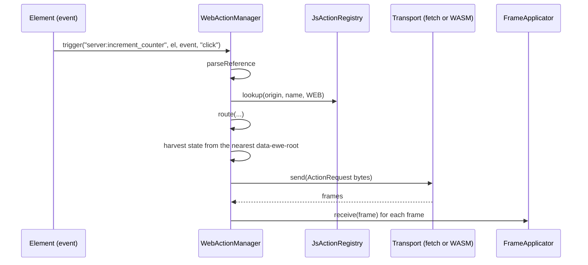

# Feature 10: The web action manager

_Written in ASD-STE100 Simplified Technical English (STE). Code and identifiers stay as they
are._

**Abbreviations in this file.** user interface (UI); Document Object Model (DOM); JavaScript
(JS); WebAssembly (WASM); hypertext transfer protocol (HTTP); cross-site request forgery
(CSRF); Secure Hash Algorithm 256 (SHA-256); identifier (id); AeroSpace and Defence
Industries Association of Europe (ASD), the owner of the STE standard ASD-STE100.

## 1. Goal

On the web, an event attribute can hold an action reference: `server:name`, `native:name`
or `js:name`. One JS action manager reads the reference, checks the origin and the scope
with the same rule as the Rust manager, and routes the call. A `js:` action is a page
function, as today. A `server:` action goes to the backend as an `ActionRequest` with the
state of the component root. A `native:` action goes to the Rust registry in the local WASM
module. Every answer is a frame that the applicator of feature 09 applies. A counter
example proves the three origins in a real browser.

## 2. Story

- **S1**: "A user clicks a button that is bound to a server action, and the label changes."
- **S2**: "A user clicks a button that is bound to a page function from a `<script>`."
- **S3**: "A user clicks a button that is bound to an action in the local WASM module."
- **S4**: "The page says hello and tells the server which actions it has."
- **S5**: "A click names an action that the page does not have."
- **S6**: "The server answers that the state expired."
- **S7**: "The network fails during a server action."
- **S8**: "The server answers that the page must update."

| # | Use case | Actor | Trigger | Result |
|---|---|---|---|---|
| U1 | Server action | User | An event on an element with `primal:on<event>="server:name"` | One HTTP request; the answer frame is applied |
| U2 | JS action | User | `…="js:name"` | The page function runs with `{ node, parent, event, data }` |
| U3 | Local action | User | `…="native:name"` | The WASM export runs the action; the answer frame is applied |
| U4 | Declare | Page start code | `actions.declare(origin, name, scope)` | The JS registry has the entry |
| U5 | Hello | Page start code | `manager.hello()` | `ClientHello` bytes with the registry hash |
| U6 | Typed failure | Manager | A bad reference, a missing action, a transport failure | `onError({ code, … })`; nothing else happens |

## 3. Bounded context

**Inside this feature:** `foundation-ui-actions.js` (`JsActionRegistry`, `WebActionManager`,
`FetchActionTransport`, `WasmActionTransport`, `installActionRuntime`); two seams in
`foundation-wasm-ui.js`; the Rust WASM export `ewe_ui_action` in `foundation_wasm_ui`; the
counter example and its browser test.

**Outside:**

| Thing | Owner |
|---|---|
| The route rule and `fixtures/action_routes.json` | Feature 05 |
| `Dispatcher`, `LocalDispatcher`, the wire error codes | Feature 07 |
| `FrameApplicator`, `splitFrames`, base64url helpers, `data-ewe-state` | Feature 09 |
| The generated builders for `ActionRequest` and `ClientHello` | Feature 01 (`foundation-ui-wire.js`) |
| `EventDispatcher`, `Hydrator`, `buildEventData`, `resolveFunctionRef` | `foundation-wasm-ui.js` (spec 39) |
| The HTTP endpoint and the session cookie | The host (D25) |
| Local handlers `primal:on*={closure}` and `primal:setter` | Spec 39. They do not change (D40) |

| Entity | Meaning | Owner (the one writer) |
|---|---|---|
| JS registry | Declared actions by origin and name; the functions of `js:` actions | `JsActionRegistry` |
| Client sequence counter | The `sequence_id` of the next request | `WebActionManager` |
| In-flight set | The component roots that have a request with no answer yet | `WebActionManager` |

| Verb | Kind | Trigger | Effect |
|---|---|---|---|
| `declare`, `registerJs` | entity | Page start, a scoped script | Adds an entry |
| `trigger` | story | An event | Parse, check, route, harvest, send, apply |
| `hello` | entity | Page start | Builds `ClientHello` bytes |

**Words.** "Harvest" is to copy the `data-ewe-state` text of the nearest component root and
decode it from base64url to bytes. The manager does not read the bytes.

## 4. Rules

### 4.1 Law worksheets

```
Entity: JS registry
Conserved value:         an entry does not change after it is added, except that registerJs can replace the function of a js: entry (a script that runs again after a morph)
Bound:                   the same bound as the Rust registry: one All entry, or one Web and one Mobile entry, for one (origin, name)
Inverse pairs:           none
Idempotent verbs:        declare with the same origin, name and scope
Ordering pairs:          declare comes before trigger
Monotone values:         none
Freeze points:           none
Links to other entities: hash() equals the Rust hash_for(WEB) for the same set
```

```
Entity: Client sequence counter
Conserved value:         none
Bound:                   >= 1
Inverse pairs:           none
Idempotent verbs:        none
Ordering pairs:          none
Monotone values:         strictly increases
Freeze points:           none
Links to other entities: ActionRequest.sequence_id; the answer's ack_action
```

```
Entity: In-flight set
Conserved value:         a root is in the set from send until its answer or its failure
Bound:                   at most one request for one root at a time
Inverse pairs:           add / remove
Idempotent verbs:        none
Ordering pairs:          none
Monotone values:         none
Freeze points:           none
Links to other entities: none
```

### 4.2 Invariants

| # | Invariant |
|---|---|
| I1 | The route of the JS manager equals the `expect` of every row of `backends/foundation_ui_runtime/fixtures/action_routes.json`. |
| I2 | Only a `server:` reference reaches the server transport. Only a `native:` reference reaches the WASM transport. A `js:` reference never leaves the page. |
| I3 | The state bytes in an `ActionRequest` equal the base64url decode of the `data-ewe-state` attribute of the nearest ancestor-or-self with `data-ewe-root`, byte for byte. With no such ancestor, the state is empty. |
| I4 | No request is sent before the reference parsed, the registry has the action for the web surface, and the origin is available. |
| I5 | Each request has a `sequence_id` greater than the one before. |
| I6 | While a root is in flight, a second `server:` or `native:` trigger from inside that root is not sent. It is dropped, and `onError` gets `{ code: "Busy" }`. |
| I7 | A reference with no origin prefix is not an action reference: the dispatcher resolves it with the existing rules (callback id, `primal:setter`, dot-path function). |
| I8 | `registry.hash()` equals `ActionRegistry::hash_for(WEB)` of Rust for the same set of references. |
| I9 | Every failure calls `onError` with a `code`. No failure is silent, and none throws out of the event listener. |

### 4.3 Must have

- `backends/foundation_wasm_ui/runtimes/foundation-ui-actions.js`, embedded as
  `FOUNDATION_UI_ACTIONS_JS`.
- A custom request header on every server action, so a plain HTML form on another site
  cannot make the request (the CSRF layer of research 08 section 4.4).
- The example `examples/ui_counter` (section 6.8).

### 4.4 Must do

- Keep the current capability: a function that a page script defined is callable by name
  after the DOM mounts (D37).
- Apply every answer frame through `FrameApplicator.receive`.
- Reload the page one time when the server answers `StateExpired` or `UpdateRequired`
  (A3), through an injectable handler.

### 4.5 Must not

- Do not send a `js:` or `native:` reference to the server.
- Do not edit, parse or re-encode the state bytes.
- Do not add optimistic updates, retries or a "local then remote" policy (D32).
- Do not block the event loop on a WASM action.

## 5. Acceptance scenarios

The JS scenarios use the mock DOM and recording transports. `WEB` is
`{ platform: "web", mount: "web" }`.

```gherkin
Feature: Web action manager

  Scenario: A server action sends the state of its component root
    Given <div primal-id="40" data-ewe-root data-ewe-state="AQID"><button primal-id="42"
      primal:onclick="server:increment_counter">Add</button></div>
    And the registry declares server:increment_counter with scope all
    And a recording server transport that answers frame_ops_counter.bin
    When the user clicks the button
    Then the transport received one ActionRequest with action "server:increment_counter",
      node_id 42, sequence_id 1, input.event_name "click", input.parent_node 40 and state bytes [1, 2, 3]
    And the applicator received frame_ops_counter.bin

  Scenario: A click on an element with no component root sends an empty state
    Given <button primal-id="42" primal:onclick="server:ping">Ping</button> with no data-ewe-root ancestor
    When the user clicks the button
    Then the ActionRequest has an empty state

  Scenario: A page function runs for a js reference
    Given a scoped script ran scope.action("open_picker", fn)
    And <button primal-id="42" primal:onclick="js:open_picker">Pick</button>
    When the user clicks the button
    Then fn was called once with { node: the button, parent: its parent element, event, data }
    And no transport received a request

  Scenario: A global page function is callable by name
    Given globalThis.open_picker is a function and nothing called scope.action
    And the registry declares js:open_picker
    When the user clicks a button bound to "js:open_picker"
    Then globalThis.open_picker was called once

  Scenario: A native action goes to the WASM transport
    Given the registry declares native:toggle with scope all
    And a recording WASM transport
    When the user clicks a button bound to "native:toggle"
    Then the WASM transport received one ActionRequest with action "native:toggle"
    And the server transport received nothing

  Scenario: An undeclared action is a typed error
    Given an empty registry
    When the user clicks a button bound to "server:nope"
    Then onError was called once with { code: "UnknownAction", reference: "server:nope" }
    And no transport received a request

  Scenario: A mobile-only action is refused on the web
    Given the registry declares server:open_picker with scope mobile
    When the user clicks a button bound to "server:open_picker"
    Then onError was called once with { code: "UnsupportedAction", reference: "server:open_picker" }

  Scenario: A server action with no server transport is unavailable
    Given a manager with no server transport
    And the registry declares server:increment_counter
    When the user clicks the button
    Then onError was called once with { code: "UnavailableOrigin", origin: "server" }

  Scenario: A second click while a request is in flight is dropped
    Given a server transport that does not answer yet
    When the user clicks the button two times
    Then the transport received one request
    And onError was called once with { code: "Busy" }

  Scenario: A transport failure is reported and the root is free again
    Given a server transport that rejects with "offline"
    When the user clicks the button
    Then onError was called once with { code: "Transport", detail: "offline" }
    And a later click sends a new request with sequence_id 2

  Scenario: An expired state reloads the page one time
    Given a server transport that answers an Error frame with code StateExpired
    When the user clicks the button
    Then the injected reload handler was called once

  Scenario: An existing local handler still works
    Given <button primal:onclick="callback-7">
    When the user clicks the button
    Then the registry callback bridge got callback id 7
    And the action manager was not called

  Scenario: The registry hash matches Rust
    Given a registry that declares server:increment_counter (all), native:toggle (all) and js:open_picker
    Then registry.hash() as hex equals the value in fixtures/registry_hash_web.txt, which a Rust test wrote
```

Browser scenario (the phase gate of `requirements.md` section 7):

```gherkin
  Scenario: The counter example works with three origins in a real browser
    Given the ui_counter example server runs
    When the test browser opens the page and clicks "Server +1", "Local +1" and "JS +1"
    Then the label next to each button reads "1"
    And the server log shows exactly one action request
```

## 6. Technical breakdown

### 6.1 Measured facts

| Fact | Source |
|---|---|
| `EventDispatcher.#buildListener` resolves a handler in three steps: callback id, `primal:setter`, dot-path function on `this.scope` (default `globalThis`) | `backends/foundation_wasm_ui/runtimes/foundation-wasm-ui.js:917-928`, `:875-878` |
| `scanAndWire` reads every `primal:on<event>` attribute; `wire` is idempotent | `foundation-wasm-ui.js:889-915` |
| `Hydrator.createScope(targetElement)` builds the `scope` object of a scoped script | `foundation-wasm-ui.js:2138-2160` |
| `buildEventData` gives `type`, `primalId`, `value`, `checked`, `keyCode`, `modifiers` | `foundation-wasm-ui.js:818-833` |
| WASM exports `create_allocation`, `allocation_start_pointer`, `allocation_length`, `dispose_allocation` | `backends/foundation_wasm/src/host_runtime.rs:540-574` |
| `invoke_signal_callback` shows the pattern "JS writes a slot, Rust reads and frees it" | `backends/foundation_wasm_ui/src/events.rs:65-106` |
| The test server of `foundation_browser` serves the runtime assets; a pure-Rust browser test task exists | `backends/foundation_browser/src/test/server.rs:49-53`, `mise.toml:156-200` (`test:browser`) |

### 6.2 Files

```
backends/foundation_wasm_ui/runtimes/foundation-ui-actions.js            new
backends/foundation_wasm_ui/runtimes/foundation-wasm-ui.js               two seams (section 6.6)
backends/foundation_wasm_ui/src/embedded.rs                              FOUNDATION_UI_ACTIONS_JS
backends/foundation_wasm_ui/src/actions.rs                               install_local_dispatcher, ewe_ui_action
backends/foundation_wasm_ui/tests/actions_export_tests.rs
backends/foundation_wasm_ui/integration/test/actions-registry.test.js
backends/foundation_wasm_ui/integration/test/actions-manager.test.js
backends/foundation_wasm_ui/integration/test/actions-routes.test.js
backends/foundation_wasm_ui/integration/fixtures/registry_hash_web.txt   written by a Rust test
backends/foundation_ui_runtime/tests/action_registry_tests.rs            + writes registry_hash_web.txt
examples/ui_counter/                                                     new example crate
```

### 6.3 Public JS API

```js
export class JsActionRegistry {
  /** origin: "server" | "native" | "js"; scope: "all" | "web" | "mobile" (default "all";
   *  "js" forces "web"). Throws RangeError on a bad name or a duplicate that breaks the bound. */
  declare(origin, name, scope = "all");
  /** Declares js:name (if needed) and sets its function. */
  registerJs(name, fn);
  /** Returns "ok", "unknown" or "unsupported" for the surface. */
  lookup(origin, name, surface);
  jsFunction(name) /* function | undefined */;
  /** Sorted "origin:name" strings that exist on the surface. */
  refs(surface);
  /** Promise<Uint8Array(32)>: SHA-256 over each ref followed by "\n". Uses crypto.subtle. */
  hash(surface);
}

/** The pure route rule. Returns { route: "server"|"local"|"js" } or { error: code }. */
export function route(reference, surface, lookup, has /* {server, local, js} */);
/** Returns { origin, name } or { error: "BadReference" }. */
export function parseReference(text);

export class FetchActionTransport {
  /** @param {{url: string, fetch?: typeof fetch, csrfToken?: string,
   *           hello?: () => Uint8Array}} options */
  constructor(options);
  /** POSTs the request. Resolves to the frames of the answer. Rejects on a network error
   *  or a status other than 200. */
  send(requestBytes) /* Promise<Uint8Array[]> */;
}

export class WasmActionTransport {
  /** @param {{exports: object, memory: () => WebAssembly.Memory}} bridge  as signalDeliver */
  constructor(bridge);
  send(requestBytes) /* Promise<Uint8Array[]> */;
}

export class WebActionManager {
  /**
   * @param {object} deps
   * @param {JsActionRegistry} deps.registry
   * @param {FrameApplicator} deps.frames
   * @param {{send(bytes): Promise<Uint8Array[]>}=} deps.server
   * @param {{send(bytes): Promise<Uint8Array[]>}=} deps.local
   * @param {object=} deps.scope            where a global js function is looked up; default globalThis
   * @param {bigint=} deps.streamId         default 0n
   * @param {(error) => void=} deps.onError default console.error
   * @param {() => void=} deps.reload       default () => location.reload()
   */
  constructor(deps);
  /** Called by the event listener. Never throws. Resolves when the action is done. */
  trigger(reference, el, event, eventType) /* Promise<void> */;
  /** ClientHello bytes for this page: platform Web, mount Web, the registry hash. */
  hello() /* Promise<Uint8Array> */;
  setStreamId(streamId);
}

/** Wires the manager into foundation-wasm-ui.js (the two seams). Returns the manager. */
export function installActionRuntime(wasmUi, deps) /* WebActionManager */;
```

An error passed to `onError` is `{ code, reference?, origin?, detail? }`, with `code` one of
`"BadReference"`, `"UnknownAction"`, `"UnsupportedAction"`, `"UnavailableOrigin"`, `"Busy"`,
`"Transport"`, `"JsThrew"`, or the name of a wire `ErrorCode` from an `Error` frame
(`"StateRejected"`, `"StateExpired"`, …).

### 6.4 `trigger`, in order



_The diagram shows one server or local action on the web. A `js:` action stops after the
route and calls the page function._

1. `parseReference`; an error gives `BadReference`.
2. `registry.lookup(origin, name, WEB)`.
3. `route(…, { server: !!deps.server, local: !!deps.local, js: true })`; an error gives its
   code.
4. **`js`**: `fn = registry.jsFunction(name) ?? resolveGlobal(deps.scope, name)`; with no
   function, `UnavailableOrigin` with origin `"js"`. Call
   `fn.call(el, { node: el, parent: el.parentElement, event, data: buildEventData(eventType, event, el) })`.
   A thrown exception gives `JsThrew`. If the return value (or its awaited value) is a
   `Uint8Array` or an array of `Uint8Array`, pass each to `frames.receive`. Stop.
5. **Root**: `root = el.closest("[data-ewe-root]")`. If `root` is in the in-flight set:
   `Busy`; stop. Else add `root` (or the element itself when there is no root).
6. **State**: `root ? base64urlDecode(root.getAttribute("data-ewe-state") ?? "") : empty`.
7. **Request**: build with the generated builder: `schema_version`, `stream_id`, the next
   `sequence_id` (a `bigint` counter from 1), `action` = the reference text, `node_id` =
   the number in the `primal-id` of `el` (0 when absent), `input` = `{ event_name:
   eventType, value: el.value ?? "", checked: !!el.checked, key_code: event.keyCode ?? 0,
   modifiers: alt 1 | ctrl 2 | shift 4 | meta 8, parent_node: the primal-id number of root,
   or 0 }`, `state`. Finish with the identifier `"EWA1"`.
8. **Send** on the transport of the route. On rejection: remove the root from the set;
   `Transport` with the message; stop.
9. **Apply**: for each frame: if its body is `Error`, call `onError` with the code name and
   message; for `StateExpired` or `UpdateRequired` also call `deps.reload()` one time for
   each manager. Else `frames.receive(frame)`.
10. Remove the root from the in-flight set (in a `finally`).

**Fault table: `trigger`**

| Step that fails | What the system does | What the caller sees | What is left behind |
|---|---|---|---|
| 1 to 4 | Stops | `onError` with the code | nothing; the counter did not move |
| 5 (busy) | Stops | `onError({ code: "Busy" })` | nothing; the first request continues |
| 8 (transport) | Removes the root from the in-flight set | `onError({ code: "Transport" })` | The counter moved by one. The server may or may not have run the action; the domain rule of the action covers a repeat (D14) |
| 9 (an `Error` frame) | Reports it; reloads for the two reload codes | `onError` with the wire code | The DOM and the state attribute are unchanged |
| 9 (a frame fails in the applicator) | The applicator reports (feature 09) | `onReport` of the applicator | Rows that applied stay applied |

### 6.5 The transports

**`FetchActionTransport.send`**: `fetch(url, { method: "POST", credentials: "same-origin",
headers: { "content-type": "application/primal-action", "accept":
"application/primal-frame", "x-ewe-action": "1", "x-ewe-hello": base64url(hello()) when
`hello` is given, "x-csrf-token": csrfToken when given }, body: requestBytes })`. A status
other than 200 rejects with `"http <status>"`. The body is read with `arrayBuffer()` (one
answer frame; small) and split with `splitFrames`.

The `x-ewe-hello` header lets a server with no connection state build a
`Connection::stateless` for each request (feature 07 section 6.6). A host that keeps a
connection ignores it.

**`WasmActionTransport.send`**: write the request into a new allocation
(`create_allocation`, `allocation_start_pointer`), call
`exports.ewe_ui_action(memId)`, which returns the id of an allocation with the answer
frame; copy `allocation_length` bytes from `allocation_start_pointer` into a new
`Uint8Array`; `dispose_allocation` the answer; resolve to `[bytes]`. A return value of
`0n` rejects with `"no local dispatcher"`. The call is synchronous inside the Promise
executor; it does not wait.

### 6.6 Seams in `foundation-wasm-ui.js`

1. `EventDispatcher.actionHook = null;` (static). At the start of `#buildListener`:

```js
const hook = EventDispatcher.actionHook;
if (hook && /^(server|native|js):/.test(String(handlerRef))) {
  return (event) => { hook(String(handlerRef), el, event, eventType); };
}
```

   A reference with an origin prefix and no installed hook falls through to the existing
   steps, which end in the existing `console.warn`.

2. `Hydrator.scopeExtensions = [];` (static). At the end of `createScope`, before the
   return: build the object as `scope`, then
   `for (const extend of Hydrator.scopeExtensions) extend(scope, targetElement);`.

`installActionRuntime(wasmUi, deps)`: build the manager; set
`wasmUi.EventDispatcher.actionHook = (ref, el, event, type) => { manager.trigger(ref, el, event, type); }`;
push `(scope) => { scope.action = (name, fn) => deps.registry.registerJs(name, fn); }` to
`wasmUi.Hydrator.scopeExtensions`; call
`wasmUi.Patcher.runtime.dispatcher?.scanAndWire?.(document.body)` so elements that were
wired before the install get the hook.

### 6.7 The Rust export (`backends/foundation_wasm_ui/src/actions.rs`)

Add `foundation_ui_runtime` as a dependency of `foundation_wasm_ui`.

```rust
/// Installs the dispatcher that `ewe_ui_action` runs. Call once at app init.
pub fn install_local_dispatcher(local: foundation_ui_runtime::LocalDispatcher);
pub fn uninstall_local_dispatcher();

/// WASM export: run one `native:` action.
/// `allocation_id` names a global-arena slot with `ActionRequest` bytes. Rust reads and
/// frees it. Returns the id of a new slot that holds the answer `Frame`; JS disposes it.
/// Returns 0 when no dispatcher is installed or the slot is missing.
#[no_mangle]
pub extern "C" fn ewe_ui_action(allocation_id: u64) -> u64;
```

The slot handling copies `invoke_signal_callback` (`src/events.rs:65-90`), with the same
single-threaded global pattern as `EVENT_BRIDGE`.

**Running the future.** A browser WASM module has one thread. The export polls the future
of `LocalDispatcher::send` one time with a no-op waker.

| Poll result | Effect |
|---|---|
| `Ready(Ok(bytes))` | Write `bytes` to a new slot; return its id |
| `Pending` | Drop the future. Return a slot with an `Error` frame: code `ActionFailed`, message `"a native action in the browser must not wait"` |

So a `native:` action in the browser must finish without waiting (it reads and writes
local signals). This is a stated limit of version 1, not a silent one. On a device,
feature 13 awaits the same dispatcher on the Rust executor, so the limit does not apply
there. The export never spins on a pending future (rule 6).

The local dispatcher in the browser uses `HmacStateCodec` with a key made at start from
`ctx.rng()` (feature 04 section 6.7).

### 6.8 The counter example (`examples/ui_counter`)

A workspace member (add it to `members` in the root `Cargo.toml`, next to
`examples/platform_demo`) with:

- `src/actions.rs`: `Counter { current: u32 }` with `ComponentState` (`COMPONENT_TYPE` 1,
  4-byte little-endian body); `#[action] async fn increment_counter` that returns the view
  form of feature 08; `#[action] async fn increment_local` with the same body.
- A server binary: serves the page, the runtime assets, and `POST /action`. `/action`
  reads the `x-ewe-hello` header, makes `Connection::stateless`, calls
  `Dispatcher::dispatch`, and answers with `application/primal-frame` (one size-prefixed
  frame). Use the HTTP server that `foundation_browser`'s test server uses, so no new
  dependency is added. The session id comes from a cookie that the page handler sets.
- A WASM module (built as `backends/foundation_wasm_ui/integration/module` is built) that
  registers `increment_local` under `Origin::Native` and calls `install_local_dispatcher`.
- The page: three component roots, each mounted by the server with `view::mount`, and one
  scoped script that calls `scope.action("increment_js", …)` and changes its label in JS.
- A browser test, with the pure-Rust browser harness of spec 43 (`foundation_browser`),
  that runs the browser scenario of section 5. Add it to the `test:browser` mise task set.

## 7. Tests

| Law or scenario | Test | Oracle |
|---|---|---|
| I1 | `integration/test/actions-routes.test.js` "route matches every vector" (reads `../../../foundation_ui_runtime/fixtures/action_routes.json`) | example |
| I2; Scenarios: server, js, native | `actions-manager.test.js` "server action sends state", "js action runs the page function", "native action goes to wasm" | example |
| I3; Scenarios: state of root, no root | `actions-manager.test.js` "state bytes equal the attribute", "no root gives empty state" | example |
| I4; Scenarios: undeclared, mobile-only, no transport | `actions-manager.test.js` three tests named after the scenarios | fault |
| I5 | `actions-manager.test.js` "sequence ids increase" | property |
| I6; Scenario: second click | `actions-manager.test.js` "busy root drops the second trigger" | stateful model |
| I7; Scenario: existing local handler | `actions-manager.test.js` "a reference with no origin uses the old rules" | example |
| I8; Scenario: registry hash | `actions-registry.test.js` "hash equals the Rust fixture"; Rust `action_registry_tests.rs::writes_web_hash_fixture` | example |
| I9 | `actions-manager.test.js` "trigger never throws" (a transport that throws synchronously, a function that throws, a null element) | fault |
| Scenarios: global function, transport failure, expired state | `actions-manager.test.js` named after the scenarios | example |
| Registry bound | `actions-registry.test.js` "duplicate is rejected", "web and mobile forms coexist", "js forces web scope" | expected outcome |
| `FetchActionTransport` sends the headers and splits the frames | `actions-manager.test.js` "fetch transport" with an injected `fetch` | example |
| `ewe_ui_action`: ready action; pending action; no dispatcher | `backends/foundation_wasm_ui/tests/actions_export_tests.rs::ready_action_returns_frame`, `::pending_action_returns_error_frame`, `::no_dispatcher_returns_zero` (the export is callable natively, as `invoke_signal_callback` is) | example |
| Browser scenario | `examples/ui_counter/tests/counter_browser_tests.rs::three_origins_work` | example |

## 8. Tasks

- [ ] 1. `parseReference`, `route` and the route-vector test.
- [ ] 2. `JsActionRegistry` with `hash`; the Rust test that writes `registry_hash_web.txt`.
- [ ] 3. `WebActionManager.trigger` for `js:` with tests.
- [ ] 4. The state harvest, the request builder, the in-flight set, with tests.
- [ ] 5. `FetchActionTransport` and `WasmActionTransport`.
- [ ] 6. The two seams and `installActionRuntime`.
- [ ] 7. `actions.rs` and `ewe_ui_action` with its tests.
- [ ] 8. `embedded.rs`; serve the file from the `foundation_browser` test server.
- [ ] 9. The `ui_counter` example and its browser test.
- [ ] 10. Bump crate versions; add `examples/ui_counter` to `ci/packages.toml` if a default does not fit.
- [ ] 11. Update `progress.md` and `learnings.md`.

## 9. Verify

```bash
mise run ui-web:test
node --check backends/foundation_wasm_ui/runtimes/foundation-ui-actions.js
cargo fmt --all -- --check
cargo clippy -p foundation_wasm_ui --profile uat --no-deps -- -D warnings
cargo test   -p foundation_wasm_ui --profile uat
cargo check  -p foundation_wasm_ui --profile uat --target wasm32-unknown-unknown
cargo test   -p foundation_ui_runtime --profile uat
cargo clippy -p ui_counter --profile uat --no-deps -- -D warnings
cargo test   -p ui_counter --profile uat
mise run test:browser
```

## 10. Done when

- [ ] All tasks are complete and every command of section 9 passes with no warning.
- [ ] Each invariant and each scenario has a passing test (section 7).
- [ ] The browser scenario passes. Record it in `progress.md`: it opens the phase gate for
      feature 13.
- [ ] `git diff` of `foundation-wasm-ui.js` for this feature shows only the two seams.
- [ ] No existing JS or Rust test file changed.
- [ ] The check list of the `story-driven-specification` skill passes.

---

_Created: 2026-11-13_
