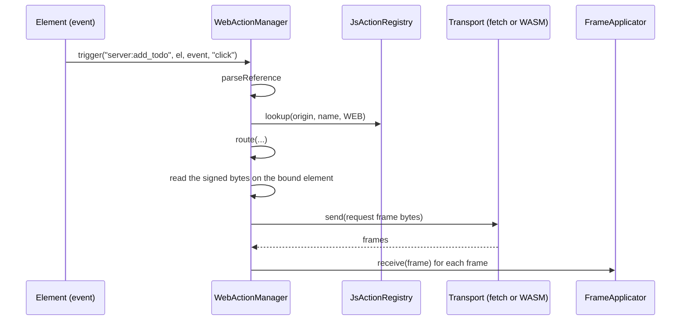

# Feature 10: The web action manager

_Written in ASD-STE100 Simplified Technical English (STE). Code and identifiers stay as they
are._

**Abbreviations in this file.** user interface (UI); Document Object Model (DOM); JavaScript
(JS); WebAssembly (WASM); hypertext transfer protocol (HTTP); inter-process communication
(IPC); cross-site request forgery (CSRF); identifier (id); AeroSpace and Defence Industries
Association of Europe (ASD), the owner of the STE standard ASD-STE100.

## 1. Goal

On the web, an event attribute can hold an action reference with one of two origins: `server`
or `host` (D50). One JS action manager reads the reference, checks the origin and the scope
with the same rule as the Rust manager, and routes the call. A `host:` action is a page
function or a compiled action in the local WASM or page registry. A `server:` action goes to
the backend as one request `Frame` with the state of the bound element. A plain declaration has no origin limit.
When its local implementation is absent, the manager sends it to the server if the server advertises its name.
An explicit host declaration always requires a local implementation. Every answer is a frame that the applicator of feature 09 applies.
The server sends its `server:` action list in `ServerCaps.actions`, and the manager hides or
marks a control whose action the list lacks (D54). A todo list example proves the paths in a
real browser.

## 2. Story

- **S1**: "A user clicks a button that is bound to a server action, and the label changes."
- **S2**: "A user clicks a button that is bound to a page function from a `<script>`."
- **S3**: "A user clicks a button that is bound to an action in the local WASM module."
- **S4**: "The page says hello, and the server tells the page which actions it has."
- **S5**: "A click names a `host:` action that neither the page nor the server has."
- **S6**: "The server answers that the state expired."
- **S7**: "The network fails during a server action."
- **S8**: "The server answers that the page must update."
- **S9**: "The server list lacks an action that a control uses, and the control is marked."
- **S10**: "A click names a plain host action that the page does not have, and the server runs it."

| # | Use case | Actor | Trigger | Result |
|---|---|---|---|---|
| U1 | Server action | User | An event on an element with `primal:on<event>="server:name"` | HTTP applies its reply. WebSocket sends once and accepts later updates through the receive path. |
| U2 | Host page function | User | `…="host:name"` | The page function runs with `{ node, parent, event, data }` |
| U3 | Local compiled action | User | `…="host:name"` and a host registry entry with a WASM action | The WASM export runs the action; the answer frame is applied |
| U4 | Declare | Page start code | `actions.declare(origin, name, scope)` | The JS registry has the entry |
| U5 | Hello | Page start code | `manager.hello()` | The bytes of one `Frame` with a `ClientHello`; no action list (D54) |
| U6 | Typed failure | Manager | A bad reference, a missing action, a transport failure | `onError({ code, … })`; nothing else happens |
| U7 | Adapt down | Manager | `ServerCaps.actions` arrives | A control whose action is absent gets `data-ewe-unavailable` |

## 3. Bounded context

**Inside this feature:** `foundation-ui-actions.js` (`JsActionRegistry`, `WebActionManager`,
`FetchActionTransport`, `WasmActionTransport`, `installActionRuntime`); two seams in
`foundation-wasm-ui.js`; the Rust WASM export `ewe_ui_action` in `foundation_wasm_ui`; the
todo list example and its browser test.

**Outside:**

| Thing | Owner |
|---|---|
| The route rule and `fixtures/action_routes.json` | Feature 05 |
| `Dispatcher`, `LocalDispatcher`, the wire error codes | Feature 07 |
| `FrameApplicator`, `splitFrames`, base64url helpers, `primal::state` | Feature 09 |
| The generated builders for `Frame`, `FrameRequest`, `ActionRequest`, `ClientHello` and `ServerCaps` | Feature 01 (`foundation-ui-wire.js`) |
| `EventDispatcher`, `Hydrator`, `buildEventData`, `resolveFunctionRef` | `foundation-wasm-ui.js` (spec 39) |
| The HTTP endpoint and the session cookie | The host (D25) |
| Local handlers `primal:on*={closure}` and `primal:setter` | Spec 39. They do not change (D40) |

A transport implements `send(bytes): Promise<Uint8Array[]>`. A request transport resolves with the reply frames.
A WebSocket action transport resolves with an empty list after the open socket accepts the outbound binary message.
The receiver delivers later frames independently. An empty list means local handoff only.

| Entity | Meaning | Owner (the one writer) |
|---|---|---|
| JS registry | Declared actions by origin and name; the page functions and compiled host actions | `JsActionRegistry` |
| Server action list | The `server:` actions of the latest `ServerCaps.actions`, by name | `WebActionManager` |
| Client sequence counter | The `Frame.sequence_id` of the next request | `WebActionManager` |
| In-flight set | The component roots with a transport send still pending | `WebActionManager` |

The manager copies and decodes the bound control's `primal::state` attribute without interpreting the bytes.
It sends one request frame to the selected runtime.

## 4. Rules

### 4.1 Registration and request order

Reject overlapping declarations for the same name, origin and surface.
A plain declaration covers both origins. A page remount can replace its own script callback.
Assign request numbers from one, in send order. The answer acknowledges the number.
Keep one pending request per root until the send settles.

### 4.2 Invariants

| # | Invariant |
|---|---|
| I1 | The route of the JS manager equals the `expect` of every row of `backends/foundation_ui_runtime/fixtures/action_routes.json`. |
| I2 | Only a `server:` reference reaches the server transport, except the D50 (8) fall-forward of a `host:` reference as `server:<name>`. Only a `host:` reference reaches a host target: a WASM action goes to the WASM transport, and a page function runs in the page. A `host:` reference leaves the page only as that fall-forward. |
| I3 | The state bytes in a request frame equal the base64url decode of the `primal::state` attribute on the bound control, byte for byte. An absent attachment gives empty bytes. |
| I4 | No request is sent before the reference parses, the route meets the declaration and server list rules in section 6.4, and a transport for the route exists. |
| I5 | Each request has a `sequence_id` greater than the one before. |
| I6 | While a root is in flight, a second `server:` trigger from inside that root is not sent. It is dropped, and `onError` gets `{ code: "Busy" }`. |
| I7 | A reference with no origin prefix is not an action reference: the dispatcher resolves it with the existing rules (callback id, `primal:setter`, dot-path function). |
| I8 | A server control whose action is absent from `ServerCaps.actions` gets `data-ewe-unavailable` (D54). The control stays in the DOM. A `trigger` on it stops with `{ code: "UnavailableAction" }`. |
| I9 | Every failure calls `onError` with a `code`. No failure is silent, and none throws out of the event listener. |

### 4.3 Must have

- `backends/foundation_wasm_ui/runtimes/foundation-ui-actions.js`, embedded as
  `FOUNDATION_UI_ACTIONS_JS`.
- A custom request header on every HTTP server action, so a plain HTML form on another site
  cannot make the request (the CSRF layer of research 08 section 4.4).
- The `scope.behaviour(name, fn)` extension, which calls
  `registerWebBehaviour(name, fn)` of `foundation-ui-behaviours.js` (feature 09 section 6.9).
  A scoped script registers a custom web behaviour with it.
- The example `examples/ui_todo` (section 6.8).

### 4.4 Must do

- Keep the current capability: a function that a page script defined is callable by name
  after the DOM mounts (D37).
- Mark a control whose `server:` action is absent from `ServerCaps.actions` with
  `data-ewe-unavailable`. Do not remove it (D54).
- Apply every answer frame through `FrameApplicator.receive`.
- Reload the page one time when the server answers `StateExpired` or `UpdateRequired`
  (A3), through an injectable handler.

### 4.5 Must not

- Do not send a `host:` reference to the server, except the D50 (8) fall-forward as
  `server:<name>`.
- Do not edit, parse or re-encode the state bytes.
- The manager never retries an action. Only an explicit host policy for HTTP action requests may retry. Keep the D50 route rule.
- Do not block the event loop on a WASM action.
- Do not keep or compare an action registry hash. Use action names from the server list for routing (D54).

## 5. Acceptance scenarios

The JS scenarios use the mock DOM and recording transports. `WEB` is
`{ platform: "web", mount: "web" }`.

```gherkin
Feature: Web action manager

  Scenario: A server action sends the bound element’s own state
    Given <div primal-id="40" data-ewe-root primal::state="BAUG"><button primal-id="42" primal::state="AQID"
      primal:onclick="server:add_todo">Add</button></div>
    And the registry declares server:add_todo with scope all
    And a recording server transport that answers the add frame
    When the user clicks the button
    Then the transport received one request frame with action "server:add_todo",
      node_id 42, sequence_id 1, input.event_name "click", input.parent_node 40 and state bytes [1, 2, 3]
    And the applicator received the add frame

  Scenario: A child without attached state sends empty state
    Given <button primal-id="42" primal:onclick="server:add_todo">Add</button> inside a parent with primal::state="BAUG"
    When the user clicks the button
    Then the request frame has an empty state

  Scenario: The next click sends the updated copy
    Given the first frame attached signed bytes A to nodes 40 and 42
    And the reply attached signed bytes B to both nodes
    When button 42 triggers its action again
    Then the request identifies node 42 and carries B from button 42

  Scenario: A page function runs for a host reference
    Given a scoped script ran scope.action("notify", fn)
    And <button primal-id="42" primal:onclick="host:notify">Notify</button>
    When the user clicks the button
    Then fn was called once with { node: the button, parent: its parent element, event, data }
    And no transport received a request

  Scenario: A global page function is callable by name
    Given globalThis.notify is a function and nothing called scope.action
    And the registry declares host:notify with scope web
    When the user clicks a button bound to "host:notify"
    Then globalThis.notify was called once

  Scenario: A host action in the local WASM module goes to the WASM transport
    Given the registry declares host:filter_todos with scope all
    And a recording WASM transport
    When the user clicks a button bound to "host:filter_todos"
    Then the WASM transport received one request frame with action "host:filter_todos"
    And the server transport received nothing

  Scenario: An undeclared action is a typed error
    Given an empty registry
    When the user clicks a button bound to "server:nope"
    Then onError was called once with { code: "UnknownAction", reference: "server:nope" }
    And no transport received a request

  Scenario: A host reference with no host target fails at the tap
    Given the registry declares host:open_picker with scope web
    But no page function and no WASM action has that name
    And ServerCaps.actions advertises "open_picker"
    When the user clicks the button
    Then onError was called once with { code: "UnavailableOrigin", origin: "host" }
    And no transport received a request

  Scenario: A plain host reference falls forward to the server
    Given the registry declares add_todo with no origin limit and scope all
    But no page function and no WASM action has that name
    And ServerCaps.actions holds "add_todo"
    And a recording server transport
    When the user clicks a button bound to "host:add_todo"
    Then the server transport received one request frame with action "server:add_todo"

  Scenario: The server action list marks a control that it lacks
    Given a page with <button primal-id="42" primal:onclick="server:add_todo">
    And ServerCaps.actions holds only "toggle_todo"
    When the manager applies the caps message
    Then the button has the attribute data-ewe-unavailable
    And the button is still in the DOM

  Scenario: A control that the server list marks cannot send
    Given a button with data-ewe-unavailable and primal:onclick="server:add_todo"
    When the user clicks the button
    Then onError was called once with { code: "UnavailableAction" }
    And no transport received a request

  Scenario: A mobile-only action is refused on the web
    Given the registry declares server:open_picker with scope mobile
    When the user clicks a button bound to "server:open_picker"
    Then onError was called once with { code: "UnsupportedAction", reference: "server:open_picker" }

  Scenario: A server action with no server transport is unavailable
    Given a manager with no server transport
    And the registry declares server:add_todo
    When the user clicks the button
    Then onError was called once with { code: "UnavailableOrigin", origin: "server" }

  Scenario: A second click while a request is in flight is dropped
    Given a server transport that does not answer yet
    When the user clicks the button two times
    Then the transport received one request
    And onError was called once with { code: "Busy" }

  Scenario: A transport failure is reported and the root is free again
    Given a server transport that rejects with "offline"
    When the user clicks the button
    Then onError was called once with { code: "Transport", detail: "offline" }
    And a later click sends a new request with sequence_id 2

  Scenario: An expired state reloads the page one time
    Given a server transport that answers a frame with control.state_expired set
    When the user clicks the button
    Then the injected reload handler was called once

  Scenario: An existing local handler still works
    Given <button primal:onclick="callback-7">
    When the user clicks the button
    Then the registry callback bridge got callback id 7
    And the action manager was not called
```

Browser scenario (the phase gate of `requirements.md` section 7):

```gherkin
  Scenario: The todo list works with both origins in a real browser
    Given the ui_todo example server runs
    When the test browser opens the page, clicks "Add", types "buy milk" and confirms
    Then the new item is in the list and the open count is 1
    And after a click on the filter "Done" the list is empty
    And after a click on "All" and a toggle on the item, the open count is 0
    And after a delete and a confirm, the item is gone
    And a second delete of the same item answers with the server error ActionFailed
```

## 6. Technical breakdown

### 6.1 Measured facts

| Fact | Source |
|---|---|
| `EventDispatcher.#buildListener` resolves a handler in three steps: callback id, `primal:setter`, dot-path function on `this.scope` (default `globalThis`) | `backends/foundation_wasm_ui/runtimes/foundation-wasm-ui.js:917-928`, `:875-878` |
| `scanAndWire` reads every `primal:on<event>` attribute; `wire` is idempotent | `foundation-wasm-ui.js:889-915` |
| `Hydrator.createScope(targetElement)` builds the `scope` object of a scoped script | `foundation-wasm-ui.js:2138-2160` |
| `buildEventData` gives `type`, `primalId`, `value`, `checked`, `keyCode`, `modifiers` | `foundation-wasm-ui.js:818-833` |
| WASM exports `create_allocation`, `allocation_start_pointer`, `allocation_length`, `dispose_allocation` | `backends/foundation_wasm/src/host_runtime.rs:540-574` |
| `invoke_signal_callback` shows the pattern "JS writes a slot, Rust reads and frees it" | `backends/foundation_wasm_ui/src/events.rs:65-106` |
| The test server of `foundation_browser` serves the runtime assets; a pure-Rust browser test task exists | `backends/foundation_browser/src/test/server.rs:49-53`, `mise.toml:156-200` (`test:browser`) |

### 6.2 Files

```
backends/foundation_wasm_ui/runtimes/foundation-ui-actions.js            new
backends/foundation_wasm_ui/runtimes/foundation-wasm-ui.js               two seams (section 6.6)
backends/foundation_wasm_ui/src/embedded.rs                              FOUNDATION_UI_ACTIONS_JS
backends/foundation_wasm_ui/src/actions.rs                               install_local_dispatcher, ewe_ui_action
backends/foundation_wasm_ui/tests/actions_export_tests.rs
backends/foundation_wasm_ui/integration/test/actions-registry.test.js
backends/foundation_wasm_ui/integration/test/actions-manager.test.js
backends/foundation_wasm_ui/integration/test/actions-routes.test.js
backends/foundation_wasm_ui/integration/test/actions-behaviours.test.js
examples/ui_todo/                                                        new example crate
examples/ui_todo/module/                                                 WASM module (cdylib)
examples/ui_todo/tests/todo_browser_tests.rs                             browser test
```

### 6.3 Public JS API

```js
export class JsActionRegistry {
  /** origin: null (plain), "server", or "host". Scope: "all", "web", or "mobile".
   *  Reject an invalid name or overlapping declaration. */
  declare(origin, name, scope = "all");
  /** Declares host:name with scope web (if needed) and sets its page function. */
  registerHost(name, fn);
  /** Returns the declared origin, scope and local availability, or a lookup error. */
  lookup(origin, name, surface);
  hostFunction(name) /* function | undefined */;
  /** Sorted "origin:name" strings that exist on the surface. */
  refs(surface);
}

/** The pure route rule (feature 05, stage 2). Returns { route: "server"|"host" } or
 *  { error: code }. Use the declaration returned by lookup. has records available transports.
 *  serverHas returns undefined before caps arrive, then reports whether caps include the name. */
export function route(reference, surface, lookup, has /* {server, host} */, serverHas);
/** Returns { origin, name } or { error: "InvalidReference" }. */
export function parseReference(text);

export class FetchActionTransport {
  /** @param {{url: string, fetch?: typeof fetch, csrfToken?: string,
   *           hello?: () => Uint8Array, requestSignal?: () => AbortSignal}} options */
  constructor(options);
  /** POSTs the request. Resolves to the frames of the answer. Rejects on a network error
   *  or a status other than 200. */
  send(requestBytes) /* Promise<Uint8Array[]> */;
}

export class WasmActionTransport {
  /** @param {{exports: object, memory: () => WebAssembly.Memory}} bridge  as signalDeliver */
  constructor(bridge);
  send(requestBytes) /* Promise<Uint8Array[]> */;
}

export class WebActionManager {
  /**
   * @param {object} deps
   * @param {JsActionRegistry} deps.registry
   * @param {FrameApplicator} deps.frames
   * @param {{send(bytes): Promise<Uint8Array[]>}=} deps.server
   * @param {{send(bytes): Promise<Uint8Array[]>}=} deps.local
   * @param {object=} deps.scope            where a global host function is looked up; default globalThis
   * @param {bigint=} deps.streamId         default 0n
   * @param {number=} deps.maxRequestBytes  default 1024 * 1024 (WireLimits::max_action_request_bytes)
   * @param {(error) => void=} deps.onError default console.error
   * @param {() => void=} deps.reload       default () => location.reload()
   */
  constructor(deps);
  /** Called by the event listener. Never throws. Resolves after reply processing or socket handoff. */
  trigger(reference, el, event, eventType) /* Promise<void> */;
  /** The bytes of one Frame of kind FrameRequest with `hello` set and `action` absent:
   *  platform Web, mount Web, the vocabulary version of the page, resume_from 0,
   *  stream_id 0 (a new stream), no action list (D47, D54). */
  hello() /* Promise<Uint8Array> */;
  /** Stores the list of ServerCaps.actions and marks the controls that it lacks. */
  applyCaps(caps) /* void */;
  setStreamId(streamId);
}

/** Wires the manager into foundation-wasm-ui.js (the two seams). Returns the manager. */
export function installActionRuntime(wasmUi, deps) /* WebActionManager */;
```

An error passed to `onError` is `{ code, reference?, origin?, detail? }`, with `code` one of
`"InvalidReference"`, `"UnknownAction"`, `"UnsupportedAction"`, `"UnavailableOrigin"`,
`"UnavailableAction"`, `"Busy"`, `"Transport"`, `"HostThrew"`, or the name of a wire
`ErrorCode` from an `Error` message (`"StateRejected"`, `"StateExpired"`, …).

### 6.4 `trigger`, in order



_The diagram shows one server action on the web. A `host:` action either calls a page
function and stops, or sends a request on the local WASM transport. A plain host action with
no local target sends to the server as `server:<name>` (D50 (8))._

1. `parseReference`; an error gives `InvalidReference`.
2. If `el` or an ancestor has `data-ewe-unavailable`: `UnavailableAction`; stop.
3. Read the declaration for the origin, name and surface. Reject the wrong origin or surface.
   An unknown host reference gives `UnknownAction`, even when the server advertises the name.
4. For a server reference, require a server transport. Before caps arrive, require a matching declaration.
   After caps arrive, the server must advertise the name. Its list can supply a missing server declaration.
5. For a host reference, run the registered page function or compiled local action when present.
   A declared web page function may resolve the named global function. Require the local transport for a compiled action.
   If the implementation is absent, check the declared origin. An explicit host action gives `UnavailableOrigin`.
   A plain declaration can select `server:<name>` when the server advertises the name and its transport exists.
   Otherwise report `UnavailableOrigin`. A local call failure ends the call.
6. **Concurrency group** (used only to prevent duplicate requests): `root = el.closest("[data-ewe-root]")`. If `root` is in the in-flight set:
   `Busy`; stop. Else add `root` (or the element itself when there is no root).
7. **State**: Read `base64urlDecode(el.getAttribute("primal::state") ?? "")` on the bound control.
   The parent number describes the tree structure only.
   For a delegated click, `el` remains the control that owns the action binding.
8. **Request**: build one root `Frame` whose kind is `FrameRequest`, with `action` set and
   `hello` absent (D47):

   `FrameT { schema_version: SCHEMA_VERSION, stream_id, sequence_id, kind:
   FrameKindT::FrameRequest(Box::new(FrameRequestT { action: Some(ActionRequestT { action:
   callName, node_id, input, state }), hello: None })) }`.

   The generated TS object API gives the same fields. `sequence_id` is the next value of the
   `bigint` counter from 1 and sits on the frame, not on `ActionRequest` (D47). `callName`
   is the reference text, or `server:<name>` after the fall-forward of step 5. `node_id` is
   the number in the `primal-id` of `el` (0 when absent). `input` is `{ event_name:
   eventType, value: el.value ?? "", checked: !!el.checked, key_code: event.keyCode ?? 0,
   modifiers: alt 1 | ctrl 2 | shift 4 | meta 8, parent_node: the immediate parent element’s primal-id number,
   or 0 }`. Finish the frame with `finish_frame`; in the TS bundle the generated `Frame.pack`
   plus `builder.finish(root, "EWF1")` gives the same bytes. A buffer longer than
   `WireLimits::max_action_request_bytes` (`deps.maxRequestBytes`, default 1 MiB) gives
   `onError({ code: "BadRequest", detail: "request too large" })`; stop. The state and node
   values come from the bound control. Omit the state vector when the control has no attachment.
9. **Send** on the transport that steps 4 and 5 selected: `deps.server` after the
   fall-forward, else the transport of the route. On rejection: remove the root from the set;
   `Transport` with the message; stop.
10. **Apply**: each answer is a `Frame` of kind `FrameMessage`; its `ack` is the
    `sequence_id` of the request frame, and 0 for a push. For each frame: a message with
    `control.error` calls `onError` with the code name and the message; a message with
    `control.state_expired` calls `onError({ code: "StateExpired" })` and `deps.reload()` one
    time for each manager; a message with `control.update_required` calls
    `onError({ code: "UpdateRequired" })` and `deps.reload()` one time for each manager; else
    `frames.receive(frame)`. A `control.caps` message reaches `applyCaps` through the
    `onCaps` seam of section 6.6.
11. Release the root in `finally`. A socket send returns no immediate frames. Release the root as soon as that send settles.
    Route inbound socket frames through the same control and frame handlers as step 10. An error can arrive after handoff.

A page function gets `fn.call(el, { node: el, parent: el.parentElement, event, data:
buildEventData(eventType, event, el) })`. A thrown exception gives `HostThrew`. If the
return value (or its awaited value) is a `Uint8Array` or an array of `Uint8Array`, pass each
to `frames.receive`.

**Fault table: `trigger`**

| Step that fails | What the system does | What the caller sees | What is left behind |
|---|---|---|---|
| 1 to 5 | Stops | `onError` with the code | nothing; no request was sent |
| 6 (busy) | Stops | `onError({ code: "Busy" })` | nothing; the first request continues |
| 8 (request too large) | Stops | `onError({ code: "BadRequest" })` | nothing; no request was sent |
| 9 (transport) | Removes the root from the in-flight set | `onError({ code: "Transport" })` | No answer arrived. The server may or may not have run the action; the domain rule of the action covers a repeat (D14) |
| 5 (a page function throws) | Stops | `onError({ code: "HostThrew" })` | Nothing changed in the DOM or the state attribute |
| 10 (a `control.error`, `control.state_expired` or `control.update_required` message) | Reports it; reloads for the two reload members | `onError` with the host code | The DOM and the state attribute are unchanged |
| 10 (a frame fails in the applicator) | The applicator reports (feature 09) | `onReport` of the applicator | Rows that applied stay applied |

### 6.5 The transports

**`FetchActionTransport.send`**: `fetch(url, { method: "POST", credentials: "same-origin", signal: requestSignal?.(),
headers: { "content-type": "application/primal-frame", "accept":
"application/primal-frame", "x-ewe-action": "1", "x-ewe-hello": base64url(hello()) when
`hello` is given, "x-csrf-token": csrfToken when given }, body: requestBytes })`. A status
other than 200 rejects with `"http <status>"`. Read a successful reply as a bounded stream of size-prefixed frames.
Await the HTTP client's ordinary configured deadline for the full request, including its response body.
The host supplies its request cancellation signal or deadline through the transport options. A timeout or network failure ends the attempt.
Default to one attempt. Retrying a timed-out mutation requires an explicit HTTP action retry policy from the host.

One content type and one identifier cover both directions (D47): `application/primal-frame`
and `EWF1`. The header says that the message is ours; the `kind` field of the frame says
which kind it is.

The `x-ewe-hello` header lets a server with no connection state build a
`Connection::stateless` for each request (feature 07 section 6.6). A host that keeps a
connection ignores it.

**WebSocket delivery.** Accept a host-supplied action transport on an open socket. Send `requestBytes` as one binary message.
Reject a closed socket or a send failure. Resolve with `[]` after successful handoff. Reconnection never replays an action.
The host can deliver a later reply on the socket, through a live mount, or through another registered frame receiver.
Use the request sequence for a correlated answer and the channel sequence for independent pushes. Register only one receive path per delivered frame.

**Local Rust delivery.** Allocate a call identifier and register the pending promise before starting the Rust task.
Transfer the request slot to Rust. The bridge resolves or rejects that promise on completion. Section 6.7 defines slot ownership.

### 6.6 Seams in `foundation-wasm-ui.js`

1. `EventDispatcher.actionHook = null;` (static). At the start of `#buildListener`:

```js
const hook = EventDispatcher.actionHook;
if (hook && /^(server|host):/.test(String(handlerRef))) {
  return (event) => { hook(String(handlerRef), el, event, eventType); };
}
```

   A reference with an origin prefix and no installed hook falls through to the existing
   steps, which end in the existing `console.warn`.

2. `Hydrator.scopeExtensions = [];` (static). At the end of `createScope`, before the
   return: build the object as `scope`, then
   `for (const extend of Hydrator.scopeExtensions) extend(scope, targetElement);`.

`installActionRuntime(wasmUi, deps)`: build the manager; set
`wasmUi.EventDispatcher.actionHook = (ref, el, event, type) => { manager.trigger(ref, el, event, type); }`;
set `deps.frames.onCaps = (caps) => { manager.applyCaps(caps); }` (feature 09 section 6.5);
push `(scope) => { scope.action = (name, fn) => deps.registry.registerHost(name, fn); }` and
`(scope) => { scope.behaviour = (name, fn) => deps.behaviours.registerWebBehaviour(name, fn); }`
to `wasmUi.Hydrator.scopeExtensions`; call
`wasmUi.Patcher.runtime.dispatcher?.scanAndWire?.(document.body)` so elements that were
wired before the install get the hook.

`deps.behaviours` is the namespace of `foundation-ui-behaviours.js` (feature 09 section
6.9). A scoped script that calls `scope.behaviour("spotlight", fn)` adds a custom web
behaviour. A scoped script that calls `scope.action("notify", fn)` adds a `host:`
action with scope `web` (D50).

### 6.7 The Rust export (`backends/foundation_wasm_ui/src/actions.rs`)

Add `foundation_ui_runtime` as a dependency of `foundation_wasm_ui`.

```rust
/// Installs the dispatcher that `ewe_ui_action` runs. Call once at app init.
pub fn install_local_dispatcher(local: foundation_ui_runtime::LocalDispatcher);
pub fn uninstall_local_dispatcher();

/// Start one action on the browser thread. A zero status means accepted.
#[no_mangle]
pub extern "C" fn ewe_ui_action(call_id: u64, request_slot: u64) -> u32;
```

Rust consumes and releases a valid request slot on every start path. A start error rejects the registered promise.
On acceptance, the local executor owns the request bytes, dispatcher handle and action future until completion.
The action can await network or device input. A wake schedules another poll on the browser thread.
The export returns control to the event loop between polls. Use Valtron’s thread-local future adapter and browser wake path. Propagate task scheduling failures as start errors.
The proposed completion import is `ewe_ui_action_done(call_id, reply_slot)`. Rust calls it once per completed task.
JavaScript copies and releases the reply slot, then resolves the matching promise. A missing reply slot signals a bridge failure.
A normal action failure uses the dispatcher's error frame. On teardown, cancel outstanding tasks and reject outstanding promises.
Release any late reply slot even if its caller has gone away.

Test two local actions that wake in reverse order. Each promise must receive its own frame exactly once.
Test teardown while waiting. Assert that all promises settle and all transferred slots are released.
See the [research on signals and async delivery](../../research/15-actions-signals-and-rendering.md).

### 6.8 The todo list example (`examples/ui_todo`)

The web example is `examples/ui_todo` (package `ui_todo`). It is a workspace member: add it
to `members` in the root `Cargo.toml`, next to `examples/platform_demo`. The native examples
are `examples/ui_todo_ios` and `examples/ui_todo_android`; features 14 and 15 own them. All
platforms use one set of templates and actions.

**State.** `TodoApp` derives `Serialize` and `Deserialize` for use in `Interaction<TodoApp>`. It
holds the items (id, text, done), the filter (all, open, done), the add-dialog visibility and
the delete-dialog target.

**Server actions.** Each action returns `Result<(), ErrorTrace<ActionError>>` and writes its
operations to `ctx.receiver()` (D52):

- `#[action(server)] add_todo`: validates the text, appends the item, closes the dialog and
  sends the notification `host:notify`.
- `#[action(server)] toggle_todo`: toggles the item.
- `#[action(server)] confirm_delete`: deletes the item. A second delete of the same id
  returns `Err(ErrorTrace::new(ActionError::new(ErrorCode::ActionFailed, "already deleted")))` (the domain
  rule).

**Host actions.** Each action returns `Result<(), ErrorTrace<ActionError>>`:

- `#[action(host)] open_add_dialog`: shows the dialog and focuses the field.
- `#[action(host)] open_delete_dialog`: shows the confirm dialog with the target id.
- `#[action(host)] close_dialog`: hides both dialogs.
- `#[action(host)] filter_todos`: sets the filter and rewrites the list locally. The local
  dispatcher signs the new state with its configured signer.

**The `host:notify` pair.** `notify` has two forms (D50 (2)): a web-only page script declared
with `scope.action("notify", …)` and a mobile form compiled into the native core. Both use
the reference `host:notify`.

**The web-only page script.** One page script, `scroll_to_top`, has scope `web`. Only the web
template binds it, with `on:tap="host:scroll_to_top"` on the Todo header.
The shared Todo renderer has one entry point with a web surface and a native surface.
The web surface uses the existing scoped-script hydration to register the action.
The header keeps the current page title and accepts keyboard focus on the web.
See the [existing Todo title](../32-portable-view-targets/screenshots/chrome-retry.png).

Run the packaged server in Chromium with a scrollable Todo page.
Activate the header with the keyboard. Verify scroll position zero and no server request.
Decode the native initial frame. Verify that the script and binding are absent.

**The tree.** The list behind an open dialog does not scroll: both dialogs carry the `DIALOG`
behaviour and the list carries `SCROLL_LOCK` (feature 16). The open count sits inside a
`<mount-stream>` live region (feature 11).

**The server binary.** It serves the page, the runtime assets, `POST /action` and the `/live`
route. `/action` reads the `x-ewe-hello` header, makes `Connection::stateless`, calls
`Dispatcher::dispatch` and answers with `application/primal-frame` (one size-prefixed
`Frame`). The `caps` message lists `add_todo`, `toggle_todo` and `confirm_delete` (D54). Use
the HTTP server that `foundation_browser`'s test server uses, so no new dependency is added.
Build the render and action contexts from the same application services.
When the application binds its signer to a user, derive that binding from the validated session on each request.

**The WASM module.** It is a `cdylib` for `wasm32-unknown-unknown` in
`examples/ui_todo/module/`, built the way
`backends/foundation_wasm_ui/integration/module` is built. It registers `open_add_dialog`,
`open_delete_dialog`, `close_dialog` and `filter_todos` under `Origin::Host`, and calls
`install_local_dispatcher`.

**The browser test.**
`examples/ui_todo/tests/todo_browser_tests.rs::server_and_host_actions_work` runs in the
pure-Rust browser harness of spec 43 (`foundation_browser`). It does these steps:

1. Open the page. Click "Add". Type "buy milk". Confirm. The item appears, and the open
   count is 1.
2. Click the filter "Done". The list is empty.
3. Click "All". Toggle the item to done. The open count is 0.
4. Click delete and confirm. The item is gone.
5. Click delete on a stale row. The server answers `Control { error }` with `ActionFailed`.

Add the test to the `test:browser` mise task set.

Use `frame_state_custom.bin` and `action_increment_custom.bin` from the wire fixtures.
Check that nodes 40 and 42 receive the bytes of `state_counter_custom.json` and that a submit on node 42 returns them unchanged.

## 7. Tests

| Law or scenario | Test | Oracle |
|---|---|---|
| I1 | `integration/test/actions-routes.test.js` "route matches every vector" (reads `../../../foundation_ui_runtime/fixtures/action_routes.json`) | example |
| I2; Scenarios: server, host page function, host WASM | `actions-manager.test.js` "server action sends state", "host action runs the page function", "host action goes to wasm" | example |
| D50 (8); Scenario: A plain host reference falls forward to the server | `actions-manager.test.js` "a plain host reference falls forward to the server" | example |
| I3; Scenarios: local state, absent attachment, next click | `actions-manager.test.js` "state bytes equal the attribute", "absent attachment gives empty state" | example |
| I4; Scenarios: undeclared, mobile-only, no transport | `actions-manager.test.js` three tests named after the scenarios | fault |
| I5 | `actions-manager.test.js` "sequence ids increase" | property |
| I6; Scenario: second click | `actions-manager.test.js` "busy root drops the second trigger" | stateful model |
| I7; Scenario: existing local handler | `actions-manager.test.js` "a reference with no origin uses the old rules" | example |
| I8; Scenarios: caps mark, marked control | `actions-manager.test.js` "caps marks a control that the list lacks", "a marked control does not send" | example |
| I9 | `actions-manager.test.js` "trigger never throws" (a transport that throws synchronously, a function that throws, a null element) | fault |
| Scenarios: global function, missing host target, transport failure, expired state | `actions-manager.test.js` named after the scenarios | example |
| Registry bound | `actions-registry.test.js` "duplicate is rejected", "web and mobile forms coexist", "a page function is host and web" | expected outcome |
| `scope.behaviour` registers a custom web behaviour | `actions-behaviours.test.js` "scope.behaviour reaches registerWebBehaviour" | example |
| `FetchActionTransport` sends the headers and splits the frames | `actions-manager.test.js` "fetch transport" with an injected `fetch` | example |
| `ewe_ui_action`: ready action; pending action; no dispatcher | `backends/foundation_wasm_ui/tests/actions_export_tests.rs::ready_action_returns_frame`, `::pending_action_wakes_and_returns_frame`, `::missing_dispatcher_rejects_start` (the export is callable natively, as `invoke_signal_callback` is) | example |
| HTTP timeout and retry | Set the test deadline, expire the request, and count one send. Repeat with an explicit retry policy and count its configured attempts. | fault |
| WebSocket action | Record one binary send. Complete the trigger before any reply. Deliver a later frame once. Reconnect and count zero resends. | example |
| Browser scenario | `examples/ui_todo/tests/todo_browser_tests.rs::server_and_host_actions_work` | example |

## 8. Tasks

- [x] 1. `parseReference`, `route` with the D50 (8) fall-forward, and the route-vector test.
- [x] 2. `JsActionRegistry` with the origin rules and the bound; its tests.
- [x] 3. `WebActionManager.trigger` for `host:` page functions and local WASM actions, with tests.
- [x] 4. The state harvest, the request frame builder, the in-flight set, the host fall-forward
      (D50 (8)), `applyCaps` adapt down, with tests.
- [x] 5. `FetchActionTransport` and `WasmActionTransport`.
- [x] 6. The two seams, `scope.behaviour` and `installActionRuntime`.
- [x] 7. `actions.rs` and `ewe_ui_action` with its tests.
- [x] 8. `embedded.rs`; serve the file from the `foundation_browser` test server.
- [x] 9. The `ui_todo` example and its browser test.
- [x] 10. Bump crate versions; add `examples/ui_todo` to `ci/packages.toml` if a default does not fit.
- [x] 11. Update `progress.md` and `learnings.md`.
- [x] 12. Write or update the package or feature README.
      Show a server action and a host action in a browser. Run the example routing checks.

## 9. Verify

```bash
mise run ui-web:test
node --check backends/foundation_wasm_ui/runtimes/foundation-ui-actions.js
cargo fmt --all -- --check
cargo clippy -p foundation_wasm_ui --profile uat --no-deps -- -D warnings
cargo test   -p foundation_wasm_ui --profile uat
cargo check  -p foundation_wasm_ui --profile uat --target wasm32-unknown-unknown
cargo test   -p foundation_ui_runtime --profile uat
cargo clippy -p ui_todo --profile uat --no-deps -- -D warnings
cargo test   -p ui_todo --profile uat
mise run test:browser
```

## 10. Done when

- [x] The package or feature README is current. Its examples and validation commands pass.
- [x] All feature checks pass. Cargo reports existing workspace manifest notices.
- [x] Each invariant and each scenario has a passing test (section 7).
- [x] The browser scenario passes. Record it in `progress.md`: it opens the phase gate for
      feature 13.
- [x] `git diff` of `foundation-wasm-ui.js` for this feature shows only the two seams.
- [x] No existing JS or Rust test file changed.
- [x] The check list of the `story-driven-specification` skill passes.
