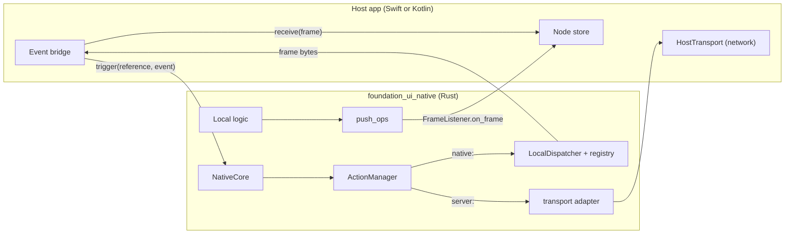

# Feature 13: The native core and commands

_Written in ASD-STE100 Simplified Technical English (STE). Code and identifiers stay as they
are._

**Abbreviations in this file.** user interface (UI); foreign function interface (FFI);
Unified Foreign Function Interface generator (UniFFI); WebAssembly (WASM); continuous
integration (CI); software development kit (SDK); identifier (id); AeroSpace and Defence
Industries Association of Europe (ASD), the owner of the STE standard ASD-STE100.

**Phase gate.** Do not start this feature before the browser scenario of feature 10 is
recorded as passed in `progress.md` (D4).

## 1. Goal

A new crate, `backends/foundation_ui_native`, is the Rust core that an iOS or Android app
compiles in. It wraps the shared `ActionManager` and `LocalDispatcher`, so `native:` actions
run on the device with no network and `server:` actions go out through a transport that the
host app implements. Frames cross the boundary as one byte buffer for each frame. A platform
effect is a `NativeCommand` op in a frame; Rust never calls a platform API.

## 2. Story

- **S1**: "An app starts the core with its registry and gets the hello bytes."
- **S2**: "A user taps a control that is bound to a `native:` action, and the core returns a
  frame."
- **S3**: "A user taps a control that is bound to a `server:` action, and the core sends the
  request through the host's transport."
- **S4**: "Local Rust logic changes a signal, and the host receives a frame."
- **S5**: "A local action asks for a haptic pulse."
- **S6**: "A tap names a `js:` action on a device."
- **S7**: "The host's transport fails."
- **S8**: "A local action waits on device input and output, and the app stays responsive."

| # | Use case | Actor | Trigger | Result |
|---|---|---|---|---|
| U1 | Start | Host app | `NativeCore::new(config)` then `hello()` | `ClientHello` bytes for `mount: Native` |
| U2 | Trigger | Host event bridge | `core.trigger(reference, event).await` | Frame bytes, or a `CoreError` |
| U3 | Push | Local logic | `core.push_ops(ops)` | The frame listener gets frame bytes |
| U4 | Command | Local action | A `NativeCommand` op in its response | The op is in the frame; the host runs it (features 14, 15) |

## 3. Bounded context

**Inside this feature:** `NativeCore`, `CoreConfig`, `CoreError`, `HostTransport`,
`FrameListener`, `EventInput`, the UniFFI exports, the binding generator binary, the
`command` constructor helpers.

**Outside:**

| Thing | Owner |
|---|---|
| `ActionRegistry`, `ActionManager`, `ActionTransport`, `TriggerEvent`, `Surface` | Feature 05 |
| `Dispatcher`, `LocalDispatcher`, `Connection` | Feature 07 |
| `PlainStateCodec` | Feature 04 |
| `gate`, `write_ops`, `StreamSequencer`, `ClientCaps` | Feature 03 |
| The network (`URLSession`, `OkHttp`) and the session | The host app, behind `HostTransport` |
| Reading frames, the node store, running a `NativeCommand` | Features 14 and 15 |
| The app's own actions and its registry | The app's Rust crate |
| The update policy of native apps | Not a concern (D33) |

| Entity | Meaning | Owner (the one writer) |
|---|---|---|
| `NativeCore` | One core for one app process | The app's Rust crate builds it |
| Local stream sequencer | Sequence ids of pushed frames | `NativeCore` |

| Verb | Kind | Trigger | Effect |
|---|---|---|---|
| `trigger` | story | A host event | Delegates to `ActionManager::trigger` |
| `push_ops` | entity | Local logic | Gate for native, encode, call the listener |
| `hello` | entity | Host start | Builds bytes |

**Words.** "Host" is the Swift or Kotlin app. "Core" is this crate inside the app. "Local
logic" is Rust code in the app that owns signals and sends frames.

## 4. Rules

### 4.1 Law worksheet

```
Entity: NativeCore
Conserved value:         its surface is { platform, mount: Native } for its whole life
Bound:                   one frame listener at a time
Inverse pairs:           set_frame_listener / clear_frame_listener
Idempotent verbs:        hello (the same bytes for the same registry)
Ordering pairs:          none
Monotone values:         the sequence ids of pushed frames strictly increase
Freeze points:           the registry and the platform are fixed at construction
Links to other entities: hello.action_registry_hash == registry.hash_for(surface)
```

### 4.2 Invariants

| # | Invariant |
|---|---|
| I1 | `trigger` gives the same result as `ActionManager::trigger` with the same registry, surface and transports. The core adds no route rule of its own. |
| I2 | A `js:` reference gives `CoreError::UnavailableOrigin`. The core has no script field and no way to run a script. |
| I3 | Every frame that leaves the core for the host passed the gate for `mount: Native`: it holds no `Web` form. |
| I4 | One call across the boundary carries one whole frame or one whole request. The core makes no call for each op. |
| I5 | `hello` gives a valid `ClientHello` with `mount: Native`, the platform of the config and the registry hash for that surface. |
| I6 | The core calls no platform API. A platform effect leaves the core only as a `NativeCommand` op. |
| I7 | `trigger` is `async`, and it does not block a thread while a local action or the host transport waits. |
| I8 | With no frame listener, `push_ops` returns `CoreError::NoListener` and uses no sequence id. |

### 4.3 Must have

- The crate with `crate-type = ["lib", "staticlib", "cdylib"]`.
- UniFFI at its latest stable version, in `[workspace.dependencies]`, in proc-macro mode.
- A binary `uniffi-bindgen` in the crate that generates the Swift and Kotlin bindings.

### 4.4 Must do

- Use `PlainStateCodec` for local actions (D5: on device, view and logic are in one signed
  app).
- Map every `ManagerError` to one `CoreError` case.

### 4.5 Must not

- Do not download or load code: no WASM module, no script, no dynamic library (App Store
  guideline 2.5.2; research 11 section 3.4).
- Do not decode frames in Rust for the render path. Swift and Kotlin read them (owner
  answer Q12).
- Do not add a second action registry model or a second manager.

## 5. Acceptance scenarios

Tests use a `RecordingHost` that implements `HostTransport` and `FrameListener` in Rust.

```gherkin
Feature: Native core and commands

  Scenario: The hello names a native mount
    Given a NativeCore for platform Ios with Toggle under Origin::Native
    When the host calls hello()
    Then read_client_hello gives platform Ios, mount Native, schema_version 1
    And action_registry_hash equals registry.hash_for(Surface { Ios, Native })

  Scenario: A native action runs on the device
    Given the same core and no host transport
    When the host awaits trigger("native:toggle", event for node 42)
    Then the result is a frame with body Ops and ack_action 1
    And the RecordingHost transport received nothing

  Scenario: A server action goes through the host transport
    Given a core with a declared server:increment_counter and a RecordingHost that answers frame_ops_counter.bin
    When the host awaits trigger("server:increment_counter", event for node 42 with state bytes [1,2,3])
    Then the RecordingHost received one ActionRequest with that action and state bytes [1,2,3]
    And the result equals frame_ops_counter.bin

  Scenario: A js reference is unavailable on a device
    Given a registry that declares js:open_picker
    When the host awaits trigger("js:open_picker", event)
    Then the result is CoreError::UnsupportedAction

  Scenario: A local action asks for a haptic pulse
    Given a native action that returns UIUpdate([command::haptic()])
    When the host awaits trigger for it
    Then the frame holds one NativeCommand with command HAPTIC

  Scenario: A web form from a local action does not reach the host
    Given a native action that returns UIUpdate([SetText(42,"x"), HtmlMorph(node 40,"<b>x</b>")])
    When the host awaits trigger for it
    Then the frame holds SetText(42,"x") only

  Scenario: Local logic pushes a frame to the listener
    Given a core with a RecordingHost as the frame listener
    When local logic calls push_ops([SetText(42,"1")]) and then push_ops([SetText(42,"2")])
    Then the listener received two frames with sequence 1 and 2 and ack_action 0

  Scenario: A push with no listener is an error
    Given a core with no frame listener
    When local logic calls push_ops([SetText(42,"1")])
    Then the call fails with CoreError::NoListener
    And after a listener is set, the next push has sequence 1

  Scenario: A transport failure is a typed error
    Given a RecordingHost whose transport fails with "offline"
    When the host awaits trigger("server:increment_counter", event)
    Then the result is CoreError::Transport { detail: "offline" }

  Scenario: A waiting local action does not block the caller
    Given a native action that awaits a channel
    When the host starts trigger and then sends on the channel from another task
    Then trigger completes with a frame
```

The `js:` scenario gives `UnsupportedAction`, not `UnavailableOrigin`: `declare_js` gives
the entry the scope `Web`, and the scope check of the registry runs first (feature 05
section 6.5, row 2). A `js:` reference with no entry gives `UnknownAction`. I2 covers the
third case, an entry that a wrong registry made with another scope.

## 6. Technical breakdown



_The diagram shows the two directions across the boundary. Each call carries one whole
request or one whole frame._

### 6.1 Measured facts

| Fact | Source |
|---|---|
| The workspace has no UniFFI, cbindgen, Swift or Kotlin code | `research/06-native-rendering.md` section 2; `grep -rn uniffi Cargo.toml backends/*/Cargo.toml` gives nothing (2026-11-13) |
| UniFFI in proc-macro mode exports `async fn` methods as Swift `async` functions and Kotlin `suspend` functions, and supports traits that the foreign side implements, including async methods | UniFFI user guide, sections "Procedural macros", "Async/Future support" and "Foreign traits" |
| UniFFI passes `Vec<u8>` as `Data` in Swift and `ByteArray` in Kotlin, by copy | UniFFI user guide, "Built-in types" |
| CI tests every crate on Linux, macOS and Windows; an OS opt-out needs a reason | `CLAUDE.md` rule 15; `ci/packages.toml` header |

The executor reads the UniFFI guide of the pinned version before writing the exports. If an
attribute name in section 6.3 differs in that version, use the name of that version and
keep the surface.

### 6.2 Files

```
backends/foundation_ui_native/
├── Cargo.toml
├── src/
│   ├── lib.rs            uniffi::setup_scaffolding!(); re-exports
│   ├── core.rs           NativeCore, CoreConfig
│   ├── host.rs           HostTransport, FrameListener, the ActionTransport adapter
│   ├── error.rs          CoreError
│   ├── input.rs          EventInput
│   ├── command.rs        NativeCommand constructors
│   └── bin/uniffi_bindgen.rs
├── tests/{mod.rs,core_tests.rs,core_push_tests.rs,support.rs}
scripts/ui_native/generate-bindings.sh
```

`scripts/ui_native/generate-bindings.sh` builds the crate for the host and runs the
bindgen binary in library mode to write Swift to `native/ios/EweUI/Sources/EweCoreFFI/`
and Kotlin to `native/android/ewe-ui/core/src/main/kotlin/`. Features 14 and 15 call it.
The generated bindings are checked in, with the same drift check pattern as
`scripts/ui_wire/check.sh`.

### 6.3 Public API

```rust
/// The configuration of one core.
pub struct CoreConfig {
    pub ctx: foundation_ui_runtime::Ctx,
    pub registry: Arc<ActionRegistry>,
    /// Ios or Android.
    pub platform: Platform,
    pub writer: WriterConfig,
}

/// Implemented by the host app: carries one ActionRequest to the server, returns one Frame.
#[uniffi::export(with_foreign)]
#[async_trait::async_trait]
pub trait HostTransport: Send + Sync {
    async fn send(&self, request: Vec<u8>) -> Result<Vec<u8>, CoreError>;
}

/// Implemented by the host app: receives frames from local logic.
#[uniffi::export(with_foreign)]
pub trait FrameListener: Send + Sync {
    fn on_frame(&self, frame: Vec<u8>);
}

/// The event fields that the host event bridge collects.
#[derive(uniffi::Record, Clone, Debug, PartialEq)]
pub struct EventInput {
    pub node_id: u32,
    pub event_name: String,
    pub value: String,
    pub checked: bool,
    pub parent_node: u32,
    /// The sealed state bytes of the component root, as the node record holds them.
    pub state: Vec<u8>,
}

#[derive(uniffi::Error, Clone, Debug, PartialEq, Eq)]
pub enum CoreError {
    BadReference { detail: String },
    UnknownAction { reference: String },
    UnsupportedAction { reference: String },
    UnavailableOrigin { origin: String },
    Transport { detail: String },
    NoListener,
    Write { detail: String },
}

#[derive(uniffi::Object)]
pub struct NativeCore { /* manager: ActionManager, sequencer: Mutex<StreamSequencer>,
    listener: Mutex<Option<Arc<dyn FrameListener>>>, registry, surface, writer */ }

impl NativeCore {
    /// Plain Rust constructor, for the app's own Rust crate.
    #[must_use] pub fn new(config: CoreConfig, server: Option<Arc<dyn HostTransport>>) -> Arc<Self>;
    /// Sends ops from local logic to the host as one frame on the local stream (stream id 0).
    pub fn push_ops(&self, ops: Vec<OpT>) -> Result<u64, CoreError>;
}

#[uniffi::export]
impl NativeCore {
    /// ClientHello bytes for this app.
    pub fn hello(&self) -> Vec<u8>;
    /// Runs or sends one action. Returns the bytes of the answer frame.
    pub async fn trigger(&self, reference: String, event: EventInput) -> Result<Vec<u8>, CoreError>;
    pub fn set_frame_listener(&self, listener: Arc<dyn FrameListener>);
    pub fn clear_frame_listener(&self);
}

// command.rs: constructors for the NativeCommand ops of schema version 1
#[must_use] pub fn haptic() -> OpT;                       // NativeCommandId::HAPTIC, no args
#[must_use] pub fn open_url(url: &str) -> OpT;            // OPEN_URL, arg "url": Text
#[must_use] pub fn share(text: &str) -> OpT;              // SHARE, arg "text": Text
```

If the pinned UniFFI does not need `async_trait` for an exported async trait, do not add
the dependency.

**How the app exposes the core.** The app's own Rust crate builds the registry and the
`CoreConfig`, and exports one function with `#[uniffi::export]` that returns
`Arc<NativeCore>` and takes the host's `Arc<dyn HostTransport>`. The framework crate does
not hold a global core.

### 6.4 Behaviour

**`new`**: `surface = Surface { platform, mount: Native }`. Build a `Dispatcher` with
accept origin `Native`, the registry, `PlainStateCodec` and a `DefaultDelivery` with
`config.writer`. Build `Connection::stateless(ClientCaps::native_current(platform),
surface, Session::new("device"), "device", 0)` and a `LocalDispatcher`. Build the
`ActionManager` for the surface with the local transport, and with the server transport
when `server` is `Some` (an adapter that implements `ActionTransport` by calling
`HostTransport::send` and mapping `CoreError` to `TransportError`).

**`trigger`**: build `TriggerEvent { node_id, input: ActionInputT { event_name, value,
checked, key_code: 0, modifiers: 0, parent_node }, state }`; call `manager.trigger`.

| `ManagerError` | `CoreError` |
|---|---|
| `BadReference(e)` | `BadReference { detail: e as text }` |
| `UnknownAction` | `UnknownAction` |
| `UnsupportedAction` | `UnsupportedAction` |
| `UnavailableOrigin { origin }` | `UnavailableOrigin { origin: origin.prefix() }` |
| `Transport(e)` | `Transport { detail }` |

**`push_ops`**, in order: take the listener (clone the `Arc` and release the lock); `None`
gives `NoListener`. Lock the sequencer; `header = FrameHeader { stream_id: 0, sequence_id:
last + 1, ack_action: 0 }`; `write_ops(ops, &ClientCaps::native_current(platform), header,
&writer)`; an error gives `Write` and the sequencer does not move; else `next()`; unlock;
call `listener.on_frame(bytes)`; return the sequence id. The listener is called outside
both locks.

**`hello`**: `ClientHelloT { schema_version: SCHEMA_VERSION, vocabulary_version:
VOCABULARY_VERSION, action_registry_hash: registry.hash_for(surface), platform, mount:
Native, stream_id: 0, resume_from: 0 }`, then `finish_client_hello`.

**Local logic and signals.** A device `App` (`foundation_wasm_ui::App`) lives on one thread
because signals are not `Send`. After feature 12 it takes a `ProtocolMethods<Vec<OpT>>`.
Give it a sink whose `encode_and_write` calls `core.push_ops(ops)`:
`pub struct CoreSink { core: Arc<NativeCore> }` in `core.rs`, with the same shape as
`FrameBroadcastSink` of feature 11. It needs `foundation_wasm_ui` as an optional
dependency behind the feature `app` (default off), so a core with no signal App does not
pull it in.

### 6.5 Fault tables

**`trigger`**

| Step that fails | What the system does | What the caller sees | What is left behind |
|---|---|---|---|
| The manager's checks | Returns | `BadReference`, `UnknownAction`, `UnsupportedAction`, `UnavailableOrigin` | nothing |
| The host transport | Returns | `Transport` | The manager's sequence counter moved by one (feature 05 section 6.6) |
| The local action returns `Response::Error` | The dispatcher encodes it | `Ok(frame)` whose body is `Error`. The host reader shows it (features 14, 15) | What the action changed |

**`push_ops`**

| Step that fails | What the system does | What the caller sees | What is left behind |
|---|---|---|---|
| No listener | Returns | `NoListener` | nothing |
| Encode | Returns | `Write` | nothing; no sequence id used |
| The listener panics on the foreign side | UniFFI reports a foreign exception; `push_ops` does not catch it | A panic in the caller of `push_ops` (local logic) | The sequence id was used. The host's ordering rule sees no gap because the frame was delivered to the failing listener; the app's own error handling decides |

### 6.6 CI

- The Rust tests of this crate run on Linux, macOS and Windows with the default set
  (rule 15). They use Rust fakes for the two foreign traits.
- Add two compile checks to the full run (rule 16): `cargo check -p foundation_ui_native
  --target aarch64-apple-ios` on the macOS job and `cargo check -p foundation_ui_native
  --target aarch64-linux-android` on the Linux job. Add the two targets to
  `rust-toolchain.toml` `targets`. A check is not a test (rule 15); the tests on device
  hosts are in features 14 and 15.

## 7. Tests

All in `backends/foundation_ui_native/tests/`.

| Law or scenario | Test | Oracle |
|---|---|---|
| I1 | `core_tests.rs::trigger_matches_the_manager` (the same registry and fakes through `NativeCore` and through a hand-built `ActionManager`, for 6 references: native ok, server ok, unknown, unsupported, bad text, no server transport) | metamorphic |
| I2; Scenario: js on a device | `core_tests.rs::js_reference_never_runs` (declared with scope Web: `UnsupportedAction`; not declared: `UnknownAction`) | expected outcome |
| I3; Scenario: a web form does not reach the host | `core_tests.rs::local_answer_has_no_web_form`; `core_push_tests.rs::pushed_frame_has_no_web_form` | example |
| I4 | `core_tests.rs::one_boundary_call_per_action` (the `RecordingHost` counts calls: 1 for a server action, 0 for a native action); `core_push_tests.rs::one_listener_call_per_push` | example |
| I5; Scenario: hello | `core_tests.rs::hello_names_a_native_mount` | example |
| I6 | A review item in "Done when": `grep -rn "objc\|jni\|UIKit\|android" backends/foundation_ui_native/src` finds nothing | expected outcome |
| I7; Scenario: a waiting local action | `core_tests.rs::waiting_action_does_not_block` (two futures driven by the test executor that features 05 and 07 use) | example |
| I8; Scenarios: push, no listener | `core_push_tests.rs::pushes_have_increasing_sequence`, `::push_with_no_listener_uses_no_sequence` | example, fault |
| Scenarios: native action, server action, haptic, transport failure | `core_tests.rs::native_action_runs_on_device`, `::server_action_uses_host_transport`, `::haptic_is_a_command_op`, `::transport_failure_is_typed` | example |
| The error mapping table | `core_tests.rs::manager_errors_map_one_to_one` | example |
| Bindings are current | `scripts/ui_native/generate-bindings.sh --check` in the CI step of feature 14 | expected outcome |

## 8. Tasks

- [ ] 1. Add UniFFI to `[workspace.dependencies]`; create the crate; add the two Rust targets.
- [ ] 2. `error.rs`, `input.rs`, `host.rs` with the adapter.
- [ ] 3. `NativeCore::new`, `hello`, with tests.
- [ ] 4. `trigger` with tests.
- [ ] 5. `push_ops`, the listener methods, with tests.
- [ ] 6. `command.rs` with a test.
- [ ] 7. `CoreSink` behind the `app` feature (after feature 12).
- [ ] 8. The bindgen binary and `scripts/ui_native/generate-bindings.sh`.
- [ ] 9. `ci/packages.toml` section; the two compile checks in CI.
- [ ] 10. Update `progress.md` and `learnings.md`.

## 9. Verify

```bash
cargo fmt --all -- --check
cargo check  -p foundation_ui_native --profile uat
cargo clippy -p foundation_ui_native --profile uat --no-deps -- -D warnings
cargo test   -p foundation_ui_native --profile uat
cargo clippy -p foundation_ui_native --profile uat --no-deps --features app -- -D warnings
cargo test   -p foundation_ui_native --profile uat --features app
cargo check  -p foundation_ui_native --target aarch64-linux-android
cargo check  -p foundation_ui_native --target aarch64-apple-ios      # on macOS
python3 scripts/ci/ci.py plan
```

## 10. Done when

- [ ] All tasks are complete and every command of section 9 passes with no warning.
- [ ] Each invariant and each scenario has a passing test (section 7).
- [ ] The crate calls no platform API (I6).
- [ ] No lock is held across an `.await` or across a listener call.
- [ ] The check list of the `story-driven-specification` skill passes.

---

_Created: 2026-11-13_
