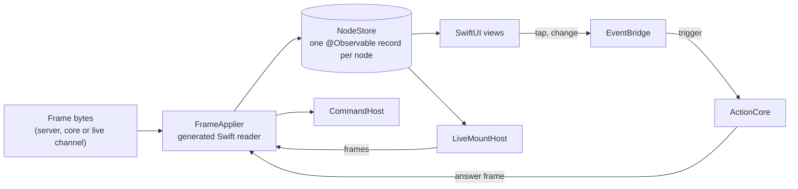

# Feature 14: The iOS renderer

_Written in ASD-STE100 Simplified Technical English (STE). Code and identifiers stay as they
are._

**Abbreviations in this file.** user interface (UI); Server-Sent Events (SSE); hypertext
transfer protocol (HTTP); JavaScript Object Notation (JSON); continuous integration (CI);
browser view embedded in an app (WebView); identifier (id); AeroSpace and Defence
Industries Association of Europe (ASD), the owner of the STE standard ASD-STE100.

## 1. Goal

A Swift package, `native/ios/EweUI`, renders frames with SwiftUI. A generated reader edits a
node store. Each node is one observable record, so a change to node 42 recomposes only the
view of node 42. Native controls give focus, gestures and accessibility. Events go to the
action core of feature 13. Live mounts open channels with the same semantics as the web.
A reference model in Rust gives the expected store for each fixture frame; the Swift store
must match it, and so must the Kotlin store of feature 15.

## 2. Story

- **S1**: "The app receives a frame, and the screen shows the change."
- **S2**: "A user taps a button, and the bound action runs."
- **S3**: "A screen has a live region that follows a server stream."
- **S4**: "A local action asks for a haptic pulse, and the phone gives it."
- **S5**: "A screen mounts a WebView that renders the web runtime."
- **S6**: "A frame holds a web form."
- **S7**: "A frame names a node that the store does not have."
- **S8**: "A frame holds a node kind that this app version does not know."
- **S9**: "A live channel drops, and the region resumes."

| # | Use case | Actor | Trigger | Result |
|---|---|---|---|---|
| U1 | Apply | Host | `store.receive(frame)` | The store changed; the views of the changed records recompose |
| U2 | Event | User | A tap or a change on a control | `core.trigger(reference, input)`; the answer frame is applied |
| U3 | Live mount | Store | A `LiveMount` record enters the tree | `LiveMountHost` opens the channel and feeds frames |
| U4 | Command | Store | A `NativeCommand` op | `CommandHost` runs the platform effect |
| U5 | Report | Store | A form or id it cannot apply | A `Report`; the batch continues |
| U6 | WebView | Store | `NativeControl(WEB_VIEW)` | A `WKWebView` that loads the given URL |

## 3. Bounded context

**Inside this feature:** the reference model `foundation_ui_wire::reference` and its
snapshots; the Swift package (`EweWire`, `EweUI`, `EweUITests`); the binding of
`NativeCore`; the example app `examples/ui_counter_ios`; the build script; the CI step.

**Outside:**

| Thing | Owner |
|---|---|
| The schema, the generated Swift (`generated/swift`), the fixtures | Feature 01 |
| The core vocabulary and the form table | Feature 02 |
| The tier 2 column layout | Feature 03 section 6.4 |
| `NativeCore`, `EventInput`, `HostTransport`, `FrameListener`, the UniFFI bindings | Feature 13 |
| SwiftUI, the render pass, focus, gestures, dynamic type, accessibility | Apple platform. Do not rebuild it (research 06 section 3.5) |
| The web runtime inside a WebView | Features 09 to 11 |
| Behaviour bindings beyond what the native control gives | Feature 16 |

| Entity | Meaning | Owner (the one writer) |
|---|---|---|
| `NodeStore` | node id to `NodeRecord`; reports; stream cursors | `FrameApplier`, on the main actor |
| `NodeRecord` | One node: kind, props, text, children, actions, state bytes, live mount, control | `FrameApplier` |
| Channel | One open SSE, WebSocket or HTTP connection of a live mount | `LiveMountHost` |

| Verb | Kind | Trigger | Effect |
|---|---|---|---|
| `receive` | story | Frame bytes | Order, then apply each row to the store |
| `send` (event bridge) | story | A control event | Harvest state, call the core, apply the answer |
| `open`, `close` (live mount) | entity | A record enters or leaves the tree | Opens or closes a channel |

**Words.** "Record" is a `NodeRecord`. "Screen root" is the record with id 1, which exists
before the first frame. "Reference model" is the Rust function that says what a store must
hold after a frame.

## 4. Rules

### 4.1 Law worksheets

```
Entity: NodeStore
Conserved value:         every record except the screen root has exactly one parent or is detached; a child id appears in one children list at most
Bound:                   none
Inverse pairs:           CreateNode / Remove
Idempotent verbs:        SetText, SetProp, BindAction, AttachState with equal arguments
Ordering pairs:          rows of one frame apply in order; live frames of one stream apply in sequence_id order
Monotone values:         the cursor of a stream never decreases
Freeze points:           the screen root (id 1) is never removed
Links to other entities: the store after a frame equals the reference model's store for that frame
```

```
Entity: NodeRecord
Conserved value:         its id never changes
Bound:                   none
Inverse pairs:           BindAction / UnbindAction
Idempotent verbs:        see the store
Ordering pairs:          none
Monotone values:         none
Freeze points:           the state bytes are never edited, only replaced whole
Links to other entities: none
```

### 4.2 Invariants

| # | Invariant |
|---|---|
| I1 | For each conformance fixture, the JSON snapshot of the Swift store after `receive` equals the checked-in expected snapshot of the reference model. |
| I2 | A `Web` form is never applied. It adds a report `UnsupportedPlatformOp` with the row index, and the next row applies. Its string is never rendered and never run. |
| I3 | A row that names an unknown node changes nothing, adds a report `UnknownNode`, and the next row applies. |
| I4 | A change to one record notifies only the observers of that record. |
| I5 | `receive` returns after the store is edited. No scheduler sits between the reader and the store (research 06 section 3.5). |
| I6 | Live frames of one stream apply in strictly increasing sequence order; an answer frame (`ack_action != 0`) applies at once; a frame with sequence 0 is out of band. The rule is the rule of feature 09 section 6.4. |
| I7 | The state bytes that the event bridge sends equal the bytes of the last `AttachState` of the nearest ancestor-or-self record that has state. |
| I8 | A live mount opens its channel when its record is attached under the screen root and closes it when the record is removed. |
| I9 | A `NativeCommand` with an unknown command id adds a report `UnknownCommand` and runs nothing. |
| I10 | The package holds no script engine and loads no code from the network. |

### 4.3 Must have

- Minimum platforms: iOS 17, macOS 14 (for `swift test`). Swift tools version 5.9.
- The FlatBuffers Swift runtime at the version of the pinned `flatc`.
- `EweUI` does not import the UniFFI module. It uses the protocol `ActionCore`. A separate
  target, `EweCoreBinding`, adapts `NativeCore` to it.

### 4.4 Must do

- Read every frame through the generated reader, after the FlatBuffers verifier accepted
  the buffer.
- Show a fallback view for an `UNKNOWN` kind and report it.
- Run the store on the main actor.

### 4.5 Must not

- Do not decode frames in Rust for rendering (owner answer Q12).
- Do not add a tree compare. Each op names its node.
- Do not implement focus, gestures, dismiss or dynamic type by hand when the SwiftUI
  control gives them.

## 5. Acceptance scenarios

```gherkin
Feature: iOS renderer

  Scenario: A frame builds a tree in the store
    Given an empty store with the screen root
    When the store receives native_tree.bin
    Then the store snapshot equals native_tree.expected.json

  Scenario: Columns give the same store as typed ops
    Given two empty stores
    When one receives native_tree.bin and the other receives native_columnar.bin
    Then both snapshots are equal

  Scenario: A web form is reported and skipped
    Given a store after native_tree.bin
    When the store receives native_mixed.bin
    Then the snapshot equals native_mixed.expected.json
    And its reports hold { code: "UnsupportedPlatformOp", row: 1, op: 12 }
    And its commands hold one HAPTIC

  Scenario: A text change notifies one record
    Given a store after native_tree.bin with observation counters on records 41 and 42
    When the store receives a frame with SetText(42, "2")
    Then the counter of record 42 is 1 and the counter of record 41 is 0

  Scenario: A subtree replace drops the old children
    Given a store after native_tree.bin
    When the store receives native_replace.bin
    Then the snapshot equals native_replace.expected.json

  Scenario: A tap sends the state of the component root
    Given a store after native_tree.bin, where record 40 has state bytes S and record 42 has TAP bound to "server:increment_counter"
    And a fake ActionCore that answers frame_ops_counter.bin
    When the event bridge sends TAP for record 42
    Then the fake core got reference "server:increment_counter" and EventInput
      { node_id: 42, event_name: "tap", parent_node: 40, state: S }
    And the store applied the answer: record 42 has the text "1"

  Scenario: An unbound event sends nothing
    Given record 41 has no action for TAP
    When the event bridge sends TAP for record 41
    Then the fake core got no call

  Scenario: A live mount opens and closes its channel
    Given a fake ChannelFactory
    When the store receives LiveMount(node 50, Stream, channel 9, Sse, "https://x/live", 0) and AppendChild(1, 50)
    Then the factory opened one SSE channel to "https://x/live"
    When the store receives Remove(50)
    Then that channel is closed

  Scenario: A live gap resumes
    Given an open live mount for stream 9 whose cursor is 19
    When a frame with sequence 21 arrives and the gap timer fires
    Then the channel was closed and opened again with stream_id 9 and resume_from 19

  Scenario: An unknown command is reported
    When the store receives a frame with NativeCommand(command 999)
    Then the reports hold { code: "UnknownCommand", row: 0 }
    And the CommandHost ran nothing

  Scenario: Bad bytes are rejected
    When the store receives 16 bytes of 0xFF
    Then receive returns false and the reports hold { code: "BadFrame" }
    And the store did not change
```

## 6. Technical breakdown



_The diagram shows the path of a frame to the screen and the path of an event back to an
action._

### 6.1 Measured facts

| Fact | Source |
|---|---|
| `ViewKind::Native` is a type only; no Swift code exists in the workspace | `backends/foundation_ui_traits/src/platform_types.rs:175-187`; `research/06-native-rendering.md` section 2 |
| The owner fixed: Swift and Kotlin generated readers edit the node store; iOS 17 and Android API 26; one observable record per node (`@Observable`) | `research/questions.md` Q12, Q13; `research/06-native-rendering.md` section 3.1 |
| The Observation framework (`@Observable`, `withObservationTracking`) is in iOS 17 and macOS 14 | Apple documentation, "Observation" |
| `flatc --swift` output uses the `FlatBuffers` Swift package of the `google/flatbuffers` repository | FlatBuffers documentation, "Use in Swift" |
| macOS and Windows jobs run only on full runs | `CLAUDE.md` rule 16 |

### 6.2 The reference model (Rust, shared with feature 15)

Add to `backends/foundation_ui_wire`, behind the feature `reference` (default off):

```rust
// src/reference.rs
pub struct RefStore { /* BTreeMap<u32, RefNode>, reports, commands, cursors */ }
impl RefStore {
    /// A store with the screen root: id 1, kind STACK.
    #[must_use] pub fn new() -> Self;
    /// Applies one frame with the rules of section 6.3. Returns false for a rejected frame.
    pub fn receive(&mut self, bytes: &[u8]) -> bool;
    /// The snapshot as JSON text with a fixed key order (section 6.4).
    #[must_use] pub fn snapshot_json(&self) -> String;
}
```

`tests/reference_tests.rs` builds the conformance frames with `write_ops` for
`ClientCaps::native_current(Platform::Ios)`, except `native_mixed.bin`, which it builds
with `finish_frame` directly so that it holds a web form (the gate would remove it; the
fixture tests the reader's own defence). It writes the frames and the snapshots under
`backends/foundation_ui_wire/fixtures/native/` with `UPDATE_FIXTURES=1` and compares them
without it.

| Fixture | Content |
|---|---|
| `native_tree.bin` | `CreateNode(40, STACK)`, `SetProp(40, PADDING, 8 Point)`, `SetProp(40, AXIS, Vertical)`, `CreateNode(41, TEXT)`, `SetText(41, "Count")`, `AppendChild(40, 41)`, `CreateNode(42, BUTTON)`, `SetText(42, "0")`, `BindAction(42, TAP, "server:increment_counter")`, `AppendChild(40, 42)`, `AppendChild(1, 40)`, `AttachState(40, state_counter.bin)`; header 7/1/1 |
| `native_columnar.bin` | The same ops, written with threshold 0 |
| `native_mixed.bin` | `SetText(42, "a")`, `HtmlMorph(node 40, ReplaceChildren, "<b>x</b>")`, `NativeCommand(HAPTIC)`, `SetText(999, "x")`, `SetText(42, "b")`; header 7/2/2 |
| `native_replace.bin` | `ReplaceSubtree(40, [CreateNode(43, TEXT), SetText(43, "new"), AppendChild(40, 43)])`; header 7/3/3 |
| `native_unknown_kind.bin` | `CreateNode(60, UNKNOWN)`, `AppendChild(1, 60)`; header 7/4/4 |

Each has an `.expected.json` next to it. `native_mixed` and `native_replace` are applied
after `native_tree`; the snapshot is of the final store.

### 6.3 The apply rules

These rules are the contract for the reference model, the Swift store and the Kotlin store.

| Form | Effect on the store |
|---|---|
| `CreateNode` | Insert a record with that kind and no parent. If the id exists: replace the record, detach it from its parent, report `DuplicateNode`. Kind `UNKNOWN` or a number above the known kinds: kind `UNKNOWN`, report `UnknownKind` |
| `SetText` | `record.text = text` |
| `SetProp` | `record.props[prop] = value`. An unknown `PropId`: report `UnknownProp`, no change |
| `AppendChild` | Detach the child from its old parent; append its id to the parent's children |
| `InsertBefore` | Detach the child; insert it before `before_id` in the parent's children. `before_id` not a child of the parent: report `UnknownNode`, no change |
| `Remove` | Detach the node; delete it and every descendant |
| `ReplaceSubtree` | Delete every descendant of the node; clear its children; apply the nested rows with the same rules |
| `BindAction` | `record.actions[event] = action` |
| `UnbindAction` | Remove `record.actions[event]` |
| `AttachState` | `root.state = bytes` (the exact bytes) |
| `LiveMount` | Insert a record with kind `STACK` and `live = { kind, channel_id, transport, endpoint, resume_from }` |
| `NativeControl` | Insert a record with kind `UNKNOWN` replaced by `control = { control, args }`. An unknown control id: report `UnknownControl`, and the record shows the fallback view |
| `NativeCommand` | Append `{ command, args }` to the command list (the host runs it). An unknown command id: report `UnknownCommand`, nothing appended |
| Any `Web` form (12 to 22) | Report `UnsupportedPlatformOp { row, op }` |
| Union `NONE` or a number above 24 | Report `UnknownOp { row }` |

A row that names a node id that is not in the store (as target, parent or child) reports
`UnknownNode { row, node }` and changes nothing. Node id 1 is the screen root. Ids 0 and 2
are not in a native store.

Bodies: `Ops` and `Columnar` use the rows above (tier 2 through the column layout of
feature 03 section 6.4). `Table`, `ArrowIpc` and `MessagePack` are passed to a data
listener of the target node; the reference snapshot records only
`{ "data": kind, "target": node }`. `Error` is recorded in `errors`. `Capabilities` is
recorded in `caps`.

Ordering: the rule of feature 09 section 6.4, with the same three classes of frame.

### 6.4 The snapshot format

```json
{
  "nodes": [
    { "id": 1, "kind": "STACK", "text": null, "props": {}, "children": [40],
      "actions": {}, "state_len": 0, "live": null, "control": null }
  ],
  "reports": [ { "code": "UnknownNode", "row": 3, "node": 999 } ],
  "commands": [ { "command": "HAPTIC", "args": {} } ],
  "errors": [],
  "data": []
}
```

- `nodes` are sorted by id. Object keys are in the order shown.
- `props` keys are the `PropId` names; values are text: a length is `"8pt"`, `"50%"` or
  `"auto"`; a token is `"color:1"` or `"font:1"`; an enum is its name; a bool is `"true"`
  or `"false"`.
- `actions` keys are the `EventId` names.
- A report has `code`, `row`, and `op` or `node` when the rule gives one.

The Swift and Kotlin tests build the same JSON and compare it as parsed JSON, so
whitespace does not matter.

### 6.5 The Swift package

```
native/ios/EweUI/
├── Package.swift
├── Sources/
│   ├── EweWire/                 generated Swift, copied from backends/foundation_ui_wire/generated/swift
│   ├── EweUI/
│   │   ├── NodeRecord.swift     @Observable final class NodeRecord
│   │   ├── NodeStore.swift      @MainActor final class NodeStore
│   │   ├── FrameApplier.swift   rows, tier 1 and tier 2 adapters, ordering
│   │   ├── Reports.swift        Report, ReportCode
│   │   ├── Snapshot.swift       snapshotJSON() for tests
│   │   ├── ActionCore.swift     protocol ActionCore; struct EventInput
│   │   ├── EventBridge.swift
│   │   ├── LiveMountHost.swift  protocol Channel, protocol ChannelFactory, URLSessionChannelFactory
│   │   ├── CommandHost.swift    protocol CommandHost; SystemCommandHost
│   │   ├── Views/NodeView.swift, CoreViews.swift, FallbackView.swift, WebViewControl.swift
│   │   └── EweScreen.swift      the root view: EweScreen(store:)
│   ├── EweCoreFFI/              UniFFI Swift, from scripts/ui_native/generate-bindings.sh
│   └── EweCoreBinding/          adapts NativeCore to ActionCore and FrameListener to the store
└── Tests/EweUITests/            XCTest; Resources/ = the fixtures, copied by the sync script
```

`scripts/ui_native/sync-ios.sh` copies the generated Swift and the fixtures into the
package; `--check` fails when a copy differs. `EweCoreFFI` and `EweCoreBinding` need the
Rust static library; `Package.swift` adds them only when the environment variable
`EWE_CORE_XCFRAMEWORK` names an `.xcframework`, so `swift test` runs with no Rust build.
`scripts/ui_native/build-ios.sh` builds `foundation_ui_native` for `aarch64-apple-ios` and
`aarch64-apple-ios-sim` and makes the `.xcframework` with `xcodebuild -create-xcframework`.

**Key types**

```swift
@Observable public final class NodeRecord {
    public let id: UInt32
    public var kind: NodeKind
    public var text: String?
    public var props: [PropId: PropValue]        // PropValue: a Swift enum over the 7 kinds
    public var children: [UInt32]
    public var actions: [EventId: String]
    public var state: Data?
    public var live: LiveMountSpec?
    public var control: NativeControlSpec?
    @ObservationIgnored public var parent: UInt32?
}

@MainActor public final class NodeStore {
    public init(gapTimeout: Duration = .milliseconds(1000),
                maxFrameBytes: Int = 4 * 1024 * 1024,
                commands: CommandHost? = nil, live: LiveMountHost? = nil)
    public func record(_ id: UInt32) -> NodeRecord?
    /// Returns false for a rejected frame. Never throws.
    @discardableResult public func receive(_ frame: Data) -> Bool
    public private(set) var reports: [Report]
    public func setCursor(stream: UInt64, sequence: UInt64)
    public var onGap: ((_ stream: UInt64, _ resumeFrom: UInt64) -> Void)?
    public var onError: ((_ code: ErrorCode, _ message: String) -> Void)?
}

public protocol ActionCore: Sendable {
    func hello() -> Data
    func trigger(reference: String, event: EventInput) async throws -> Data
}

@MainActor public final class EventBridge {
    public init(store: NodeStore, core: ActionCore)
    /// Called by a view. `event` is the lower-case EventId name: "tap", "change", ….
    public func send(_ event: EventId, node: UInt32, value: String = "", checked: Bool = false)
}

public protocol Channel: AnyObject { func close() }
public protocol ChannelFactory {
    /// Calls `onFrame` on the main actor for each frame. `transport` is sse, websocket or http.
    func open(endpoint: URL, transport: LiveTransport, streamId: UInt64, resumeFrom: UInt64,
              onFrame: @escaping @MainActor (Data) -> Void,
              onClose: @escaping @MainActor (Error?) -> Void) -> Channel
}
public protocol CommandHost { @MainActor func run(_ command: NativeCommandId, args: [String: PropValue]) -> Bool }
```

**Views.** `NodeView(id:)` reads `store.record(id)` and switches on `kind`:

| Kind | SwiftUI view | Props used |
|---|---|---|
| `STACK` | `VStack` or `HStack` by `AXIS` | `SPACING`, `ALIGN`, `PADDING`, `BACKGROUND` |
| `TEXT` | `Text(record.text ?? "")` | `COLOR`, `FONT` |
| `IMAGE` | `AsyncImage(url:)` from `SOURCE` | `WIDTH`, `HEIGHT` |
| `BUTTON` | `Button(record.text ?? "") { bridge.send(.tap, node: id) }` | `ENABLED` |
| `TEXT_INPUT` | `TextField(placeholder, text: binding)`; the binding sends `.change` with the value | `VALUE`, `PLACEHOLDER`, `ENABLED` |
| `TOGGLE` | `Toggle(isOn: binding)`; the binding sends `.change` with `checked` | `CHECKED`, `ENABLED` |
| `LIST` | `LazyVStack` of the children | `SPACING` |
| `SCROLL` | `ScrollView` of the children | — |
| `SPACER` | `Spacer()` | — |
| `OVERLAY` | A `ZStack` layer above its parent's content | `BACKGROUND` |
| `UNKNOWN` | `FallbackView`: an empty view with the accessibility label "unsupported content" | — |
| control `WEB_VIEW` | `WebViewControl`: a `WKWebView` (through `UIViewRepresentable`) that loads the `url` text argument. It loads the web runtime and says hello with `mount: Web` (D11) | — |

Every kind applies `A11Y_LABEL` (`.accessibilityLabel`), `HIDDEN`, `WIDTH` and `HEIGHT`
(`.frame`). Tokens: `ColorToken` id `n` is `Color("ewe-color-\(n)", bundle: .main)` and
`FontToken` id `n` comes from a table that the app passes to `EweScreen`. A missing asset
falls back to the primary colour and the body font.

**The event bridge `send`:** look up `record.actions[event]`; none means return. Find the
nearest ancestor-or-self with `state != nil` (walk `parent`). Build `EventInput { node_id,
event_name: lower-case event name, value, checked, parent_node: that root or 0, state: its
bytes or empty }`. Start a `Task`: `let frame = try await core.trigger(...)`,
then `store.receive(frame)` on the main actor. A thrown error goes to `store.onError` with
code `ActionFailed` and the error text.

**`LiveMountHost`:** observes store changes after each `receive`: for each record with
`live != nil` that is now attached under the screen root and has no channel, `open`; for
each channel whose record is gone, `close`. `Local` transport opens nothing: frames come
from the core's `FrameListener` (the `EweCoreBinding` target passes them to
`store.receive`). On `onGap`, close and open again with the cursor as `resumeFrom`.
`URLSessionChannelFactory`: SSE with `URLSession.bytes(for:)` reading `event:`/`data:`
lines and base64-decoding `data` (the binary frame convention of the current servers);
WebSocket with `URLSessionWebSocketTask` (one binary message is one frame); HTTP with one
`data(for:)` request whose body is size-prefixed frames. The resume parameters are the
query items `stream_id` and `resume_from`, as on the web (feature 11 section 6.5).

**`SystemCommandHost`:** `HAPTIC` gives `UIImpactFeedbackGenerator().impactOccurred()`;
`OPEN_URL` gives `UIApplication.shared.open`; `SHARE` presents a
`UIActivityViewController`. On macOS (tests) it is not compiled; tests use a fake.

### 6.6 Fault tables

**`receive`**

| Step that fails | What the system does | What the caller sees | What is left behind |
|---|---|---|---|
| Size, verifier or identifier check | Adds a report `BadFrame` or `TooLarge` | `false` | nothing |
| A row (other platform, unknown node, unknown op, unknown kind) | Adds a report; applies the next row | `true` | The other rows are applied. A frame is not atomic; each op names its node |
| The gap timer fires | Drops held frames of that stream; calls `onGap` | `onGap` | The cursor stays |

**`send`**

| Step that fails | What the system does | What the caller sees | What is left behind |
|---|---|---|---|
| No action bound | Returns | nothing | nothing |
| `core.trigger` throws | Calls `onError` | `onError(ActionFailed, text)` | The store is unchanged |
| The answer is an `Error` frame | `receive` records it; `onError` with its code | `onError` | The store is unchanged |

### 6.7 The example and CI

- `examples/ui_counter_ios`: a small Xcode project (or a Swift package app target) that
  links the `.xcframework` of the `ui_counter` core (a Rust crate
  `examples/ui_counter/native` that registers `increment_counter` as a declared server
  action and `increment_local` under `Origin::Native`, and exports the core constructor),
  with a screen that mounts two counters. Its `README.md` gives the build and simulator
  commands.
- CI, on the macOS job of full runs only (rule 16), when `native/ios/**`,
  `backends/foundation_ui_wire/**` or `backends/foundation_ui_native/**` changed:
  `scripts/ui_native/sync-ios.sh --check`, `scripts/ui_native/generate-bindings.sh --check`,
  `swift test --package-path native/ios/EweUI`, and `scripts/ui_native/build-ios.sh`
  followed by `xcodebuild build` of the example for the simulator.

## 7. Tests

Rust tests are in `backends/foundation_ui_wire/tests/`. Swift tests are in
`native/ios/EweUI/Tests/EweUITests/`.

| Law or scenario | Test | Oracle |
|---|---|---|
| The reference model follows section 6.3 | Rust `reference_tests.rs::each_rule_of_the_apply_table` (one case for each row of the table, including each report) and `::fixtures_match` | example |
| I1; Scenarios: tree, mixed, replace | `ConformanceTests.testNativeTree`, `.testNativeMixed`, `.testNativeReplace`, `.testUnknownKind` | stateful model (the reference snapshots) |
| I1 (tiers); Scenario: columns | `ConformanceTests.testColumnarEqualsOps` | metamorphic |
| I2; Scenario: web form | `ConformanceTests.testNativeMixed`; `ApplierTests.testEveryWebFormIsReported` with `frame_ops_all_forms.bin` (11 reports with ops 12 to 22) | example |
| I3 | `ApplierTests.testUnknownNodeIsReported` | example |
| I4; Scenario: one record notified | `ObservationTests.testTextChangeNotifiesOneRecord` (`withObservationTracking` on two records) | example |
| I5 | `ApplierTests.testReceiveIsSynchronous` (the record is changed on the line after `receive`) | example |
| I6; Scenario: live gap | `OrderingTests.testLiveFramesApplyInOrder`, `.testGapAsksForResume`, `.testAnswerAppliesAtOnce`, `.testDuplicateIsIgnored` (an injected clock for the timer) | stateful model |
| I7; Scenarios: tap, unbound | `EventBridgeTests.testTapSendsRootState`, `.testUnboundEventSendsNothing`, `.testTriggerErrorGoesToOnError` | example, fault |
| I8; Scenario: live mount | `LiveMountTests.testOpensOnAttachAndClosesOnRemove`, `.testLocalTransportOpensNothing`, `.testResumeReopensWithCursor` | example |
| I9; Scenario: unknown command | `ApplierTests.testUnknownCommandIsReported`, `.testHapticReachesCommandHost` | example |
| I10 | Review item: the package has no `JavaScriptCore` import and no dynamic loading call | expected outcome |
| Scenario: bad bytes | `ApplierTests.testBadBytesAreRejected`, `.testEveryPrefixIsRejectedOrApplied` | property |
| Views build | `ViewSmokeTests.testEveryKindBuilds`: host `EweScreen` in an `NSHostingView` on macOS with a store that has one node of each kind, and lay it out | example |
| I8 of feature 01 (four languages read one fixture) | `WireTests.testFixturesReadTheSameAsRust` (the field values of feature 01 section 6.7) | example |

## 8. Tasks

- [ ] 1. `reference.rs`, the conformance fixtures and snapshots, with the Rust tests.
- [ ] 2. The package skeleton; `sync-ios.sh`; `WireTests`.
- [ ] 3. `NodeRecord`, `NodeStore`, `Reports`, `Snapshot`.
- [ ] 4. `FrameApplier` tier 1 and the cross-platform rows; `ConformanceTests`.
- [ ] 5. Tier 2, the mobile rows, the web-form reports.
- [ ] 6. Ordering and the gap timer.
- [ ] 7. `ActionCore`, `EventBridge`.
- [ ] 8. `LiveMountHost` and `URLSessionChannelFactory`.
- [ ] 9. `CommandHost`.
- [ ] 10. The views and `EweScreen`; the smoke test.
- [ ] 11. `EweCoreBinding`, `build-ios.sh`, the example app.
- [ ] 12. The CI step.
- [ ] 13. Update `progress.md` and `learnings.md`.

## 9. Verify

```bash
cargo test -p foundation_ui_wire --profile uat --features reference
cargo clippy -p foundation_ui_wire --profile uat --no-deps --features reference -- -D warnings
scripts/ui_native/sync-ios.sh --check
swift build --package-path native/ios/EweUI
swift test  --package-path native/ios/EweUI
scripts/ui_native/build-ios.sh
xcodebuild -project examples/ui_counter_ios/UICounter.xcodeproj -scheme UICounter \
  -destination 'generic/platform=iOS Simulator' build
```

The last four commands need macOS with Xcode. On another host, the executor runs the first
two and reports that the Swift commands ran in the pull request's macOS CI job.

## 10. Done when

- [ ] All tasks are complete and every command of section 9 passes with no warning.
- [ ] Each invariant and each scenario has a passing test (section 7).
- [ ] The Swift snapshots equal the reference snapshots for every conformance fixture.
- [ ] The example app shows both counters working in the simulator; the run is recorded in
      `progress.md` with the date and the Xcode version.
- [ ] The check list of the `story-driven-specification` skill passes.

---

_Created: 2026-11-13_
