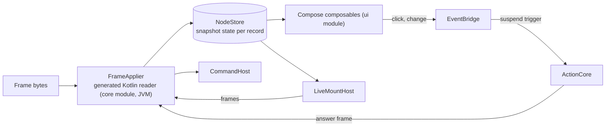

# Feature 15: The Android renderer

_Written in ASD-STE100 Simplified Technical English (STE). Code and identifiers stay as they
are._

**Abbreviations in this file.** user interface (UI); Java virtual machine (JVM); Server-Sent
Events (SSE); hypertext transfer protocol (HTTP); JavaScript Object Notation (JSON);
continuous integration (CI); software development kit (SDK); native development kit (NDK);
browser view embedded in an app (WebView); identifier (id); AeroSpace and Defence
Industries Association of Europe (ASD), the owner of the STE standard ASD-STE100.

## 1. Goal

A Kotlin library, `native/android/ewe-ui`, renders frames with Jetpack Compose. It has the
same contract as the iOS renderer of feature 14: a generated reader edits a node store, each
node is one snapshot-state record, events go to the action core of feature 13, and live
mounts follow the same rules. Its store must give the same snapshots as the reference model
of feature 14 for the same fixture frames. The store and the reader are plain JVM code, so
their tests run on Linux with no emulator.

## 2. Story

- **S1**: "The app receives a frame, and the screen shows the change."
- **S2**: "A user taps a button, and the bound action runs."
- **S3**: "A screen has a live region that follows a server stream."
- **S4**: "A local action asks for a haptic pulse, and the phone gives it."
- **S5**: "A screen holds a WebView mount row." (The control is later work, feature 18.)
- **S6**: "A frame holds a web member."
- **S7**: "A frame names a node that the store does not have."
- **S8**: "A live channel drops, and the region resumes."

| # | Use case | Actor | Trigger | Result |
|---|---|---|---|---|
| U1 | Apply | Host | `store.receive(frame)` | The store changed; only the composables that read a changed record recompose |
| U2 | Event | User | A click or a change | `core.trigger(reference, input)`; the answer frame is applied |
| U3 | Live mount | Store | A `LiveMount` record is attached | `LiveMountHost` opens the channel |
| U4 | Command | Store | A `NativeCommand` member of `MobileOperation` | `CommandHost` runs the platform effect |
| U5 | Report | Store | A member or id it cannot apply | A `Report`; the message list continues |
| U6 | WebView mount | Store | A `MountWebView` member of `MobileOperation` | The store records the row; feature 18 mounts the control (D46) |

## 3. Bounded context

**Inside this feature:** the Gradle project with the modules `core` (JVM) and `ui`
(Android); the binding of `NativeCore`; the example app; the build script; the CI steps.

**Outside:**

| Thing | Owner |
|---|---|
| The schema, the generated Kotlin (`generated/kotlin`), the fixtures | Feature 01 |
| The core vocabulary and the form table | Feature 02 |
| The `ColumnarBatch` column layout | Feature 03 section 6.4 |
| The apply rules, the snapshot format, the reference model and the conformance fixtures | Feature 14 sections 6.2 to 6.4. This feature implements them; it does not change them |
| `NativeCore`, `EventInput`, `HostTransport`, `FrameListener`, the UniFFI Kotlin bindings | Feature 13 |
| Compose, recomposition, focus, gestures, font scale, accessibility | Android platform. Do not rebuild it |
| The WebView control (`MountWebView`) | Feature 18, later work (D46) |
| Behaviour bindings (`UiBehaviour` and `MobileBehaviour`) | Feature 16 |

| Entity | Meaning | Owner (the one writer) |
|---|---|---|
| `NodeStore` | node id to `NodeRecord`; reports; stream cursors | `FrameApplier`, on the main thread |
| `NodeRecord` | One node, with each field as snapshot state: kind, props, text, children, actions, state bytes, live mount, behaviours, web view mount | `FrameApplier` |
| Channel | One open connection of a live mount | `LiveMountHost` |

| Verb | Kind | Trigger | Effect |
|---|---|---|---|
| `receive` | story | Frame bytes | Order, then apply each row |
| `send` (event bridge) | story | A control event | Harvest state, call the core, apply the answer |
| `open`, `close` (live mount) | entity | A record is attached or removed | Opens or closes a channel |

**Words.** The same as feature 14: "record", "screen root" (id 1), "reference model".

## 4. Rules

### 4.1 Law worksheets

```
Entity: NodeStore
Conserved value:         every record except the screen root has exactly one parent or is detached; a child id appears in one children list at most
Bound:                   none
Inverse pairs:           CreateNode / Remove
Idempotent verbs:        SetText, SetProp, BindAction, AttachState with equal arguments
Ordering pairs:          rows of one frame apply in order; live frames of one stream apply in sequence_id order
Monotone values:         the cursor of a stream never decreases
Freeze points:           the screen root (id 1) is never removed
Links to other entities: the store after a frame equals the reference model's store for that frame
```

```
Entity: NodeRecord
Conserved value:         its id never changes
Bound:                   none
Inverse pairs:           BindAction / UnbindAction
Idempotent verbs:        see the store
Ordering pairs:          none
Monotone values:         none
Freeze points:           the state bytes are never edited, only replaced whole
Links to other entities: none
```

### 4.2 Invariants

| # | Invariant |
|---|---|
| I1 | For each conformance fixture of feature 14, the JSON snapshot of the Kotlin store equals the checked-in expected snapshot. |
| I2 | A `web` member of an `Operation` is never applied. It adds a report `UnsupportedPlatformOp` with the row index, and the next member applies. |
| I3 | A row that names an unknown node changes nothing, adds a report `UnknownNode`, and the next row applies. |
| I4 | A write to one field of one record invalidates only the snapshot readers of that field. |
| I5 | `receive` returns after the store is edited. |
| I6 | The ordering of live, answer and out-of-band frames is the rule of feature 09 section 6.4. |
| I7 | The state bytes that the event bridge sends equal the bytes of the last `AttachState` of the nearest ancestor-or-self record that has state. |
| I8 | A live mount opens its channel when its record is attached under the screen root and closes it when the record is removed. |
| I9 | A `NativeCommand` with an unknown command id adds a report `UnknownCommand` and runs nothing. |
| I10 | The library holds no script engine and loads no code from the network. The WebView control is the only place that runs web content, and it is feature 18 (D46). |
| I11 | A `UiBehaviour` or `MobileBehaviour` adds its id or custom name to the record's behaviour set. An id or name with no registered binding adds a report `UnknownBehaviour` and changes no record. |

### 4.3 Must have

- `minSdk` 26 (owner answer Q13). Gradle 9.9.1 and Kotlin 2.4.21 from the feature 17 pins,
  written in one version catalog `gradle/libs.versions.toml`. The build runs with the pinned
  JDK 25 (`temurin-25.0.5+8.0.LTS`). The Android Gradle plugin is at its latest stable
  version.
- The FlatBuffers Java runtime (`com.google.flatbuffers:flatbuffers-java`) at the version
  of the pinned `flatc`. The Kotlin code that `flatc --kotlin` generates uses it.
- The `core` module is a Kotlin JVM library. It depends on `androidx.compose.runtime`
  (which has a JVM artifact) for snapshot state, and on no Android SDK class.

The Android SDK packages come from `mise run toolchain:android` (feature 17, D58):
platform-tools, platform 36, build-tools 36.0.0 and NDK 27.0.12077973. The feature does not
install a package by hand.

### 4.4 Must do

- Run `scripts/toolchain/check.sh` before the verify commands (feature 17). A check failure
  is a setup error, not a test failure.
- Verify every buffer before reading it: check the size limit, the length (8 bytes or
  more) and the identifier `EWF1`, then read through the generated accessors inside a
  `try`; an `IndexOutOfBoundsException` or `BufferUnderflowException` gives `BadFrame`.
  The FlatBuffers Java runtime has no verifier, so these checks and the `try` are the
  defence.
- Show a fallback composable for an `UNKNOWN` kind and report it.

### 4.5 Must not

- Do not decode frames in Rust for rendering (owner answer Q12).
- Do not add a tree compare.
- Do not implement focus, gestures or font scaling by hand when the Compose control gives
  them.
- Do not build the WebView control here. This feature stores the `MountWebView` row only;
  feature 18 builds the control (D46).

## 5. Acceptance scenarios

```gherkin
Feature: Android renderer

  Scenario: A frame builds a tree in the store
    Given an empty store with the screen root
    When the store receives native_tree.bin
    Then the store snapshot equals native_tree.expected.json

  Scenario: Columns give the same store as typed ops
    Given two empty stores
    When one receives native_tree.bin and the other receives native_columnar.bin
    Then both snapshots are equal

  Scenario: Behaviours change the record set
    Given a store after native_tree.bin
    When the store receives native_behaviour.bin
    Then the snapshot equals native_behaviour.expected.json
    And record 40 has the behaviour "SCROLL_LOCK"

  Scenario: An unknown behaviour is reported
    When the store receives a frame with UiBehaviour(40, behaviour 999)
    Then the reports hold (code UnknownBehaviour, row 0, node 40, name "999")
    And record 40 has no behaviour

  Scenario: A WebView mount row is stored
    Given an empty store with the screen root
    When the store receives a frame with CreateNode(70, STACK), MountWebView(70, 1, "https://x/ui") and AppendChild(1, 70)
    Then record 70 holds a web view mount for "https://x/ui"
    And the store built no control

  Scenario: A web member is reported and skipped
    Given a store after native_tree.bin
    When the store receives native_mixed.bin
    Then the snapshot equals native_mixed.expected.json

  Scenario: A text change invalidates one record
    Given a store after native_tree.bin with snapshot read observers on the text of records 41 and 42
    When the store receives a frame with SetText(42, "2")
    Then the observer of record 42 ran once and the observer of record 41 did not run

  Scenario: A subtree replace drops the old children
    Given a store after native_tree.bin
    When the store receives native_replace.bin
    Then the snapshot equals native_replace.expected.json

  Scenario: A click sends the state of the component root
    Given a store after native_tree.bin and a fake ActionCore that answers frame_ops_counter.bin
    When the event bridge sends TAP for record 42
    Then the fake core got reference "server:increment_counter" and EventInput
      (nodeId 42, eventName "tap", parentNode 40, state = the bytes of state_counter.bin)
    And record 42 has the text "1"

  Scenario: A live mount opens and closes its channel
    Given a fake ChannelFactory
    When the store receives LiveMount(node 50, Stream, channel 9, Sse, "https://x/live", 0) and AppendChild(1, 50)
    Then the factory opened one SSE channel to "https://x/live"
    When the store receives Remove(50)
    Then that channel is closed

  Scenario: A live gap resumes
    Given an open live mount for stream 9 whose cursor is 19
    When a frame with sequence 21 arrives and the gap timer fires
    Then the channel was closed and opened again with streamId 9 and resumeFrom 19

  Scenario: An unknown command is reported
    When the store receives a frame with NativeCommand(command 999)
    Then the reports hold (code UnknownCommand, row 0)

  Scenario: Bad bytes are rejected
    When the store receives 16 bytes of 0xFF
    Then receive returns false and the reports hold (code BadFrame)
    And the store did not change
```

## 6. Technical breakdown



_The diagram shows the same contract as iOS. The store and the reader are JVM code, so
their tests need no emulator._

### 6.1 Measured facts

| Fact | Source |
|---|---|
| No Kotlin or Gradle code for the UI exists in the workspace (`examples/platform_android` is a Tauri WebView app) | `research/06-native-rendering.md` section 2; `ls examples` |
| The owner fixed Android API 26 and one observable record per node (`mutableStateOf` per node on Compose) | `research/questions.md` Q13; `research/06-native-rendering.md` section 3.1 |
| The Compose runtime (`androidx.compose.runtime`) is a multiplatform library with a JVM artifact; snapshot state works without the Android SDK | Jetpack Compose documentation, "Compose runtime" and "Snapshot" |
| `flatc --kotlin` generates Kotlin that uses the FlatBuffers Java runtime | FlatBuffers documentation, "Use in Kotlin" |
| UniFFI generates Kotlin with `suspend` functions for exported async methods | UniFFI user guide, "Kotlin" and "Async/Future support" |
| The Linux CI job runs on every pull request; macOS and Windows only on full runs | `CLAUDE.md` rule 16 |

The executor checks the artifact names and versions against the current documentation and
records them in `learnings.md`.

### 6.2 The project

```
native/android/ewe-ui/
├── settings.gradle.kts, build.gradle.kts, gradle/libs.versions.toml, gradlew (wrapper, checked in)
├── core/                                   Kotlin JVM library
│   ├── src/main/kotlin/ewe/ui/wire/        generated Kotlin, copied from backends/foundation_ui_wire/generated/kotlin
│   ├── src/main/kotlin/ewe/ui/
│   │   ├── NodeRecord.kt, NodeStore.kt, FrameApplier.kt, Reports.kt, Snapshot.kt
│   │   ├── ActionCore.kt, EventBridge.kt
│   │   ├── LiveMountHost.kt                interface Channel, interface ChannelFactory
│   │   └── CommandHost.kt
│   └── src/test/kotlin/…                   JUnit 5; resources = the fixtures
├── ui/                                     Android library (Compose)
│   ├── src/main/kotlin/ewe/ui/compose/     NodeView.kt, CoreViews.kt, FallbackView.kt, EweScreen.kt
│   ├── src/main/kotlin/ewe/ui/compose/behaviours/  BehaviourBinding.kt, BehaviourRegistry.kt, ScrollLockBinding.kt
│   ├── src/main/kotlin/ewe/ui/android/     OkHttpChannelFactory.kt, SystemCommandHost.kt
│   └── src/test/kotlin/…                   Robolectric-free JVM tests only (section 7)
└── binding/                                Android library: UniFFI Kotlin + CoreBinding.kt
```

`scripts/ui_native/sync-android.sh` copies the generated Kotlin and the fixtures;
`--check` fails on a difference. `scripts/ui_native/build-android.sh` builds
`foundation_ui_native` for `aarch64-linux-android` and `x86_64-linux-android` with
`cargo ndk` and puts the `.so` files in `binding/src/main/jniLibs/`. `cargo-ndk` is a
toolchain pin: feature 17 adds `"cargo:cargo-ndk"` to `mise.toml` `[tools]` when this
feature needs it (D58).

The Gradle wrapper uses the feature 17 Gradle 9.9.1 distribution. The version catalog takes
Kotlin 2.4.21 from the same pin. The build runs with the pinned JDK 25: `JAVA_HOME` points at
the mise `java` tool, and the project sets `jvmToolchain(25)`.

### 6.3 Key types (`core`)

```kotlin
class NodeRecord(val id: UInt) {
    var kind by mutableStateOf(NodeKind.UNKNOWN)
    var text by mutableStateOf<String?>(null)
    val props = mutableStateMapOf<UShort, PropValue>()     // PropValue: a sealed interface over the 7 kinds
    val children = mutableStateListOf<UInt>()
    val actions = mutableStateMapOf<UShort, String>()
    var state: ByteArray? = null                           // not observed; views do not read it
    var live by mutableStateOf<LiveMountSpec?>(null)
    var behaviours by mutableStateOf<Set<String>>(emptySet())   // shared ids and custom mobile names
    var webView by mutableStateOf<WebViewMountSpec?>(null)      // the row only; feature 18 mounts the control
    var parent: UInt? = null
}

data class WebViewMountSpec(val parentId: UInt, val url: String)

class NodeStore(
    private val gapTimeoutMs: Long = 1000,
    private val maxFrameBytes: Int = 4 * 1024 * 1024,
    private val commands: CommandHost? = null,
    private val timer: GapTimer = SystemGapTimer(),        // injectable for tests
) {
    fun record(id: UInt): NodeRecord?
    /** Returns false for a rejected frame. Never throws. Call on the main thread. */
    fun receive(frame: ByteArray): Boolean
    val reports: List<Report>
    fun setCursor(stream: ULong, sequence: ULong)
    var onGap: ((stream: ULong, resumeFrom: ULong) -> Unit)?
    var onError: ((code: Int, message: String) -> Unit)?
    var onChanged: (() -> Unit)?                            // called after each applied frame; LiveMountHost uses it
    fun snapshotJson(): String
}

interface ActionCore {
    fun hello(): ByteArray
    suspend fun trigger(reference: String, event: EventInput): ByteArray
}
data class EventInput(val nodeId: UInt, val eventName: String, val value: String,
                      val checked: Boolean, val parentNode: UInt, val state: ByteArray)

class EventBridge(private val store: NodeStore, private val core: ActionCore,
                  private val scope: CoroutineScope) {
    fun send(event: UShort, node: UInt, value: String = "", checked: Boolean = false)
}

interface Channel { fun close() }
interface ChannelFactory {
    fun open(endpoint: String, transport: Byte, streamId: ULong, resumeFrom: ULong,
             onFrame: (ByteArray) -> Unit, onClose: (Throwable?) -> Unit): Channel
}
class LiveMountHost(private val store: NodeStore, private val factory: ChannelFactory)
interface CommandHost { fun run(command: UShort, args: Map<String, PropValue>): Boolean }
```

The apply rules, the ordering and the snapshot format are those of feature 14 sections 6.3
and 6.4, with no difference. A `Message` with `control.state_expired` or
`control.update_required` is recorded in `errors` and calls `onError` with its own code
(`StateExpired`, `UpdateRequired`); the nodes stay. The event bridge and the live mount host
follow feature 14 section 6.5: the same harvest rule, the same `EventInput` fields, the
same open and close rule, the same resume parameters (`stream_id`, `resume_from`), and
`Local` transport opens nothing.

`behaviours/` holds the interface `BehaviourBinding` and the registry
`BehaviourRegistry.standard`, as feature 16 section 6.6 defines. `NodeView` folds the
registered modifiers over its content. `ScrollLockBinding` sets `scrollEnabled = false`, and
the `SCROLL` and `LIST` composables pass it to `verticalScroll(enabled = …)` and
`LazyColumn(userScrollEnabled = …)`. A name in `record.behaviours` with no binding reports
`UnknownBehaviour` and the node renders without it (I11).

The shared set is `BehaviourId` (D56). A `MobileBehaviour` with `custom` names a behaviour
that only the app knows. The registry is keyed by name, so the app registers that name with
the same call that the standard registry uses for a shared behaviour (feature 16 section
6.6).

### 6.4 Composables (`ui`)

`NodeView(id)` reads `store.record(id)` and switches on `kind`:

| Kind | Composable | Props used |
|---|---|---|
| `STACK` | `Column` or `Row` by `AXIS` | `SPACING` (`Arrangement.spacedBy`), `ALIGN`, `PADDING`, `BACKGROUND` |
| `TEXT` | `Text(record.text ?: "")` | `COLOR`, `FONT` |
| `IMAGE` | An image loader composable that the app passes to `EweScreen` (`imageLoader: @Composable (url: String, modifier: Modifier) -> Unit`); the library adds no image dependency | `SOURCE`, `WIDTH`, `HEIGHT` |
| `BUTTON` | `Button(onClick = { bridge.send(TAP, id) }) { Text(record.text ?: "") }` | `ENABLED` |
| `TEXT_INPUT` | `TextField(value, onValueChange = { bridge.send(CHANGE, id, value = it) })` | `VALUE`, `PLACEHOLDER`, `ENABLED` |
| `TOGGLE` | `Switch(checked, onCheckedChange = { bridge.send(CHANGE, id, checked = it) })` | `CHECKED`, `ENABLED` |
| `LIST` | `LazyColumn` over `record.children`, keyed by the child id | `SPACING` |
| `SCROLL` | `Column(Modifier.verticalScroll(rememberScrollState()))` | — |
| `SPACER` | `Spacer(Modifier.weight(1f))` inside a `Column` or `Row` | — |
| `OVERLAY` | A `Box` that fills its parent, drawn after the parent's other children | `BACKGROUND` |
| `UNKNOWN` | `FallbackView`: an empty `Box` with the content description "unsupported content" | — |
| web view mount | No composable in this feature. The store holds `webView`; feature 18 mounts the `android.webkit.WebView` (D46) | `WIDTH`, `HEIGHT`, `HIDDEN` |

Every kind applies `A11Y_LABEL` (`Modifier.semantics { contentDescription = … }`),
`HIDDEN` (not composed), `WIDTH` and `HEIGHT` (`Modifier.width`, `.height`,
`.fillMaxWidth(fraction)` for a percent). A length in points is `dp`. Tokens: the app
passes `colors: (id: UInt) -> Color` and `fonts: (id: UInt) -> TextStyle` to `EweScreen`;
the defaults return `MaterialTheme.colorScheme.onSurface` and
`MaterialTheme.typography.bodyMedium`.

`OkHttpChannelFactory`: SSE reads `event:` and `data:` lines from the response body
source and base64-decodes `data`; WebSocket uses `OkHttpClient.newWebSocket` (one binary
message is one frame); HTTP makes one request whose body is size-prefixed frames. It
posts each frame to the main thread before `onFrame`. `SystemCommandHost`: `HAPTIC` gives
`View.performHapticFeedback`; `OPEN_URL` gives an `ACTION_VIEW` intent; `SHARE` gives an
`ACTION_SEND` chooser.

### 6.5 Fault tables

**`receive`**

| Step that fails | What the system does | What the caller sees | What is left behind |
|---|---|---|---|
| Size, length or identifier check; an exception from the reader | Adds a report `TooLarge` or `BadFrame` | `false` | nothing for a header failure. For an exception inside a row: the rows before it are applied, the frame stops at that row, and the report holds the row index |
| A row (other platform, unknown node, unknown op, unknown kind, unknown behaviour) | Adds a report; applies the next row | `true` | The other members are applied |
| The gap timer fires | Drops held frames of that stream; calls `onGap` | `onGap` | The cursor stays |

**`send`**

| Step that fails | What the system does | What the caller sees | What is left behind |
|---|---|---|---|
| No action bound | Returns | nothing | nothing |
| `core.trigger` throws | Calls `onError` | `onError(ActionFailed, text)` | The store is unchanged |
| The answer holds a `control.error` message | `receive` records it in `errors`; `onError` with its code | `onError` | The store is unchanged |
| The answer holds a `control.state_expired` message | `receive` records it in `errors` and calls `onError(StateExpired, …)` | `onError(StateExpired, …)` | The nodes stay. The app reloads the state of its roots |
| The answer holds a `control.update_required` message | `receive` records it in `errors` and calls `onError(UpdateRequired, …)` | `onError(UpdateRequired, …)` | The nodes stay. The app tells the user to update |

### 6.6 The example and CI

- `examples/ui_todo_android`: a Gradle app that depends on `:ui` and `:binding` by a
  composite build, uses the same `examples/ui_todo/native` Rust crate as the iOS example,
  and shows the D48 todo list: an "Add" button that opens a dialog with a text field, a long
  scrolling list with scroll lock behind the dialog, a done toggle on each row, a delete
  button that opens a confirm dialog and whose second delete the domain rejects, a
  notification after an add or a delete, a filter (all, open, done) bound to a `host:`
  action in the core, and a count of open items that follows a live mount. The dialog,
  dismiss, scroll lock and transition behaviours come from feature 16. Its `README.md` gives
  the build and emulator commands.
- CI on the Linux job (every pull request that changes `native/android/**`,
  `backends/foundation_ui_wire/**` or `backends/foundation_ui_native/**`):
  `scripts/toolchain/check.sh`, `mise run toolchain:android`,
  `scripts/ui_native/sync-android.sh --check` and
  `./gradlew -p native/android/ewe-ui :core:test :ui:testDebugUnitTest`. The toolchain pins
  and `mise install` give the JDK 25, Gradle 9.9.1, Kotlin 2.4.21 and the cmdline-tools
  (feature 17, D58). Gradle runs with `JAVA_HOME` at the pinned JDK. If the Linux CI image
  cannot hold the Android SDK within the free runner disk, run `:core:test` only on pull
  requests and the `:ui` compile on the nightly full run; record which case applies in
  `learnings.md`.
- On full runs: `scripts/ui_native/build-android.sh` and
  `./gradlew -p examples/ui_todo_android assembleDebug`.

## 7. Tests

All `core` tests are JUnit 5 tests in `native/android/ewe-ui/core/src/test/kotlin/`.

| Law or scenario | Test | Oracle |
|---|---|---|
| I1; Scenarios: tree, mixed, replace, behaviour | `ConformanceTest.nativeTree`, `.nativeMixed`, `.nativeReplace`, `.unknownKind`, `.nativeUiBehaviour` | stateful model (the reference snapshots of feature 14) |
| The columnar member; Scenario: columns | `ConformanceTest.columnarEqualsOps` | metamorphic |
| I2 | `ApplierTest.everyWebMemberIsReported` with `frame_ops_all_forms.bin` | example |
| I3 | `ApplierTest.unknownNodeIsReported` | example |
| I4; Scenario: one record invalidated | `ObservationTest.textChangeInvalidatesOneRecord` (`Snapshot.observe` read observers, or `snapshotFlow` with a test dispatcher) | example |
| I5 | `ApplierTest.receiveIsSynchronous` | example |
| I6; Scenario: live gap | `OrderingTest.liveFramesApplyInOrder`, `.gapAsksForResume`, `.answerAppliesAtOnce`, `.duplicateIsIgnored` (a fake `GapTimer`) | stateful model |
| I7; Scenario: click | `EventBridgeTest.tapSendsRootState`, `.unboundEventSendsNothing`, `.triggerErrorGoesToOnError` (`runTest`) | example, fault |
| I8; Scenario: live mount | `LiveMountTest.opensOnAttachAndClosesOnRemove`, `.localTransportOpensNothing`, `.resumeReopensWithCursor` | example |
| I9; Scenario: unknown command | `ApplierTest.unknownCommandIsReported`, `.hapticReachesCommandHost` | example |
| I10 | Review item: no script engine dependency in any `build.gradle.kts`; no `WebView` class appears in this feature, because feature 18 owns the control | expected outcome |
| I11; Scenarios: behaviour, unknown behaviour | `ApplierTest.uiBehaviourIsStored`, `.unknownBehaviourIsReported`, `.mobileBehaviourUsesItsCustomName` | example |
| U6; Scenario: WebView mount row | `ApplierTest.mountWebViewIsStored` (no control is built) | example |
| Scenario: bad bytes | `ApplierTest.badBytesAreRejected`, `.everyPrefixIsRejectedOrApplied` (no exception escapes for any prefix of each fixture) | property |
| I8 of feature 01 | `WireTest.fixturesReadTheSameAsRust` | example |
| The `ui` module compiles and its prop mapping is right | `ui/src/test/kotlin/PropMappingTest`: pure functions `lengthToDp`, `alignmentOf`, `arrangementOf` | example |

## 8. Tasks

- [ ] 1. The Gradle project, the version catalog, the wrapper; `sync-android.sh`; `WireTest`.
- [ ] 2. `NodeRecord`, `NodeStore`, `Reports`, `Snapshot`.
- [ ] 3. `FrameApplier` and the cross-platform rows; `ConformanceTest`.
- [ ] 4. The columnar member, the mobile rows (`MountWebView`, `NativeCommand`, `MobileBehaviour`), the `UiBehaviour` rows, the web-member reports, the read `try`.
- [ ] 5. Ordering and the gap timer.
- [ ] 6. `ActionCore`, `EventBridge`.
- [ ] 7. `LiveMountHost`; `OkHttpChannelFactory`.
- [ ] 8. `CommandHost`; `SystemCommandHost`.
- [ ] 9. The composables, the behaviour bindings and `EweScreen`; `PropMappingTest`.
- [ ] 10. `binding`, `build-android.sh`, the example app.
- [ ] 11. The CI steps; the toolchain pins come from feature 17.
- [ ] 12. Update `progress.md` and `learnings.md`.

## 9. Verify

```bash
scripts/toolchain/check.sh
mise run toolchain:android
scripts/ui_native/sync-android.sh --check
./gradlew -p native/android/ewe-ui :core:test
./gradlew -p native/android/ewe-ui :ui:testDebugUnitTest
scripts/ui_native/build-android.sh
./gradlew -p examples/ui_todo_android assembleDebug
cargo test -p foundation_ui_wire --profile uat --features reference
```

## 10. Done when

- [ ] All tasks are complete and every command of section 9 passes with no warning.
- [ ] Each invariant and each scenario has a passing test (section 7).
- [ ] The Kotlin snapshots equal the reference snapshots for every conformance fixture.
- [ ] The example todo list runs in an emulator: an add, a done toggle, a delete with its
      second-delete rejection, the filter and the live count; the run is recorded in
      `progress.md` with the date and the API level.
- [ ] The check list of the `story-driven-specification` skill passes.

---

_Created: 2026-11-13_
