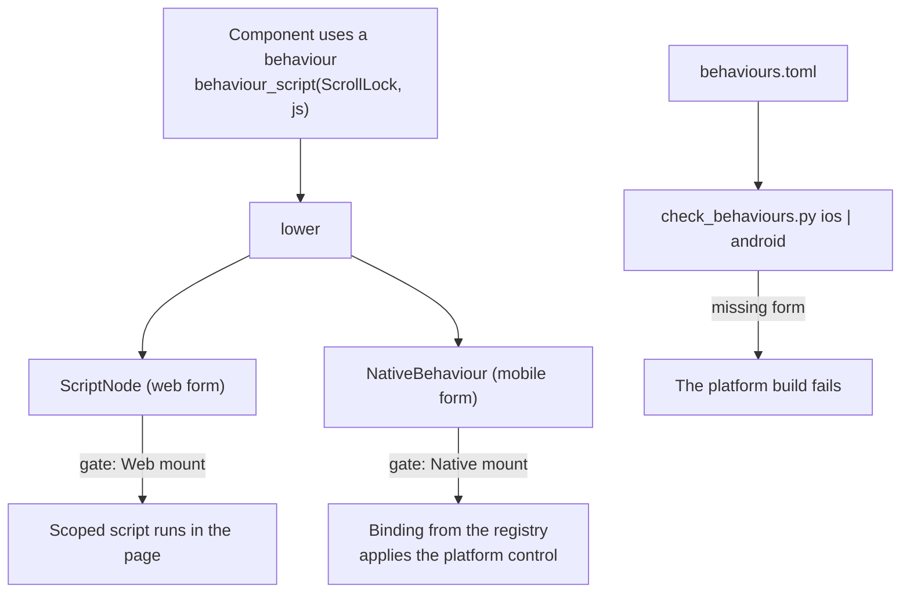

# Feature 16: The behaviour matrix

_Written in ASD-STE100 Simplified Technical English (STE). Code and identifiers stay as they
are._

**Abbreviations in this file.** user interface (UI); JavaScript (JS); continuous integration
(CI); identifier (id); AeroSpace and Defence Industries Association of Europe (ASD), the
owner of the STE standard ASD-STE100.

## 1. Goal

A component behaviour (focus trap, dismiss, scroll lock, …) is one name with one form for
each platform. On the web the form is the scoped script that exists today. On iOS and
Android the form is a compiled binding to a platform control. A matrix file lists every
behaviour and its forms. A check fails the build of a platform when a component that ships
on that platform uses a behaviour with no form there. The first native binding,
`scroll_lock`, proves the path from a component to a native node.

## 2. Story

- **S1**: "A component declares the behaviours that it uses."
- **S2**: "A web page gets the behaviour as a scoped script, as today."
- **S3**: "A native screen gets the same behaviour as a compiled binding."
- **S4**: "A developer marks a component as native, and one of its behaviours has no iOS
  form."
- **S5**: "A developer adds a behaviour to a component and forgets the matrix."
- **S6**: "An old app receives a behaviour that it does not know."

| # | Use case | Actor | Trigger | Result |
|---|---|---|---|---|
| U1 | Declare | Component author | `pub const BEHAVIOURS` | The list is in code |
| U2 | Emit | Lowering | A behaviour script node in a tree | A `ScriptNode` (web) and a `NativeBehaviour` (mobile) for the same node |
| U3 | Bind | Native renderer | A `NativeBehaviour` op | The binding registered under that id is applied to the node's view |
| U4 | Check | Build of a platform | `check_behaviours.py <platform>` | Pass, or a list of missing forms |
| U5 | Drift | Rust test | The matrix against the code | Fail when they differ |

## 3. Bounded context

**Inside this feature:** `foundation_ui_components::behaviour` (`Behaviour`, the
per-component lists, `behaviour_script`); the mobile form `NativeBehaviour` and
`BehaviourId` in the schema; vocabulary version 2; the lowering rule for a behaviour
script; `behaviours.toml`; `scripts/ui/check_behaviours.py`; the binding registries in
Swift and Kotlin; the `scroll_lock` bindings.

**Outside:**

| Thing | Owner |
|---|---|
| The JS of each behaviour and `scoped_script` | `backends/foundation_ui_components/src/machinery/` (spec 42). The JS does not change |
| The schema rules (append only), the generate script, `VOCAB_VERSIONS` | Features 01 and 02 |
| The gate | Feature 03 |
| `view::lower` | Feature 08 |
| The node stores and views; the reference model | Features 14 and 15 |
| What the platform control already gives | Apple and Android platforms |

| Entity | Meaning | Owner (the one writer) |
|---|---|---|
| Behaviour list of a component | `BEHAVIOURS` constant | The component module |
| Matrix | `backends/foundation_ui_components/behaviours.toml` | A person; a test checks it against the code |
| Binding registry | `BehaviourId` to a native binding | `EweUI` (Swift), `ewe-ui` (Kotlin) |

| Verb | Kind | Trigger | Effect |
|---|---|---|---|
| check | entity | A platform build, CI | Reads the matrix and the binding sources; changes nothing |
| bind | entity | A `NativeBehaviour` op | Adds the behaviour id to the record |

No verb changes more than one entity, so this feature has no fault table. The failures are
the outputs of the check.

**Words.** "Behaviour" is a named capability of a component. "Form" here is the
implementation of a behaviour on one platform. "Binding" is the native form. "Native
component" is a component that the matrix marks `native = true`.

## 4. Rules

### 4.1 Law worksheets

```
Entity: Matrix
Conserved value:         every Behaviour variant has exactly one row; every component with a BEHAVIOURS list has exactly one row
Bound:                   none
Inverse pairs:           none
Idempotent verbs:        check
Ordering pairs:          none
Monotone values:         BehaviourId numbers only grow
Freeze points:           the number of a released BehaviourId never changes
Links to other entities: a component row equals the BEHAVIOURS constant of that component; a native form names a binding that exists in the platform source
```

```
Entity: Binding registry
Conserved value:         one binding for one BehaviourId
Bound:                   none
Inverse pairs:           none
Idempotent verbs:        applying a binding two times to one node equals applying it one time
Ordering pairs:          none
Monotone values:         none
Freeze points:           none
Links to other entities: the matrix
```

### 4.2 Invariants

| # | Invariant |
|---|---|
| I1 | The matrix and the code agree: the behaviours of each component row equal that component's `BEHAVIOURS`, and the behaviour rows equal the `Behaviour` variants. |
| I2 | `check_behaviours.py <platform>` exits with a non-zero status exactly when a native component uses a behaviour that has no form for that platform, or when a named binding does not exist in that platform's source. |
| I3 | A behaviour script node lowers to exactly one `ScriptNode` and one `NativeBehaviour` for its parent node. A plain scoped script lowers to one `ScriptNode` only. |
| I4 | A web client never applies `NativeBehaviour`; a native client never applies `ScriptNode`. (The gate removes them; a reader that still gets one reports it.) |
| I5 | The web output of every component is unchanged except for one more attribute, `data-ewe-behaviour`, on its behaviour script nodes, which the hydrator removes with the script. |
| I6 | A native client that receives a `BehaviourId` with no registered binding reports `UnknownBehaviour` and renders the node without it. |
| I7 | The writer does not send `NativeBehaviour` to a client whose vocabulary version is 1. |

### 4.3 Must have

- `Behaviour` with the eleven variants of section 6.2.
- `NativeBehaviour` as `Op` member 25, with `FormPlatform::Mobile`.
- `VOCABULARY_VERSION = 2` with a second row in `VOCAB_VERSIONS`.
- The `scroll_lock` binding on iOS and Android.

### 4.4 Must do

- Run the check in the iOS CI step of feature 14 and in the Android CI step of feature 15.
- Use the platform control for each binding (research 12 section 3.2).

### 4.5 Must not

- Do not send script to a native client, and do not put a script field in
  `NativeBehaviour`.
- Do not change the JS body of a behaviour.
- Do not add a native binding for a behaviour that no native component uses (A5).
- Do not reuse a `BehaviourId` number.

## 5. Acceptance scenarios

```gherkin
Feature: Behaviour matrix

  Scenario: A behaviour script lowers to one web form and one mobile form
    Given a tree <Overlay> with one child made by behaviour_script(Behaviour::ScrollLock, body)
    When the caller calls lower with id_base 40
    Then the ops hold ScriptNode { node_id: 41, parent_id: 40, body }
    And the ops hold NativeBehaviour { node_id: 40, behaviour: SCROLL_LOCK }

  Scenario: A plain scoped script has no mobile form
    Given a tree <div> with one child made by scoped_script(body)
    When the caller calls lower
    Then the ops hold one ScriptNode and no NativeBehaviour

  Scenario: A native client gets the behaviour and not the script
    Given the ops of the first scenario and ClientCaps for a native mount with vocabulary version 2
    When the producer calls write_ops
    Then the frame holds NativeBehaviour(40, SCROLL_LOCK) and no ScriptNode

  Scenario: A web client gets the script and not the behaviour
    Given the same ops and ClientCaps for a web mount
    When the producer calls write_ops
    Then the frame holds ScriptNode and no NativeBehaviour

  Scenario: An old native client does not get the new form
    Given the same ops and ClientCaps for a native mount with vocabulary version 1
    When the producer calls write_ops
    Then the frame holds no NativeBehaviour
    And report.filtered holds { op: NativeBehaviour, reason: UnknownVocabulary }

  Scenario: The store records the behaviour
    Given a native store after native_tree.bin
    When the store receives a frame with NativeBehaviour(40, SCROLL_LOCK)
    Then the snapshot of record 40 has "behaviours": ["SCROLL_LOCK"]

  Scenario: An unknown behaviour is reported
    When the store receives a frame with NativeBehaviour(40, behaviour 999)
    Then the reports hold { code: "UnknownBehaviour", row: 0 }
    And record 40 has no behaviour

  Scenario: The check passes for the shipped matrix
    When the developer runs "python3 scripts/ui/check_behaviours.py ios" and "… android"
    Then both commands exit with status 0

  Scenario: A native component with an unbound behaviour fails the check
    Given a copy of the matrix where the dialog component has native = true
    When the developer runs "python3 scripts/ui/check_behaviours.py ios --matrix <copy>"
    Then the command exits with status 1
    And the output holds "dialog: behaviour `focus_trap` has no ios form"

  Scenario: A behaviour that is missing from the matrix fails the test
    Given a component whose BEHAVIOURS has one more entry than its matrix row
    When the Rust test matrix_matches_code runs
    Then it fails and names the component and the behaviour
```

## 6. Technical breakdown



_The diagram shows one behaviour with one form for each platform, and the check that keeps
the matrix complete._

### 6.1 Measured facts

| Fact | Source |
|---|---|
| The behaviour modules are `composite`, `dialog`, `dismiss`, `focus_trap`, `gestures`, `hover`, `listbox`, `measure`, `position`, `scroll_lock`, `transition` (eleven; the research text lists ten and leaves out `composite`) | `backends/foundation_ui_components/src/machinery/mod.rs:27-37` |
| `scoped_script(body)` builds `<script scoped primal:script>`; the hydrator runs it one time and removes the node | `machinery/mod.rs:39-61`; `backends/foundation_wasm_ui/runtimes/foundation-wasm-ui.js:2176-2188` |
| A component uses a behaviour by calling a function of its `machinery::<name>` module | For example `grep -n "machinery::" backends/foundation_ui_components/src/dialog.rs` |
| Component tests assert markup | `backends/foundation_ui_components/tests/components_tests.rs` (1898 lines) |

### 6.2 Rust: `foundation_ui_components::behaviour`

```rust
/// A named capability of a component. The number is the wire BehaviourId.
#[derive(Clone, Copy, Debug, PartialEq, Eq, Hash)]
#[repr(u16)]
pub enum Behaviour {
    Composite = 1, Dialog = 2, Dismiss = 3, FocusTrap = 4, Gestures = 5, Hover = 6,
    Listbox = 7, Measure = 8, Position = 9, ScrollLock = 10, Transition = 11,
}
impl Behaviour {
    pub const ALL: &'static [Behaviour];
    /// "composite", "dialog", … "scroll_lock", "transition".
    #[must_use] pub fn name(self) -> &'static str;
    #[must_use] pub fn from_name(name: &str) -> Option<Self>;
}

/// `scoped_script(body)` with one more attribute: data-ewe-behaviour="<name>".
#[must_use]
pub fn behaviour_script(behaviour: Behaviour, body: impl Into<Cow<'static, str>>) -> Html;

/// (component name, its behaviours), for every component that uses a behaviour.
pub static COMPONENT_BEHAVIOURS: &[(&str, &[Behaviour])];
```

- Each `machinery::<name>` function that returns a script node today calls
  `behaviour_script(Behaviour::<Name>, …)` in place of `scoped_script(…)`.
- Each component module that calls a `machinery::<name>` function gets
  `pub const BEHAVIOURS: &[Behaviour] = &[…];` with exactly the behaviours whose module it
  calls, in the order of the `Behaviour` numbers. `COMPONENT_BEHAVIOURS` lists
  `(module name, MODULE::BEHAVIOURS)` for each of them, sorted by module name.
- Markup tests that print a behaviour script gain the attribute
  `data-ewe-behaviour="<name>"` in their expected text. This is the only permitted change
  to an expected value (I5).

### 6.3 Schema and vocabulary (through the rules of features 01 and 02)

Append to `ops.fbs`, then run `mise run ui-wire:generate`:

```flatbuffers
enum BehaviourId : ushort { UNKNOWN = 0, COMPOSITE = 1, DIALOG = 2, DISMISS = 3,
  FOCUS_TRAP = 4, GESTURES = 5, HOVER = 6, LISTBOX = 7, MEASURE = 8, POSITION = 9,
  SCROLL_LOCK = 10, TRANSITION = 11 }
table NativeBehaviour { node_id: uint; behaviour: BehaviourId; args: [NativeArg]; }
// and, at the END of `union Op`:  …, NativeControl, NativeCommand, NativeBehaviour
```

- `form_platform(Op::NativeBehaviour)` is `Mobile`. It is not columnar-eligible.
- `VOCABULARY_VERSION = 2`. Add the row
  `VocabVersion { version: 2, …the same maxima as version 1…, max_op: 25 }`, and add the
  field `max_behaviour: u16` to `VocabVersion` (0 in row 1, 11 in row 2). The gate rule 3
  of feature 03 gains: `NativeBehaviour.behaviour > max_behaviour` gives
  `UnknownVocabulary`. An op number above `max_op` is already removed by that rule.
- Update `union_numbers_tests.rs` (member 25), `frame_ops_all_forms.bin` (one more row),
  `foundation-ui-vocab.js`, and the web applicator's row table: code 25 reports
  `UnsupportedPlatformOp`, as codes 23 and 24 do.
- A test asserts that `Behaviour as u16` equals the `BehaviourId` of the same name, for
  all eleven.

### 6.4 Lowering (`foundation_ui_runtime::view::lower`)

In the row "Web element with `primal:script`" of feature 08 section 6.6: after the
`ScriptNode`, if the element has the attribute `data-ewe-behaviour` with a name that
`BehaviourId` has, also emit `NativeBehaviour { node_id: id of the parent element,
behaviour, args: [] }`. An unknown name gives
`LowerError::BadProp { node_id, prop: "data-ewe-behaviour", value }`. A behaviour script
at the root (no parent element) gives `LowerError::NoRootElement`.

`foundation_ui_runtime` must not depend on `foundation_ui_components`; it maps the name
with the generated `BehaviourId` names in lower case.

Options of a behaviour ride the component's `data-*` attributes on the web
(`machinery/mod.rs` module doc). Version 1 of the native form sends no arguments; a
binding that needs one adds a named `NativeArg` with its own change.

### 6.5 Native stores and bindings

- **Reference model and both stores** (feature 14 section 6.3): add the row
  "`NativeBehaviour`: add the id to `record.behaviours` (a sorted set). An id that the
  client's `BehaviourId` enum does not have, or that has no registered binding: report
  `UnknownBehaviour { row }`, no change." The snapshot gains the key `"behaviours"` (a
  list of names) after `"control"`. Regenerate the expected snapshots; add
  `native_behaviour.bin` (`NativeBehaviour(40, SCROLL_LOCK)`, applied after
  `native_tree.bin`) with its snapshot.
- **Swift**: `public protocol BehaviourBinding { static var id: BehaviourId { get }
  func body(content: AnyView, record: NodeRecord) -> AnyView }` and
  `BehaviourRegistry.standard` in `Sources/EweUI/Behaviours/`. `NodeView` folds the
  bindings of `record.behaviours` over its content. `ScrollLockBinding.swift`:
  `content.scrollDisabled(true)`.
- **Kotlin**: `interface BehaviourBinding { val id: UShort; fun modifier(record:
  NodeRecord): Modifier; val scrollEnabled: Boolean get() = true }` and
  `BehaviourRegistry.standard` in `ui/src/main/kotlin/ewe/ui/compose/behaviours/`.
  `ScrollLockBinding.kt` sets `scrollEnabled = false`; the `SCROLL` and `LIST`
  composables pass it to `verticalScroll(enabled = …)` and
  `LazyColumn(userScrollEnabled = …)`.

Why `scroll_lock` is first: the counter screens use no behaviour (A5), so no binding is
needed for them. One binding is needed to prove the path, and `scroll_lock` is the one
that each platform gives with a single control option.

### 6.6 The matrix (`backends/foundation_ui_components/behaviours.toml`)

```toml
# One row for each behaviour. `web` is the Rust module that holds the scoped script.
# `ios` / `android` name the binding type; leave the key out when no binding exists.
[behaviours.scroll_lock]
id = 10
web = "machinery/scroll_lock.rs"
ios = "ScrollLockBinding"
android = "ScrollLockBinding"
planned = "SwiftUI scrollDisabled; Compose userScrollEnabled"

[behaviours.dialog]
id = 2
web = "machinery/dialog.rs"
planned = "SwiftUI sheet or alert; Compose Dialog"
# … one row for each of the eleven behaviours, with `planned` from research 12 section 3.2
#   (composite: "the platform focus engine and list selection")

# One row for each component in COMPONENT_BEHAVIOURS.
[components.dialog]
behaviours = ["dialog", "dismiss", "focus_trap", "scroll_lock"]   # example; the test fixes the real list
native = false
```

Every component row starts with `native = false`. A component becomes `native = true` in
the change that makes it render in the core vocabulary, and the check then requires its
bindings.

### 6.7 The check (`scripts/ui/check_behaviours.py`)

```text
usage: check_behaviours.py <ios|android> [--matrix PATH]
```

1. Read the matrix (`tomllib`).
2. For each component with `native = true`, for each of its behaviours: if the behaviour
   row has no key for the platform, print
   ``<component>: behaviour `<name>` has no <platform> form``.
3. For each behaviour row that has the platform key: the file
   `native/ios/EweUI/Sources/EweUI/Behaviours/<Type>.swift` or
   `native/android/ewe-ui/ui/src/main/kotlin/ewe/ui/compose/behaviours/<Type>.kt` must
   exist and hold the text `<Type>`; else print
   ``<name>: <platform> binding `<Type>` not found``.
4. A behaviour name in a component row that has no behaviour row prints
   ``<component>: unknown behaviour `<name>` ``.
5. Exit with status 1 if anything was printed, else 0.

Add tests in `scripts/ci/tests/` in the style of the tests there (a passing matrix, a
missing form, a missing binding file, an unknown behaviour), with temporary directories.

## 7. Tests

| Law or scenario | Test | Oracle |
|---|---|---|
| I1; Scenario: missing from the matrix | `backends/foundation_ui_components/tests/behaviour_matrix_tests.rs::matrix_matches_code` (parses `behaviours.toml` with the workspace `toml` crate; compares with `COMPONENT_BEHAVIOURS` and `Behaviour::ALL`, ids included); `::component_lists_match_machinery_calls` (for each component source file, the set of `machinery::<name>::` module names in its text equals its `BEHAVIOURS`) | example |
| I2; Scenarios: check passes, unbound behaviour fails | `scripts/ci/tests/test_check_behaviours.py` (four cases) and the two commands of section 9 | expected outcome |
| I3; Scenarios: behaviour script, plain script | `backends/foundation_ui_runtime/tests/view_lower_tests.rs::behaviour_script_gives_two_forms`, `::plain_script_gives_one_form`, `::unknown_behaviour_name_fails` | example |
| I4, I7; Scenarios: native client, web client, old native client | `backends/foundation_ui_wire/tests/writer_gate_tests.rs::behaviour_goes_to_native_only`, `::old_native_client_gets_no_behaviour` | example |
| I5 | `backends/foundation_ui_components/tests/components_tests.rs` passes with only the attribute added to expected behaviour scripts; `backends/foundation_ui_components/integration/test/components-behaviors.test.js` passes with no change | expected outcome |
| I6; Scenarios: store records, unknown behaviour | Rust `reference_tests.rs::native_behaviour_rule`; Swift `ConformanceTests.testNativeBehaviour`, `ApplierTests.testUnknownBehaviourIsReported`; Kotlin `ConformanceTest.nativeBehaviour`, `ApplierTest.unknownBehaviourIsReported` | stateful model, example |
| Numbers agree | `behaviour_matrix_tests.rs::behaviour_numbers_equal_wire_ids` | example |
| The web applicator reports code 25 | `backends/foundation_wasm_ui/integration/test/frames-apply.test.js` "all forms fixture" (now three reports: 23, 24, 25) | example |
| `scroll_lock` binding | Swift `BehaviourTests.testScrollLockIsRegistered`; Kotlin `PropMappingTest.scrollLockDisablesScroll` | example |

## 8. Tasks

- [ ] 1. `Behaviour`, `behaviour_script`; switch the machinery modules; update the expected markup.
- [ ] 2. `BEHAVIOURS` constants and `COMPONENT_BEHAVIOURS`.
- [ ] 3. The schema change, generate, vocabulary version 2, the gate rule, the fixtures.
- [ ] 4. The lowering rule and its tests.
- [ ] 5. The reference model rule and the snapshots.
- [ ] 6. The matrix file and `behaviour_matrix_tests.rs`.
- [ ] 7. `check_behaviours.py` and its tests.
- [ ] 8. Swift: the registry, `ScrollLockBinding`, the store rule, the tests.
- [ ] 9. Kotlin: the registry, `ScrollLockBinding`, the store rule, the tests.
- [ ] 10. The check in the iOS and Android CI steps; version bumps.
- [ ] 11. Update `progress.md` and `learnings.md`.

## 9. Verify

```bash
mise run ui-wire:check && mise run ui-wire:test-ts && mise run ui-web:test
cargo fmt --all -- --check
for c in foundation_ui_wire foundation_ui_runtime foundation_ui_components; do
  cargo clippy -p "$c" --profile uat --no-deps -- -D warnings && cargo test -p "$c" --profile uat || break
done
cargo test -p foundation_ui_wire --profile uat --features reference
python3 scripts/ui/check_behaviours.py ios
python3 scripts/ui/check_behaviours.py android
python3 -m pytest scripts/ci/tests/test_check_behaviours.py
node --test backends/foundation_ui_components/integration/test/
swift test --package-path native/ios/EweUI                 # macOS
./gradlew -p native/android/ewe-ui :core:test :ui:testDebugUnitTest
```

If `scripts/ci/tests` does not use `pytest`, run the new test file the way the other files
there are run.

## 10. Done when

- [ ] All tasks are complete and every command of section 9 passes with no warning.
- [ ] Each invariant and each scenario has a passing test (section 7).
- [ ] No behaviour JS body changed (`git diff` of `machinery/*.rs` shows only the call
      that builds the script node).
- [ ] The matrix has eleven behaviour rows and one row for each component in
      `COMPONENT_BEHAVIOURS`.
- [ ] The check list of the `story-driven-specification` skill passes.

---

_Created: 2026-11-13_
