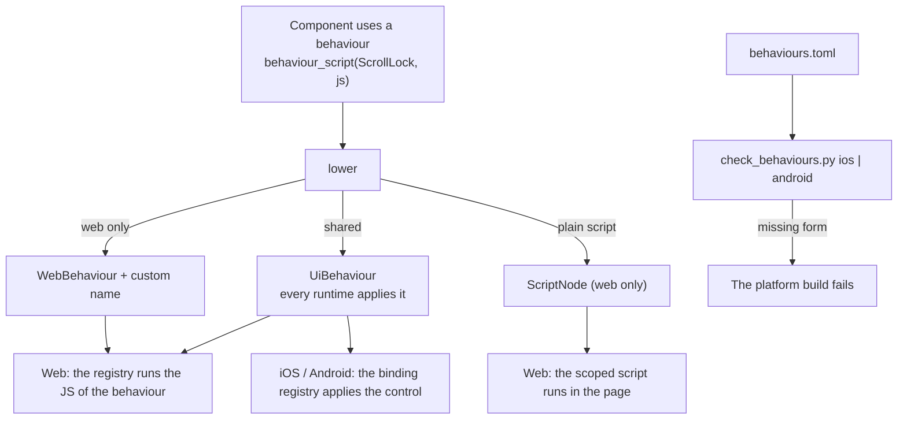

# Feature 16: The behaviour matrix

_Written in ASD-STE100 Simplified Technical English (STE). Code and identifiers stay as they
are._

**Abbreviations in this file.** user interface (UI); JavaScript (JS); continuous integration
(CI); identifier (id); AeroSpace and Defence Industries Association of Europe (ASD), the
owner of the STE standard ASD-STE100.

## 1. Goal

A component behaviour (focus trap, dismiss, scroll lock, …) is one name with one form on
each platform. Behaviours use the same grouping as operations (D56, D59): one shared set
that every runtime applies, then a web set and a mobile set for what only one platform can
express. The shared set is `DIALOG`, `DISMISS`, `SCROLL_LOCK` and `TRANSITION`. A behaviour
that is not in the shared set travels as a custom name in its platform set. The name table is
feature 02 section 6.7; this feature writes the authoring enum and the marker, the component
lists, the matrix and the native bindings.

A matrix file lists every behaviour and its forms. A check fails the build of a platform
when a component that ships on that platform uses a behaviour with no form there. The four
shared behaviours that the D48 todo list needs — `dialog`, `dismiss`, `scroll_lock` and
`transition` — each have a native binding, which proves the path from a component to a
native node on both platforms.

## 2. Story

- **S1**: "A component declares the behaviours that it uses."
- **S2**: "A shared behaviour reaches the web runtime, which applies its own implementation."
- **S3**: "A native screen gets the same behaviour as a compiled binding."
- **S4**: "A developer marks a component as native, and one of its behaviours has no iOS
  form."
- **S5**: "A developer adds a behaviour to a component and forgets the matrix."
- **S6**: "An old app receives a behaviour that it does not know."

| # | Use case | Actor | Trigger | Result |
|---|---|---|---|---|
| U1 | Declare | Component author | `pub const BEHAVIOURS` | The list is in code |
| U2 | Emit | Lowering | A behaviour marker in a tree | One `UiBehaviour`, `WebBehaviour` or `MobileBehaviour`, by the kind of the behaviour |
| U3 | Bind | Native renderer | A `UiBehaviour` or `MobileBehaviour` op | The binding registered under that name is applied to the node's view |
| U4 | Check | Build of a platform | `check_behaviours.py <platform>` | Pass, or a list of missing forms |
| U5 | Drift | Rust test | The matrix against the code | Fail when they differ |

## 3. Bounded context

**Inside this feature:** `foundation_ui_components::behaviour` (`Behaviour`, its wire kind,
the per-component lists, `behaviour_script`); `behaviours.toml`;
`scripts/ui/check_behaviours.py`; the binding registries in Swift and Kotlin; the four shared
bindings (`dialog`, `dismiss`, `scroll_lock`, `transition`).

**Outside:**

| Thing | Owner |
|---|---|
| The behaviour name tables, the three enums and the three maxima | Feature 02 section 6.7 |
| The behaviour tables in `ops.fbs` and the generated types | Feature 01 (schema) |
| The gate over a `Native` or `Web` mount | Feature 03 |
| The lowering of a behaviour marker (`view::lower`) | Feature 08 |
| The web behaviour registry and its JS bodies | Feature 09 section 6.9 |
| The JS of each behaviour and `scoped_script` | `backends/foundation_ui_components/src/machinery/` (spec 42) |
| The node stores and views; the reference model | Features 14 and 15 |
| What the platform control already gives | Apple and Android platforms |

| Entity | Meaning | Owner (the one writer) |
|---|---|---|
| Behaviour list of a component | `BEHAVIOURS` constant | The component module |
| Matrix | `backends/foundation_ui_components/behaviours.toml` | A person; a test checks it against the code |
| Binding registry | A behaviour id or name to a native binding | `EweUI` (Swift), `ewe-ui` (Kotlin) |
| Web behaviour registry | A behaviour id or name to a JS function | Feature 09 (`foundation-ui-behaviours.js`) |

| Verb | Kind | Trigger | Effect |
|---|---|---|---|
| check | entity | A platform build, CI | Reads the matrix and the binding sources; changes nothing |
| bind | entity | A behaviour op | Adds the behaviour id or name to the record |

No verb changes more than one entity, so this feature has no fault table. The failures are
the outputs of the check.

**Words.** "Behaviour" is a named capability of a component. "Shared behaviour" is a value of
`BehaviourId`; every runtime applies it. "Web behaviour" is a value of `WebBehaviourId`, or a
custom name in `WebBehaviour.custom`. "Mobile behaviour" is a value of `MobileBehaviourId`,
or a custom name in `MobileBehaviour.custom`. "Binding" is the native form. "Native
component" is a component that the matrix marks `native = true`.

## 4. Rules

### 4.1 Law worksheets

```
Entity: Matrix
Conserved value:         every Behaviour variant has exactly one row; every component with a BEHAVIOURS list has exactly one row
Bound:                   none
Inverse pairs:           none
Idempotent verbs:        check
Ordering pairs:          none
Monotone values:         BehaviourId, WebBehaviourId and MobileBehaviourId numbers only grow
Freeze points:           the number of a released behaviour id never changes
Links to other entities: a component row equals the BEHAVIOURS constant of that component; a mobile form names a binding that exists in the platform source
```

```
Entity: Binding registry
Conserved value:         one binding for one behaviour id or custom name
Bound:                   none
Inverse pairs:           none
Idempotent verbs:        applying a binding two times to one node equals applying it one time
Ordering pairs:          none
Monotone values:         none
Freeze points:           none
Links to other entities: the matrix
```

### 4.2 Invariants

| # | Invariant |
|---|---|
| I1 | The matrix and the code agree: the behaviours of each component row equal that component's `BEHAVIOURS`, and the behaviour rows equal the `Behaviour` variants. |
| I2 | `check_behaviours.py <platform>` exits with a non-zero status exactly when a native component uses a behaviour that has no form for that platform, or when a named binding does not exist in that platform's source. |
| I3 | A shared behaviour lowers to exactly one `UiBehaviour` and no `ScriptNode`. A web-only behaviour lowers to exactly one `WebBehaviour` with `custom` set and `behaviour = UNKNOWN`. A plain scoped script lowers to one `ScriptNode`. |
| I4 | A web mount never receives `MobileBehaviour`; a native mount never receives `WebBehaviour` or `ScriptNode`. (The gate removes them; a reader that still gets one reports it.) |
| I5 | The web applies a `UiBehaviour` with the implementation of that behaviour in its own registry. The markup of a component no longer holds the inline script of a shared behaviour. |
| I6 | A client that receives a behaviour id or custom name with no registered binding reports `UnknownBehaviour` and renders the node without it. |
| I7 | The writer does not send a behaviour to a client whose vocabulary version is 1. |
| I8 | `BehaviourArg` is the only argument type of a behaviour. No behaviour type holds a script body. |

### 4.3 Must have

- `Behaviour` with the eleven variants of section 6.2, and its wire kind.
- `UiBehaviour`, `WebBehaviour` and `MobileBehaviour` as members of the three unions (the
  schema of feature 01; the name table of feature 02).
- A binding for `dialog`, `dismiss`, `scroll_lock` and `transition` on iOS and on Android.
  These are the behaviours that the D48 todo list needs, on every surface.

### 4.4 Must do

- Run the check in the iOS CI step of feature 14 and in the Android CI step of feature 15.
- Use the platform control for each binding (research 12 section 3.2).

### 4.5 Must not

- Do not send a script to a native client, and do not put a script field in a behaviour type.
- Do not change the JS body of a behaviour. It moves from the inline script to the registry
  of feature 09 unchanged.
- Do not add a native binding for a behaviour that no native component uses (A5, D48).
- Do not reuse a behaviour id number.

## 5. Acceptance scenarios

```gherkin
Feature: Behaviour matrix

  Scenario: A shared behaviour lowers to one shared form
    Given a tree <Overlay> with one child made by behaviour_script(Behaviour::ScrollLock, body)
    When the caller calls lower with id_base 40
    Then the ops hold UiBehaviour { node_id: 41, behaviour: SCROLL_LOCK, args: [] }
    And the ops hold no ScriptNode

  Scenario: A web-only behaviour lowers to one web form
    Given a tree <Stack> with one child made by behaviour_script(Behaviour::Hover, body)
    When the caller calls lower
    Then the ops hold WebBehaviour { node_id: 41, behaviour: UNKNOWN, custom: "hover", args: [] }
    And the ops hold no UiBehaviour

  Scenario: A plain scoped script has no behaviour form
    Given a tree <div> with one child made by scoped_script(body)
    When the caller calls lower
    Then the ops hold one ScriptNode and no behaviour

  Scenario: A native client gets the shared behaviour and not the script
    Given the ops of the first scenario and ClientCaps for a native mount with vocabulary version 2
    When the producer calls write_ops
    Then the frame holds UiBehaviour(41, SCROLL_LOCK) and no ScriptNode

  Scenario: A web client gets the shared behaviour and not the mobile form
    Given the same ops and ClientCaps for a web mount
    When the producer calls write_ops
    Then the frame holds UiBehaviour and no MobileBehaviour

  Scenario: An old native client does not get the new form
    Given the same ops and ClientCaps for a native mount with vocabulary version 1
    When the producer calls write_ops
    Then the frame holds no UiBehaviour
    And report.filtered holds { op: UiBehaviour, reason: UnknownVocabulary }

  Scenario: The store records the behaviour
    Given a native store after native_tree.bin
    When the store receives a frame with UiBehaviour(40, SCROLL_LOCK)
    Then the snapshot of record 40 has "behaviours": ["SCROLL_LOCK"]

  Scenario: An unknown behaviour is reported
    When the store receives a frame with UiBehaviour(40, behaviour 999)
    Then the reports hold { code: "UnknownBehaviour", row: 0, node: 40, name: "999" }
    And record 40 has no behaviour

  Scenario: The web applies a shared behaviour without a script node
    Given a web store with a node that has no script child
    When the frame with UiBehaviour(40, SCROLL_LOCK) applies
    Then the JS registry runs the scroll_lock function for node 40
    And no script element is added to the page

  Scenario: The check passes for the shipped matrix
    When the developer runs "python3 scripts/ui/check_behaviours.py ios" and "… android"
    Then both commands exit with status 0

  Scenario: A native component with an unbound behaviour fails the check
    Given a copy of the matrix where the dialog component has native = true
    When the developer runs "python3 scripts/ui/check_behaviours.py ios --matrix <copy>"
    Then the command exits with status 1
    And the output holds "dialog: behaviour `focus_trap` has no ios form"

  Scenario: A behaviour that is missing from the matrix fails the test
    Given a component whose BEHAVIOURS has one more entry than its matrix row
    When the Rust test matrix_matches_code runs
    Then it fails and names the component and the behaviour
```

## 6. Technical breakdown



_The diagram shows the one shared form, the web-only form and the plain script, and the
check that keeps the matrix complete._

### 6.1 Measured facts

| Fact | Source |
|---|---|
| The behaviour modules are `composite`, `dialog`, `dismiss`, `focus_trap`, `gestures`, `hover`, `listbox`, `measure`, `position`, `scroll_lock`, `transition` (eleven; the research text lists ten and leaves out `composite`) | `backends/foundation_ui_components/src/machinery/mod.rs:27-37` |
| `scoped_script(body)` builds `<script scoped primal:script>`; the hydrator runs it one time and removes the node | `machinery/mod.rs:39-61`; `backends/foundation_wasm_ui/runtimes/foundation-wasm-ui.js:2176-2188` |
| A component uses a behaviour by calling a function of its `machinery::<name>` module | For example `grep -n "machinery::" backends/foundation_ui_components/src/dialog.rs` |
| Component tests assert markup | `backends/foundation_ui_components/tests/components_tests.rs` (1898 lines) |

### 6.2 Rust: `foundation_ui_components::behaviour`

```rust
/// A named capability of a component. The number is the wire id in its set (D56).
#[derive(Clone, Copy, Debug, PartialEq, Eq, Hash)]
#[repr(u16)]
pub enum Behaviour {
    Composite = 1, Dialog = 2, Dismiss = 3, FocusTrap = 4, Gestures = 5, Hover = 6,
    Listbox = 7, Measure = 8, Position = 9, ScrollLock = 10, Transition = 11,
}

/// The wire form of a behaviour: one shared id, or one custom web name.
#[derive(Clone, Copy, Debug, PartialEq, Eq)]
pub enum BehaviourWire {
    Shared(BehaviourId),
    Web(&'static str),
}

impl Behaviour {
    pub const ALL: &'static [Behaviour];
    /// "composite", "dialog", … "scroll_lock", "transition".
    #[must_use] pub fn name(self) -> &'static str;
    #[must_use] pub fn from_name(name: &str) -> Option<Self>;
    /// DIALOG, DISMISS, SCROLL_LOCK and TRANSITION are shared; the other seven are web only.
    /// Reads the name tables of feature 02 section 6.7; it holds no second copy.
    #[must_use] pub fn wire(self) -> BehaviourWire;
}

/// The marker of a behaviour. Lowering turns it into one behaviour op and no script.
#[must_use]
pub fn behaviour_script(behaviour: Behaviour, body: impl Into<Cow<'static, str>>) -> Html;

/// (component name, its behaviours), for every component that uses a behaviour.
pub static COMPONENT_BEHAVIOURS: &[(&str, &[Behaviour])];
```

The four shared names map to their `BehaviourId` values through `shared_behaviour` of feature
02 section 6.7. The other seven map to `BehaviourWire::Web("hover")` and so on through
`is_web_behaviour` and the same `name()` text. `Composite` has no shared form because the
shared set is for behaviours that every platform can apply (D56).

- `behaviour_script` keeps the signature and the body. It writes the marker
  `<span data-ewe-behaviour="<name>">` with no child, in place of the inline script.
- Each component module that calls a `machinery::<name>` function gets
  `pub const BEHAVIOURS: &[Behaviour] = &[…];` with exactly the behaviours whose module it
  calls, in the order of the `Behaviour` numbers. `COMPONENT_BEHAVIOURS` lists
  `(module name, MODULE::BEHAVIOURS)` for each of them, sorted by module name.
- A body argument is still accepted so that no caller changes, but it is not put on the
  wire: the behaviour implementation comes from the runtime (I5, I8). A plain scoped script
  keeps its body and its `ScriptNode`.

### 6.3 Schema and vocabulary (through the rules of features 01 and 02)

The three types are already in `ops.fbs` with the schema of feature 01:

```flatbuffers
enum BehaviourId : ushort { UNKNOWN = 0, DIALOG = 1, DISMISS = 2, SCROLL_LOCK = 3,
  TRANSITION = 4 }
enum WebBehaviourId : ushort { UNKNOWN = 0 }
enum MobileBehaviourId : ushort { UNKNOWN = 0 }
table BehaviourArg { name: string; value: PropValue; }
table UiBehaviour { node_id: uint; behaviour: BehaviourId; args: [BehaviourArg]; }
table WebBehaviour { node_id: uint; behaviour: WebBehaviourId; custom: string;
  args: [BehaviourArg]; }
table MobileBehaviour { node_id: uint; behaviour: MobileBehaviourId; custom: string;
  args: [BehaviourArg]; }
```

- `UiBehaviour` is a member of `UiOperation`, `WebBehaviour` of `WebOperation`, and
  `MobileBehaviour` of `MobileOperation` (D56, D59).
- `custom` is set only when the id is `UNKNOWN`. A web-only behaviour uses
  `WebBehaviour.custom`; no behaviour uses a flag.
- The vocabulary version and the three maxima belong to feature 02 (section 6.3). This
  feature adds no schema text and no fixture: feature 01 writes the tables and its fixtures.
- A test asserts that `Behaviour as u16` equals the id of the shared behaviour of the same
  name, for all four.

### 6.4 Lowering (feature 08)

The lowering rule for the marker is feature 08's (section 6.6, the behaviour marker row).
`behaviour_script` of this feature writes the marker only; this feature does not lower it.

- The runtime reads the name table of feature 02 section 6.7. It does not depend on
  `foundation_ui_components`, so it does not call `Behaviour::from_name`.
- `shared_behaviour(name)` gives `Some(id)` for the four shared names; `is_web_behaviour`
  gives `true` for the seven web names; any other name gives `LowerError::BadProp`.
- Options of a behaviour ride the marker's `data-*` attributes today. Version 2 sends no
  arguments from a component; a binding that needs one adds a named `BehaviourArg` with its
  own change.

### 6.5 The web behaviour registry (feature 09)

The registry is feature 09's (section 6.9): `foundation-ui-behaviours.js` holds `SHARED`
(the four ids), `WEB_ONLY` (the seven web names) and the table that `registerWebBehaviour`
fills. This feature only says which JS body each matrix row names in its `web` key. A native
mount never loads the module.

### 6.6 Native stores and bindings

- **Reference model and both stores** (feature 14 section 6.3): add the row
  "`UiBehaviour` / `MobileBehaviour`: add the id or custom name to `record.behaviours` (a
  sorted set). An id or name that has no registered binding: report
  `UnknownBehaviour { row, node, name }`, no change." The snapshot gains the key `"behaviours"` (a list of names) after
  `"web_view"` (D46). Regenerate the expected snapshots; add `native_behaviour.bin`
  (`UiBehaviour(40, SCROLL_LOCK)`, applied after `native_tree.bin`) with its snapshot.
- **One registry, keyed by name.** A behaviour reaches a store as a name: the `BehaviourId`
  name of a shared behaviour, or the `custom` name of a `MobileBehaviour`. The registry maps
  a name to a binding. The standard registry holds the shared names; the app registers a
  custom mobile name with the same call, as its action registry takes an action.
- **Swift**: `public protocol BehaviourBinding { var name: String { get }
  func body(content: AnyView, record: NodeRecord) -> AnyView }`,
  `public final class BehaviourRegistry { public func register(_ b: BehaviourBinding);
  public static let standard: BehaviourRegistry }` in `Sources/EweUI/Behaviours/`.
  `NodeView` folds the bindings of `record.behaviours` over its content, in sorted name
  order. The four bindings, each with `name` set to its shared name:
  - `DialogBinding.swift`: presents the record as a `.sheet`, or as an `.alert` when it
    holds no text field. The `dismiss` binding closes it.
  - `DismissBinding.swift`: closes the presenting `dialog` or `transition` on a tap outside
    it, on the Escape key and on a downward swipe, as `machinery/dismiss.rs` does on the web.
  - `ScrollLockBinding.swift`: `content.scrollDisabled(true)` on the `SCROLL` and `LIST`
    chain that holds the node.
  - `TransitionBinding.swift`: `.transition(...)` and `.animation(...)` with the default
    duration of `machinery/transition.rs`.
- **Kotlin**: `interface BehaviourBinding { val name: String; fun modifier(record:
  NodeRecord): Modifier; val scrollEnabled: Boolean get() = true; val dialog: Boolean get() =
  false }`, `class BehaviourRegistry { fun register(b: BehaviourBinding); companion object {
  val standard: BehaviourRegistry } }` in `ui/src/main/kotlin/ewe/ui/compose/behaviours/`.
  The four bindings, each with `name` set to its shared name:
  - `DialogBinding.kt`: `dialog = true`; the `OVERLAY` composable shows an `AlertDialog`
    when the record has it, or a `Dialog` when the node holds children.
  - `DismissBinding.kt`: the `Dialog`'s `onDismissRequest`, a tap outside the content and
    the Back key close it.
  - `ScrollLockBinding.kt`: `scrollEnabled = false`; the `SCROLL` and `LIST` composables
    pass it to `verticalScroll(enabled = …)` and `LazyColumn(userScrollEnabled = …)`.
  - `TransitionBinding.kt`: `AnimatedVisibility` with the default duration of
    `machinery/transition.rs`.

The conformance fixture `native_behaviour.bin` proves the shared path only. The custom
mobile path has no framework-defined name to put in a fixture, so each store proves it in a
test that registers a test binding under a custom name.

The four bindings follow D48: the todo list on iOS and Android opens a dialog, dismisses it,
locks the scroll of the list behind it and animates the change. A behaviour that no native
component uses gets no binding (A5).

### 6.7 The matrix (`backends/foundation_ui_components/behaviours.toml`)

```toml
# One row for each behaviour.
# shared = "the BehaviourId name" for a shared behaviour.
# web    = "the module of the scoped JS" (the source that the registry copies).
# ios / android name the binding type; leave the key out when no binding exists.
[behaviours.scroll_lock]
id = 3
shared = "SCROLL_LOCK"
web = "machinery/scroll_lock.rs"
ios = "ScrollLockBinding"
android = "ScrollLockBinding"
planned = "SwiftUI scrollDisabled; Compose userScrollEnabled"

[behaviours.hover]
web = "machinery/hover.rs"
custom = "hover"
planned = "Web only; no native form"

[behaviours.dialog]
id = 1
shared = "DIALOG"
web = "machinery/dialog.rs"
ios = "DialogBinding"
android = "DialogBinding"
planned = "SwiftUI sheet or alert; Compose Dialog or AlertDialog"

[behaviours.dismiss]
id = 2
shared = "DISMISS"
web = "machinery/dismiss.rs"
ios = "DismissBinding"
android = "DismissBinding"
planned = "A tap outside, Escape and a swipe close the dialog"

[behaviours.transition]
id = 4
shared = "TRANSITION"
web = "machinery/transition.rs"
ios = "TransitionBinding"
android = "TransitionBinding"
planned = "SwiftUI transition and animation; Compose AnimatedVisibility"
# … one row for each of the eleven behaviours, with `planned` from research 12 section 3.2

# One row for each component in COMPONENT_BEHAVIOURS.
[components.dialog]
behaviours = ["dialog", "dismiss", "focus_trap", "scroll_lock"]   # example; the test fixes the real list
native = false
```

Every component row starts with `native = false`. A component becomes `native = true` in
the change that makes it render in the core vocabulary, and the check then requires its
bindings.

### 6.8 The check (`scripts/ui/check_behaviours.py`)

```text
usage: check_behaviours.py <ios|android> [--matrix PATH]
```

1. Read the matrix (`tomllib`).
2. For each component with `native = true`, for each of its behaviours: if the behaviour
   row has no key for the platform, print
   ``<component>: behaviour `<name>` has no <platform> form``.
3. For each behaviour row that has the platform key: the file
   `native/ios/EweUI/Sources/EweUI/Behaviours/<Type>.swift` or
   `native/android/ewe-ui/ui/src/main/kotlin/ewe/ui/compose/behaviours/<Type>.kt` must
   exist and hold the text `<Type>`; else print
   ``<name>: <platform> binding `<Type>` not found``.
4. A behaviour name in a component row that has no behaviour row prints
   ``<component>: unknown behaviour `<name>` ``.
5. A row with neither `shared` nor `custom` prints ``<name>: no wire form``.
6. Exit with status 1 if anything was printed, else 0.

Add tests in `scripts/ci/tests/` in the style of the tests there (a passing matrix, a
missing form, a missing binding file, an unknown behaviour, a row with no wire form), with
temporary directories.

## 7. Tests

| Law or scenario | Test | Oracle |
|---|---|---|
| I1; Scenario: missing from the matrix | `backends/foundation_ui_components/tests/behaviour_matrix_tests.rs::matrix_matches_code` (parses `behaviours.toml` with the workspace `toml` crate; compares with `COMPONENT_BEHAVIOURS` and `Behaviour::ALL`, ids included); `::component_lists_match_machinery_calls` (for each component source file, the set of `machinery::<name>::` module names in its text equals its `BEHAVIOURS`) | example |
| I2; Scenarios: check passes, unbound behaviour fails | `scripts/ci/tests/test_check_behaviours.py` (five cases) and the two commands of section 9 | expected outcome |
| I3; Scenarios: shared behaviour, web-only behaviour, plain script | `backends/foundation_ui_runtime/tests/view_lower_tests.rs::shared_behaviour_gives_one_form`, `::web_behaviour_keeps_its_name`, `::plain_script_gives_one_form`, `::unknown_behaviour_name_fails` | example |
| I4, I7; Scenarios: native client, web client, old native client | `backends/foundation_ui_wire/tests/writer_gate_tests.rs::behaviour_goes_to_its_group_only`, `::old_client_gets_no_behaviour` | example |
| I5; Scenario: the web applies a shared behaviour | Feature 09: `frames-apply.test.js` "a shared behaviour goes to the registry", "an unknown behaviour is reported"; `backends/foundation_ui_components/tests/components_tests.rs` passes with the marker in place of the script | expected outcome |
| I6; Scenarios: store records, unknown behaviour | Rust `reference_tests.rs::behaviour_rule`; Swift `ConformanceTests.testUiBehaviour`, `ApplierTests.testUnknownBehaviourIsReported`; Kotlin `ConformanceTest.uiBehaviour`, `ApplierTest.unknownBehaviourIsReported` | stateful model, example |
| Numbers agree | `behaviour_matrix_tests.rs::shared_behaviour_numbers_equal_wire_ids` | example |
| The web applicator reports a mobile field | `backends/foundation_wasm_ui/integration/test/frames-apply.test.js` "all forms fixture" | example |
| The four native bindings | Swift `BehaviourTests.testDialogAndDismissAreRegistered`, `.testScrollLockIsRegistered`, `.testTransitionIsRegistered`; Kotlin `BehaviourRegistryTest.allSharedBindingsAreRegistered`, `PropMappingTest.scrollLockDisablesScroll`, `.dialogOpensOnTheRecord` | example |

## 8. Tasks

- [ ] 1. `BehaviourWire`, `Behaviour::wire` (on the tables of feature 02), the marker form of
      `behaviour_script`; switch the machinery modules; update the expected markup.
- [ ] 2. `BEHAVIOURS` constants and `COMPONENT_BEHAVIOURS`.
- [ ] 3. Check that feature 02's vocabulary version 2 row and feature 03's gate rule give the
      behaviour results that the scenarios of section 5 expect; add no fixture.
- [ ] 4. Check the lowering rule of feature 08 against the matrix; add the marker cases that
      section 5 names.
- [ ] 5. Check the registry of feature 09 section 6.9 against the matrix `web` keys.
- [ ] 6. The reference model rule and the snapshots.
- [ ] 7. The matrix file and `behaviour_matrix_tests.rs`.
- [ ] 8. `check_behaviours.py` and its tests.
- [ ] 9. Swift: the registry, the four bindings (`DialogBinding`, `DismissBinding`,
      `ScrollLockBinding`, `TransitionBinding`), the store rule, the tests.
- [ ] 10. Kotlin: the registry, the four bindings, the store rule, the tests.
- [ ] 11. The check in the iOS and Android CI steps; version bumps.
- [ ] 12. Update `progress.md` and `learnings.md`.

## 9. Verify

```bash
mise run ui-wire:check && mise run ui-wire:test-ts && mise run ui-web:test
cargo fmt --all -- --check
for c in foundation_ui_wire foundation_ui_runtime foundation_ui_components; do
  cargo clippy -p "$c" --profile uat --no-deps -- -D warnings && cargo test -p "$c" --profile uat || break
done
cargo test -p foundation_ui_wire --profile uat --features reference
python3 scripts/ui/check_behaviours.py ios
python3 scripts/ui/check_behaviours.py android
python3 -m pytest scripts/ci/tests/test_check_behaviours.py
node --test backends/foundation_ui_components/integration/test/
node --test backends/foundation_wasm_ui/integration/test/
swift test --package-path native/ios/EweUI                 # macOS
./gradlew -p native/android/ewe-ui :core:test :ui:testDebugUnitTest
```

If `scripts/ci/tests` does not use `pytest`, run the new test file the way the other files
there are run.

## 10. Done when

- [ ] All tasks are complete and every command of section 9 passes with no warning.
- [ ] Each invariant and each scenario has a passing test (section 7).
- [ ] The JS logic of each shared behaviour is identical to its `machinery` source
      (`git diff` of `machinery/*.rs` shows only the call that builds the marker).
- [ ] The matrix has eleven behaviour rows and one row for each component in
      `COMPONENT_BEHAVIOURS`.
- [ ] The check list of the `story-driven-specification` skill passes.

---

_Created: 2026-11-13_
