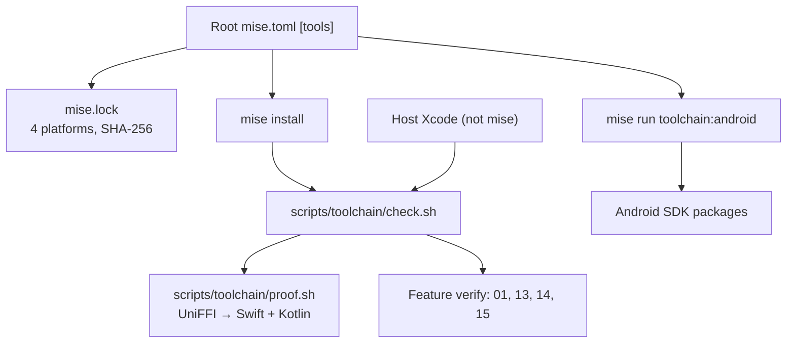

# Feature 17: The toolchain in mise

_Written in ASD-STE100 Simplified Technical English (STE). Code and identifiers stay as they
are._

**Abbreviations in this file.** continuous integration (CI); command-line tools (cmdline-tools);
Java Development Kit (JDK); Android Native Development Kit (NDK); Unified Foreign Function
Interface generator (UniFFI); software development kit (SDK); Secure Hash Algorithm 256-bit
(SHA-256); AeroSpace and Defence Industries Association of Europe (ASD), the owner of the STE
standard ASD-STE100.

## 1. Goal

One file pins every external tool that this specification needs. One command installs them.
One script proves that the host has them at the pinned versions. The native features consume
the pinned tools; they do not install a tool by hand.

The tools are the schema compiler `flatc`, the Java Development Kit (JDK), Gradle, Kotlin,
the Android software development kit (SDK) and `cargo-ndk`. Xcode is different: Apple
licenses it for the host, so the check reports the host Xcode version and a minimum, and it
does not install it.

## 2. Story

- **S1**: "I clone the repository and run one command. Every tool that the specification
  needs is there."
- **S2**: "The Android work needs the JDK, Gradle, Kotlin and an Android platform. One task
  installs the SDK packages."
- **S3**: "A tool is missing or has the wrong version. The check names it and stops before a
  test gives a confusing failure."
- **S4**: "CI uses the same pins as my machine."
- **S5**: "A later feature needs a new tool. It adds one pin and one check line, not a
  download script."
- **S6**: "The iOS work needs Xcode. Xcode is not in mise; the check tells me the found
  version and the minimum."

| # | Use case | Actor | Trigger | Result |
|---|---|---|---|---|
| U1 | Install | Developer | `mise install` | Every pinned tool is on the host |
| U2 | Android | Developer or CI | `mise run toolchain:android` | Platform-tools, the platform, build-tools and the NDK are installed |
| U3 | Check | Developer or CI | `scripts/toolchain/check.sh` | Exit 0, or a list of missing or wrong tools |
| U4 | Lock | Developer | `mise lock --platform …` | `mise.lock` holds a URL and a SHA-256 for every platform |
| U5 | CI | Runner | The job's mise step | The same pins as the developer's host |
| U6 | Drift | Check | A binary reports another version | A named failure |
| U7 | Proof | Developer | `scripts/toolchain/proof.sh` | A minimal UniFFI export builds, and its Swift and Kotlin bindings compile |

## 3. Bounded context

**Inside this feature:** the root `mise.toml` `[tools]`, `[env]` and `[tasks]`; `mise.lock`;
`scripts/toolchain/check.sh`; `scripts/toolchain/android.sh`; `scripts/toolchain/proof.sh`;
the shared tools of `ci/platform-images/mise/mise.toml`; the tool steps of the CI workflows;
the version record in `learnings.md`.

**Outside this feature:** the UniFFI crate surface (feature 13); the Swift package (feature
14); the Gradle project and its version catalog (feature 15); the schema and the `flatc`
flags (feature 01); the installation of Xcode (Apple); the Android application build
(feature 15).

## 4. Rules

### 4.1 Law worksheets

```
Entity: Toolchain
Conserved value:         exactly one pin for each external tool in the root mise.toml [tools]
Bound:                   none
Inverse pairs:           install / check
Idempotent verbs:        install, check, toolchain:android
Ordering pairs:          none
Monotone values:         none
Freeze points:           the pinned version of a tool that a released feature used
Links to other entities: mise.lock holds the URL and SHA-256 of each pin; the shared tools of the
                         CI image; the check script
```

```
Entity: Check
Conserved value:         every path of the root mise.toml [tools] has one check line
Bound:                   none
Inverse pairs:           pass / fail
Idempotent verbs:        check
Ordering pairs:          none
Monotone values:         none
Freeze points:           none
Links to other entities: the Toolchain entity; the host Xcode
```

### 4.2 Invariants

| # | Invariant |
|---|---|
| I1 | Every external tool appears once in the root `mise.toml` `[tools]`. No script, test or feature file holds a tool version of its own. |
| I2 | `mise.lock` holds an entry for each pinned tool for `linux-x64`, `macos-arm64`, `macos-x64` and `windows-x64`. |
| I3 | `scripts/toolchain/check.sh` exits with a non-zero status exactly when a tool is absent, not on `PATH`, or at a version other than its pin, and names each such tool. |
| I4 | `mise run toolchain:android` is idempotent: a second run installs no package and exits 0. |
| I5 | The CI jobs install the same pins as the root `mise.toml`; a difference fails the job. |
| I6 | Xcode is not installed by mise. On macOS the check requires at least the minimum version; on Linux and Windows it skips the Xcode line and the Android line. |
| I7 | `flatc` is 25.9.23, the newest release that the `flatbuffers` npm runtime also has (D57). |
| I8 | A native feature runs the check before its verify commands. A check failure is a setup error, not a test failure. |

### 4.3 Must have

- The `[tools]` rows of section 6.2.
- `scripts/toolchain/check.sh` and its test.
- `scripts/toolchain/android.sh` and the `toolchain:android` task.
- `scripts/toolchain/proof.sh`.
- The CI steps of section 6.6.

### 4.4 Must do

- Run `mise lock` for the four platforms after each pin change.
- Record the installed versions in `learnings.md`.
- Run the check at the start of the verify sections of features 01, 13, 14 and 15.
- Use the JDK pin for Gradle on every host.

### 4.5 Must not

- Do not install a tool inside a feature's test or script.
- Do not use `latest`, a branch or a range as a pin.
- Do not add `swift` to the macOS `[tools]`; it would shadow the Swift of Xcode.
- Do not put Xcode in mise.
- Do not add credentials to the repository.

## 5. Acceptance scenarios

```gherkin
Feature: Toolchain in mise

  Scenario: A clean host passes the check after one install
    Given a host with mise and no pinned tool installed
    When the developer runs "mise install" and "scripts/toolchain/check.sh"
    Then both commands exit with status 0
    And the check prints the version of every tool

  Scenario: A missing tool fails the check
    Given a PATH without flatc
    When the developer runs "scripts/toolchain/check.sh"
    Then the command exits with status 1
    And the output holds "FAIL flatc: not found"

  Scenario: A wrong version fails the check
    Given a fake flatc that prints "flatc version 25.12.19"
    When the developer runs "scripts/toolchain/check.sh"
    Then the command exits with status 1
    And the output holds "FAIL flatc: expected 25.9.23, got 25.12.19"

  Scenario: The Android packages install one time
    Given a host with the android-sdk tool and no platform
    When the developer runs "mise run toolchain:android" two times
    Then both runs exit with status 0
    And the second run prints that every package is present

  Scenario: An Xcode older than the minimum fails on macOS
    Given a macOS host with an Xcode below the minimum
    When the developer runs "scripts/toolchain/check.sh"
    Then the command exits with status 1
    And the output holds "FAIL xcode: expected at least <minimum>, got <version>"

  Scenario: The check skips the host-only tools elsewhere
    Given a Linux host
    When the developer runs "scripts/toolchain/check.sh"
    Then the output holds "SKIP xcode" and "SKIP android packages"
    And the command exits with status 0 when the mise tools are correct

  Scenario: CI uses the root pins
    Given the Linux image and the macOS job
    When the job installs the tools
    Then "mise install" reports the versions of the root mise.toml
    And a drift check exits with status 0 only when mise.lock matches

  Scenario: The proof generates both bindings
    When the developer runs "scripts/toolchain/proof.sh"
    Then the minimal UniFFI export builds
    And the generated Swift holds "func pushOps" as an async function
    And the generated Kotlin holds "suspend fun pushOps"
    And the script records the Rust, Swift and Kotlin versions in learnings.md
```

## 6. Technical breakdown



_The diagram shows the one pin table, the lock, the install, the Android task, the check and
the proof. Xcode stays on the host._

### 6.1 Measured facts

| Fact | Source |
|---|---|
| mise has a backend for every tool: `github:google/flatbuffers`, `java` (`core:java`), `gradle` (`aqua:gradle/gradle-distributions`), `kotlin` (`github:JetBrains/kotlin`), `android-sdk` (`vfox:mise-plugins/vfox-android-sdk`) | `mise registry`, 2026-11-14 |
| `mise install github:google/flatbuffers@25.9.23` downloads `Mac.flatc.binary.zip` and gives `flatc 25.9.23` | measured 2026-11-14 |
| `mise install gradle@9.9.1` and `mise install kotlin@2.4.21` succeed; `kotlinc-jvm 2.4.21` compiles and runs on JRE 27 | measured 2026-11-14 |
| Gradle 9.9.1 starts on Java 27, but a build with `jvmToolchain(21)` fails when only Java 27 is installed: no matching toolchain | measured 2026-11-14 |
| `mise install "java@temurin-25.0.5+8.0.LTS"` gives a JDK; with `JAVA_HOME` set to it, Gradle 9.9.1 and the Kotlin JVM plugin 2.4.21 compile a `jvmToolchain(25)` project | measured 2026-11-14 |
| Xcode 27.2 is installed with the iOS 27.2 SDK and simulator; the active developer directory is `/Library/Developer/CommandLineTools` | measured 2026-11-14 |
| The Android SDK has only the NDK at `27.0.12077973`; no cmdline-tools, `sdkmanager`, platform or build-tools | measured 2026-11-14 |
| The Android SDK mise plugin installs cmdline-tools, puts `platform-tools`, the emulator and the highest build-tools on `PATH`; `build_tools = false` keeps build-tools off `PATH` | `mise-plugins/vfox-android-sdk` README, 2026-11-14 |
| The shared CI image tools live in `ci/platform-images/mise/mise.toml`; the image installs them in locked mode | `ci/platform-images/images/linux/Dockerfile:59-71`, `bin/pi-mise-install` |
| The macOS CI job sets `DEVELOPER_DIR=/Applications/Xcode_26.2.app/Contents/Developer` | `.github/workflows/check.yaml` macOS job |
| The Linux CI job deletes the host Android tree before the build, to free disk | `.github/workflows/check.yaml` `package` job |
| UniFFI latest stable is 0.32.2 | crates.io, 2026-11-14 |
| cargo-ndk latest stable is 4.1.2 | `mise ls-remote cargo:cargo-ndk`, 2026-11-14 |

### 6.2 The pins

Append to the root `mise.toml` `[tools]`:

```toml
# The UI wire and the native work (feature 17).
"github:google/flatbuffers" = "25.9.23"   # flatc; D57. The npm runtime has no 25.12.19.
java = "temurin-25.0.5+8.0.LTS"           # the JDK that Gradle and the Android build use
gradle = "9.9.1"
kotlin = "2.4.21"
android-sdk = "23.0"                      # cmdline-tools; packages come from toolchain:android
"cargo:cargo-ndk" = "4.1.2"               # builds the Android .so files (feature 15)
```

| Tool | Backend | Pin | Why this version |
|---|---|---|---|
| `flatc` | `github:google/flatbuffers` | 25.9.23 | The newest release that the npm `flatbuffers` runtime has (D57) |
| JDK | `core:java` | `temurin-25.0.5+8.0.LTS` | A current long-term-support (LTS) JDK that Gradle 9.9.1 and Kotlin 2.4.21 support; the host Java 27 is not a Gradle toolchain |
| Gradle | `aqua:gradle/gradle-distributions` | 9.9.1 | The current stable release; feature 15's wrapper uses the same distribution |
| Kotlin | `github:JetBrains/kotlin` | 2.4.21 | The current stable release; feature 15's version catalog uses the same compiler |
| Android SDK | `vfox:mise-plugins/vfox-android-sdk` | 23.0 | Cmdline-tools; the package versions come from section 6.3 |
| cargo-ndk | `cargo:cargo-ndk` | 4.1.2 | The current stable release; feature 15's `build-android.sh` runs `cargo ndk` |

The Gradle wrapper in feature 15 and the mise Gradle must be the same distribution. The
version catalog in feature 15 takes the Kotlin version from the same pin. A test in this
feature reads both files and fails when a number differs.

`[env]` gains the values that the Android task and the check share:

```toml
ANDROID_COMPILE_SDK = "36"
ANDROID_BUILD_TOOLS = "36.0.0"
ANDROID_NDK = "27.0.12077973"
XCODE_MIN = "26.2"
```

### 6.3 The Android task

`scripts/toolchain/android.sh`:

```bash
#!/usr/bin/env bash
# Installs the Android SDK packages that feature 15 needs. Idempotent.
set -euo pipefail
: "${ANDROID_HOME:?mise must resolve the android-sdk tool first}"
yes | sdkmanager --licenses >/dev/null
sdkmanager --install \
  "platform-tools" \
  "platforms;android-${ANDROID_COMPILE_SDK}" \
  "build-tools;${ANDROID_BUILD_TOOLS}" \
  "ndk;${ANDROID_NDK}" >/dev/null
```

The task entry:

```toml
[tasks."toolchain:android"]
run = "scripts/toolchain/android.sh"
```

`sdkmanager` installs only what is absent, so the second run is a no-op (I4). The NDK is
already present on the development host at the pinned version; the task keeps it.

### 6.4 The check

`scripts/toolchain/check.sh` reads the pins from `mise.toml` with Python's `tomllib`, then
checks each tool in order. The expected value comes from the same file, so the script holds
no version (I1). The parse of the reported version is per tool, because the tools print in
different forms.

```bash
#!/usr/bin/env bash
# Checks every pinned tool of the root mise.toml. Exits 1 on the first summary with a fault.
set -euo pipefail
root="$(git rev-parse --show-toplevel)"
cd "$root"
fail=0
pass() { printf 'ok   %-12s %s\n' "$1" "$2"; }
miss() { printf 'FAIL %-12s %s\n' "$1" "$2"; fail=1; }

pin() { # pin <key> -> the version string from mise.toml
  python3 -I - "$1" <<'PY'
import sys, tomllib
key = sys.argv[1]
with open("mise.toml", "rb") as f:
    value = tomllib.load(f)["tools"][key]
print(value if isinstance(value, str) else value["version"])
PY
}

want=$(pin 'github:google/flatbuffers')
got=$(flatc --version 2>/dev/null | awk '{print $2}') || true
[ "$got" = "$want" ] && pass flatc "$got" || miss flatc "expected $want, got ${got:-none}"

want=$(pin gradle); got=$(gradle --version 2>/dev/null | awk '/^Gradle /{print $2}') || true
[ "$got" = "$want" ] && pass gradle "$got" || miss gradle "expected $want, got ${got:-none}"

want=$(pin kotlin); got=$(kotlinc -version 2>&1 | sed -nE 's/.*kotlinc-jvm ([0-9.]+).*/\1/p') || true
[ "$got" = "$want" ] && pass kotlin "$got" || miss kotlin "expected $want, got ${got:-none}"

want=$(pin java); want=${want#temurin-}; want=${want%%+*}
got=$(java -version 2>&1 | sed -nE '1s/.*"([0-9.]+).*/\1/p') || true
[ "$got" = "$want" ] && pass java "$got" || miss java "expected $want, got ${got:-none}"

want=$(pin 'cargo:cargo-ndk')
got=$(cargo ndk --version 2>/dev/null | awk '{print $2}') || true
[ "$got" = "$want" ] && pass cargo-ndk "$got" || miss cargo-ndk "expected $want, got ${got:-none}"

if [ "$(uname -s)" = Darwin ]; then
  xcode=$(xcodebuild -version 2>/dev/null | awk 'NR==1{print $2}') || true
  if [ -z "$xcode" ]; then miss xcode "not found; run: sudo xcode-select -s /Applications/Xcode.app/Contents/Developer"
  elif [ "$(printf '%s\n%s\n' "$XCODE_MIN" "$xcode" | sort -V | head -1)" != "$XCODE_MIN" ]; then
    miss xcode "expected at least $XCODE_MIN, got $xcode"
  else pass xcode "$xcode"; fi
  sdkmanager --version >/dev/null 2>&1 && pass android "cmdline-tools present" \
    || miss android "run: mise run toolchain:android"
else
  printf 'SKIP %-12s host-only\n' xcode android
fi

exit "$fail"
```

The exact Python call for a backend key such as `"github:google/flatbuffers"` comes from the
same `[tools]` table. The executor checks the generated output of `mise ls --json` if a key
is reported under another name, and records that name in `learnings.md`.

### 6.5 The proof

`scripts/toolchain/proof.sh` proves that the pinned Rust, Swift and Kotlin tools work
together. It runs when this feature is worked on, not on every pull request.

1. Make a temporary crate with `uniffi = "0.32.2"` in proc-macro mode and
   `crate-type = ["cdylib"]`.
2. Export one record with `Vec<u8>`, one error, one `async fn`, and one
   `#[uniffi::export(with_foreign)]` trait with an `async` method. This is the smallest
   surface that feature 13 uses.
3. `cargo build` the crate.
4. Run `uniffi-bindgen generate --library <dylib> --language swift` and `--language kotlin`.
5. Compile the generated Swift against the iOS simulator SDK:
   `xcrun --sdk iphonesimulator swiftc -target arm64-apple-ios27.0-simulator -typecheck`.
6. Compile the generated Kotlin with `kotlinc` against the JVM (the Android application
   classes are not needed for the binding).
7. Print the versions of Rust, UniFFI, Swift, Xcode and Kotlin, and record them in
   `learnings.md`.

The Swift target and the simulator SDK number come from the installed Xcode; the script reads
them with `xcrun --sdk iphonesimulator --show-sdk-version`. If a generator detail differs,
the executor records it and feature 13 uses the measured form.

The script does not go in the repository's build. It is a setup proof; it keeps its crate in
a temporary directory and removes it on exit. A test of the script itself checks that it
prints the six versions and exits 0.

### 6.6 CI

The Linux package job runs in the platform image. The image carries the generic tools from
`ci/platform-images/mise/mise.toml`; the repository's own pins come from the root
`mise.toml`. Add one step after the checkout:

```yaml
- name: Install the pinned toolchain
  shell: bash
  run: |
    mise install --yes
    scripts/toolchain/check.sh
```

- **Linux**: `flatc`, the JDK, Gradle and Kotlin. The Android packages stay off the image
  by default: the image deletes the host Android tree to free disk, and the SDK is large.
  Feature 15's `:core:test` runs on pull requests; the `:ui` compile and the example build
  run on the nightly full run. If the image can hold the packages, the task installs them
  there and the nightly condition is removed; record which case applies in `learnings.md`.
- **macOS**: the runner already has Xcode. It sets `DEVELOPER_DIR` to the Xcode that the
  image provides; the check requires at least `XCODE_MIN`. The Android SDK packages are
  installed on the macOS job only when the Android build runs there.
- **Windows**: no new tool is needed. The wire code is generated and checked in; the Windows
  job runs the Rust tests only. If a Windows step needs `flatc`, the same step installs it.

Rule 16 holds: these are steps in existing jobs, not new jobs.

### 6.7 Delegation from feature 01

Feature 01 section 6.3 step 1 no longer adds `flatc` to `mise.toml`. It states that `flatc`
comes from this feature, that `mise which flatc` must resolve, and that `flatc --version`
must equal the pin before the generate script runs. The flags of feature 01 section 6.3 are
the measured ones for 25.9.23.

The revision pass moves the pin paragraph from feature 01 to this file, and feature 01
depends on this feature.

### 6.8 Fault table

| Condition | Cause | Effect | Recovery |
|---|---|---|---|
| `mise install` cannot fetch a tool | No network, or a backend is down | A non-zero status and the tool name | Run again; if it stays, check `mise registry <tool>` and record the backend |
| A pin is absent from `mise.lock` | The lock was not refreshed | `mise install` fetches without the lock | Run `mise lock --platform linux-x64,macos-arm64,macos-x64,windows-x64` |
| `sdkmanager` asks for a licence | The licences were not accepted | The task stops | The task accepts them with `yes`; run it again |
| The Android platform is not in the SDK | The task did not run | Feature 15's Gradle build fails with "platform not found" | `mise run toolchain:android` |
| Xcode is the command-line tools only | `xcode-select` points at `/Library/Developer/CommandLineTools` | `xcodebuild` reports a missing tool | `sudo xcode-select -s /Applications/Xcode.app/Contents/Developer` |
| The Xcode version is below `XCODE_MIN` | An old runner | The check fails | Use a newer runner image, or lower the minimum with a recorded reason |
| The Gradle wrapper and the pin differ | A manual wrapper update | The drift test fails | Update the pin and the wrapper in one change |
| The Kotlin catalog and the pin differ | A manual catalog edit | The drift test fails | Update both in one change |

### 6.9 Security

- Every download comes from mise or from `sdkmanager`; `mise.lock` holds a SHA-256 for each
  tool and the image installs in locked mode.
- No script runs `curl | sh`.
- The Android licences are accepted in the task; no credential is stored.
- The proof crate is in a temporary directory and is removed on exit.

## 7. Tests

| Test | File | What it proves |
|---|---|---|
| Check passes on a complete host | `scripts/toolchain/check_test.sh` | I3, scenarios 1 |
| Check names a missing tool | same | I3, scenario 2 |
| Check names a wrong version | same | I3, scenario 3 |
| Check skips host-only tools on Linux | same, with a fake `uname` | I6, scenario 6 |
| The Android task is idempotent | `scripts/toolchain/android_test.sh` with a fake `sdkmanager` | I4, scenario 4 |
| The pins match the lock | `scripts/toolchain/lock_test.sh` | I2, scenario 7 |
| The Gradle and Kotlin numbers match the pins | `scripts/toolchain/drift_test.sh` reads feature 15's catalog and wrapper | I5, scenario 7 |
| The proof prints the six versions | `scripts/toolchain/proof_test.sh` with fake tools | scenario 8 |

The shell tests use a fake `PATH`; they do not install a tool.

## 8. Tasks

- [ ] 1. Add the `[tools]`, `[env]` and `[tasks]` entries of sections 6.2 and 6.3 to the
      root `mise.toml`.
- [ ] 2. Run `mise lock --platform linux-x64,macos-arm64,macos-x64,windows-x64` and check in
      `mise.lock`.
- [ ] 3. Write `scripts/toolchain/check.sh` and its test.
- [ ] 4. Write `scripts/toolchain/android.sh`, the task, and its test.
- [ ] 5. Write `scripts/toolchain/proof.sh` and its test.
- [ ] 6. Run the proof on macOS with the pinned tools; record the six versions in
      `learnings.md`.
- [ ] 7. Add the drift test for feature 15's catalog and wrapper.
- [ ] 8. Add the CI steps of section 6.6.
- [ ] 9. Change feature 01 section 6.3 step 1 to consume the pin.
- [ ] 10. Update `progress.md` and `learnings.md` with the versions and any backend that
      needed a different name.

## 9. Verify

```bash
mise install --yes
scripts/toolchain/check.sh
mise run toolchain:android          # macOS or Linux, when the Android build is needed
scripts/toolchain/proof.sh          # macOS, when the UniFFI surface exists
bash scripts/toolchain/check_test.sh
bash scripts/toolchain/android_test.sh
bash scripts/toolchain/lock_test.sh
bash scripts/toolchain/drift_test.sh
bash scripts/toolchain/proof_test.sh
```

On Linux, the check prints `SKIP xcode` and `SKIP android`. On macOS it needs Xcode at or
above `XCODE_MIN`. The Android task needs a network connection the first time.

## 10. Done when

- [ ] All tasks are complete and every command of section 9 passes with no warning.
- [ ] Each invariant and each scenario has a passing test (section 7).
- [ ] The proof records the Rust, UniFFI, Swift, Xcode and Kotlin versions in `learnings.md`.
- [ ] The CI has the steps of section 6.6, and the Linux, macOS and Windows jobs use the
      same pins.
- [ ] Feature 01, feature 13, feature 14 and feature 15 name this check in their verify
      sections.
- [ ] The check list of the `story-driven-specification` skill passes.
