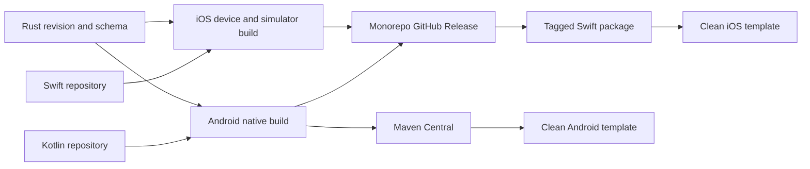

# Feature 19. Native package releases and starter applications

## Glossary

| Term | Meaning |
|---|---|
| Monorepo | The ewe_platform repository that owns the Rust core, wire schema and release workflow. |
| Sibling repository | A separate Git repository beside the monorepo in a developer workspace. |
| Swift Package Manager (SwiftPM) | The tool that resolves the iOS library from its tagged source repository. |
| XCFramework | An Apple bundle that contains native libraries for devices and simulators. |
| Android Archive (AAR) | An Android library archive that can include resources and compiled native libraries. |
| Maven coordinate | The group, artifact name and version that identify a published module. |
| Digest | A checksum that identifies the exact bytes of a file. |

## Story and ownership

An application developer starts from an iOS or Android template. One remote package dependency supplies the renderer and native runtime.
The developer can build the app without a Rust installation or a checkout of any library source.

| Proposed repository | Owns | Checkout for library development |
|---|---|---|
| ewe-studios/ewe_platform | Rust core, schema, generated wire contract, release inputs and workflow | ewe_platform/ |
| ewe-studios/ewe-ui-swift | Swift sources, tests, root Package.swift, iOS starter template | ewe-ui-swift/ |
| ewe-studios/ewe-ui-kotlin | Kotlin sources, tests, Gradle publication, Android starter template | ewe-ui-kotlin/ |

Confirm repository names and ownership of the Maven namespace before the first release.
Feature 14 establishes the Swift repository. Feature 15 establishes the Kotlin repository.
Their implementation briefs use the sibling checkout as the package root. Each source file has one owner.
Feature 13 generates bindings into a specified build directory. Package builds take the generated bindings and native libraries from the same Rust revision.
The packaged bindings, test fixtures and application sources have separate build inputs. Applications receive only runtime dependencies.
A local source override is an explicit maintainer option. A new app uses published dependencies by default.

## Release contract

Use one semantic version for the Rust native artifacts, Swift package, Kotlin modules and starter references.
Track native releases independently of the monorepo's existing binary and crate tags.

| Destination | Release identity and contents |
|---|---|
| Monorepo GitHub Release | Tag `native-ui-vX.Y.Z`. Attach the zipped XCFramework, Android publication archives and a checksummed release manifest. |
| Swift repository | Tag `X.Y.Z`. The root package exposes `EweUI`. Its binary target references the exact GitHub Release URL and checksum. |
| Swift Package Index | Submit the public Swift repository after its first semantic version tag. Verify the package listing. SwiftPM resolves the Git tag directly. |
| Kotlin repository | Tag `X.Y.Z` on the source commit used by Gradle. Record the monorepo release URL and Maven coordinates. |
| Maven Central | Publish the core, binding and renderer modules under a verified namespace. The renderer declares both dependencies for consumers. |

The native release manifest records all three source revisions, the schema version, the tool versions, the Maven coordinates and each artifact digest.
Record the final Swift tag revision in the manifest after creating its checksum-bearing package manifest.
Keep the native source revision used for compilation separately if the final Swift commit updates only release metadata.



Each template builds from a published version of the same native release.

## Build and publication

1. Add `release/native-ui.toml` to the monorepo. Record the version, repository addresses, input revisions, module names and target architectures.
2. Build from explicit commits in isolated checkouts. Use the pinned tools from feature 17.
3. Build the Swift wrapper and the Rust library for an iOS device and the supported simulator architectures. Assemble the XCFramework and compute its archive checksum.
4. Publish the Kotlin core as a Java archive. Publish binding and renderer modules as AAR files. Include native libraries for ARM64 and x86-64 in the binding.
5. Generate Maven module metadata and project descriptors with transitive dependencies. Attach sources, documentation, signatures and required checksums.
6. Stage the Maven deployment and a draft GitHub Release. Validate package contents and run the template tests against temporary release endpoints.
7. Use a protected release job to publish the GitHub assets, Swift and Kotlin tags, and Maven deployment. Keep credentials in the release environment.
8. Resolve the published version in each clean template. Record the final revisions, artifact digests and install coordinates on the GitHub Release.
9. Submit the Swift repository to Swift Package Index once. Index processing can finish after SwiftPM installation is available.

The workflow accepts a native release tag or a manual preview. The existing `v*` binary release workflow keeps its own triggers.
Preview jobs build and verify artifacts without repository write permissions. Release jobs serialize attempts for the same version.
On retry, compare each remote tag, digest and Maven deployment state with the saved release inputs.
Resume missing steps when the inputs match. Stop on a different digest or revision. Fix a published defect in a new version.
Advance the default template version only after both public installs pass.

## Template contract

The iOS starter adds the Swift package by repository URL and exact version. It imports `EweUI`.
The Android starter uses `google()` and `mavenCentral()` and declares one renderer coordinate. These identifiers illustrate the proposed names.

```swift
.package(url: "https://github.com/ewe-studios/ewe-ui-swift.git", exact: "1.0.0")
```

```kotlin
implementation("io.github.ewe-studios:ewe-ui:1.0.0")
```

Use the actual approved version and verified Maven namespace in the released templates.
Each starter renders a screen and calls one Rust-backed action. Keep application setup independent of generator scripts and local source paths.

## README task

- [ ] Write a README for the release tools and for each native package and starter.
  Show how to build a preview and how to install an exact version in each starter.
  Include package generation and the fixture checks that apply to each package.

## Verification and completion

| Scenario | Evidence required |
|---|---|
| Prepare a candidate | All three inputs resolve to fixed commits. Both builds use the same native core and schema. |
| Inspect the artifacts | The XCFramework contains device and simulator variants. The Android archives contain the declared native libraries and dependency metadata. |
| Consume Swift | In a clean directory, resolve the public URL with Xcode, build for a device, and run the starter on a simulator. |
| Consume Kotlin | With empty Gradle caches, build the starter from Maven Central. Run its native action on an emulator. |
| Detect a hidden local dependency | Run the template jobs with only the starter present. Reject local paths, composite builds and copied library directories. |
| Recover from partial publication | Interrupt after publishing one destination. A retry completes the other destinations and preserves published files. |
| Detect a conflict | Supply a different source revision for an existing release. The job fails before replacing an artifact or moving a tag. |
| Update a starter | Change only the package version. Both starters resolve the replacement and pass the same runtime checks. |
| Follow the README instructions | Build a preview and both starter examples from the documented commands. Run the documented generation and fixture checks. |

- [ ] The release, package and starter README examples and validation commands pass.

Add these entry points under `scripts/ui_native/release/`. Each command reads the same release configuration.

```sh
prepare.sh --config release/native-ui.toml --output dist/native-ui
verify.sh --candidate dist/native-ui --templates both
publish.sh --candidate dist/native-ui --resume
```

The prepare command builds a candidate and records its inputs. The verify command tests the consumer applications.
The publish command verifies the candidate digest before each public write. A manual preview runs the first two commands.
The first release requires repository write access, a verified Maven namespace, signing credentials and Central publishing credentials.

SwiftPM supports checksummed binary targets. Swift Package Index accepts public repositories with a root manifest and a semantic release tag.
[Apple binary distribution](https://developer.apple.com/documentation/xcode/distributing-binary-frameworks-as-swift-packages) · [Swift Package Index submission](https://swiftpackageindex.com/add-a-package)

Android documents Maven publication for libraries. Maven Central defines the required publication files and metadata.
[Android library publication](https://developer.android.com/build/publish-library/upload-library) · [Maven Central requirements](https://central.sonatype.org/publish/requirements/)
