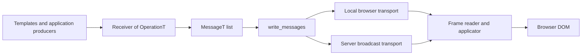
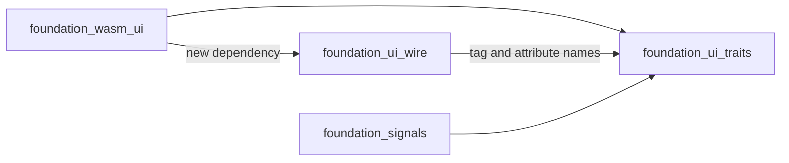

# Feature 20. Move existing callers to the frame writer

## Glossary

| Term | Meaning |
|---|---|
| User interface (UI) | The elements that an application displays and updates. |
| Document Object Model (DOM) | The browser's tree of elements and text. |
| Producer | Code that requests an element, text, attribute, or event change. |
| Writer | The feature 03 function that encodes messages for a client's platform and vocabulary. |
| Frame | One complete wire message with an `EWF1` identifier. |

## Story and sequence

An application updates a text node through a reactive template. Its receiver queues a generated operation.
The local browser and a remote browser both apply that operation through the frame protocol.
Application authors can use the same template syntax throughout the migration.

Features 03 and 09 supply the writer and browser reader. Verify browser parity before switching a caller.
Move the existing browser delivery path into this feature so its first migrated caller has a working reader.

The two transports deliver the writer's output to the same browser applicator.

## Crate ownership

Keep `foundation_ui_traits` independent of the writer throughout the migration.
It owns `Html`, `IntoHtml`, part descriptors, `HtmlTag`, `AttrName` and their name tables.
It also owns the current `DomOp` enum and its legacy codecs. These two groups have different lifetimes.
The wire crate already reads `TAG_NAMES` and `ATTR_NAMES` from traits in `src/vocab/web.rs`.
Deleting the legacy converter alone does not remove this dependency.

Each arrow points from the consumer to its dependency. The graph applies both during and after migration.

| Package | During the migration | After the switch |
|---|---|---|
| `foundation_ui_traits` | Keep its enum and codecs available to existing callers. | Keep pure template types and shared names. Retire legacy exports after the caller audit. |
| `foundation_ui_wire` | Own the generated operations, typed constructors, temporary conversion and frame writer. | Keep the constructors and writer. Remove the conversion after the last legacy producer moves. |
| `foundation_wasm_ui` | Add a direct wire dependency with the features needed on each target. Supply an opt-in frame transport. | Queue generated operations. Use one writer at each local or server delivery boundary. |
| `foundation_macros` | Keep pure `html!` expansion on traits. Test the existing reactive expansion with the new transport. | Generate reactive operation calls through the renderer’s public API. Test renamed dependencies. |
| `foundation_signals` | Check its actual imports. Its crate documentation mentions `DomOp`. | Keep signal and effect APIs independent of wire encoding. |

## Stage 1. Record current behavior and resolve child removal

Run an unchanged reactive template through the current browser runtime. Record results for all 19 variants.
Capture node registration, listener effects, sibling order, selectors and error behavior. Keep these fixtures independent of the new converter.

The current browser detaches a child from its named parent and keeps its identifier registered.
Deleting a node removes its registration. The current converter loses that distinction.
Add a parent-aware detach operation to the wire schema and browser applicator. Keep deletion as a separate operation.
Regenerate the bindings and check the schema and vocabulary version rules before emitting the new operation.

**Pass condition.** Detach a child, then reattach it by identifier. Delete the child, then check that lookup fails.
Try detaching from the wrong parent and verify that the original tree and registration survive.
Run each case against both readers. [Browser parity issue](https://github.com/ewe-studios/ewe_platform/issues/629)

## Stage 2. Add an opt-in frame transport

Keep the existing `DomOp` producers and receiver signatures. Add the wire dependency to `foundation_wasm_ui`.
Build the browser reader for this subset of feature 09. Ship the reader before enabling a producer that sends the new format.
At a row-batch flush, convert each operation to a generated `OperationT` and wrap it in a `MessageT`.
Call `writer::write_messages` once for the whole batch, with the receiving client's capabilities and the stream header.
Propagate errors before sending bytes.

Exercise both the local WebAssembly host and server broadcast. Also exercise `ColumnarReceiver` explicitly.
It accumulates columns directly. The row-buffer flush cannot intercept that path.
Compare the existing columnar path with the frame path using the same producer calls. Record bytes, allocations and timing for small reactive updates.

**Pass condition.** The same template produces the recorded browser effects through both transports.
A rejected batch sends zero bytes. A successful batch keeps operation order and frame headers.
Leave the existing default in place until the supported browser bundles pass.

## Stage 3. Switch the bundled default and migrate producers

Enable frames for the bundled browser and its matching producer. Keep an explicit legacy transport during this stage.
An independently deployed browser must receive a compatible reader before its server switches formats.
The explicit legacy transport provides a rollback while the producer migration is in progress.

Implement the [typed constructors](../12-legacy-wire-retirement/feature.md#64-step-b-move-the-internals-from-domop-to-generated-ops) in `foundation_ui_wire::ops`.
Expose those constructors through `foundation_wasm_ui` for renderer-based macro consumers.
A crate that builds wire operations directly declares its own wire dependency.
A pure template consumer continues to compile with the traits and macro crates alone.

Move the receiver, slots, reactive updates, component producers, mocks and examples in buildable groups.
Move the columnar-native receiver to the frame path before retiring its legacy encoder.
Check expanded macro code in an external consumer. Include a pure template and a reactive template with renamed dependencies.
Audit `foundation_arrow` and `foundation_wasm` separately for UI delivery. Preserve their general-purpose data and instruction paths.

**Public Rust API change.** A custom protocol implementing `ProtocolMethods<Vec<DomOp>>` or returning `HandleResult` must migrate.
Document its replacement signature and provide a compiled before-and-after fixture before removing the old interface.
Callers that match enum variants also need a migration example. Template authors keep the same syntax.

## Stage 4. Retire the legacy API

Check direct imports, re-exports, macro expansions, protocol selectors, examples and browser bundles.
Inspect each use of the traits crate's encoders and envelope before deleting an export.
Keep any item with a non-UI caller until that caller has an equivalent API.
Remove the converter and its reverse mapping when no production producer needs either one.
Feature 12 owns final removal of the traits crate's legacy exports and remaining compatibility readers after its parity checks pass.

**Pass condition.** Run the affected package tests, no-default-features wire tests, WebAssembly checks and real browser parity tests.
Use `cargo tree -p foundation_ui_wire` and `cargo tree -p foundation_wasm_ui` to verify the dependency direction.
Update package versions, consumer requirements and READMEs for each changed public API.
Show a template update, a custom protocol migration and a hand-written operation reaching the same reader.

## Ownership of later work

| Feature | Responsibility after this migration |
|---|---|
| 08 | Extend templates with core vocabulary and action bindings. Existing reactive output already uses generated operations. |
| 09 | Extend the shared browser applicator to the remaining frame forms. Reuse the reader and operation tests from feature 20. |
| 11 | Add live channels, replay and resume. Its frame sinks take generated operations directly. |
| 12 | Verify complete web parity and retire any remaining compatibility readers and test infrastructure. Feature 20 owns the producer switch. |

## Acceptance

- An unchanged reactive template updates a real browser through the default local path and the server broadcast path.
- The new browser results match the saved reference for each of the 19 operations.
- A rejected batch produces an error and emits zero bytes. A successful batch preserves order, stream identity and acknowledgement.
- Production producers, mocks and examples use generated operations. Every active UI delivery path reaches the feature 03 writer.
- Audit Rust with `rg -n '\bDomOp\b|\bweb_form\b|vocab::dom_op' backends bin examples --type rust`.
  Review browser protocol registrations separately. Document each remaining test-only reference with its removal owner.
- Run the affected Rust suites, the wire suite without default features, the WebAssembly target check and browser smoke tests.
  Run the README examples and the feature 09 browser parity cases for all migrated forms.
