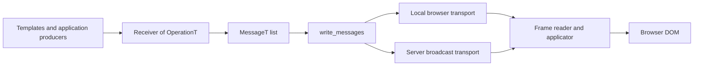

# Feature 20. Move existing callers to the frame writer

## Glossary

| Term | Meaning |
|---|---|
| User interface (UI) | The elements that an application displays and updates. |
| Document Object Model (DOM) | The browser's tree of elements and text. |
| Producer | Code that requests an element, text, attribute, or event change. |
| Writer | The feature 03 function that encodes messages for a client's platform and vocabulary. |
| Frame | One complete wire message with an `EWF1` identifier. |

## Story and sequence

An application updates a text node through a reactive template. Its receiver queues a generated operation.
The local browser and a remote browser both apply that operation through the frame protocol.
Application authors can use the same template syntax throughout the migration.

This is the next feature after the writer. Complete its feature 03 prerequisite before switching a caller.
Move the existing browser delivery path into this feature so its first migrated caller has a working reader.

The two transports deliver the writer's output to the same browser applicator.

## Implementation

1. Record reference outputs for all 19 existing `DomOp` variants before editing producers.
   Capture DOM changes, listener effects, node registration, sibling order and selector behaviour.
2. Implement the constructors specified in [feature 12, section 6.4](../12-legacy-wire-retirement/feature.md).
   Each constructor returns the generated `OperationT`. Test each mapping against the recorded behaviour.
   Resolve dependencies before adding imports. Keep the generated wire crate and the shared traits crate free of dependency cycles.
3. Move the browser reader and application of these 19 operations forward from [feature 09](../09-web-frame-applicator/feature.md).
   Test actual frames from the Rust writer. Cover local delivery and streamed delivery before switching defaults.
4. Change `foundation_wasm_ui` receivers, slots, reactive updates, application protocols and recording mocks to accept generated operations.
   Update `foundation_macros` reactive template expansion, `foundation_ui_components`, signal users and example applications in the same migration.
   Use the existing template compile tests to verify downstream crate paths.
5. At each delivery boundary, wrap each operation in one `MessageT` and call `writer::write_messages` with the client's capabilities and stream header.
   Propagate writer errors. Send bytes only after the complete batch passes validation.
   Migrate the local WebAssembly protocol, server broadcast, browser harness and default mount configuration together.
6. Audit `foundation_arrow`, `foundation_wasm`, browser scripts, examples and tests for legacy UI batch producers and protocol selectors.
   Remove the old production paths after their replacement passes. Preserve general Arrow data delivery and unrelated WebAssembly instructions.
7. Remove `vocab/dom_op.rs`, its exports, and both conversion directions when production callers use generated operations.
   Replace the vocabulary example with a direct writer example. Keep independent reference fixtures for browser comparisons.
8. Update the wire and browser package READMEs. Show a template update and a hand-written operation reaching the same reader.
   Record test commands, affected packages and results in the spec progress log.

## Ownership of later work

| Feature | Responsibility after this migration |
|---|---|
| 08 | Extend templates with core vocabulary and action bindings. Existing reactive output already uses generated operations. |
| 09 | Extend the shared browser applicator to the remaining frame forms. Reuse the reader and operation tests from feature 20. |
| 11 | Add live channels, replay and resume. Its frame sinks take generated operations directly. |
| 12 | Verify complete web parity and retire any remaining compatibility readers and test infrastructure. Feature 20 owns the producer switch. |

## Acceptance

- An unchanged reactive template updates a real browser through the default local path and the server broadcast path.
- The new browser results match the saved reference for each of the 19 operations.
- A rejected batch produces an error and emits zero bytes. A successful batch preserves order, stream identity and acknowledgement.
- Production producers, mocks and examples use generated operations. Every active UI delivery path reaches the feature 03 writer.
- Audit Rust with `rg -n '\bDomOp\b|\bweb_form\b|vocab::dom_op' backends bin examples --type rust`.
  Review browser protocol registrations separately. Document each remaining test-only reference with its removal owner.
- Run the affected Rust suites, the wire suite without default features, the WebAssembly target check and browser smoke tests.
  Run the README examples and the feature 09 browser parity cases for all migrated forms.
