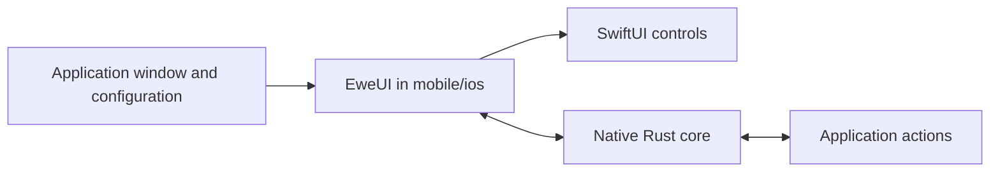

# Feature 21. Installable iOS library

## Contract

An application imports `EweUI` to display a Foundation user interface (UI) in SwiftUI.
A frame is a binary message that describes controls, state or actions.
Swift Package Manager (SwiftPM) installs the library from the tagged `ewe_platform` repository.
The package owns every native Foundation control and its rendering.



An application supplies its actions. The library renders their frames and forwards user events.

## Stage 1. Install the library

Move the existing Swift targets, generated bindings, tests and fixtures into `mobile/ios/`.
Keep one public SwiftPM manifest at the repository root. Give each target an explicit path under `mobile/ios/`.
Expose the existing `EweUI` product. Keep the generated wire reader and native bindings as dependencies.
Feature 19 supplies the versioned native binary, checksum and release tags.
Test a clean consumer against a candidate before publication and the exact tag after publication.

## Stage 2. Provide two runnable todo apps

| Xcode scheme | Example directory | Owner of task data |
|---|---|---|
| `TodoServer` | `examples/ui_todo/ios/todo_server/` | Rust server |
| `TodoOnDevice` | `examples/ui_todo/ios/todo_on_device/` | Rust core inside the app |

Give each app its own application identifier. Both apps must install on the same iPhone simulator.
Use **Todo Server** and **Todo On Device** as their display names.
Keep the package-only installation test under `examples/mobile_starter/ios/`.

**Todo Server.** The app loads its initial frame from the server. Submit, complete and delete go to server actions.
The device can still execute presentation actions such as opening a sheet and selecting a filter.

**Todo On Device.** The app starts its own Rust core, creates its task store and asks Rust for the initial frame.
Register all todo actions in the local host registry. Bind task mutations to that registry when constructing the view.
Return update frames and count changes directly to the renderer. The app requires no endpoint, socket listener or remote count subscription.
Keep the Rust store alive across actions for the app session. Reuse the Rust mutation and view functions in both modes.
Both examples use the same Swift library controls.
The server example supplies its endpoint, initial screen and application core factory.
Its Rust crate owns task data, action handlers and view declarations. Keep its generated bridge with the example.
The library owns the node store, controls, accessibility, sheet presentation, event delivery, frame decoding and live subscriptions.
A client can embed the renderer in an existing SwiftUI view. A local host can feed frames without an HTTP endpoint.

This package-only consumer supplies the server address and an action name:

```swift
import EweUI
import SwiftUI

struct ActivityScreen: View {
    let base: URL
    var body: some View {
        ServerScreen(base: base, initial: "activity", actions: ["refresh"])
    }
}
```

## Stage 3. Render the iPhone design

Implement the navigation title, toolbar button, segmented filter, list rows and form sheet in the library.
The Rust view selects controls by their presentation roles. Define each missing role in the shared vocabulary before using it.
Update readers, capability checks and fixtures for new wire fields. Verify ordinary controls on older frames.
Route each event through its declared action and attached state. The app supplies titles, values and business decisions.
Use the [design](../19-native-package-releases/design/todo-proposal.html) and [baseline screenshot](../19-native-package-releases/design/todo-before.png).

## Acceptance

- Build and install both named apps independently on the same iPhone simulator.
- Start Todo On Device with the server stopped and a test transport that fails on any network call.
  Verify the first screen, add, complete, filter, reopen, delete and count updates. Assert zero transport calls.
- Start Todo Server against a fresh store. Submit a task and read it back from a second server client.
  Confirm that the on-device app has its own list.
- Update project names, build scripts, test selectors and README commands. Document how to launch each example.

- Run `swift test` from the repository root. Replay the shared fixtures and compare the expected node snapshots.
- Build a clean app importing only the public product. Verify that its dependency graph excludes the todo bridge.
- Run a locally supplied frame and action with networking disabled. Verify the changed control on the simulator.
- Run the todo app on an iPhone simulator. Add, complete, filter, reopen and delete a task.
- Check large text, dark mode, VoiceOver labels and sheet dismissal. Save the resulting screenshot beside the baseline.
- Write `mobile/ios/README.md`. Document installation, imports, controls, actions, wire frames, fixtures and a hand-written frame example.
- Run the README examples and verify the release workflow from a checkout without sibling repositories.
