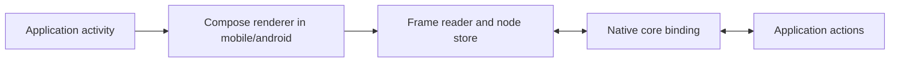

# Feature 22. Installable Android library

## Contract

An Android application installs the Kotlin user interface (UI) library with one Gradle dependency.
A frame describes controls, state or actions. The library applies frames and renders controls with Jetpack Compose.
The application supplies its business actions and decides which controls to display.



One public renderer dependency brings the frame reader and native binding into the application.

## Stage 1. Install the library

Move the existing Gradle project, wrapper, version catalog, tests and fixtures to `mobile/android/`.
Keep the `core`, `binding` and `ui` modules. The public renderer declares its runtime dependencies.
The Android Archive (AAR) contains the supported native libraries. Feature 19 publishes the modules to Maven Central.
The existing candidate uses this dependency:

```kotlin
implementation("io.github.ewe-studios:ewe-ui:0.1.0")
```

An application can embed the existing renderer with its configured store and event bridge:

```kotlin
import ewe.ui.compose.EweScreen

// Inside the activity's setContent block
EweScreen(store, bridge)
```

## Stage 2. Provide two runnable todo apps

| Gradle application project | Example directory | Owner of task data |
|---|---|---|
| `TodoServer` | `examples/ui_todo/android/todo_server/` | Rust server |
| `TodoOnDevice` | `examples/ui_todo/android/todo_on_device/` | Rust core inside the app |

Give each app its own application identifier. Both apps must install on the same Android emulator.
Use **Todo Server** and **Todo On Device** as their display names.
Keep the package-only installation test under `examples/mobile_starter/android/`.

**Todo Server.** The app loads its initial frame from the server. Submit, complete and delete go to server actions.
The device can still execute presentation actions such as opening a sheet and selecting a filter.

**Todo On Device.** The app starts its own Rust core, creates its task store and asks Rust for the initial frame.
Register all todo actions in the local host registry. Bind task mutations to that registry when constructing the view.
Return update frames and count changes directly to the renderer. The app requires no endpoint, socket listener or remote count subscription.
Keep the Rust store alive across actions for the app session. Reuse the Rust mutation and view functions in both modes.
Both examples use the same Kotlin library controls.
Move the repeated setup from their activities into the library. Provide a screen host for an endpoint or application core factory.
The host owns frame negotiation, application of the initial frame, event delivery, errors and live subscriptions.
Tie resource cleanup to the host lifecycle. Release only the resources the host owns.
Keep the lower-level renderer available for hosts that provide local frames directly.
The server example selects its endpoint, initial screen and Rust factory. Keep its native library and generated application bindings with the example.
Keep shared Rust business logic under `examples/ui_todo/`. Both mobile apps call the same actions.
Render all Foundation controls through the library. Use the shared vocabulary for any presentation roles added by feature 21.

## Acceptance

- Build and install both named apps independently on the same Android emulator.
- Start Todo On Device with the server stopped and a test transport that fails on any network call.
  Verify the first screen, add, complete, filter, reopen, delete and count updates. Assert zero transport calls.
- Start Todo Server against a fresh store. Submit a task and read it back from a second server client.
  Confirm that the on-device app has its own list.
- Update project names, build scripts, test selectors and README commands. Document how to launch each example.

- Run `./gradlew :core:test :ui:testDebugUnitTest` from `mobile/android/`. Replay the shared renderer fixtures.
- Stage the modules in a temporary Maven repository. Build a clean consumer with an empty Gradle cache and one dependency.
- Inspect the packaged libraries and dependency tree. Exclude the todo application, its native bridge and its generated bindings.
- Run a local frame and action with networking disabled. Verify its result on the emulator.
- Run the remote starter and the todo app on the emulator. Verify add, complete, filter, reopen and delete.
- Dispose and recreate the screen. Check that the old host releases subscriptions and the new screen receives each event once.
- Write `mobile/android/README.md`. Document installation, imports, controls, actions, wire frames, fixtures and a hand-written frame example.
- Run the README examples from a checkout without sibling repositories. Resolve the public coordinate after release.

## Implementation evidence

The library passed 13 Kotlin tests. A clean consumer resolved the renderer and its dependencies from the staged Maven repository.
Both apps ran on one Android 36 emulator. The installed local app excluded the network permission.
The server app preserved its task after screen recreation. A second client read the task.
The on-device app retained its separate list. The package-only starter changed its visible count after Refresh.
