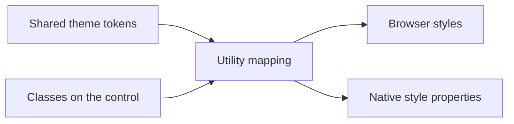

# Feature 23. Native controls and application themes

## Glossary

| Term | Meaning |
|---|---|
| Presentation role | A name in the frame that states the purpose of a node, such as a checklist row. |
| Token | A style name in Rust that travels in the frame as a number. |
| Theme | The native application's choices of colors and text styles. |
| Host | The public screen that connects the renderer to a server or an on-device Rust library. |

## Design for review

[View the proposed Android and iPhone screens](design/todo-proposal.html).
Compare the [current Android screen](design/android-before.png) and [current iPhone screen](../19-native-package-releases/design/todo-after.png).

Android already uses Material buttons. The current screen stacks the title, Add button, filters and rows at the top left.
Give each control a place in the screen layout. Keep the iPhone navigation, grouped list and sheets already in the example.
The two libraries own these decisions. Both todo applications on each platform use the same library.

| Existing role | Android proposal | iPhone proposal |
|---|---|---|
| Navigation title and toolbar action | Place the title and Add action in a Material top app bar. Respect system bar insets. | Keep the system navigation title. Place Add in the primary toolbar position. |
| Single selection | Group All, Open and Done in a single-choice segmented button row. | Keep the segmented picker. |
| Checklist row | Use a Material list item. Put completion first, the wrapping title next and the delete action last. | Keep the leading completion control. Expose delete through swipe and an accessibility action. |
| List footer | Align supporting text with the list. Use the theme's supporting text color. | Keep the section footer inside the grouped list. |
| Form and confirmation | Present entry in a Material sheet. Use a Material alert dialog for delete confirmation. | Keep the system form sheet and confirmation dialog. |
| Generic content | Render ordinary containers in document order. Apply the screen layout when the frame supplies its roles. | Preserve ordinary SwiftUI views for other content. |

The role gives a node a presentation purpose. The node identifier identifies the node. Moving its control into a toolbar must preserve its node identifier, action value and signed state.
Each tap sends one action. Dismissal sends the declared cancel action once.

## Explicit container tags

The author declares the container in Rust markup. Each tag has a shared meaning on all three platforms.
Children supply the content. Each platform measures the actual children when they appear. Authors need no placeholder or fixed height.

| Tag | SwiftUI | Android Compose | Web |
|---|---|---|---|
| Overlay | Layer children above the current view or sheet. | Layer children above the current screen or sheet. | Place children in a layer above the current view. |
| Modal | Present children and block background interaction. | Present children and block background interaction. | Present a modal dialog and contain focus. |
| BottomSheet | Align children to the bottom safe edge. | Render a bottom-aligned panel. | Anchor a section at the bottom of its container. |

An overlay allows input outside its children. A modal owns focus and background interaction.
A bottom sheet in ordinary layout takes its measured space. Inside an overlay, it leaves the underlying layout intact.
Inside a modal, it uses the existing modal surface. Opening it must create only one modal.
A bottom sheet can enter from below. Its resting edge remains at the bottom.

```rust
html! {
    <Modal>
        <BottomSheet>
            <Text>New todo</Text>
            <TextInput placeholder="Todo title" on:submit={add_todo}/>
        </BottomSheet>
    </Modal>
}
```

- Add explicit vocabulary entries. Carry tag identity through Rust lowering, the wire, and all three renderers.
- Preserve previously supported frames. New declarations select controls through tag identity.
- Give each tag its own named SwiftUI view and Kotlin component type. Each type receives its children through a rendering closure.
- Let that component own layout, accessibility, input handling, and cleanup for its tag. Keep platform dispatch limited to component selection.
- Preserve child order, identity, state, and action bindings. Components accept arbitrary supported children.
- Use the same Rust container declaration for the todo Add dialog on all platforms. Keep local and remote action selection independent.
- Test each component alone and in both nested arrangements. Verify sizing, background input, focus, dismissal, and single event delivery.
- Document the three tags and both compositions in the mobile and web guides.

### Implementation and checks

The [Swift components](../../../../mobile/ios/Sources/EweUI/ContainerViews.swift) and [Kotlin components](../../../../mobile/android/ui/src/main/kotlin/ewe/ui/compose/ContainerComponents.kt) own their child content.
The [todo view](../../../../examples/ui_todo/src/lib.rs) uses one modal with one bottom sheet for Add.
The iPhone simulator passed 17 package tests. The Android emulator passed five component tests.
Both platforms passed the on-device and server application checks.
The [browser test](../../../../examples/ui_todo/tests/todo_browser_tests.rs) checks inline layout, overlay input, modal focus, dismissal, and both submit gestures.

## Stage 1. Use the existing styling language

Authors define tokens once with the existing theme system. Shared controls accept the same utility classes as web elements.

```rust
html! { <Text class="text-primary p-md ios-p-lg android-p-sm">Buy milk</Text> }
```

All three renderers resolve primary from the active theme. Web applies medium padding. iOS applies large padding. Android applies small padding.
This example assumes the theme defines primary and the three spacing sizes. It specifies the proposed behavior for shared controls.

Today, the browser uses generated Cascading Style Sheets (CSS). The shared frame lowerer checks class as an ordinary property and rejects it.
Reuse foundation_theme token definitions and utility names. Give the shared lowering path a utility resolver before ordinary property validation.
Describe each utility's property, token category, valid units, supported platforms, and any equivalent native operation in one mapping.
Generate or validate platform mappings against that description. Keep theme identity available when a host changes its theme.

| Utility | Web | iOS | Android |
|---|---|---|---|
| text-primary | Theme text color | SwiftUI foreground style | Compose content or text color |
| p-md | Theme padding | SwiftUI padding in logical points | Compose padding in density-independent units |
| ios-p-lg | Ignore | Override padding with the large spacing token | Ignore |
| android-p-sm | Ignore | Ignore | Override padding with the small spacing token |

Apply shared utilities first. A matching platform prefix overrides the same property regardless of class order.
For competing utilities at the same level, the last applicable class wins. Explicit node properties take precedence.
Ignore prefixes for other platforms. Preserve ordinary web classes for application stylesheets.
Use a documented native equivalent when available. Otherwise skip only the unsupported utility and retain the other styles and children.
Document which length units map directly and which need layout context. Keep system text scaling and platform theme defaults available.
Use the shared theme to create the wire token mapping. Authors must not coordinate numeric identifiers by registration order.
Keep the existing explicit property syntax and wire readers compatible. [Browser theme guide](../../../../backends/foundation_wasm_ui/docs/theming.md)



Each renderer applies the supported styles to the node that owns the class list.

1. Start with the native control's default style for its role and state.
2. Inherit the host theme. Use SwiftUI tint and scalable fonts on iPhone. Read Material colors, typography and shapes on Android.
3. Resolve explicit color, background and font tokens on the node that owns the content.
4. When the host has no mapping, keep the role's theme value. An unknown background must retain the native surface.
5. Keep selected, disabled and destructive states accessible under each theme. Pair a custom surface with a legible content color.
6. Reapply theme changes to the displayed tree. Keep the existing store, focus, input and event bridge.

## Stage 2. Connect both public hosts

- Swift. Update `mobile/ios/Sources/EweUI/{Screen,Presentation,LocalScreen,ServerScreen}.swift`.
  Expose optional token maps through each host. Apply them to ordinary nodes and the controls built by presentation roles.
  Read the current theme when the view draws, including after the host loads its first frame.
- Kotlin. Update `EweHost.kt` and `EweScreen.kt` under `mobile/android/ui/src/main/kotlin/ewe/ui/compose/`.
  Let both hosts inherit a Compose theme or receive optional token mappings. Support missing entries in a partial mapping.
  Preserve existing low-level resolver calls. Keep theme changes outside the keys that restart the Rust host.
- Keep the public calls used by all four examples source compatible. Document default and branded calls in both package guides.
  Include one example that resolves the same Rust token in Swift and Kotlin. Document how Android hosts opt into dynamic color.
- Keep application actions in Rust. Build the controls in the mobile libraries. Each example only selects its transport and theme.

## Stage 3. Verify the result

| Check | Pass condition |
|---|---|
| Android and iPhone, both transports | Add, filter, toggle, cancel and confirm operate on the intended item. The keyboard can submit one new item. |
| Shared utility classes | Render the example above on all three platforms. Verify the text color and each platform's expected padding. |
| Unsupported utility | Mix a web-only class with shared padding. Verify that both mobile renderers still apply padding and display the children. |
| Theme change | Change the primary color and spacing tokens. Verify that existing controls use the new values without losing input or focus. |
| Default and branded hosts | One recorded frame renders with both themes. Changing the accent affects the control. Changing the body token affects its text. |
| Partial theme | A missing color, background or font uses the role default. Ordinary and role-based content both honor supported explicit tokens. |
| Theme change during a form | Typed text and focus survive. Changing the theme sends no action and starts no new connection. |
| Large text and long task names | The task name wraps. Filters and actions stay reachable at narrow widths and with the keyboard open. |
| Screen readers | VoiceOver and TalkBack announce each action, selected filter and completion state. Delete is reachable without a swipe. |
| Visual review | Capture real pixels on each simulator in light, dark and branded appearances. Include the list, entry sheet and delete confirmation. |

Use the [Android skill](../../../../.agents/skills/android-material-design/SKILL.md) and [iOS skill](../../../../.agents/skills/ios-human-interface-design/SKILL.md) during review.
Record the device, operating system, text size and theme with each capture.
The host token limitation is tracked in [issue 652](https://github.com/ewe-studios/ewe_platform/issues/652).
