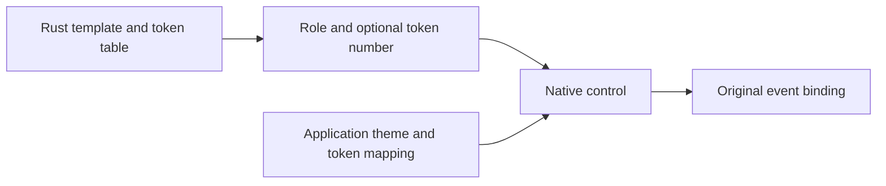

# Feature 23. Native controls and application themes

## Glossary

| Term | Meaning |
|---|---|
| Presentation role | A name in the frame that states the purpose of a node, such as a checklist row. |
| Token | A style name in Rust that travels in the frame as a number. |
| Theme | The native application's choices of colors and text styles. |
| Host | The public screen that connects the renderer to a server or an on-device Rust library. |

## Design for review

[View the proposed Android and iPhone screens](design/todo-proposal.html).
Compare the [current Android screen](design/android-before.png) and [current iPhone screen](../19-native-package-releases/design/todo-after.png).

Android already uses Material buttons. The current screen stacks the title, Add button, filters and rows at the top left.
Give each control a place in the screen layout. Keep the iPhone navigation, grouped list and sheets already in the example.
The two libraries own these decisions. Both todo applications on each platform use the same library.

| Existing role | Android proposal | iPhone proposal |
|---|---|---|
| Navigation title and toolbar action | Place the title and Add action in a Material top app bar. Respect system bar insets. | Keep the system navigation title. Place Add in the primary toolbar position. |
| Single selection | Group All, Open and Done in a single-choice segmented button row. | Keep the segmented picker. |
| Checklist row | Use a Material list item. Put completion first, the wrapping title next and the delete action last. | Keep the leading completion control. Expose delete through swipe and an accessibility action. |
| List footer | Align supporting text with the list. Use the theme's supporting text color. | Keep the section footer inside the grouped list. |
| Form and confirmation | Present entry in a Material sheet. Use a Material alert dialog for delete confirmation. | Keep the system form sheet and confirmation dialog. |
| Generic content | Render ordinary containers in document order. Apply the screen layout when the frame supplies its roles. | Preserve ordinary SwiftUI views for other content. |

The role identifies a node. Moving its control into a toolbar must preserve its node identifier, action value and signed state.
Each tap sends one action. Dismissal sends the declared cancel action once.

## Stage 1. Use the existing styling language

A Rust application registers names when it builds its token table. This example uses the existing template syntax.

```rust
let mut tokens = TokenTable::new();
let accent = tokens.color("--accent");
let body = tokens.font("--body");
let template = html! { <Text color="--accent" font="--body">Buy milk</Text> };
let ops = lower(&template, &LowerOptions { id_base: 100, tokens: &tokens })?;
```

The host maps the color number in `accent` and the font number in `body` separately.
Ship the same registration order with the frame producer and host. Each table numbers its own entries from one.



The role selects the control. The theme supplies a native value for each known token.

1. Start with the native control's default style for its role and state.
2. Inherit the host theme. Use SwiftUI tint and scalable fonts on iPhone. Read Material colors, typography and shapes on Android.
3. Resolve explicit color, background and font tokens on the node that owns the content.
4. When the host has no mapping, keep the role's theme value. An unknown background must retain the native surface.
5. Keep selected, disabled and destructive states accessible under each theme. Pair a custom surface with a legible content color.
6. Reapply theme changes to the displayed tree. Keep the existing store, focus, input and event bridge.

## Stage 2. Connect both public hosts

- Swift. Update `mobile/ios/Sources/EweUI/{Screen,Presentation,LocalScreen,ServerScreen}.swift`.
  Expose optional token maps through each host. Apply them to ordinary nodes and the controls built by presentation roles.
  Read the current theme when the view draws, including after the host loads its first frame.
- Kotlin. Update `EweHost.kt` and `EweScreen.kt` under `mobile/android/ui/src/main/kotlin/ewe/ui/compose/`.
  Let both hosts inherit a Compose theme or receive optional token mappings. Support missing entries in a partial mapping.
  Preserve existing low-level resolver calls. Keep theme changes outside the keys that restart the Rust host.
- Keep the public calls used by all four examples source compatible. Document default and branded calls in both package guides.
  Include one example that resolves the same Rust token in Swift and Kotlin. Document how Android hosts opt into dynamic color.
- Keep application actions in Rust. Build the controls in the mobile libraries. Each example only selects its transport and theme.

## Stage 3. Verify the result

| Check | Pass condition |
|---|---|
| Android and iPhone, both transports | Add, filter, toggle, cancel and confirm operate on the intended item. The keyboard can submit one new item. |
| Default and branded hosts | One recorded frame renders with both themes. Changing the accent affects the control. Changing the body token affects its text. |
| Partial theme | A missing color, background or font uses the role default. Ordinary and role-based content both honor supported explicit tokens. |
| Theme change during a form | Typed text and focus survive. Changing the theme sends no action and starts no new connection. |
| Large text and long task names | The task name wraps. Filters and actions stay reachable at narrow widths and with the keyboard open. |
| Screen readers | VoiceOver and TalkBack announce each action, selected filter and completion state. Delete is reachable without a swipe. |
| Visual review | Capture real pixels on each simulator in light, dark and branded appearances. Include the list, entry sheet and delete confirmation. |

Use the [Android skill](../../../../.agents/skills/android-material-design/SKILL.md) and [iOS skill](../../../../.agents/skills/ios-human-interface-design/SKILL.md) during review.
Record the device, operating system, text size and theme with each capture.
The host token limitation is tracked in [issue 652](https://github.com/ewe-studios/ewe_platform/issues/652).
