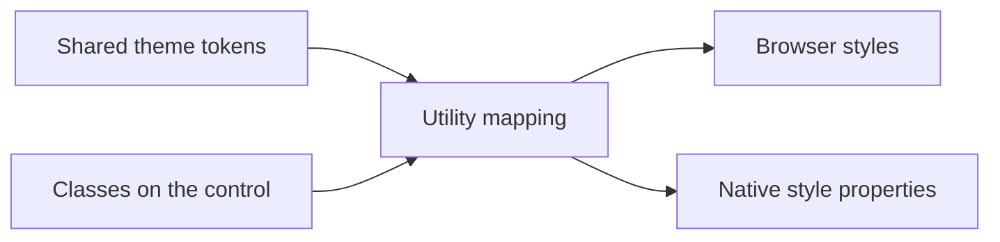

# Feature 23. Native controls and application themes

## Glossary

| Term | Meaning |
|---|---|
| Presentation role | A name in the frame that states the purpose of a node, such as a checklist row. |
| Token | A style name in Rust that travels in the frame as a number. |
| Theme | The native application's choices of colors and text styles. |
| Host | The public screen that connects the renderer to a server or an on-device Rust library. |

## Design for review

[View the proposed Android and iPhone screens](design/todo-proposal.html).
Compare the [current Android screen](design/android-before.png) and [current iPhone screen](../19-native-package-releases/design/todo-after.png).

Android already uses Material buttons. The current screen stacks the title, Add button, filters and rows at the top left.
Give each control a place in the screen layout. Keep the iPhone navigation, grouped list and sheets already in the example.
The two libraries own these decisions. Both todo applications on each platform use the same library.

| Existing role | Android proposal | iPhone proposal |
|---|---|---|
| Navigation title and toolbar action | Place the title and Add action in a Material top app bar. Respect system bar insets. | Keep the system navigation title. Place Add in the primary toolbar position. |
| Single selection | Group All, Open and Done in a single-choice segmented button row. | Keep the segmented picker. |
| Checklist row | Use a Material list item. Put completion first, the wrapping title next and the delete action last. | Keep the leading completion control. Expose delete through swipe and an accessibility action. |
| List footer | Align supporting text with the list. Use the theme's supporting text color. | Keep the section footer inside the grouped list. |
| Form and confirmation | Present entry in a Material sheet. Use a Material alert dialog for delete confirmation. | Keep the system form sheet and confirmation dialog. |
| Generic content | Render ordinary containers in document order. Apply the screen layout when the frame supplies its roles. | Preserve ordinary SwiftUI views for other content. |

The role gives a node a presentation purpose. The node identifier identifies the node. Moving its control into a toolbar must preserve its node identifier, action value and signed state.
Each tap sends one action. Dismissal sends the declared cancel action once.

## Explicit container tags

The author declares the container in Rust markup. Each tag has a shared meaning on all three platforms.
Children supply the content. Each platform measures the actual children when they appear. Authors need no placeholder or fixed height.

| Tag | SwiftUI | Android Compose | Web |
|---|---|---|---|
| Overlay | Layer children above the current view or sheet. | Layer children above the current screen or sheet. | Place children in a layer above the current view. |
| Modal | Present children and block background interaction. | Present children and block background interaction. | Present a modal dialog and contain focus. |
| BottomSheet | Align children to the bottom safe edge. | Render a bottom-aligned panel. | Anchor a section at the bottom of its container. |

An overlay allows input outside its children. A modal owns focus and background interaction.
A bottom sheet in ordinary layout takes its measured space. Inside an overlay, it leaves the underlying layout intact.
Inside a modal, it uses the existing modal surface. Opening it must create only one modal.
A bottom sheet can enter from below. Its resting edge remains at the bottom.

```rust
html! {
    <Modal>
        <BottomSheet>
            <Text>New todo</Text>
            <TextInput placeholder="Todo title" on:submit={add_todo}/>
        </BottomSheet>
    </Modal>
}
```

- Add explicit vocabulary entries. Carry tag identity through Rust lowering, the wire, and all three renderers.
- Preserve previously supported frames. New declarations select controls through tag identity.
- Give each tag its own named SwiftUI view and Kotlin component type. Each type receives its children through a rendering closure.
- Let that component own layout, accessibility, input handling, and cleanup for its tag. Keep platform dispatch limited to component selection.
- Preserve child order, identity, state, and action bindings. Components accept arbitrary supported children.
- Use the same Rust container declaration for the todo Add dialog on all platforms. Keep local and remote action selection independent.
- Test each component alone and in both nested arrangements. Verify sizing, background input, focus, dismissal, and single event delivery.
- Document the three tags and both compositions in the mobile and web guides.

### Implementation and checks

The [Swift components](../../../../mobile/ios/Sources/EweUI/ContainerViews.swift) and [Kotlin components](../../../../mobile/android/ui/src/main/kotlin/ewe/ui/compose/ContainerComponents.kt) own their child content.
The [todo view](../../../../examples/ui_todo/src/lib.rs) uses one modal with one bottom sheet for Add.
The iPhone simulator passed 17 package tests. The Android emulator passed five component tests.
Both platforms passed the on-device and server application checks.
The [browser test](../../../../examples/ui_todo/tests/todo_browser_tests.rs) checks inline layout, overlay input, modal focus, dismissal, and both submit gestures.

## Stage 1. Use the existing styling language

Authors define tokens once with the existing theme system. Shared controls accept the same utility classes as web elements.

```rust
html! { <Text class="text-primary p-md ios-p-lg android-p-sm">Buy milk</Text> }
```

All three renderers resolve primary from the active theme. Web applies medium padding. iOS applies large padding. Android applies small padding.
This example assumes the theme defines primary and the three spacing sizes. It specifies the proposed behavior for shared controls.

The browser uses generated Cascading Style Sheets (CSS). Vocabulary 7 carries shared control classes in UTILITY_CLASSES.
Reuse foundation_theme token definitions and utility names. Give the shared lowering path a utility resolver before ordinary property validation.
Describe each utility's property, token category, valid units, supported platforms, and any equivalent native operation in one mapping.
Generate or validate platform mappings against that description. Keep theme identity available when a host changes its theme.

| Utility | Web | iOS | Android |
|---|---|---|---|
| text-primary | Theme text color | SwiftUI foreground style | Compose content or text color |
| p-md | Theme padding | SwiftUI padding in logical points | Compose padding in density-independent units |
| ios-p-lg | Ignore | Override padding with the large spacing token | Ignore |
| android-p-sm | Ignore | Ignore | Override padding with the small spacing token |

Apply shared utilities first. A matching platform prefix overrides the same property regardless of class order.
For competing utilities at the same level, the last applicable class wins. Explicit node properties take precedence.
Ignore prefixes for other platforms. Preserve ordinary web classes for application stylesheets.
Use a documented native equivalent when available. Otherwise skip only the unsupported utility and retain the other styles and children.
Document which length units map directly and which need layout context. Keep system text scaling and platform theme defaults available.
Use the shared theme to create the wire token mapping. Authors must not coordinate numeric identifiers by registration order.
Keep the existing explicit property syntax and wire readers compatible. [Browser theme guide](../../../../backends/foundation_wasm_ui/docs/theming.md)



Each renderer applies the supported styles to the node that owns the class list.

1. Start with the native control's default style for its role and state.
2. Inherit the host theme. Use SwiftUI tint and scalable fonts on iPhone. Read Material colors, typography and shapes on Android.
3. Resolve explicit color, background and font tokens on the node that owns the content.
4. When the host has no mapping, keep the role's theme value. An unknown background must retain the native surface.
5. Keep selected, disabled and destructive states accessible under each theme. Pair a custom surface with a legible content color.
6. Reapply theme changes to the displayed tree. Keep the existing store, focus, input and event bridge.

## Stage 2. Connect both public hosts

- Swift. Update `mobile/ios/Sources/EweUI/{Screen,Presentation,LocalScreen,ServerScreen}.swift`.
  Expose optional token maps through each host. Apply them to ordinary nodes and the controls built by presentation roles.
  Read the current theme when the view draws, including after the host loads its first frame.
- Kotlin. Update `EweHost.kt` and `EweScreen.kt` under `mobile/android/ui/src/main/kotlin/ewe/ui/compose/`.
  Let both hosts inherit a Compose theme or receive optional token mappings. Support missing entries in a partial mapping.
  Preserve existing low-level resolver calls. Keep theme changes outside the keys that restart the Rust host.
- Keep the public calls used by all four examples source compatible. Document default and branded calls in both package guides.
  Include one example that resolves the same Rust token in Swift and Kotlin. Document how Android hosts opt into dynamic color.
- Keep application actions in Rust. Build the controls in the mobile libraries. Each example only selects its transport and theme.

## Stage 3. Verify the result

| Check | Pass condition |
|---|---|
| Android and iPhone, both transports | Add, filter, toggle, cancel and confirm operate on the intended item. The keyboard can submit one new item. |
| Shared utility classes | Render the example above on all three platforms. Verify the text color and each platform's expected padding. |
| Unsupported utility | Mix a web-only class with shared padding. Verify that both mobile renderers still apply padding and display the children. |
| Theme change | Change the primary color and spacing tokens. Verify that existing controls use the new values without losing input or focus. |
| Default and branded hosts | One recorded frame renders with both themes. Changing the accent affects the control. Changing the body token affects its text. |
| Partial theme | A missing color, background or font uses the role default. Ordinary and role-based content both honor supported explicit tokens. |
| Theme change during a form | Typed text and focus survive. Changing the theme sends no action and starts no new connection. |
| Large text and long task names | The task name wraps. Filters and actions stay reachable at narrow widths and with the keyboard open. |
| Screen readers | VoiceOver and TalkBack announce each action, selected filter and completion state. Delete is reachable without a swipe. |
| iOS and Android entry sheets | Place Cancel and Add on one row below the field. Put Cancel first. Keep both buttons visible above the keyboard. Allow wrapping when larger text needs more room. |
| Android delete confirmation | Show Cancel and Confirm side by side when both fit. Cancel preserves the item. Confirm deletes it. |
| Visual review | Capture real pixels on each simulator in light, dark and branded appearances. Include the list, entry sheet and delete confirmation. |

Use the [Android skill](../../../../.agents/skills/android-material-design/SKILL.md) and [iOS skill](../../../../.agents/skills/ios-human-interface-design/SKILL.md) during review.
Record the device, operating system, text size and theme with each capture.
The host token limitation is tracked in [issue 652](https://github.com/ewe-studios/ewe_platform/issues/652).

### Device captures

The iPhone 17 simulator runs iOS 27.0. The Pixel emulator runs Android 16 with Google APIs.
Light and dark use the default text size. Branded uses a larger text size and the Rust primary color.
The iPhone uses accessibility large text. The Pixel uses a font scale of 1.4.

| Device and theme | List | Entry | Confirmation |
|---|---|---|---|
| iPhone light | [List](design/ios-light-list.png) | [Entry](design/ios-light-entry.png) | [Confirmation](design/ios-light-confirmation.png) |
| iPhone dark | [List](design/ios-dark-list.png) | [Entry](design/ios-dark-entry.png) | [Confirmation](design/ios-dark-confirmation.png) |
| iPhone branded | [List](design/ios-branded-list.png) | [Entry](design/ios-branded-entry.png) | [Confirmation](design/ios-branded-confirmation.png) |
| Pixel light | [List](design/android-light-list.png) | [Entry](design/android-light-entry.png) | [Confirmation](design/android-light-confirmation.png) |
| Pixel dark | [List](design/android-dark-list.png) | [Entry](design/android-dark-entry.png) | [Confirmation](design/android-dark-confirmation.png) |
| Pixel branded | [List](design/android-branded-list.png) | [Entry](design/android-branded-entry.png) | [Confirmation](design/android-branded-confirmation.png) |

Use `TEST_RUNNER_EWE_REVIEW_THEMES=1` with `scripts/ui_native/test-ios-todo.sh DEVICE` to record the iPhone attachments.
Use `EWE_THEME_CAPTURES=DIRECTORY` with `scripts/ui_native/test-android-todo.sh` to record the Pixel images.
Set `EWE_ANDROID_SERIAL` to reuse a running emulator. Use a full system image for screenshots.

## Todo search and iPhone entry revision

The owner approves this revision on 2026-11-25.

Compare the [Android capture](design/android-search-before.png) and [iPhone capture](design/ios-search-before.png) with the [proposed layout](design/search-and-entry.html).

1. Give search an explicit typed control in the shared view. Preserve its query, label, and change action.
2. Map the control to a Material 3 search field on Android. Use theme colors, a leading search icon, and a clear action.
3. Use the native search field below the navigation title on iPhone. Support clearing, keyboard dismissal, and live filtering.
4. Preserve the search action in the browser renderer. Keep ordinary form fields independent.
5. Present iPhone entry as one sheet that slides from the bottom. Round only its upper corners.
6. Extend its background to the physical bottom edge. Keep the text field and both buttons above the home indicator.
7. Move controls above the keyboard. Allow vertical scrolling at large text sizes. Preserve draft, submit, and cancel behavior.
8. Verify both mobile hosts with empty and populated queries. Check light and dark appearances, large text, and keyboard transitions.
9. Capture the open sheet with and without the keyboard. Verify that no strip of the list shows below the sheet.

### Search and entry checks

Todo Server and Todo On Device use the same search control on each platform.
Typing filters the visible list. Clearing the query restores matching rows for the selected status filter.
Pending titles follow the same search rules as confirmed titles.

| Device | Search | Entry and keyboard |
|---|---|---|
| Pixel | [Light](design/android-search-light.png) and [large dark text](design/android-search-dark-large.png) | [Search with the keyboard open](design/android-search-keyboard.png) |
| iPhone | [Light](design/ios-native-search.png) and [large dark text](design/ios-dark-native-search.png) | [Attached sheet](design/ios-entry-attached.png) and [keyboard](design/ios-entry-keyboard.png) |
| iPhone with large dark text | [Search](design/ios-dark-native-search.png) | [Attached sheet](design/ios-dark-entry-attached.png) and [keyboard](design/ios-dark-entry-keyboard.png) |

## Browser list color scheme

The browser changes the row text color when the system selects a dark appearance.
The page canvas remains white. A populated title has a contrast ratio of approximately 1.45 to 1.
[Issue 1069](https://github.com/ewe-studios/ewe_platform/issues/1069) tracks this problem.

- [Current light list](design/browser-light-list-before.png)
- [Current dark list](design/browser-dark-list-before.png)

Declare support for light and dark appearances in the Todo page template.
This declaration makes the standard browser canvas and form colors follow the selected appearance.
Keep the existing theme token values and controls.

1. Load a populated Todo list in Chromium with each appearance.
2. Check that populated row titles and dialog text have a contrast ratio of at least 4.5 to 1.
3. Use the keyboard to reach the filter and dialog controls. Check that you can see the focus outline.
4. Complete a Todo. Check its state, count, and filter placement.
5. Capture the list and open dialog in each appearance.

The row title contrast is 7.47 to 1 in light appearance and 12.90 to 1 in dark appearance.
The filter focus outline contrast is 5.98 to 1 in light and 10.76 to 1 in dark.
The dialog text contrast is 21 to 1 in light and 18.73 to 1 in dark.
Keyboard focus remains inside the dialog. Complete moves the row to Done and updates the open count.

- [Light list](design/browser-light-list.png)
- [Light dialog](design/browser-light-dialog.png)
- [Dark list](design/browser-dark-list.png)
- [Dark dialog](design/browser-dark-dialog.png)

### iPhone Simulator rerun on 2026-11-28

A new iPhone 17 simulator runs iOS 27.0. It uses the retained Feature 37 Todo apps and a separate loopback server and database.
Todo Server opens to the Todos list with zero items on its first launch. The server test adds a task and marks it complete.
The on-device test creates, filters, completes, reopens and deletes a task. This test uses the standard controls.

[First launch on iPhone 17 Simulator](screenshots/iphone17-simulator-first-launch-2026-11-28.png)


### Physical iPhone setup on 2026-11-28

The iPhone 13 Pro runs iOS 27.2.1 with Developer Mode enabled.
Xcode signs the scratch Todo On Device application with the existing Apple Development identity.
The signature passes verification. The provisioning profile includes this phone and the scratch bundle identifier.
The device accepts installation. A launch before device approval returns a security error.
The owner trusts the Personal Team on the phone. The device then launches the app without a debugger and reports its running process.
A separate signed Todo Server app installs and launches on the same phone.
A relay binds to the wired developer tunnel. It accepts connections from the paired phone only.
It forwards to the existing Mac loopback server. The phone connects without any Todo write from the check.
The phone screen shows the Todos title and the Play Mathalley control.
The debugger-stopped launch and the scratch-store VoiceOver handoff remain open.

### Physical iPhone Todo handoff

Use a signed scratch Todo Server for the first-install and VoiceOver checks.
Run the preparation task and start a separate server from the repository root.

```sh
native-task task run native:todo:prepare-ios
todo_device_run=$(mktemp -d "${TMPDIR:-/tmp}/ewe-todo-device.XXXXXX")
cargo run --locked --profile uat -p ui_todo --bin ui_todo -- 127.0.0.1:0 --store "$todo_device_run/todo.sqlite3"
```

Use the printed address to seed the scratch store from the browser.
Add three uniquely named test items.
Use an approved device-reachable endpoint for this scratch port.
Keep the Todo process bound to loopback. Leave the check pending if the phone cannot reach that endpoint.

1. Open the [Todo Server project](../../../../examples/ui_todo/ios/todo_server/README.md). Select a signing team.
   Select the physical device and TodoServer scheme.
2. Build two fresh scratch bundle identifiers. Set `EWE_TODO_SERVER_URL` in both builds for launches outside the Xcode scheme.
3. Install the first signed application. Launch it with no debugger. Record the launch time, first title and first visible seeded item.
4. Install the second application. Launch it with `--start-stopped`. Capture the screen before the application runs.
5. Continue the second process in the debugger. Record scene readiness and first list content.
   Save logs for the scratch bundle and the launch-image service.
6. Compare both results with issue 831. Record any launch-image timeout, including the reported error and elapsed time.

Use the built application paths and scratch bundle identifiers in these commands.

```sh
xcrun devicectl device install app --device "$IPHONE" "$TODO_NORMAL_APP"
xcrun devicectl device process launch --device "$IPHONE" "$TODO_NORMAL_ID"
xcrun devicectl device install app --device "$IPHONE" "$TODO_PAUSED_APP"
xcrun devicectl device process launch --device "$IPHONE" --start-stopped "$TODO_PAUSED_ID"
```

To continue the paused application, start `xcrun lldb`.
Enter `device select IPHONE` and `device process attach -p PROCESS_ID`. Use the selected device and launch process identifier.
Enter `continue` after you record the launch image.

For VoiceOver, use the live scratch list after a normal launch.
Focus one test item. Select Delete from VoiceOver Actions and double-tap.
The confirmation opens without a row reveal gesture. Focus enters the confirmation.
Cancel once and check that the item remains. Repeat and confirm the deletion.
Check that the named item is gone and the other two items remain.
Record the spoken action, confirmation and result with the device and operating system.
[First launch issue 831](https://github.com/ewe-studios/ewe_platform/issues/831)
[VoiceOver issue 1168](https://github.com/ewe-studios/ewe_platform/issues/1168)
