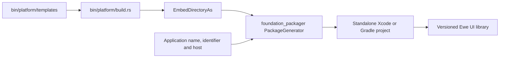

# Feature 24. Generate iOS and Android application projects

## Glossary

| Term | Meaning |
|---|---|
| Starter | A small application that a developer generates and owns. |
| Template | Files and named values that the project generator uses to create a starter. |
| Host | The screen that receives frames from a server or from Rust on the device. |
| Frame | One set of instructions that updates the user interface (UI). |
| Release candidate | A package built for verification before public release. |

## What the developer gets

Generate a standalone consumer project for iOS or Android. Each starter imports the released Ewe UI library.
The developer owns the first screen and its business action. The mobile package supplies controls, rendering and event delivery.
The example applications remain available for reference.

These proposed commands use the existing generator. Run each command in the parent directory of the new project.

```sh
ewe_platform generate -t ios-app -p FieldNotes -l plain --app-id com.example.fieldnotes --host server
ewe_platform generate -t android-app -p FieldNotesAndroid -l plain --app-id com.example.fieldnotes --host on-device
```

The template names and the options `--app-id` and `--host` are new.
Both templates support both hosts. The default host is `server`. Require an application identifier for each mobile project.
Validate the project name, application identifier and destination before writing files.
Reject an existing destination and report its path. Retain existing generator behavior for other templates.

| Selection | Generated files and first run |
|---|---|
| iOS | An Xcode project, shared build scheme, Swift application entry point, package reference and a guide. Build and launch the scheme on an iPhone simulator. |
| Android | A Gradle project, wrapper, manifest, Kotlin activity, package dependency and a guide. Build and install the application with the generated wrapper. |
| Server | A setting selects the server address. The starter opens the initial screen and sends Refresh. Document the route, action and a runnable reference server. |
| On-device | Include a minimal Rust action, first frame, native build steps and bindings for the selected platform. A tap increments a count with networking disabled. |

## Where it fits



The installed generator carries the templates. Generation works outside the source checkout.

## Stage 1. Register the templates

- Put the source files under `bin/platform/templates/ios-app/` and `bin/platform/templates/android-app/`.
- Extend `bin/platform/src/generate/mod.rs` to pass validated mobile values to the existing configurator.
- Use `Directorate` and `PackageGenerator` from `backends/foundation_packager`.
- Preserve the build script convention for embedded Rust manifests. Store them as `Cargo.toml.template`.
- Keep binary assets byte-exact and Gradle launchers executable. Test native source braces, package identifiers and project references after substitution.
- Include only the files for the selected host. If generation fails, report the cause and allow a clean retry.

## Stage 2. Connect the released packages

- Use the package reference and product from `mobile/ios/README.md`. Use the Android dependency from `mobile/android/README.md`.
- Pin a matching package version. Take release coordinates from the mobile release configuration.
- Use the package-only starters as the reference for server setup. Use the todo applications as the reference for local Rust linkage.
- Keep generated projects independent of repository paths, mounted drives, example imports and copied renderer sources.
- Put the generation command first in each mobile package guide. Keep a separate link to the complete examples.
- Include commands to build, configure, run and change the first action in each generated guide.

## Stage 3. Prove all four combinations

| Check | Acceptance condition |
|---|---|
| Package contents | Package the generator and run it outside the checkout. Generate each platform with each host. |
| Project identity | Generate two different names and identifiers. Each project builds with its requested identity. |
| Swift | Resolve the package from a clean cache. Build the generated scheme, launch it and verify the first action. |
| Kotlin | Resolve the library from a clean cache. Build with the generated wrapper, install the application and verify the first action. |
| Server | Change the server value. Tap Refresh and verify that the screen displays the value from that server. |
| On-device | Stop the server and disable networking. Launch each application and verify the counter update. |
| Safe retry | Supply an invalid identifier or an occupied destination. Verify the diagnostic and the original files. |
| Existing templates | Run the existing project generation tests for the web and Rust templates. |

Use the local release candidate for prepublication tests. Point only the test configuration at that candidate.
Feature 19 supplies the public artifacts for the final installation check.
Record the generated command, package version and verification result in the specification progress log.

## Candidate checks

The generator produced SwiftRemote, SwiftCounter, KotlinRemote, and KotlinCounter outside the checkout.
Each project used a distinct application identifier. The package version was 0.1.0.

| Check | Command or result |
|---|---|
| Generate all layouts and reject invalid destinations | `cargo test --profile uat -p ewe_platform --test mobile_templates` |
| Build the previous web and Rust starters | `cargo test --profile uat -p ewe_platform --test templates_build` |
| Remote Swift and Kotlin | Each screen showed zero. The test added one server item. Refresh showed one. |
| On-device Swift | The simulator blocked outgoing internet connections. Increment changed zero to one. The same configuration blocked the remote starter. |
| On-device Kotlin | The emulator disabled Wi-Fi and mobile data. Increment changed zero to one. The test restored the previous settings. |
| Package archive | Cargo included the Rust manifest template and the binary Gradle wrapper. An installed command generated a project with source access denied. |

The local checks substitute a Swift package checkout and a Maven candidate repository.
Issue [672](https://github.com/ewe-studios/ewe_platform/issues/672) tracks the command dependencies that need publication.
Feature 19 tracks the public mobile package installation.
