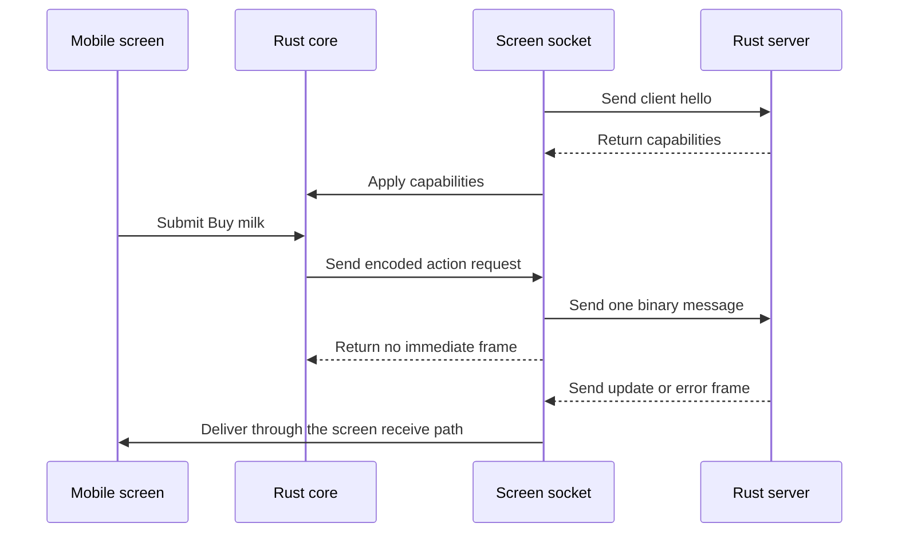

# Feature 25. Send mobile actions over WebSocket

## Glossary

| Term | Meaning |
|---|---|
| Frame | One encoded Foundation message. A request frame can carry a hello or an action. |
| Transport | The connection that carries encoded frames between the application and the server. |
| Dispatcher | The Rust component that selects and runs a registered action. |
| Capabilities | The server reply that identifies the supported actions and protocol settings. |
| HTTP | Hypertext Transfer Protocol. The mobile hosts currently use it for remote actions. |

## User story

A developer selects WebSocket when creating a server screen in Swift or Kotlin.
The application can still use its own Rust core with both local handlers and remote action declarations.

In Todo Server, **Add** opens the form on the device. Submitting **Buy milk** sends one action frame over the socket.
The server saves the task. A later frame updates the same screen.

## Stage 1. Select the transport when creating the screen

- Add a WebSocket option to Swift `ServerScreen` and Kotlin `RemoteEweScreen`. Keep HTTP as the default.
- Let the application supply the socket endpoint and connection credentials. Keep credentials in the host configuration.
- Retain the existing initial page request and live mount settings. This option selects the connection for actions.
- In Swift, the current core factory requires `URLActionTransport`. Add a factory path that accepts either implementation. Preserve existing initializers.
- In Kotlin, the core factory already accepts `HostTransport`. Supply the selected implementation from `EweHost.kt`.
- Include one working call in each package guide. Show the endpoint, the transport selection and the existing todo core factory.

## Stage 2. Use the existing frames

The socket carries requests and later updates in separate messages.

1. Open the socket for this screen. Send the existing hello frame and apply the capabilities before enabling remote actions.
2. Bind the negotiated connection to the host’s authenticated request context on the server.
3. Send the encoded `FrameRequest.action` as one binary WebSocket message. Use the WebSocket message boundary directly.
4. Complete the send when the socket accepts the message. Return `nil` in Swift or `null` in Kotlin.
5. Dispatch the request on the server. Deliver any returned `FrameMessage` through the socket receive path exactly once.
6. Apply incoming frames only to the owning screen. Report action errors through its existing error handler.
7. On disconnect, report the connection loss. A new connection must negotiate again. Never replay an earlier action automatically.
8. Close the socket and cancel its reader when the screen closes. Ignore late callbacks from a replaced connection.

Use the configured frame limits for incoming and outgoing messages. Reject invalid frames and unsupported message types before dispatch.
Keep local `host:` actions on the device. Use the existing `server:` prefix for remote actions.

## Stage 3. Connect the example and verify delivery

Add a binary WebSocket endpoint to the todo server. Reuse its dispatcher, action registrations and state checks.
Keep the negotiated connection for the socket lifetime. Route capability, update and error frames through one reader on the client.
Make the existing Todo Server applications selectable between HTTP and WebSocket.

| Check | Expected result |
|---|---|
| Open the form and submit once | Opening the form sends no action over the socket. Submitting sends one binary request and creates one task. |
| Delay the server response | The send completes first. The later frame updates the screen once. |
| Reject an action | The server sends an error frame. The screen reports the error and keeps the current list. |
| Lose the connection after a send | Reconnection sends a fresh hello. The client sends no duplicate request. |
| Open two screens | Each screen receives its own reply. Closing one screen leaves the other connection open. |
| Invalid input | Test an action before the hello, an oversized message, a text message and a malformed frame. |
| Existing applications | Run the HTTP and on-device examples. Their actions still work with the existing setup calls. |

Run the WebSocket example on an iPhone simulator and an Android emulator. Verify the saved task in the server store.
Document the message format, a decoded action example, the build commands and the checks in both package guides.

## Related code

- [Request and message frames](../../../../backends/foundation_ui_wire/schema/frame.fbs)
- [Rust transport interface](../../../../backends/foundation_ui_native/src/host.rs)
- [Browser action transport](../../../../backends/foundation_wasm_ui/runtimes/foundation-ui-actions.js)
- [Swift server screen](../../../../mobile/ios/Sources/EweUI/ServerScreen.swift)
- [Android screen setup](../../../../mobile/android/ui/src/main/kotlin/ewe/ui/compose/EweHost.kt)
- [Todo server dispatcher setup](../../../../examples/ui_todo/src/server.rs)
