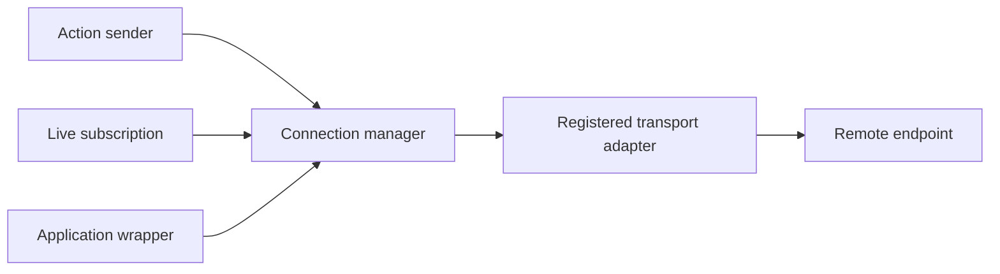

# Feature 25. Share live connections and send WebSocket actions

## Glossary

| Term | Meaning |
|---|---|
| Transport | An adapter that moves bytes using a protocol such as WebSocket. |
| Connection manager | The owner that opens, shares, and closes connections for an application. |
| Handle | A reference that lets one caller send or receive through a managed connection. |
| Subscription | A consumer’s request for messages of interest. |
| Cursor | The last sequence number a consumer successfully applied to a logical stream. |
| Frame | One encoded Foundation message. |
| HTTP | Hypertext Transfer Protocol. |
| SSE | Server-sent events. A server sends events through an open HTTP response. |

## Select a connection

The same attribute applies on web, iOS, and Android. It selects connection ownership for a mount.

| Transport | Attribute absent | `data-connection-shared="true"` | `data-connection-shared="false"` |
|---|---|---|---|
| SSE | Open a dedicated event response for this mount. | Join the live feed for this endpoint. | Open a dedicated event response for this mount. |
| WebSocket | Use the shared socket for the endpoint. | Use the shared socket for the endpoint. | Open a dedicated socket for this element. |

```html
<mount-stream transport="sse" api="/live" data-connection-shared="true"></mount-stream>
<mount-stream transport="websocket" api="/live"></mount-stream>
<mount-stream transport="websocket" api="/live" data-connection-shared="false"></mount-stream>
```

The first shared SSE listener opens the response. Later listeners receive matching events from the time they join.
Joining requires no cursor or replay. Removing the last listener closes the response under the default lifetime policy.
Removing a dedicated SSE mount closes its own response.

WebSocket actions and mounts use the application's configured socket endpoint by default.
An explicit different endpoint selects a separate socket. An explicit dedicated mount gets a separate socket even at the same endpoint.
Closing that mount leaves shared users connected. Ordinary HTTP actions still use one request per call.

## Stage 1. Separate ownership from use



Wrappers use handles. The manager owns the underlying connections.

- Provide interfaces for opening, receiving, sending where supported, and closing. Register custom adapters through the same interfaces as built-in adapters.
- Allow wrappers to accept an existing handle. A custom wrapper can implement its own message selection or encoding.
- Reuse the browser, Swift and Kotlin transport implementations. Share one underlying reader for each connection.
- Share connections with compatible transport, resolved endpoint, protocol settings, and authentication context. Keep credentials out of map keys and logs.
- Preserve the endpoint query. For example, `/live` and `/live?before=42` identify different feeds.
- Carry the sharing choice through Rust lowering and the wire as three values: transport default, shared, and dedicated.
- Decode an absent field as the transport default. Parse the text `false` as a dedicated request on all three platforms.
- Acquire concurrent handles atomically. Release each handle once. Count send handles and receive handles when deciding whether to close.
- Support a default close-on-last-release policy and an explicit keep-alive policy.
- Let Rust select the policy in the live mount declaration. Extend the schema and platform readers with a backward-compatible default.
- Open a retained connection on first use. Keep it until its owner releases retention or the manager shuts down.
- With no listeners, drain incoming transport data and discard application messages before application decoding. Maintain transport framing and required control traffic.
- Close affected connections on sign-out or manager shutdown. Ignore callbacks from an earlier connection after replacement.

## Stage 2. Deliver messages without shared mutation

Give each subscriber the same message contents. Support all messages and filtered subscriptions.
A subscriber can observe a frame without applying it to a screen.
Route action replies to their originating screen. Two observers of one store must never apply the same update twice.

Use read-only message storage where the platform enforces it. Give independent copies to consumers that can mutate the underlying bytes.
A Kotlin `ByteArray` or browser typed array can expose mutable storage even through a read-only reference.

## Stage 3. Resume through the application protocol

A subscription owns its cursor. Advance it after successful application.
A physical connection has no stream cursor. Subscription cursors do not change the connection key. Explicit endpoint query parameters remain part of the address.
Opening and closing a connection must work for custom protocols that have no resume concept.

The following notation shows message contents. The wire schema must define the encoding.

```text
Consumer A → server: Resume(subscription=A, stream=tasks, after=42)
Consumer B → server: Resume(subscription=B, stream=tasks, after=97)
```

This example applies to consumers that explicitly request replay. An ordinary shared SSE listener receives new events without sending either message. The server identifies the subscription when it returns replay frames.
A replay for A must never rewind B. Define the subscription identifier within the authenticated session and check it on the server.
If retained history is insufficient, return a resynchronization result to the affected consumer.
The subscription requests a fresh snapshot. The connection stays available to other consumers.

- On WebSocket, send the resume request as a protocol message on the open socket.
- On SSE or a streamed HTTP response, send it through a separate authenticated HTTP request.
- Correlate that request with the active delivery session and subscription. Return the requested frames through the existing downstream connection.
- On connection loss, notify consumers. After reconnection, each consumer can send its own resume request.
- A keep-alive connection that drops unobserved frames does not advance any subscriber’s cursor.
- Preserve the current query-based behavior for existing endpoints. Negotiate message-based resume before using it with a peer.
- Extend the wire request and reply types where needed. Existing hello and live mount cursor fields alone cannot identify two subscribers to one stream.

## Stage 4. Use shared handles for actions

Keep HTTP as the default for Swift and Kotlin server screens. Let applications select WebSocket or supply a compatible transport.
Use the same manager for browser actions and live mounts when the application supplies compatible settings.
Keep the initial page request separately configurable.

Negotiate capabilities before enabling remote actions. Send the existing action request frame as one binary WebSocket message.
Complete the send when the socket accepts the message. Deliver any later update or error through the receive path.
Report disconnects. Never replay a submitted action automatically. Local Rust handlers still run on the device.

## Stage 5. Verify the contract

| Test | Expected result |
|---|---|
| Two default SSE mounts open `/live` | Each opens its own response. Removing either closes only that response. |
| Two shared SSE mounts open `/live` concurrently | The first listener opens one response. Both receive new events. Final release closes it once. |
| A listener joins an active shared SSE feed | The manager sends no resume request. Earlier listeners continue without interruption. |
| Shared mounts use `/live` and `/live?before=42` | The manager opens two feeds. |
| An action and a mount use the default WebSocket endpoint | Both use one socket. A different endpoint or an explicit dedicated mount gets a separate socket. |
| One sender and two readers share a socket | Each release affects only its handle. Final release closes the default connection once. |
| Rust requests keep-alive | The connection stays open with zero consumers. A later subscription reuses it. |
| No listeners receive application data | The application decoder and screen store receive zero calls. |
| One consumer attempts mutation | Other consumers read the original bytes. |
| Two consumers request different cursors | Both keep the same connection. Each receives its own replay without duplicate screen updates. |
| SSE consumer requests resume | The control request leaves the existing event response open. Verify routing to the requesting subscription. |
| Network loss during an action | Reconnect and negotiate. Resume subscriptions independently. Send zero duplicate actions. |
| Two accounts use the same endpoint | Each authenticated context gets its own connection and replies. |
| Application supplies a custom adapter | The same mount wrapper works with the custom adapter and releases its handle. |

Run the shared contract checks on web, iOS, and Android. Exercise a real endpoint for SSE and WebSocket on each platform.
Extend Todo Server with a binary WebSocket endpoint that uses the existing dispatcher.
Show two subscriptions, local form opening, remote submission, and the resulting screen update.
Keep existing HTTP and on-device examples working. Document the configuration, frames, lifecycle, and verification commands in each platform guide.

## Related code

- [Request and message frames](../../../../backends/foundation_ui_wire/schema/frame.fbs)
- [Rust transport interface](../../../../backends/foundation_ui_native/src/host.rs)
- [Browser action transport](../../../../backends/foundation_wasm_ui/runtimes/foundation-ui-actions.js)
- [Swift server screen](../../../../mobile/ios/Sources/EweUI/ServerScreen.swift)
- [Android screen setup](../../../../mobile/android/ui/src/main/kotlin/ewe/ui/compose/EweHost.kt)
- [Todo server dispatcher setup](../../../../examples/ui_todo/src/server.rs)

## Native connection selection during replay

Subscription replay sends frames after a mount's last applied sequence number.
Use the server's replay capability to select the connection only when the mount leaves sharing unspecified.
An explicit dedicated mount opens its own connection with its stream and cursor.
An explicit keep-alive request retains that connection under the connection manager.
A retained dedicated mount has its own managed connection even if another mount uses the same endpoint.

Check these rules in the Android and iOS host tests.
Enable server replay and attach dedicated, shared, and unspecified mounts at one endpoint.
Verify each direct connection uses its own cursor.
Detach retained dedicated mounts and verify their separate connections stay open until the manager closes them.
[Issue 1062](https://github.com/ewe-studios/ewe_platform/issues/1062)
