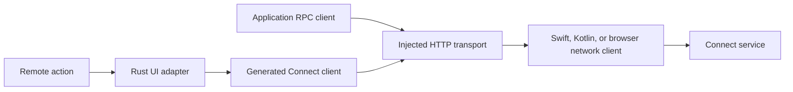

# Feature 26. Use ConnectRPC through the host network client

## Glossary

| Term | Meaning |
|---|---|
| Remote procedure call (RPC) | A call to a function on another system. Connect is an RPC protocol. |
| Hypertext Transfer Protocol (HTTP) | The request and response protocol that carries Connect messages. |
| User interface (UI) frame | One complete Foundation wire message for a request or an update. |
| Protocol Buffers (Protobuf) | The message format for this service. A schema defines the fields and procedures. |
| Unary call | One request message followed by one reply message. |
| Server stream | One request message followed by a sequence of reply messages. |
| WebAssembly (Wasm) | The format that runs compiled Rust code inside the browser. |
| UniFFI | The binding generator that connects Rust to Swift and Kotlin. |
| Exchange | The HTTP request and response for one call. A host network client can serve many exchanges. |

## What works today

A mobile screen can install a Rust core with local actions and a remote action sender.
The native `HostTransport::send` method takes one UI request and returns an optional reply.
Swift and Kotlin provide senders for the existing HTTP action endpoint.
Browser JavaScript also sends Foundation requests directly. [Native callback](../../../../backends/foundation_ui_native/src/host.rs) · [Swift setup](../../../../mobile/ios/Sources/EweUI/ServerScreen.swift) · [Android setup](../../../../mobile/android/ui/src/main/kotlin/ewe/ui/compose/EweHost.kt) · [Browser sender](../../../../backends/foundation_wasm_ui/runtimes/foundation-ui-actions.js)

Generated Rust RPC clients already accept an `Arc<dyn Transport>`, a base address, and client options.
The transport opens an exchange with request bytes, response headers, response bytes, and optional trailing headers.
Rust handles the protocol, message encoding, limits, deadlines, and cancellation.
The crate supports Connect, gRPC, and gRPC-Web. It provides Protobuf and JSON codecs.
The browser Fetch module declares capabilities for unary calls and server streams. It supplies no concrete Fetch transport.
[Generated constructor](../../../../backends/foundation_connectrpc_codegen/src/generator.rs) · [Rust client](../../../../backends/foundation_connectrpc/src/shared/client.rs) · [Transport contract](../../../../backends/foundation_connectrpc/src/shared/transport/base.rs) · [Codecs](../../../../backends/foundation_connectrpc/src/shared/codec/mod.rs) · [Fetch capabilities](../../../../backends/foundation_connectrpc/src/shared/transport/wasm.rs)

## Proposed call flow

A screen owner selects a Connect service and supplies the platform network client during setup.
The Rust UI adapter wraps each Foundation request in a generated Protobuf message.
Swift, Kotlin, or JavaScript sends the resulting HTTP request.
Rust decodes the reply and gives the Foundation frame to the originating caller.



Application clients can reuse the transport for their own generated procedures.
Native code can supply the network client directly. Rust can also request that client from a native provider by service name.
Both paths use the same Connect client and action sender. [Provider setup](../27-single-todo-package/feature.md#obtain-a-transport-from-the-native-host)

## Stage 1. Inject an HTTP exchange

- Implement the existing Rust `Transport` trait once over a host exchange interface.
- Supply the interface through UniFFI on mobile and through JavaScript imports on browser Wasm.
- Give each call its own exchange handle. Keep one network client per configured host and credential context.
- Pass the method, resolved address, and ordered header pairs to the host. Preserve repeated headers.
- Supply one bounded request message for unary and server-stream calls. Finalize the request before reading the response.
- Return the HTTP status and headers first. Read response chunks on demand.
- Return end of body or a typed read error. Close the trailer channel when the host exposes no trailers.
- Check the status before consuming the body. Bound error details and each decoded message using configuration.
- Propagate cancellation and deadline expiry to the host request. Release each handle once, including on early drop.
- Use the platform session for credentials. Isolate different accounts. Surface browser access errors to the caller.
- Implement Swift with URLSession, Kotlin with OkHttp, and browser Wasm with Fetch and a response reader.
- Keep browser objects on their JavaScript event loop. Rust holds opaque handles and wakes pending reads through callbacks.
- Use a single-thread Wasm build without the default multi-thread executor. Test the actual browser module.
- Advertise unary and server-stream Connect calls with Protobuf. Reject unsupported call shapes before opening a request.

The host owns HTTP connection reuse. Each RPC still owns its request, result, and cancellation.
Feature 25 controls sharing for live event feeds and WebSocket connections. An RPC call needs no feed subscription.

## Stage 2. Connect the UI action sender

Use this proposed service. Generate its Rust messages, client, and service bindings.

```protobuf
syntax = "proto3";
package ewe.ui.v1;

message UiRequest {
  bytes frame = 1;
  optional bytes hello = 2;
}
message UiReply { optional bytes frame = 1; }

service Actions {
  rpc Exchange(UiRequest) returns (UiReply);
}
```

The request field contains one complete Foundation request frame, including its existing header.
On action calls, include the original hello in the second field. A stateless service uses it to select compatible output.
On negotiation calls, the first field already contains the hello. Omit the second field.
The service decodes the request kind and calls the existing capability or action handler.
A hello requires a capabilities reply. An action can return an update or omit the reply frame.
Reject an empty or invalid present frame. Preserve wire bytes, including signed state, across the exchange.
Map RPC errors to the action error returned by the existing core. Submit an action once per trigger.

The following Rust example shows the proposed setup inside an application core factory.
The application supplies `network`, `base_url`, `options`, and `config`.

```rust
let transport = Arc::new(PlatformHttpTransport::new(network));
let client = ActionsClient::new(transport, base_url, options)?;
let sender = Arc::new(ConnectActionTransport::new(client));
let core = NativeCore::new(config, Some(sender));
```

Each native screen needs a setup path that accepts this sender for negotiation and action calls.
Pass the hello through the same service before enabling remote actions. Keep the initial view endpoint configurable.
Use the screen's existing store and frame listener for updates. Local actions still use their registered Rust handlers.
On web, register a JavaScript action sender that passes requests into the Wasm adapter and awaits its optional frame.
Use the browser action manager to apply that frame once. [Native core](../../../../backends/foundation_ui_native/src/core.rs) · [Foundation frame schema](../../../../backends/foundation_ui_wire/schema/frame.fbs)

## Stage 3. Verify the transport and document setup

1. Test a generated application client and the generated UI client over the same injected fake transport.
2. Split a server-stream message across chunks. Combine two messages in one chunk. Verify ordered delivery before response completion.
3. Test an oversized message, a non-success status, a Connect error, and a failure after the headers arrive.
4. Cancel a pending read. Verify that the other exchange on the same host still completes.
5. Run hello and a remote todo action against a generated service on iOS, Android, and browser Wasm.
6. Check the update reaches its originating screen once. Check that a local action sends zero network requests.
7. Verify an absent reply, invalid reply, unsupported call shape, timeout, and account isolation.
8. Update each package README with setup code, the schema, limits, and commands for running the example.
9. Document how to inject a custom HTTP client and consume a generated server stream one message at a time.

This proposal covers the Connect UI action procedure and reusable host transport.
Applications define their own streaming procedures. Mapping a live UI mount to an RPC subscription remains a separate design choice.
