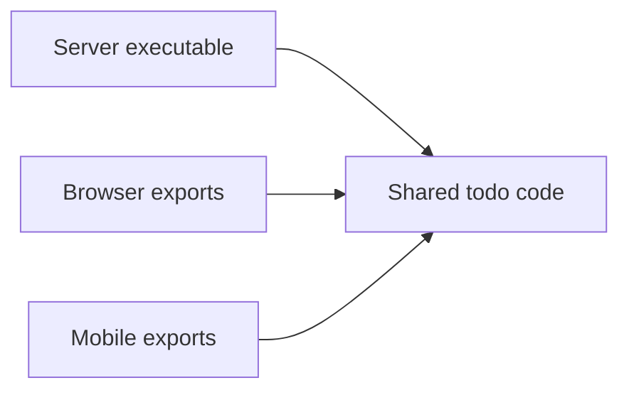

# Feature 27. Build the todo application from one Rust package

## Glossary

| Term | Meaning |
|---|---|
| Package | A set of Rust build targets with one Cargo manifest. |
| Feature | A named Cargo option that selects code and dependencies for a build. |
| WebAssembly (Wasm) | The compiled module format that the browser loads. |
| Binding | Generated code that lets Swift or Kotlin call Rust functions. |

## Outcome

An author edits the todo application in `examples/ui_todo`. One manifest builds the server, browser module, and mobile library.
Today, the browser and mobile adapters each have their own manifest. Both already import the shared todo package.



Each entry point calls the same application code.

## Stage 1. Organize the package

| Path under `examples/ui_todo` | Contents |
|---|---|
| `src/shared/` | Todo state, stores, views, action functions, and registry builders |
| `src/lib.rs` | Module declarations and existing public exports |
| `src/mobile.rs` | Both mobile core constructors and the initial frame function |
| `src/web.rs` | The browser startup function, `init_todo_host` |
| `src/server.rs` | Server implementation |
| `src/bin/server.rs` | Server entry point. Keep the existing executable name, `ui_todo`. |

Keep the Rust paths that callers use today. Move the native integration tests under the package's `tests/` directory.
Keep the generated Swift and Kotlin constructors callable from the existing screens.
Each screen selects local or remote execution when it creates its core.

## Stage 2. Select each output

Declare one library with crate types `rlib`, `staticlib`, and `cdylib`. Select platform modules and optional dependencies with Cargo features.
Keep the existing default server build. Use explicit features for cross-platform builds.
Compile the web exports only for Wasm. Permit a desktop mobile-library build for binding generation.

```rust
pub mod shared;

#[cfg(all(feature = "web", target_arch = "wasm32"))]
mod web;

#[cfg(all(feature = "mobile", not(target_family = "wasm")))]
mod mobile;

#[cfg(all(feature = "server", not(target_family = "wasm")))]
pub mod server;
```

| Consumer | Build selection for package `ui_todo` | Output it uses |
|---|---|---|
| Server | `--bin ui_todo --features server` | Host executable |
| Browser | `--lib --no-default-features --features web --target wasm32-unknown-unknown` | Wasm module |
| iOS | `--lib --no-default-features --features mobile` with each Apple target | Static library |
| Android | `--lib --no-default-features --features mobile` with each Android target | Shared library |

Set `required-features = ["server"]` on the server binary. The build command enables features.
Keep mobile dependencies out of browser builds. Keep server dependencies out of both client builds.

## Stage 3. Start a local browser application

Add a reusable `LocalApp` builder to `foundation_wasm_ui::actions`.
The application supplies its context and action registry. The context carries its render target, signer, and view services.
The proposed startup call follows application setup:

```rust
LocalApp::builder(ctx, actions).build().install();
```

1. `builder(ctx, actions)` takes ownership of both inputs.
2. `build()` creates the host dispatcher and stateless web connection with the current browser capabilities and existing connection settings.
3. The resulting `LocalApp` owns one `LocalDispatcher`. That dispatcher already holds the context, dispatcher, and connection.
4. `install(self)` prepares the browser task pool with the supplied context and installs the existing action bridge.
5. The bridge retains the dispatcher after startup returns. The existing browser close function releases it and cancels pending calls.

Preserve the existing startup error codes for application setup and registration.
Keep the lower-level bridge functions available to custom hosts.
Document the builder in the browser library README and use it in the todo example.
Verify that a registered action reads a service from the supplied context after startup returns.
Verify that closing the browser bridge completes each pending call once.

## Stage 4. Build a mobile core or a Rust network client

The mobile core already creates its dispatcher, connection, and action manager.
Add a Rust builder to `foundation_ui_native::NativeCore`. Use the existing constructor internally.
The application supplies the platform, prepared context, and registry. The builder uses the default writer unless the application supplies one.

```rust
// Inside the on-device constructor.
let core = NativeCore::builder(platform, ctx, actions).build();

// Inside the server-connected constructor.
let core = NativeCore::builder(platform, ctx, actions)
    .with_host_transport(transport)
    .build();
```

Both calls return the same shared core type. Each screen retains its own core.
The second form accepts the Swift or Kotlin network sender through the existing native callback.
Reuse the existing adapter to convert that callback to a Rust action transport.

A Rust application can also act as a client of a remote Foundation service.
Add a `NetworkApp` builder to `foundation_ui_runtime` for this use.
Accept the platform capabilities, mount surface, prepared context, action registry, and a Rust action transport.
The caller configures the endpoint and credentials on its transport.

```rust
let app = NetworkApp::builder(ctx, actions, caps, surface)
    .with_server_transport(transport)
    .build();
app.connect().await?;
let reply = app.trigger("server:add_todo", event).await?;
```

These calls specify the proposed Rust interface. Require a server transport before building a network app.
The app owns one action manager. Reuse the existing host dispatcher for local actions and the supplied transport for remote actions.
Share manager setup and capability processing with the mobile core. Keep the mobile frame listener on the mobile core.
Use the existing hello request and validate the server capability frame before sending a remote action.
For a transport with deferred delivery, accept the capability frame through the receive path before declaring the app ready.
Return the validated reply frame when the transport supplies one. Preserve the existing deferred update path when the transport returns no immediate reply.
Report negotiation and transport errors to the caller. A local action uses the supplied context.

Test an on-device core, a mobile core with a native sender, and a Rust client with an injected test transport.
For the Rust client, verify the hello, one advertised remote action, and one local action.
Verify that local actions send no network request. Verify rejection of an invalid capability reply.
Document both builders in their crate READMEs. Keep the existing native constructors and screen entry points callable.

### Obtain a transport from the native host

The application can pass a ready sender or give Rust a provider during setup.
A provider is a native object that returns a transport handle for a named service.
Swift or Kotlin implements the provider. Rust requests the handle once when it builds the screen.
The native provider selects the account and endpoint for that service.

For a ready action sender, adapt the native handle to the Rust action transport.
For a Connect remote procedure call (RPC), request the native network client and build the Connect sender in Rust.
Both paths end at the same builder method. This proposed example uses the adapters from [Feature 26](../26-connectrpc-transport/feature.md).

```rust
let network = provider.http_client("todos").await?;
let transport = Arc::new(PlatformHttpTransport::new(network));
let client = ActionsClient::new(transport, base_url, options)?;
let sender = Arc::new(ConnectActionTransport::new(client));
let app = NetworkApp::builder(ctx, actions, caps, surface)
    .with_server_transport(sender)
    .build();
```

Keep lookup separate from sending. The handle retains the native client for subsequent calls.
Return a typed setup error for an unknown service. Test that failed lookup sends no action.
Test direct and provider-supplied senders with the same action. Verify one lookup for two calls.

## Stage 5. Update builds and verify behavior

1. Update the root workspace members and lockfile. Remove both adapter manifests and the browser's separate workspace.
2. Update `build-module.sh`, the server asset lookup, and the browser test to use the same Wasm artifact.
3. Update the native build scripts, binding generation, starter checks, and application library imports together.
4. Regenerate the bindings. Verify the library names that Swift links and Android loads.
5. Run the action tests and the migrated offline tests. Run the browser test against the newly built Wasm file.
6. Build both mobile examples on each platform. Open the add dialog and submit a todo on each screen.
7. Verify that each on-device example works offline. Verify that each server example adds the todo on its server.
8. Update the example README with the layout, build commands, artifact locations, and both mobile constructors.

Acceptance requires a clean build without artifacts from the old packages. The browser must load its module and run a local action.
The same mobile library must support both screen types. The installable platform libraries keep their existing package identities.
