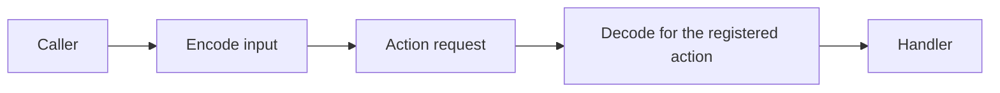

# Feature 28. Declare an action input type

## Glossary

| Term | Meaning |
|---|---|
| State | Component data that the host signs and later verifies. |
| Input | A value that the caller supplies for this action. |
| JSON | JavaScript Object Notation, the proposed encoding for structured input. |

## Author contract

`Interaction<S, E = String>` exposes `state: S` and `input_value: E`. Keep the existing node identifier and event name.
Existing handlers that declare `Interaction<S>` continue to receive plain text, including empty strings.

```rust
#[derive(serde::Serialize, serde::Deserialize)]
struct AddTodoInput {
    title: String,
    list_id: u64,
}

#[action(server)]
async fn add_todo(ctx: &Context, event: Interaction<(), AddTodoInput>) -> ActionResult {
    let input = event.input_value;
    add_to_list(ctx, input.list_id, &input.title)
}
```

The application defines add_to_list. It checks access to the requested list before changing it.



The sender encodes the value once. The dispatcher decodes it before calling the handler.

## Stage 1. Extend the wire contract

- Keep the existing text field. Append an optional byte vector for a structured JSON value.
- Use field presence to select the encoding. Reject requests that supply both fields.
- Preserve the existing empty input when neither field is present for a text action.
- Negotiate support before sending structured input. Report unsupported peers to the caller.
- Update the schema, generated types, frame writer, readers, and fixtures together. Apply configured frame limits before decoding.

## Stage 2. Extend action registration and invocation

- Accept one or two type arguments in the action macro. Record the resolved input type in the registered adapter.
- Keep String as the default. Select text handling by the resolved type, including a Rust alias for String.
- Require Serialize when producing structured input and DeserializeOwned when consuming it.
- Pass plain text through unchanged. Reject a missing structured payload or an encoding that conflicts with the action declaration.
- Return a typed invalid-input error for malformed data. Skip the handler on decode failure.
- Keep input decoding independent of state verification. Keep input errors distinct from state errors.

## Stage 3. Connect callers and verify

- Expose explicit structured submission in Rust, browser, Swift, and Kotlin senders. Preserve current text-field events.
- Let the form author construct the payload. Each field keeps its declared name and type.
- Test plain text, quoted text, empty text, a nested object, and a missing required field.
- Test mismatched encodings, both fields present, malformed JSON, and peers with different capabilities.
- Send the same structured request through local and remote routes. Verify the handler receives equal values.
- Test typed input with verified state and with unit state. Verify rejected requests produce no handler side effects.
- Update the runtime, macro, wire, and platform guides with a text example and a structured example.
