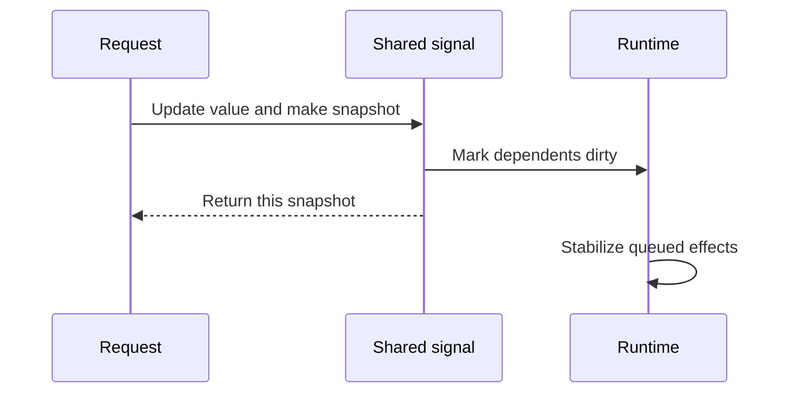

# Feature 29. Share signals between native threads

## Glossary

| Term | Meaning |
|---|---|
| WebAssembly (Wasm) | A compilation target used by the browser runtime. |
| Signal | A value that records which effects read it. |
| Effect | A callback that runs again when an observed value changes. |
| Stabilization | A pass that processes pending changes and updates dependent computations and effects. |
| Process | A running program with its own address space. |
| Scope | The owner that controls the lifetime of signals, computations, and effects. |

## What the author writes

Two todo requests can update one list. Each request receives the snapshot from its own change.
The caller selects the runtime. Each runtime owns its graph and creates scopes. Each scope owns its signals and effects.
The following examples show the runtime interfaces.

A browser or native caller can keep all reactive work on one thread:

```rust
use foundation_signals::SingleThreadedRuntime;
use std::rc::Rc;

let runtime = Rc::new(SingleThreadedRuntime::new());
let scope = runtime.scope();
let (count, set_count) = scope.signal(0);
```

A native server can share its todo signal across worker threads:

```rust
use foundation_signals::MultiThreadedRuntime;
use std::sync::Arc;

let runtime = Arc::new(MultiThreadedRuntime::new());
let scope = runtime.scope();
let (read, write) = scope.signal(StoreState::default());
app_ctx.store(TodoSignals { read, write });
```

The host retains the scope across requests. StoreState holds the last identifier and the items in one value.
The request updates that value through the writer:

```rust
let snapshot = todos.write.update_with(|state| {
    let id = state.last_id.checked_add(1).ok_or(TodoError::IdExhausted)?;
    state.items.push(Todo { id, text: title, done: false });
    state.last_id = id;
    Ok::<_, TodoError>(state.snapshot())
})?;
```

Here the application validates the title before the call. It can render the returned snapshot immediately.
A later request can change the signal while the first request renders its snapshot.

## Stage 1. Select and own the runtime

| Host | Contract |
|---|---|
| Single-thread Wasm | Keep the current local runtime, default imports, and support for callbacks with local captures. |
| Native, one thread | Keep the local runtime and existing SignalHub clients available. |
| Native, many threads | Enable the Cargo feature `thread_safe` and import `foundation_signals::MultiThreadedRuntime`. |
| Many processes | Each process can select its runtime. To update one authoritative signal, route commands to its owning process through an application transport. |

Add the native backend in `backends/foundation_signals`. The new feature enables standard library support.
Make the two features additive. Cargo can combine them when separate dependencies select different backends.
Expose MultiThreadedRuntime only on supported native targets. A combined feature build for Wasm must preserve the local runtime.
A native process can use a local runtime with SignalHub and a separate shared runtime in the same build.
Export both runtime names at the crate root when the target supports them and the caller enables both backends.
Keep `Runtime` as a public alias for `SingleThreadedRuntime`. Cargo features must never change the meaning of that alias.
Preserve `Context::new(Rc::clone(&runtime))`, local callback bounds, SignalHub, RemoteSetter, and the optional HubDriver.
The local scope method uses the existing context constructor. The multithread scope method retains the same shared runtime.
Both scope methods create a new scope in the selected graph.
A remote update still queues its closure for the owner. Its return confirms queue admission. The closure can send its own result.
Keep shared runtime, scope, reader, and writer handles safe to send and share between threads.
Use Rust trait bounds for shared values and callbacks. Keep browser view objects in their local scope.
A native lock protects memory inside one process. Cross-process delivery and restart storage belong to the application.

## Stage 2. Commit one value and return the caller's result

```rust
pub fn update_with<R>(&self, change: impl FnOnce(&mut T) -> R) -> R;
```

- Serialize updates to the same signal. Call the closure once and return its exact result.
- Keep comparison, change publication, and dependency invalidation ordered with respect to other writes.
- A reader sees a complete old or new value. Equal writes produce no new notification.
- The closure operates only on its supplied value. Document that it must not acquire signal handles or wait for external work.
- A returned Result belongs to the caller. The primitive does not interpret an application error as a rollback.
- Validate fallible work before mutating state, as the example does. Define and test lock recovery if a writer panics.
- Keep the current split between updating a value and stabilizing effects. Release write locks before running effects or cleanup callbacks.

## Stage 3. Preserve reactive behavior under concurrency



A request can render its result before the host runs the next stabilization pass.

Reuse the existing algorithms for dependency ordering, change detection, and batching wherever their invariants hold for both runtimes.
Keep ownership, synchronization, and callback execution specific to each backend.
Serialize effect execution per multithread runtime. Associate tracked reads with the current evaluation on its executing thread.
A read on another thread must not join that evaluation. Preserve nested tracking and untracked reads.
Preserve dependency order and existing batch behavior. Record writes during a pass for that pass or a subsequent pass.
A completed write must remain visible to a later pass. Concurrent stabilization calls must not run the same effect simultaneously.
Coordinate scope disposal with in-flight evaluations. Run cleanup exactly once and prevent disposed effects from starting again.
Protect graph metadata separately from user callbacks. Document lock ordering and the stabilization contract in the crate guide.

## Stage 4. Prove the contract

- Add integration tests under `backends/foundation_signals/tests/`. Use barriers or channels to control interleavings.
- Compile the existing Runtime import and context constructor with both backends enabled.
- Create signals through each named runtime's scope method. Verify that each scope registers its signals in its selected graph.
- Run common dependency ordering, change detection, and batching tests against both runtimes.
- Start two writers together. Verify unique todo identifiers and an exact snapshot for each request.
- Read on another thread during an effect. Verify that only the effect's own reads become dependencies.
- Exercise a write during stabilization, an effect that writes a signal, and two competing stabilization calls.
- Test scope disposal during a pass, cleanup, equal writes, and a graph with two paths to one dependent.
- Check the shared handle types against Send and Sync. Test the existing local graph with a local-only capture.
- With both backends enabled, queue two hub updates from a worker. Give each closure its own reply channel.
- Verify that replies arrive after the owner applies each mutation. Verify that each reply contains that mutation's snapshot.
- Drop the hub and verify that a later submission returns HubGone. Exercise the shared runtime in the same build.
- Run native tests with local, shared, and combined features. Run the existing browser tests with the local backend.
- Add the feature combinations to the package test configuration. Document native setup and the process boundary in the crate README.


## Verification

The macOS package runner passed all four configurations. The shared configurations each passed 16 new integration tests.
The combined build also ran the existing local, hub, and Valtron driver tests.
One existing documentation example remains excluded from execution.
The browser todo flow passed in Chrome with the rebuilt WebAssembly module. All 11 reactive structure tests passed.
The JavaScript suite passed 146 tests and skipped one optional fixture.
The shared feature compiled for Linux and Windows. Their native test runs are configured in continuous integration.
Formatting, crate documentation, and strict crate lint checks passed. [Runtime guide](../../../../backends/foundation_signals/README.md#choose-a-runtime)
