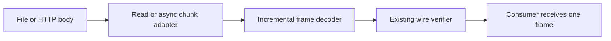

# Feature 30. Read frames from streams and simplify server routes

## Glossary

| Term | Meaning |
|---|---|
| Frame | One Foundation wire message. |
| HTTP | Hypertext Transfer Protocol. |
| HTML | Hypertext Markup Language. |
| EOF | End of file or input stream. |

## Starting point

The todo server serves the browser assets, initial views, remote actions, and live counts. On-device actions use their local core.
Wello builds an HttpApp independently of the listener. Its handler implements Serve and delegates response writing to the HTTP library.
The todo handler instead implements body collection, frame framing, response writing, and count publication inside its endpoint.
The wire crate verifies a complete byte slice. The browser already reads a length-prefixed response incrementally.
The native HTTP writer already supports byte, text, HTML string, and typed JSON responses. JSON means JavaScript Object Notation.
The router already supports methods, wildcard segments, and middleware. Reuse these facilities.

## Stage 1. Provide a reusable wire reader and writer

```rust
for result in FrameReader::length_prefixed(reader, limits) {
    let frame = result?;
    consume(frame)?;
}
```

Accept any standard Rust Read source in the synchronous adapter. Yield one owned, verified frame per iterator item.
Give the owned frame access to its verified contents and original bytes. Keep borrowed views tied to the owned bytes.
Reuse the existing FlatBuffers verifier. Keep framing logic independent of files, sockets, HTTP, and routing.



Both adapters use the same decoder. The asynchronous adapter consumes the existing request body stream and waits for more bytes when needed.

- For a stream of frames, read a four-byte little-endian length followed by one payload.
- Check the configured limit before allocating. Retain surplus bytes for the next item. Produce the first frame before waiting for EOF.
- Treat EOF between frames as completion. Report truncated lengths, truncated payloads, invalid frames, limit errors, and source failures distinctly.
- Provide an explicit single-message mode for existing raw requests and raw initial views. Use the enclosing message boundary.
- A raw frame has no stream length prefix. Select the framing from the endpoint contract and direction.
- Keep decoder memory bounded per frame. Keep asynchronous waiting at the source adapter.
- Provide a matching writer for raw frames and prefixed streams. Route handlers never calculate prefixes.
- Test fragmented prefixes, split payloads, several frames per chunk, early delivery, raw input, invalid frames, and a failing reader.

## Stage 2. Adapt ordinary functions to Serve

Keep the low-level Serve trait. Add method wrappers for ordinary synchronous and asynchronous handlers.
Support GET, POST, PUT, PATCH, DELETE, HEAD, and OPTIONS. Preserve the existing route and middleware interfaces.
Use distinct adapter constructors if Rust trait coherence requires them. Keep blocking input away from async handlers.
The foundation_http crate exposes route attributes such as `#[http::get("/todos")]`.
Generate a named Serve implementation with method and path constants.
Pass the three native Serve arguments to the function in order. Preserve context, incoming request, and connection ownership.
A synchronous function can return ConnectionResult directly. An asynchronous function can yield ServeOutcome through the existing ConnectionResult::Async adapter.
Test both forms using foundation_http alone.

```rust
#[http::get("/about")]
fn about(ctx: Ctx, _req: SimpleIncomingRequest, conn: SharedByteBufferStream<RawStream>) -> ConnectionResult {
    send_html(conn, 200, "<main>About Todos</main>", &ctx)
}
```
Define a route description trait in foundation_http. Both handwritten structs and generated structs can implement it.

```rust
pub trait Route {
    const METHOD: SimpleMethod;
    const PATH: &'static str;
    const ALIASES: &'static [&'static str] = &[];
}
```

For the native router, accept a handler that implements both Route and Serve.
Router::mount reads the route constants and stores the supplied handler instance in its existing route tree.
Validate every declared path before insertion. Allocate one shared handler for the primary path and its aliases.
Use the existing add_route insertion logic for each path. Keep direct add_route registration available.
Expose HttpApp::mount as a convenience method with the same handler bounds and result as Router::mount.
Its entire body is `self.router.mount(handler)`. The router owns validation, aliases, and insertion.
The route module below uses router.mount directly to show that ownership.
Test both entry points with the same route type. Check dispatch and registration errors through both.
Router::at accepts an explicit path and method wrapper when the caller owns the route definition.
Verify that a handwritten handler and an attributed function dispatch like explicit add_route registrations.
Test explicit and attributed routes directly on a router without constructing an application.
Use the existing HTTP writers. Preserve status codes, response headers, streaming, error propagation, and HEAD semantics.

## Stage 3. Supply view responses and an action route handler

The owner approves the separate foundation_ui_http integration and its view-handler interface.
Use router.mount for registration. An initial handler can return a complete view without specifying a target.

The integration crate is foundation_ui_http. It depends on foundation_http, foundation_ui_runtime, and foundation_ui_wire.
Keep the HTTP library independent of view types. Keep the wire crate independent of HTTP.
A plain Serve handler can call the integration adapter explicitly.
The integration crate exposes the convenience attribute `#[ui_http::get("/initial")]`.
Its generated Serve implementation receives the three HTTP arguments. It builds a ViewRequest from the context and incoming request.
ViewRequest is the integration request type. It exposes application services and builds a render context with the request signer and negotiated surface.
The adapter retains the connection and writes the returned response or a mapped error exactly once.
The integration handler supplies the same route metadata that Router::mount consumes.
Use Response::html(view) for an HTML document and Response::json(value) for JSON. Provide escaped HTML serialization and test shared controls, attributes, text, and action bindings.
The existing send_html helper accepts a string. Verify the tree conversion separately.
The view handler returns a typed Response or a Result containing it. The route attribute declares the method and path.
Response::frame(tree) selects frame encoding and supplies the complete content of the requesting view.
The client owns the mount for that view. The handler supplies no node identifier or selector.
On initial load or reload, replace that mount's contents once. Dispose old scopes and subscriptions. Preserve the host shell and sibling mounts.
Give the frame reader and renderer an explicit full-view contract. Test repeated loads and two independent mounts.
Response::frame(render_context) carries queued operations. Keep the request render scope available through finalization.
Apply targeted operations according to their declared placements. The receiver must distinguish the two cases without guessing from node identifiers.
Targeted macros such as html_swap! queue a placement in the supplied receiver and return ActionResult.
The handler checks that result before passing its render context to the response adapter.
The adapter obtains the request context after middleware, including the configured signer and platform capabilities.
Each response owns its body source and exposes it for inspection. Constructors store the supplied tree, frame, render context, or JSON value.
Construction and inspection perform no encoding, stabilization, queue draining, or output.
The adapter passes a writer to the response when it starts writing the body. A test can supply an in-memory writer at the same boundary.
Expose the body renderer to any standard Rust Write destination, including a buffer, file, or writer trait object.

```rust
pub fn write_body(self, out: &mut dyn std::io::Write) -> Result<(), RenderError>;
```

Handle short writes. Keep HTTP headers in the transport adapter. For asynchronous connections, share the encoding logic and respect writer backpressure.
That operation consumes the response. For queued updates, stabilize the request-owned runtime when present, then drain the receiver once.
Forward an already encoded frame through its writer. Report encoding and write failures to the caller.
Use the existing view lowering and encode_updates. Preserve raw initial frames and prefixed action replies.

Implement ActionRegistryRouteHandler as Serve. It owns negotiation, dispatch, protocol errors, and response framing.
Use the Stage 1 reader. Reuse a verified frame through dispatch and preserve its signed bytes.
Support POST /action for current clients and POST /action/* for named paths.
If a path supplies a name, require it to agree with the frame. Keep server authorization and state policy in the request context.
Use foundation_netio body extractors for other content types. A bounded diagnostic preview cannot establish a complete request.

## Stage 4. Rewrite the todo example

Separate application setup and route registration from listener startup. Keep listener and shutdown ownership at the binary or test boundary.
Use markup for the initial nodes and live mounts. Obtain mobile capabilities from the requesting host.
Register browser assets and live channels through helpers. Keep the replay test's injectable channel.
Publish live counts from the successful mutation. Remove reply inspection from the HTTP endpoint.
Keep the existing web and mobile client paths during migration.

## Verification

Run router and reader tests, including middleware order, invalid requests, and prefixed versus raw replies.
Compile both handler styles. Test HTML escaping and equivalent view content in HTML and frame outputs.
Call a handler and inspect its original body source. Verify zero serializer calls and an intact receiver before writing.
Use the production body writer with a memory sink. Verify the decoded frame, escaped HTML, or JSON and its media type.
Drop an unwritten response and verify zero body renders. Test a failing sink for error propagation.
Exercise browser startup, native startup, add, cancel, and live replay against the revised server.
The todo route module must contain no FlatBuffers imports, request collection loop, frame header construction, or socket writes.
Document the reader with a file example and an async HTTP example. Document the writer and route helpers in their owning crates.

## Todo route module

The binary binds its listener. The application builder installs the signer, store, shared node allocator, and live channels.
It calls the route module to register actions and views. The route module also registers the two live channels.

```rust
router.mount(ActionRegistryRouteHandler::new(crate::server_registry()?))?;
router.mount(initial)?;
router.mount(native_initial)?;
router.mount(native_starter)?;
```

The browser handler reads the shared store and selects its response.

```rust
#[foundation_ui_http::get("/initial")]
fn initial(req: ViewRequest) -> Result<Response, Error> {
    let state = req.require::<TodoStore>()?.snapshot();
    Ok(Response::frame(screens::web_page(state)))
}
```

The page supplies its tree and state. The writer attaches signed state to each marked control.
The client supplies the receiving mount. Stable region identifiers inside the page support later targeted updates.
The mobile view declares its stream in markup. It includes the channel identifier and a resume cursor.
The store publishes the open count after a successful mutation.
The browser integration test disconnects its channel and checks replay after a new change.

## Verification record

The shared and native router tests pass. The shared router also compiles for WebAssembly.
The wire tests cover raw frames, fragmented streams, size limits, short writes, and source failures.
The view tests inspect unencoded payloads and exercise the socket writer.
Chrome passes the action and stream replay test.
The iPhone simulator passes the offline and server application tests.
The Android emulator passes the offline, server, repeated delete, and store isolation tests.
