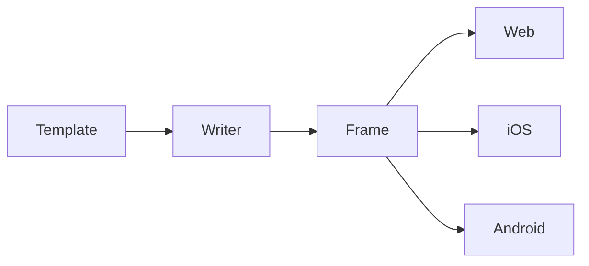

# Feature 31. Explicit control tags

Status: Approved for implementation.

## Glossary

A tag names a control in a template. A renderer draws that control on one platform.
A frame carries rendering instructions. A binding connects a user event to an application action.

## Purpose

Write one control tree for web, iOS, and Android. Use tags to select controls.
Use properties for values and state. Use classes for style. Use event bindings for application actions.

```rust
html! {
    <Modal><BottomSheet>
        <SheetTitle>New todo</SheetTitle>
        <TextInput placeholder="Todo title" on:submit={add_todo}/>
        <CancelButton on:tap={close_dialog}>Cancel</CancelButton>
        <SubmitButton>Add</SubmitButton>
    </BottomSheet></Modal>
}
```

The input owns the submit binding in this example. Add and keyboard submission each send the same input value once.
Cancel invokes its own binding. It never submits the draft.

## Stage 1. Define the vocabulary

| Former presentation value | Shared markup | Web | iOS | Android |
|---|---|---|---|---|
| navigation-title | NavigationTitle | Screen heading | Navigation title | Top bar title |
| toolbar-action | ToolbarButton | Header button | Toolbar button | Top bar action |
| segmented-control | SegmentedControl | Labelled single-choice group | Segmented picker | Single-choice segmented buttons |
| inset-list | InsetList | Grouped list | Inset grouped list | Material list |
| checklist-row | ChecklistRow | List item with completion state | Checklist row | Checkable list item |
| checkmark-action | CheckmarkButton | Labelled completion toggle | Completion control | Checkbox |
| destructive-action | DestructiveButton | Destructive button | Destructive button | Destructive action |
| list-footer | ListFooter | Supporting list text | Section footer | Supporting list text |
| form-sheet | Modal containing BottomSheet | Modal bottom panel | System sheet | Modal bottom sheet |
| confirmation-dialog | ConfirmationDialog | Accessible alert dialog | System alert | Material alert dialog |
| sheet-title | SheetTitle | Dialog heading | Sheet or alert title | Sheet or dialog title |
| submit-action | SubmitButton | Form submit button | Submit button | Submit button |
| cancel-action | CancelButton | Dismiss button | Cancel button | Dismiss button |



Each renderer receives the same control identity.

## Stage 2. Implement and migrate

1. Append control kinds in the wire schema. Regenerate bindings for all supported languages. Reserve the old presentation property number.
2. Add tag parsing, validation, frame writing, and web document rendering for each control.
3. Reject the former presentation property in shared markup. Give a diagnostic that names the replacement for each known value.
4. Remove role-string dispatch from the renderers. Reject obsolete wire properties through the existing unsupported-property path.
5. Give each new tag a Swift view and a Kotlin component. Render supplied children and preserve their identifiers and bindings.
6. Migrate the todo views, starter templates, fixtures, tests, and package guides. Remove browser branches that only choose equivalent controls.
7. Preserve stream subscriptions, host selection, signed state, and native accessibility actions during migration.
8. Preserve explicit button bindings. An explicit tap binding runs once. Otherwise SubmitButton invokes the form input’s submit binding.
9. Keep sibling forms independent. Resolve the submit input within its form. Reject ambiguous implicit submission when multiple inputs own submit bindings.

## Stage 3. Prove the result

- Check each tag through browser frame rendering, browser document rendering, Swift, and Kotlin.
- Verify selection, disabled controls, keyboard submission, cancellation, dismissal, destructive confirmation, focus, and accessible names.
- Test a shared todo tree on all three platforms. Verify that each gesture reaches the correct action exactly once.
- Check that shared examples, generated starters, and active renderer paths contain no presentation role strings.
- Update the vocabulary and package README files. Include a complete form and a confirmation example.
- Compare simulator captures with the [approved mobile designs](../23-native-design-and-themes/feature.md). Capture the same interactions in a browser.
- Keep Cancel and Add on one row above the keyboard when they fit. Test large text and all three approved themes.

This feature replaces the role-based instructions in Feature 23. The existing mobile screenshots define the expected appearance.
