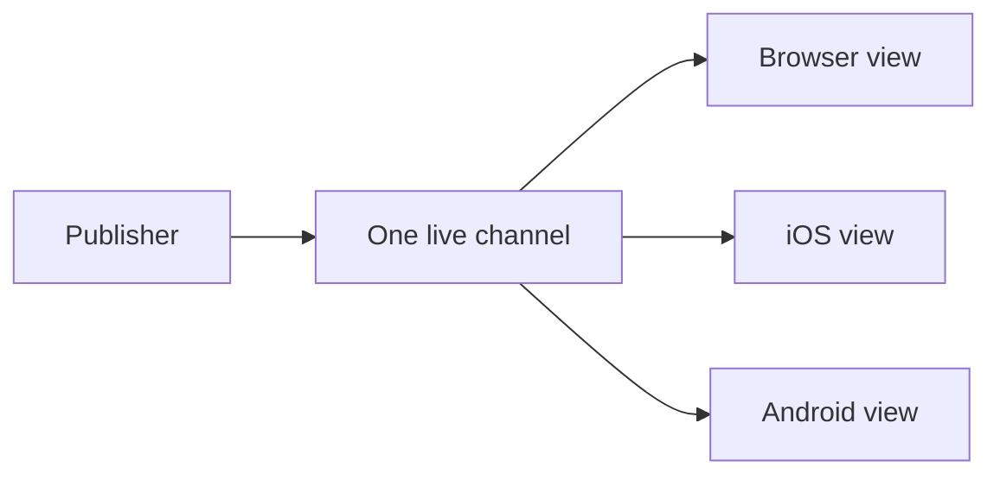

# Feature 32. Target views and elements by name

Status: Complete.

## Glossary

A view is a content area that a host registers with a renderer.
An identifier is a name that an author assigns with `id`.
A target selects a view or an element for a rendering instruction.
A frame carries instructions from a producer to a renderer.

## Framework contract

Every application can use the same placement markup on web, iOS, and Android.
Put target resolution in the framework. The todo example consumes the public contract.

| Author intent | Target | Resolution |
|---|---|---|
| Render an initial page | Omitted | Fill the receiving view. |
| Append content to a view | Omitted | Append to the receiving view. Preserve existing children. |
| Select a registered view | `view#view-1` | Find the named view in this host. |
| Select an element | `#open-count` | Find the name in the receiving view. |
| Check the element type too | `sheet#editor` | Match the name and its declared sheet type. |

A call or subscription carries its receiving view. Independent output can use the only registered view.
If several views qualify, require an explicit view. Never guess from focus or registration order.
Scope element lookup to that view. All shared element kinds support identifiers, including custom registered kinds.
A qualified target checks the shared tag type. The platform widget name cannot change the result.
Provide a common tag-name mapping. Accept `sheet` for the shared bottom sheet and document its canonical spelling.
Reserve `view` for registered view roots.

The author adds an identifier when another operation needs to address an element.
Keep identifiers unique within one view. Different views can use the same element name.
View names are unique within a host. Keep numeric handles available for internal node operations and event dispatch.

## Example

```rust
// Initial content for the receiving view.
let footer = html! { <Text id="open-count">0 open todos</Text> };

// A later publication uses the same declaration on each platform.
html_swap! {
    "#open-count", ctx, ctx.receiver(),
    <Text id="open-count">{count_label}</Text>
}
```

The replacement keeps the name so later publications can find it.



Each subscriber resolves the same named target inside its own view.

## Stage 1. Define the public syntax and wire contract

- Support names in shared markup, initial rendering, and all targeted placement macros.
- Add a target-free append form. Keep append and full-view replacement distinct.
- Use the existing wire identifier selector for bare names. Encode a type check and view selection explicitly when required.
- Specify name parsing, escaping, and malformed-input errors once. Use shared fixtures in every renderer.
- Preserve existing wire field numbers. Regenerate affected bindings and document capability requirements.
- Keep browser-specific selectors available through their existing path. Portable selectors must resolve identically on each platform.

## Stage 2. Implement placement in each framework renderer

- Register view roots at host setup. Bind action replies and stream deliveries to the receiving view.
- Index element names when mounting. Update the index on replacement, removal, and view disposal.
- Apply this contract to append, swap, remove, insert before, and insert after.
- For relative insertion, resolve the named child under the selected parent.
- Validate names and targets before changing the displayed tree. Permit a replacement to reuse names from the outgoing subtree.
- Report a missing target, duplicate name, wrong type, or ambiguous view. Preserve the affected view on failure.
- Apply the same rules to direct rendering, action replies, and streamed updates.

## Stage 3. Use a single shared publication

Publish shared instructions through one channel and one endpoint. All three renderers can apply the same portable frame.
Keep each subscriber’s transport, cursor, and cancellation independent. Preserve replay after reconnect.
Migrate the todo count to one named element and one publication on `/live`.
Remove the example’s separate native count route and numeric count target.
Keep shared selection and delivery logic in the framework. Example code supplies only the view and its business data.

## Stage 4. Use one endpoint for each screen

| Route | Frame content | Callers |
|---|---|---|
| `GET /initial` | Full todo view with a dialog area and a live count subscription | Browser, iOS, and Android todo apps |
| `GET /open-count` | Open count with a Refresh button bound to `refresh_count` | Browser, iOS, and Android starter clients |

Build each screen once with shared controls and named targets. Both handlers return a frame.
Use the same count subscription from the full view on each platform.
Point every starter at the count screen. Declare its refresh action on the browser.
Remove `/native-initial` and `/native-starter` from route registration, callers, tests, templates, and current setup guides.
Keep action submission and live subscription endpoints available.
Load both routes on all three platforms. Submit Refresh and verify that the displayed count matches the server.
Check that an update after initial load reaches the correct count target on each platform.

## Acceptance checks

1. Run common placement fixtures on web, Swift, and Kotlin. Check names on every shared element kind.
2. Verify default append, initial replacement, named views, qualified targets, and every relative placement.
3. Mount two views with identical child names. Deliver a reply to each. Check that its sibling stays unchanged.
4. Reject duplicate names, wrong types, missing children, and ambiguous destinations before mutation.
5. Replace a named subtree twice. Remove it, reuse its name, and verify cleanup when its view closes.
6. Deliver one captured count frame unchanged to all three renderers. Verify the displayed count on each platform.
7. Connect web and native subscribers to the same running endpoint. Publish once and verify independent resume.
8. Update the framework and mobile package README files. Show default placement, explicit view selection, and a typed element target.

Use the existing [mobile designs](../23-native-design-and-themes/feature.md) for the todo regression check.
