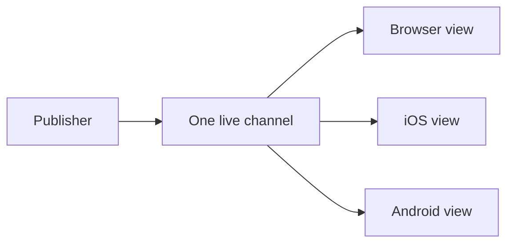
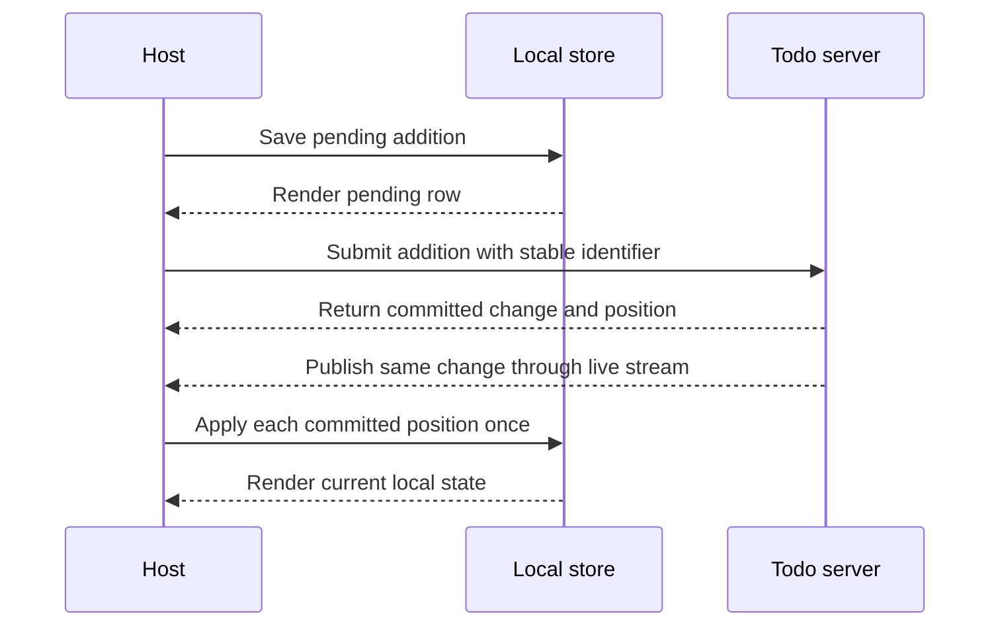
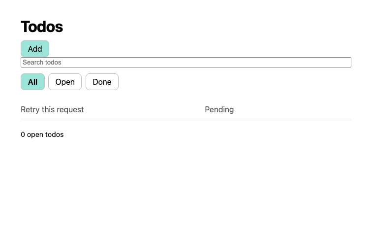
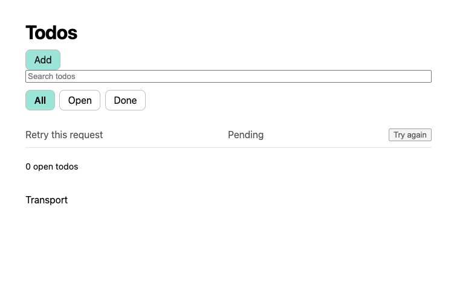
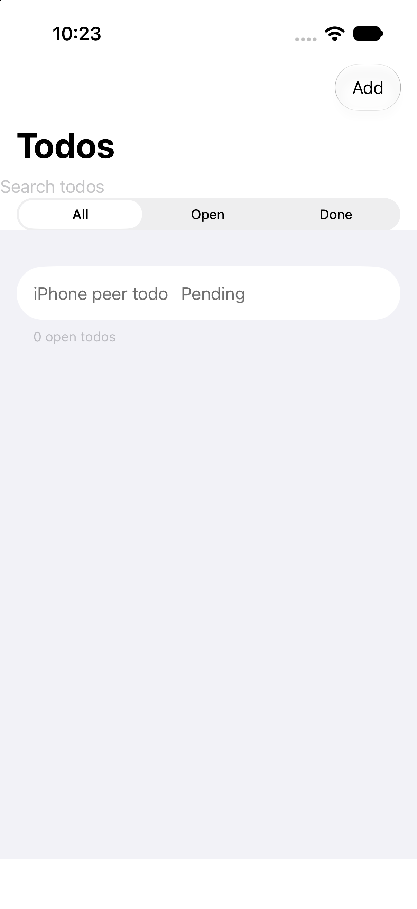
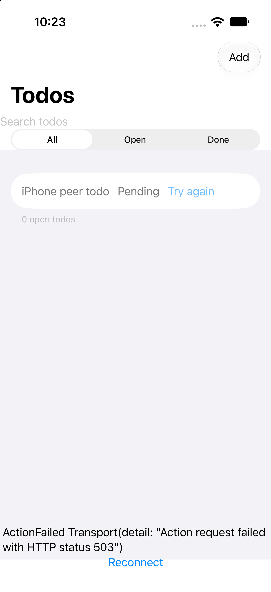
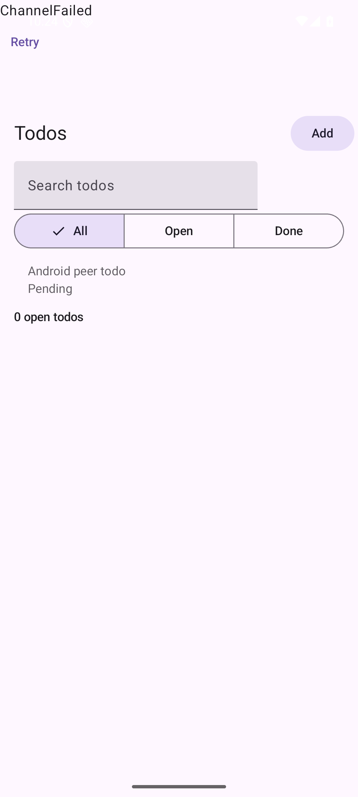
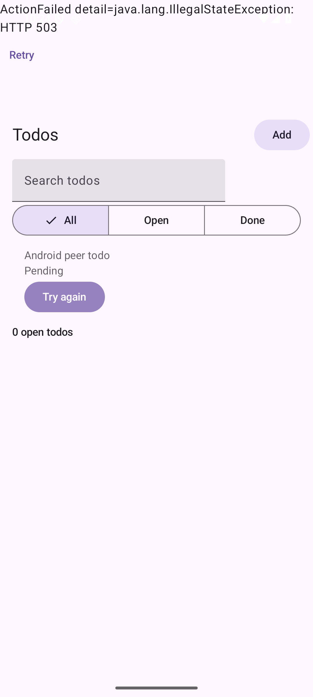

# Feature 32. Target views and elements by name

The framework placement stages and count migration are complete. The Todo agent owns the remaining target migration under issue #714.

## Glossary

A view is a content area that a host registers with a renderer.
An identifier is a name that an author assigns with `id`.
A target selects a view or an element for a rendering instruction.
A frame carries instructions from a producer to a renderer.

## Framework contract

Every application can use the same placement markup on web, iOS, and Android.
Put target resolution in the framework. The todo example consumes the public contract.

| Author intent | Target | Resolution |
|---|---|---|
| Render an initial page | Omitted | Fill the receiving view. |
| Append content to a view | Omitted | Append to the receiving view. Preserve existing children. |
| Select a registered view | `view#view-1` | Find the named view in this host. |
| Select an element | `#open-count` | Find the name in the receiving view. |
| Check the element type too | `sheet#editor` | Match the name and its declared sheet type. |

A call or subscription carries its receiving view. Independent output can use the only registered view.
If several views qualify, require an explicit view. Never guess from focus or registration order.
Scope element lookup to that view. All shared element kinds support identifiers, including custom registered kinds.
A qualified target checks the shared tag type. The platform widget name cannot change the result.
Provide a common tag-name mapping. Accept `sheet` for the shared bottom sheet and document its canonical spelling.
Reserve `view` for registered view roots.

The author adds an identifier when another operation needs to address an element.
Keep identifiers unique within one view. Different views can use the same element name.
View names are unique within a host.
Application code must never assign numeric anchors or send updates to hard-coded node handles.
Use the receiving view or a named target for application updates.
The framework may allocate numeric handles internally for node operations and event dispatch.
Todo record identifiers identify records. They do not address rendering operations.

## Example

```rust
// Initial content for the receiving view.
let footer = html! { <Text id="open-count">0 open todos</Text> };

// A later publication uses the same declaration on each platform.
html_swap! {
    "#open-count", ctx, ctx.receiver(),
    <Text id="open-count">{count_label}</Text>
}
```

The replacement keeps the name so later publications can find it.



Each subscriber resolves the same named target inside its own view.

## Stage 1. Define the public syntax and wire contract

- Support names in shared markup, initial rendering, and all targeted placement macros.
- Add a target-free append form. Keep append and full-view replacement distinct.
- Use the existing wire identifier selector for bare names. Encode a type check and view selection explicitly when required.
- Specify name parsing, escaping, and malformed-input errors once. Use shared fixtures in every renderer.
- Preserve existing wire field numbers. Regenerate affected bindings and document capability requirements.
- Keep browser-specific selectors available through their existing path. Portable selectors must resolve identically on each platform.

## Stage 2. Implement placement in each framework renderer

- Register view roots at host setup. Bind action replies and stream deliveries to the receiving view.
- Index element names when mounting. Update the index on replacement, removal, and view disposal.
- Apply this contract to append, swap, remove, insert before, and insert after.
- For relative insertion, resolve the named child under the selected parent.
- Validate names and targets before changing the displayed tree. Permit a replacement to reuse names from the outgoing subtree.
- Report a missing target, duplicate name, wrong type, or ambiguous view. Preserve the affected view on failure.
- Apply the same rules to direct rendering, action replies, and streamed updates.

## Stage 3. Use a single shared publication

Publish shared instructions through one channel and one endpoint. All three renderers can apply the same portable frame.
Keep each subscriber’s transport, cursor, and cancellation independent. Preserve replay after reconnect.
Migrate the todo count to one named element and one publication on `/live`.
Remove the example’s separate native count route and numeric count target.
Keep shared selection and delivery logic in the framework. Example code supplies only the view and its business data.

## Stage 4. Use one endpoint for each screen

| Route | Frame content | Callers |
|---|---|---|
| `GET /initial` | Full todo view with a dialog area and a live count subscription | Browser, iOS, and Android todo apps |
| `GET /open-count` | Open count with a Refresh button bound to `refresh_count` | Browser, iOS, and Android starter clients |

Build each screen once with shared controls and named targets. Both handlers return a frame.
Use the same count subscription from the full view on each platform.
Point every starter at the count screen. Declare its refresh action on the browser.
Remove `/native-initial` and `/native-starter` from route registration, callers, tests, templates, and current setup guides.
Keep action submission and live subscription endpoints available.
Load both routes on all three platforms. Submit Refresh and verify that the displayed count matches the server.
Check that an update after initial load reaches the correct count target on each platform.

## Acceptance checks

1. Run common placement fixtures on web, Swift, and Kotlin. Check names on every shared element kind.
2. Verify default append, initial replacement, named views, qualified targets, and every relative placement.
3. Mount two views with identical child names. Deliver a reply to each. Check that its sibling stays unchanged.
4. Reject duplicate names, wrong types, missing children, and ambiguous destinations before mutation.
5. Replace a named subtree twice. Remove it, reuse its name, and verify cleanup when its view closes.
6. Deliver one captured count frame unchanged to all three renderers. Verify the displayed count on each platform.
7. Connect web and native subscribers to the same running endpoint. Publish once and verify independent resume.
8. Update the framework and mobile package README files. Show default placement, explicit view selection, and a typed element target.

Use the existing [mobile designs](../23-native-design-and-themes/feature.md) for the todo regression check.

## Remaining Todo targets

Issue #714 tracks the application targets added during the synchronization repair.
The following revision supersedes the earlier full-page count publication. The separate count screen still demonstrates server rendering.

### Action ownership

The server owns todo records. Each client keeps a local copy for display and search.
Each action has one owner and one purpose.

| Intent | Owner | Result |
|---|---|---|
| Open, cancel, or dismiss a dialog | Host | Update the named dialog area on this client. |
| Submit a title or confirm deletion | Server | Validate the request and change the server store. |
| Complete or reopen a todo | Server | Change the record and publish the resulting status. |
| Search or filter | Host | Select matching cached records and update this client's list. |
| Open or close Mathalley | Host | Start or release the game view described in Feature 36. |

Build the initial page once. Give each addressed element a name in the shared markup.
Use one dialog builder. Its inputs select the dialog kind and the affected todo record.
Use declarative controls such as `Either` to select visible content. Keep each action binding in one place.
The closed, add, and delete states share the named dialog area. Only deletion carries a target record.
Submitting a title records a pending row before sending the server action `add_todo`. Bind deletion confirmation to `confirm_delete`. Bind cancellation to `close_dialog`.
Remove the duplicate device mutation handlers and their registrations.
Remove the `local` argument and the `OnDevice` checks from page, row, dialog, filter, and mutation code.
Update callers of the standalone mobile constructor. Its host actions use the cache. Record changes require a server connection.
Declare any platform-specific action scope at its registration and binding boundary.
Use the same shared page and controls on each supported host.

### Local cache and delivery

The initial page request returns the shared page, its record snapshot, and the matching stream position.
The host seeds its local store from that snapshot and retains outstanding submissions during recovery.
One local rendering action owns the rows and the named open-count footer on the full Todo page.
Keep the separate count screen as an example of a server action that renders a view.

A server write returns a typed record change with its committed stream position.
The server publishes that same change to subscribers.
Both paths enter one local action that applies changes in stream order.
Ignore a duplicate position. Request missing changes before advancing across a gap.
Recover from an expired stream with a fresh snapshot and position.
Match pending additions by record identifier. Keep local delivery status separate from confirmed records.
Show pending and failed submissions from local state. Derive the open count from confirmed records in that same store.

After applying a change, invoke the shared local rendering action for the affected named regions.
Keep search input, focus, scroll position, and open dialogs during record updates.
While search is active, keep its displayed rows fixed until the user changes or clears the query.
The write reply and live publication carry the committed record change.
A receipt alone leaves an addition pending. The store confirms it after applying the committed change in order.
Render the changed row and footer from the same resulting store revision.
Test reply-first, publication-first, duplicate delivery, and a gap before the committed change.
During search, verify that the footer updates while the displayed search results remain fixed.



Either delivery can arrive first. The local store reconciles both before the host renders confirmed records.

### Acceptance checks for this revision

1. Inspect the initial page and dialog bindings on Chrome, iPhone, and Android.
2. Verify that each mutation invokes exactly one server action. Verify that opening and cancelling send no request.
3. Freeze search results during remote changes. Clear the query and verify all changes against the cache.
4. Replay a duplicate update. Expire the replay history. Verify recovery without duplicate rows or lost local input.
5. Deliver a cache instruction without any rendering operation. Verify the receiving client's cache independently of the count screen.
6. Verify named targets and displayed rows on all three renderers. Inspect the outgoing frames for numeric application targets.
7. Verify that platform-scoped actions respect their declared scope through framework dispatch.
8. Use Feature 36 to verify game startup, continued todo delivery, and resource release when the game closes.

### Optimistic additions

Optimistic display shows a pending record before the server confirms it.
Generate one universally unique identifier (UUID) for each new todo through the injected host service.
Store the identifier and original submission locally before dispatch. Close the add dialog locally.
Show the pending row immediately with a faded appearance and a gentle pulse.
Show a pending label. Respect reduced motion settings.
Retry sends the same identifier and original submission.
The server records acceptance atomically with the new todo and recognizes repeated submissions.
A conflicting creation payload for the same identifier fails. A late retry after deletion must never recreate the record.
Use the live record or a recovery snapshot to reconcile the pending row by identifier.
An acknowledgement can precede or follow that record. A late timeout cannot revert a confirmed row.
Show Try again for an uncertain or temporary failure. Preserve the title for correction after a validation error.
Keep pending submissions across an app restart. Test two distinct additions with identical titles.
Keep the open count authoritative across pending, accepted, and replayed additions.

### Optimistic deletion

After the user confirms deletion, save the pending deletion locally and close the confirmation dialog.
Keep the row visible with a “Deleting…” label. Disable further changes to that row.
Send the delete request with the same todo identifier on every attempt.
The server makes repeated requests for the same deletion safe.
A confirmed removal from either delivery resolves the pending deletion, including a removal from another client.
Remove the row once. Update the confirmed open count once if the removed todo was open.
A temporary failure keeps the row and shows **Try again**. A late failure cannot restore a confirmed deletion.
On restart, reconcile pending deletions against the recovered records and stream position.
During search, show feedback for the user's own deletion. Keep unrelated search results fixed.
Verify delayed replies, repeated taps, retry after restart, and concurrent deletion on two clients.
This optimistic behavior applies to Add and Delete. Completion and reopening continue to use confirmed updates.

### Search during delivery

The host owns the visible list. Remote changes update the cache while a search is active.
Preserve the displayed search results, including when an incoming title matches the query.
Recompute from the latest cache when the user changes or clears the query. Preserve the selected filter.
Validate actions on a frozen row against its current record. Handle remote deletion without affecting another record.

### Separate one-minute block demonstration

A host action requests a one-minute block for the initiating client. Other clients retain their own interaction state.
The server returns a block identifier and expiry. The client shows a modal countdown and blocks application input.
The server sends a release for that block. The host removes the matching overlay.
Keep live delivery active during the block. Reconcile the current block on reconnect, resume, or restart.
Ignore a stale release for an older block. Test a lost request and a lost release.
Verify pointer, keyboard, back navigation, and assistive input on all three hosts.
Use an injected clock for timing tests. Capture pending, retry, and blocked screens on each host during implementation.

### Browser verification on 2026-11-22

Chrome shows the pending row before the test proxy delivers the addition. The confirmed count stays at zero.
A temporary server failure shows **Try again**. Retrying confirms one row and increments the count once.
The same run deletes the row and confirms its absence.





### Native verification on 2026-11-22

Both phones display a pending row before the server confirms the addition.
A temporary server error displays **Try again**. One retry confirms the original addition.
Chrome and the other phone then show the same row.









## Proposed simplification for pending writes

Keep confirmed records in the in-memory display cache. The server supplies a snapshot and its stream position on startup.
Use the host context to supply a writable key-value store. Give each pending operation its own key.
Scope keys by account and server. Store the stable creation identifier, intent, input, and delivery status.
Load pending keys by prefix. Reconcile them with the snapshot and subsequent typed deliveries.
Keep the existing identifier on retry. A snapshot alone cannot distinguish a delayed request from a lost one.
Remove an entry after the server confirms its outcome. Keep deletion receipts so delayed additions cannot recreate removed records.
Use one host submission path for saving, updating the cache, rendering the pending row, and calling the server action.
Leave network transport responsible for sending. Deliver typed errors and committed changes through the common action path.
Use one universally unique identifier (UUID) as the Todo record identifier throughout its lifetime.
The submitting client generates it once. The pending row, server record, action input, and typed data procedure use that same identifier.
Remove the numeric allocation counter and the separate creation identifier from the current model.
Update backup and restore, bindings, examples, and tests together. Reject incompatible input explicitly and preserve original backup files.
Keep stream positions and transport request identifiers separate. A repeated Add after deletion must never restore a deleted record.
The owner approves this identifier change for implementation.
Verify independent writes from two screens, recovery after restart, duplicate delivery, failure, and late confirmation.
Exercise file-backed key-value operations on iPhone and Android, including prefix listing and reopening the store.
Test the writable virtual file system independently from packaged resource reads.
Batch retry can reuse the same per-item identities and outcomes. Add a batch endpoint only after its contract has approval.
This proposal awaits owner approval.


### Action composition and delivery outcomes

The owner confirms that a local submission action owns persistence and preview before calling the registered server action.
Remove the Todo transport wrapper when this route passes the existing host checks.
Retire `examples/ui_todo/src/shared/outbox.rs` and its custom storage trait, whole-map persistence, frame rewriting, and browser preparation callbacks.
Remove `outbox::prepare`. Build the typed submission in the host action before the framework encodes the request.
Application actions send values implementing `Serialize` and receive values implementing `Deserialize`. They use `html!` for view content.
Register the incoming delivery action with its payload type. The framework validates and decodes the payload before invoking the handler.
Remove manual MessagePack encoding, byte-prefix checks, and frame parsing from Todo actions and host glue.
Test typed Add and Delete requests, typed incoming deliveries, and markup updates through the public interface.
Verify that malformed payloads return a typed error before the application handler runs.
Use the host key-value service for pending records. Add and Delete host actions persist intent and render the preview before sending.
The registered delivery action reconciles confirmed records. Retry uses the original record identifier.
Verify restart, concurrent pending writes, duplicate delivery, and late confirmation on the replacement path.
Check that the Todo application has no request interceptor or equivalent renamed module.

Proposed framework contract:

1. Let a handler submit a typed child action through its context. Reuse the host action manager for lookup and dispatch.
2. Preserve the receiving view and allocate a separate request identifier for each child call.
3. Publish the pending preview before waiting for remote completion. Verify visibility while the test server deliberately holds the request.
4. Return a Rust `Result` to the awaiting caller. Preserve the request identifier, action, endpoint, and typed transport cause when available.
5. Distinguish transport acceptance from an application reply. Use the same correlation for immediate and later replies.
6. Report known failures directly to the caller. Handle cancellation, timeout, duplicate replies, and disposal of the receiving view.
7. Keep the Todo creation identifier across retries. Each send attempt has its own request identifier.
8. If confirmed state arrives after timeout, reconcile it through the existing delivery action.

Verify immediate replies, socket acceptance followed by a delayed reply, and typed failures through each supported transport.
Use ordinary Rust error handling for immediate failures. Socket acceptance leaves the local change pending until confirmation.
Route application actions through the manager. Never interpret data bytes as instructions to call a registered function directly.

Implementation handoff: the next owner implements routed child actions and transport outcomes. The current change records requirements only.

### Shared identifier generation

The shared UUID module accepts an injected entropy source and returns a version four UUID or the source error.
The module owns byte allocation and UUID construction. Todo supplies the host entropy source directly.
Keep the entropy interface below the context crate to preserve the dependency direction. Reuse that interface in the host context.
Keep the existing platform generator. Test injected generation with a seeded source and a failing source.
Preserve the stored identifier text and the wire representation across this change.

### Review the whole shared Todo example

Trace a new Add from its button to its confirmed row. The reader should encounter these application decisions:

1. The host validates the title, saves a pending record, renders the preview, and submits typed input.
2. The server commits the record once and publishes the typed change.
3. The host applies the change, clears the matching pending entry, and updates the affected named elements.

Keep the shared Todo record and typed action inputs. Give server write history and client display state separate owners.
Keep server retry receipts with the writer. Keep the draft, selected filter, pending rows, and frozen search results with the host.
Represent closed, adding, and confirming deletion as one dialog state. Only deletion carries the selected record identifier.
Review the copies of items and pending entries in `StoreState::snapshot`. Build each view from the state it actually needs.
Retain a separate snapshot when it provides a consistent revision or preserves a frozen search result.
Use typed action inputs for retry and correction. Remove command prefixes embedded in control values.
Use public framework operations for storage, dispatch, and render delivery. Remove Todo implementations of these operations.
Keep application bindings declared once. Preserve the separate server-rendered count example.

Verify each removal against existing behavior. Test a lost reply, duplicate delivery, a stale delete retry, and an unfinished draft during a peer update.
Document which application abstractions disappeared and which remaining state each acceptance test requires.

[Feature 37](../37-todo-server-build-and-state/feature.md) defines the current Todo implementation and removal checks.
