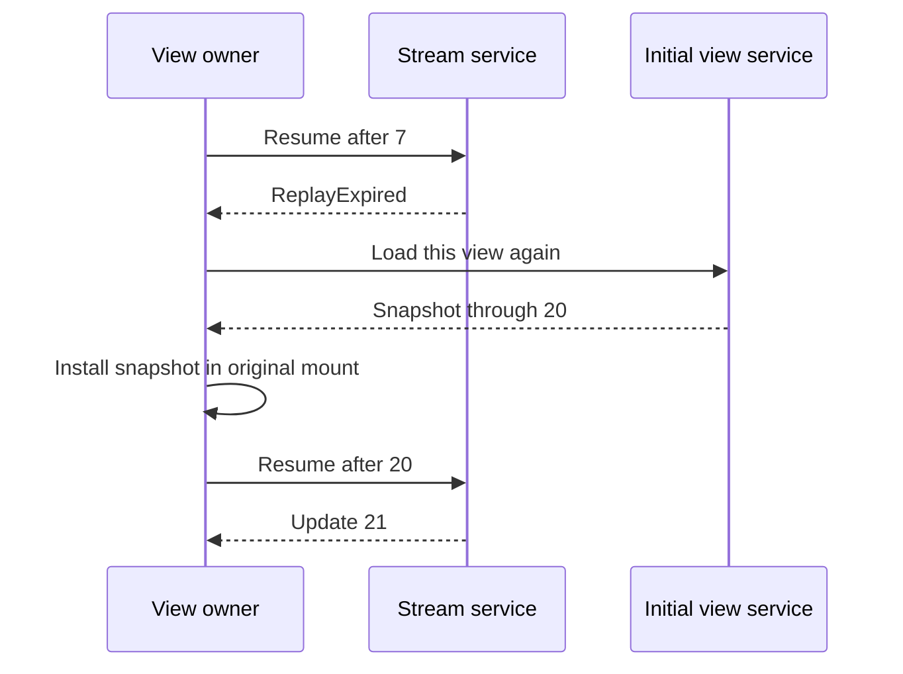

# Feature 33. Refresh the receiving view when replay expires

**Status:** Complete. [Issue 668](https://github.com/ewe-studios/ewe_platform/issues/668) records the original failure.

## Glossary

| Term | Meaning |
|---|---|
| Cursor | The sequence number through which a view includes changes from one stream. |
| Replay | Delivery of retained updates after a cursor. |
| Snapshot | Current view content with a matching cursor for each replayable subscription. |
| Loader | The operation that obtains the initial snapshot for one view. |
| Mount | The place where the host displays a view. |

## Framework contract

On web, iOS, and Android, the host refreshes the affected view when its requested history expires.
The host keeps the loader and the mount together when it opens the view.
The connection reports the failure to the affected subscriber. The view owner chooses when to load a snapshot.

Suppose a phone last applies update 7. The server discards update 8 before the phone reconnects.
The loader returns five open todos through update 20. Another client adds a todo while the snapshot travels.
The phone installs five open todos, subscribes after 20, and applies update 21. It now shows six open todos.

The same loader serves the initial mount and recovery.

## Stage 1. Report expiry to the subscriber

- Expose a typed `ReplayExpired` result with the affected subscription and stream identity.
- Map status 410 from a resume request to this result in each platform adapter.
- For message transports, carry the same result in the resume reply. Associate it with the requesting subscription.
- Stop retries for that expired cursor. Keep ordinary reconnect behavior for temporary network failures.
- Keep other listeners and any shared connection active. A latest-only subscription has no cursor to recover.

## Stage 2. Refresh a mounted view

The host retains the original loader, view parameters, and authentication mechanism.
Each load uses the current credentials for the same account. A loader can use a remote service or application code.

1. Start one recovery load for the affected view. Combine concurrent expiry notices for that view.
2. Keep its current content visible while loading. Invalidate deliveries from its previous subscription generation.
3. Validate the new frame and its stream cursors before replacing the view.
4. Install the snapshot into the original mount. Initialize each replayable subscription from its matching cursor.
5. Resume delivery. Apply each subsequent update once and in sequence.
6. Cancel recovery on view disposal or account change. Ignore late results after replacement or disposal.

A failed load keeps the current content visible. Report the error to the view owner and expose a retry operation.
A retry starts a new load. Never resume from the expired cursor or silently skip missing updates.
Prevent repeated expiry from causing an unbounded refresh loop. Use a configurable recovery attempt limit.
When the limit is reached, report the failure and allow an explicit retry.

## Stage 3. Return a consistent snapshot

The producer supplies content and stream positions from the same committed application revision.
For each stream, the content includes all changes through its stated cursor and none after it.
An application can use a transaction or one synchronization boundary for mutation, publication, and snapshot capture.
Capture owned state and cursors under that boundary. Render and send the response after releasing it.

Replace the separate count and cursor reads in the todo service.
Use the same snapshot operation for initial load and recovery on all supported platforms.
Keep the reusable loader lifecycle and error handling in the framework.

## Verification and documentation

- Expire history on a running server. Check automatic view recovery in a browser, an iPhone simulator, and an Android emulator.
- Publish update 21 between snapshot capture and subscription. Verify that each view applies it once.
- Race publication against snapshot capture. Verify that the snapshot and cursor always describe the same revision.
- Share a connection between two views. Expire one cursor and verify uninterrupted delivery to the other view.
- Test concurrent expiry notices, slow loaders, stale deliveries, view disposal, account changes, and explicit retry after failure.
- Test ordinary reconnect with sufficient history. Verify that this case makes zero calls to the loader.
- Update the framework and mobile package README files. Show loader registration, cursor capture, and recovery from a failed refresh.
- Close issue 668 after the platform checks pass.
