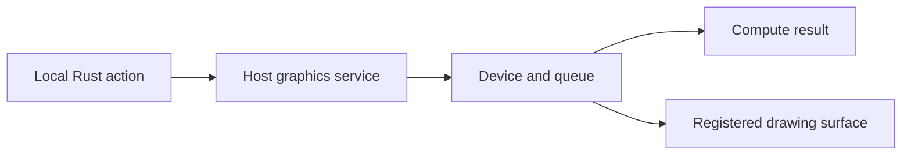

# Feature 34. Give local Rust code access to the host graphics device

Status: Approved for implementation.

## Glossary

| Term | Meaning |
|---|---|
| Graphics processing unit (GPU) | Hardware that runs graphics and parallel computation. |
| Device | A connection through which Rust creates graphics resources. |
| Queue | The channel through which Rust submits device commands. |
| Surface | A drawing target that presents images to a host view. |
| Adapter | The device choice and capabilities that the graphics driver exposes. |
| WebAssembly (Wasm) | The format that runs compiled Rust in a browser. |

## Outcome

An application can use the same Rust computation or drawing code on web, iOS, and Android.
The framework provides an optional host capability backed by the Rust wgpu crate.
An application can use computation before it creates a view. Ordinary controls keep their native renderers.

## Host contract

| Host | Input to the bridge | Host duties |
|---|---|---|
| Browser | A canvas for drawing, when needed | Register the canvas and report physical size. Run browser graphics calls on their owning event loop. |
| iOS | A drawing view with a Metal layer | Retain the layer and report size, scale, and removal. |
| Android | An Android Surface | Retain the native window and handle surface creation, resize, destruction, and recreation. |

Rust requests a compatible adapter and opens the device and queue.
Keep one initialized device per host when the requested capabilities and surfaces are compatible.
The host can supply multiple surfaces. Removing a surface leaves other surfaces and compute jobs usable.
For an incompatible surface, return a typed error. Never silently switch an existing job to a different device.

## Proposed application flow

```rust
let graphics = ctx.get::<GpuService>().ok_or(AppError::MissingGpu)?;
let result = graphics.run(FilterImage::new(input)).await?;
```

This sketch shows proposed names. The application supplies the filter and its shader.
The service submits the application job on the graphics owner. The job can use the wgpu device and queue.
Expose an owner-side extension point for custom application pipelines, buffers, and commands.
Return owned results or host-scoped resource handles. Keep graphics resources on their owner.



The local host executes each job on its own graphics device.

## Stage 1. Add the shared Rust capability

- Add wgpu to workspace dependencies and enable the required backends per target.
- Expose an optional typed service through the host context. Support host injection and a test implementation.
- Use asynchronous device initialization. Share an in-progress initialization between concurrent callers.
- Expose supported features and limits. Request only the capabilities the application needs.
- Keep nontransferable browser objects on the browser event loop. A context handle can send jobs to their owner.
- Report unavailable hardware, unsupported features, device loss, and cancellation through typed results.
- Invalidate old resource handles after device loss. Allow explicit reinitialization with a new device.
- Keep credentials, frame transport, and action registration independent of device initialization.

## Stage 2. Integrate all three host libraries

- Provide public setup for local and server-backed screens that execute local Rust code.
- Add a shared drawing-surface control and a host registration path for an existing application view.
- Let the host own the drawing target. Pass an opaque target handle across the native bridge.
- Keep pointer conversion, retention, and release inside platform-specific bridge code.
- Bind browser targets to canvases, iOS targets to Metal layers, and Android targets to native windows.
- Initialize the device without a surface for compute jobs. Check render compatibility when a surface attaches.
- Suspend presentation at zero size. Reconfigure on resize and release the surface before its native target.
- Reject late work for a destroyed target. Support a replacement target without restarting the application.
- A remote server can describe a surface. Only trusted local application code registers and submits graphics jobs.

## Stage 3. Verify the public capability

1. Run one shared compute shader on each platform. Read back its result and compare it with known values.
2. Draw a known pattern through each platform library. Verify pixels from the rendered target.
3. Exercise two surfaces, resize, removal, and recreation while a compute job remains available.
4. Test unavailable WebGPU, unsupported limits, cancellation, initialization races, and device loss.
5. Test browser setup in a secure context. Record the actual backend and capabilities for each device check.
6. Run native checks on graphics-capable devices. Record any simulator-only coverage separately.
7. Document compute-only use, surface setup, resource ownership, and error handling in the Rust and platform package guides.

The initial feature uses host-provided surfaces and Rust-owned devices.
Importing an existing Metal or Vulkan device requires a separate ownership and synchronization contract.
The reference implementation in ewe_gamify supplies the browser canvas through its RenderHost trait.
