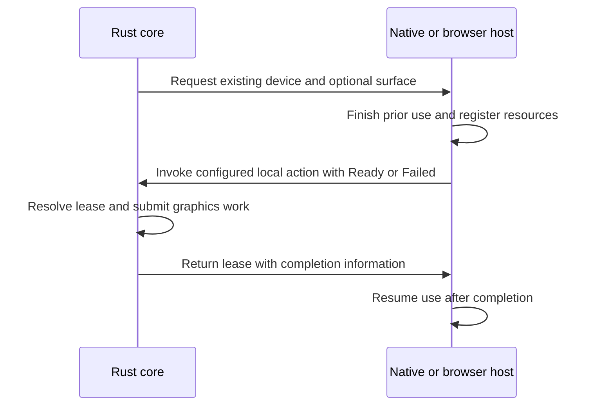

# Feature 35. Use a graphics device that the host already owns

Status: Complete on the tested targets.

## Glossary

A graphics processing unit (GPU) executes graphics commands.
A lease gives Rust temporary access to specific host resources.
A surface is the drawing destination.
A completion fence indicates when submitted device commands finish.

## Public contract

Feature 34 lets Rust open a device. This feature lets the application supply an existing device.
Both modes support application graphics jobs through the host graphics service.

**Rust starts the exchange. The host reports the result by calling a registered local Rust action.**
The application configures the action reference when it installs the host graphics provider.
Use the existing typed action input and local dispatcher. Keep the selected action on this core even when a server connection exists.
A remote frame or a user gesture cannot grant a graphics lease. The local provider validates the grant.



The request returns promptly. The core can dispatch the later action without waiting on the original action.

## Example

An editor asks the host to lend its preview surface. The host already owns the device named `editor`.
The application registers a local Rust action named `preview_device_ready`.
The following sketch shows the proposed exchange:

```text
Rust -> host: request_device(request=12, device="editor", surface="preview")
Host -> local action preview_device_ready:
    Ready(request=12, device="editor", surface="preview", lease=83)
Rust -> host: release(lease=83, completion)
```

The names select resources. The opaque lease identifies retained platform handles in the local registry.
Only the originating host and core can resolve it. Include a generation to reject stale leases after recreation.
Compute requests can omit the surface. Keep separate requests independent when their replies arrive out of order.

## Implementation

1. Add host-owned device configuration alongside the Rust-owned mode in Feature 34.
2. Inject a host request interface. Register the application's ready action and validate its local routing during setup.
3. Track pending requests before notifying the host. Handle immediate completion and asynchronous completion through the same local action.
4. Define typed outcomes for readiness, denial, cancellation, incompatibility, and device loss.
5. Carry names, request identity, and opaque lease identity in the action input. Keep native pointers and browser objects in the host registry.
6. Validate the pending request, owner, surface, generation, and device compatibility before granting access.
7. On iOS, retain the actual Metal device and drawing target. Specify queue ownership before importing resources.
8. On Android, verify the Vulkan instance, physical device, logical device, queue family, enabled features, and extensions.
9. Document the native import safety requirements. Keep the host responsible for final destruction of its device.
10. On web, retain the supplied WebGPU device and canvas on their owning event loop.
11. Verify the browser import path against the selected wgpu version. If a bridge is needed, implement and test it with the supplied device.
12. Report unsupported imports explicitly. Creating a second device does not satisfy the host-owned contract.

## Ownership and completion

A local action signals readiness after prior host work finishes or a valid synchronization dependency becomes available.
A callback alone cannot prove that queued graphics work has finished.
Define the supported fence or queue-ordering mechanism for each backend. Synchronize shared reads, writes, and presentation.
Only one owner presents each acquired image. Record who acquires, presents, and releases it.
Return the lease once after completion, cancellation, or failure. Defer reuse until outstanding device work finishes.
If the host withdraws a surface, stop new submissions. Release references after pending work finishes or the device reports loss.
Ignore duplicate or late notifications and release any unused grant. Keep unrelated views and requests active.

## Acceptance checks

- Start the exchange from Rust and invoke a configured local action from Swift, Kotlin, and the browser.
- Run with a server connection enabled. Verify that the exchange sends no network request.
- Have the host write a known texture. Process that same texture in Rust and verify the result from the host.
- Verify the actual device identity. Run a compute-only case and a visible surface case.
- Delay host readiness and Rust completion separately. Verify that neither side reuses a busy resource.
- Test immediate completion, duplicate notifications, cancellation during import, stale generations, incompatible resources, and device loss.
- Run both device ownership modes in the same test suite. Report backend, hardware, and simulator coverage.
- Update the Rust, Swift, Kotlin, and browser guides with setup, action registration, acquisition, release, and failure examples.

### Physical iPhone Metal check on 2026-11-28

An app-hosted XCTest runs on iPhone 13 Pro with iOS 27.2.1.
One test passes. No tests fail or skip.
The host supplies its original Metal device, command queue, and texture.
Rust waits for the host upload and changes the red pixel into blue.
The host reads the changed source pixel, then reads the pixel from the presented drawable.
The test also checks compute output, the original device identity, and the release callback.

The scratch project reuses the existing test and shader fixtures.
Xcode requires a signed app host for this test on a physical iPhone.
The run uses the reserved proof app slot. The original signed proof app is restored afterward.

[Metal handoff test](../../../../mobile/ios/Tests/EweUITests/HostGraphicsTests.swift)
[Issue 1265 tracks a permanent test host](https://github.com/ewe-studios/ewe_platform/issues/1265)
