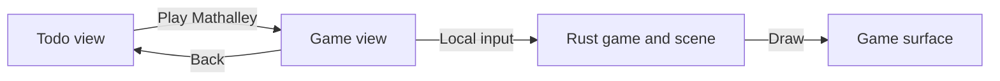

# Feature 36. Play Mathalley in a second todo view

Status: Proposed for review. Implement this feature last, after every other feature in Specification 69 is complete.

## Glossary

A view is an independently mounted content area.
A graphics processing unit (GPU) draws the game into a surface supplied by the host.
A hit region is the area where a tap selects a game action.

## User flow

Open the todo application. Select **Play Mathalley**. The application opens a game view beside the existing todo view in the host’s navigation.
Start a run. Play Gumball and Train. Return to Todos. The same list, filter, and stored items remain available.

The game owns its surface. The todo view keeps its own mount and subscriptions.

## Stage 1. Port the reference game

Use the sibling ewe_gamify repository as the source reference. Inspect src/game.rs, scene.rs, gpu.rs, audio.rs, and lib.rs.
Record the reference revision before starting. Keep the port inside the single ui_todo Rust package.
Build from a clean ewe_platform checkout without a dependency on the sibling directory.

Preserve the title, intro, round tally, lives, difficulty progression, game over, and restart flow.
Preserve both mini-games, their hit regions, the procedural music, cues, and mute control.
Reuse the pure Rust game and scene logic. Inject time and randomness through the host for deterministic tests.
Use the reference’s 390 by 844 design space for drawing and input. Exclude the letterbox margins from hit tests.

## Stage 2. Use framework navigation and graphics

- Add the game entry to browser, iOS, and Android todo screens, through the same shared page declaration.
- Register separate todo and game views through the public framework. Use host actions to open and close the game. The game view owns the running game loop.
- Use Feature 32 for view targeting. Keep remote todo updates scoped to the todo view while the game is open.
- Use Feature 34 to draw through wgpu. Exercise Feature 35 with a host-owned device in an integration configuration.
- Keep game input, simulation, and drawing local. A server-backed todo screen can open the same local game.
- Let the host schedule drawing and map pointer or touch coordinates to game coordinates.
- Reconfigure on resize and rotation. Pause simulation and sound when hidden. Resume without charging time spent away.
- On close, release the surface, audio, and frame callbacks. Keep the todo host and its graphics device available.
- If graphics initialization fails, show a recoverable error in the game view and keep the todo view usable.

## Stage 3. Verify the integrated application

1. Run deterministic tests for both mini-games and the complete run lifecycle.
2. On each platform, enter a todo, select a filter, open the game, play, and return.
3. Verify the same todo state after returning. Deliver a live count update while the game view is active.
4. Verify that game input and graphics updates reach only the game view. Verify that the todo receives its count update.
5. Repeat open, close, resize, and background transitions. Check for duplicate input, stale callbacks, and resource leaks.
6. Verify an input hit and a known rendered scene on real graphics backends. Record hardware and simulator coverage separately.
7. Capture the game and the return to Todos on web, iOS, and Android. Compare key scenes against the reference.
8. Update the todo README with launch commands, controls, navigation, and graphics ownership for each platform.
