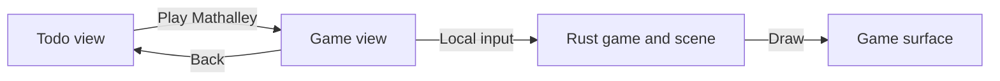
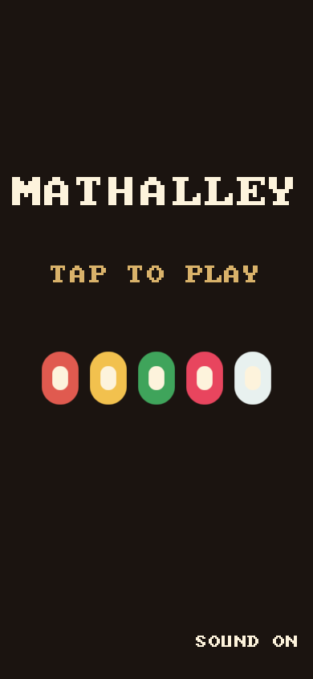
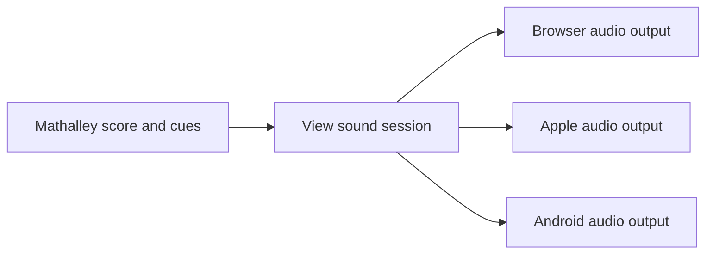
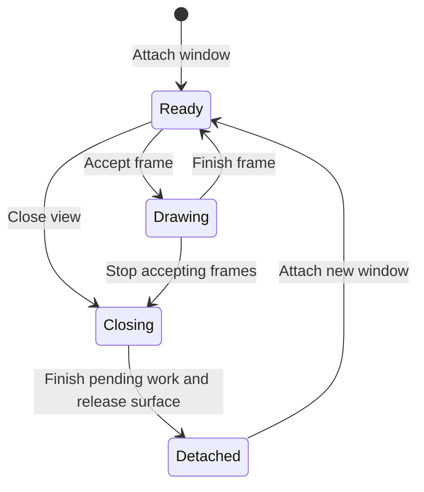

# Feature 36. Play Mathalley in a second todo view

The owner approves implementation on 2026-11-22.

The reference is `ewe_gamify` commit `11052a15411ed1534c2ba9e5f982fd7dc975ffaf`.
Use its 390 by 844 scene coordinates, bitmap letters, colors, score rules, sound score, and hit regions.

## Glossary

A view is an independently mounted content area.
A graphics processing unit (GPU) draws the game into a surface supplied by the host.
A hit region is the area where a tap selects a game action.

## User flow

Open the todo application. Select **Play Mathalley**. The application opens a game view beside the existing todo view in the host’s navigation.
Start a run. Play Gumball and Train. Return to Todos. The same list, filter, and stored items remain available.



The game owns its surface. The todo view keeps its own mount and subscriptions.



The reference title uses the full 390 by 844 surface.

## Stage 1. Port the reference game

Use the sibling ewe_gamify repository as the source reference. Inspect src/game.rs, scene.rs, gpu.rs, audio.rs, and lib.rs.
Record the reference revision before starting. Keep the port inside the single ui_todo Rust package.
Build from a clean ewe_platform checkout without a dependency on the sibling directory.

Preserve the title, intro, round tally, lives, difficulty progression, game over, and restart flow.
Preserve both mini-games, their hit regions, the procedural music, cues, and mute control.
Reuse the pure Rust game and scene logic. Inject time and randomness through the host for deterministic tests.
Use the reference’s 390 by 844 design space for drawing and input. Exclude the letterbox margins from hit tests.

## Stage 2. Use framework navigation and graphics

- Add the game entry to browser, iOS, and Android todo screens, through the same shared page declaration.
- Register separate todo and game views through the public framework. Use host actions to open and close the game. The game view owns the running game loop.
- Use Feature 32 for view targeting. Keep remote todo updates scoped to the todo view while the game is open.
- Use Feature 34 to draw through wgpu. Exercise Feature 35 with a host-owned device in an integration configuration.
- Keep game input, simulation, and drawing local. A server-backed todo screen can open the same local game.
- Let the host schedule drawing and map pointer or touch coordinates to game coordinates.
- Reconfigure on resize and rotation. Pause simulation and sound when hidden. Resume without charging time spent away.
- On close, release the surface, audio, and frame callbacks. Keep the todo host and its graphics device available.
- If graphics initialization fails, show a recoverable error in the game view and keep the todo view usable.

## Stage 3. Verify the integrated application

1. Run deterministic tests for both mini-games and the complete run lifecycle.
2. On each platform, enter a todo, select a filter, open the game, play, and return.
3. Verify the same todo state after returning. Deliver a live count update while the game view is active.
4. Verify that game input and graphics updates reach only the game view. Verify that the todo receives its count update.
5. Repeat open, close, resize, and background transitions. Check for duplicate input, stale callbacks, and resource leaks.
6. Verify an input hit and a known rendered scene on real graphics backends. Record hardware and simulator coverage separately.
7. Capture the game and the return to Todos on web, iOS, and Android. Compare key scenes against the reference.
8. Update the todo README with launch commands, controls, navigation, and graphics ownership for each platform.

## Shared audio output

A cue is a short sound that signals a game event.
A sound session groups all sounds that belong to one open view.



Each host plays the same score through its sound session.

- Keep the jazz score, seeded wind, instruments, and answer cues in Mathalley.
- Provide a host interface for timed sound output, volume changes, pause, and close.
- Inject the interface through the host context. Use its playback clock to schedule sound.
- Start browser playback on the first user gesture. Report playback errors and keep the game controls available.
- On interruption, suspend output. On resume, discard expired notes and keep the mute setting.
- On close, cancel queued sounds for that view and release its output resources.
- Test the score with a recording host and a controlled clock.
- On browser, iPhone, and Android, verify the cue, mute, interruption, resume, and close behavior.
- After closing the game, verify that a second view can still play sound.

The owner approves the audio extension for implementation. The existing game and its controls use the approved visual design.

## Shared Android surface lifecycle

The Android host supplies a window for each drawing surface. Android can replace that window while the application runs.
The framework must prevent a frame for an old window from reaching its replacement.



Each window has its own drawing lifetime.

- Put native frame coordination in the framework. Connect the shared Android component, `EweDrawingSurface`, to that coordination.
- Give applications a shared way to submit a draw and close a surface. Keep game rules and navigation in the application.
- Handle Back, view disposal, and window loss. Reject stale callbacks and handle duplicate close requests.
- Keep the Android main thread responsive while the last draw finishes. Release the surface once.
- Preserve existing callers. Check all drawing surface consumers and test a simple framework consumer independent of Mathalley.
- Move emulator sound policy into the shared Android launch task. Enable sound by default and support explicit mute.
- Keep emulator driver settings in the existing native graphics host. Read application endpoint defaults from project configuration.
- Test two game visits in one process. On each visit, draw Train, answer a question, and return to the same Todo list.
- Test window replacement during a draw. Check that a second surface can draw after the first closes.
- Test both sound settings. Check playback with sound enabled. Record the device and the observation.

Use the existing [Android Train](screenshots/android-game.png) and [Todo return](screenshots/android-return.png) images for both visits.
The owner approves this extension for implementation.

## Verification record


### Signed iPhone checks on 25 November 2026

The iPhone 17e simulator ran the two offline tests from commit `e114627ee` in the Debug profile.
The host used the release Rust archive for the simulator.

| Test | Result |
| --- | --- |
| `testMathalleyReturnsToTheSameTodo` | Added “Keep this todo” and selected Open. The same row returned after both game visits. Passed in 88.17 seconds. |
| `testTrainAndGumballSurviveRotation` | Answered six train questions with seed 13. Gumball remained visible in landscape and accepted a tap. Passed in 34.07 seconds. |
| `testMathalleyKeepsTheServerSubscription` | A browser added a second Todo during play. The iPhone restored both rows, the Open filter, and the count. Passed in 35.92 seconds. |
| `testIndependentGameSoundOnAppleOutput` | A second view rendered audio samples through the Apple audio engine after the game closed. Passed in 12.37 seconds. |

The server and audio tests used the corrected command decoder on the graphics integration checkout before the offline merge.
Physical speaker playback and operating system interruption notifications still require a phone.

### Platform coverage

| Host | Graphics and input | Todo subscription | Sound |
| --- | --- | --- | --- |
| Chrome on macOS | Train and Gumball receive input. A host texture returns the expected pixel after Rust compute. | A peer adds a task while the game is open. | Web Audio renders separate views. The first view keeps its mute setting after interruption. |
| iPhone 17 simulator | Metal presents both games. Gumball rotates to landscape and accepts the next answer. | A browser peer adds a task while the game is open. | The game adds an intro cue. An independent Apple audio engine renders the second view after the first closes. |
| Android Arm emulator | Vulkan presents both games. Gumball rotates to landscape and accepts the next answer. | A browser peer adds a task while the game is open. | The game adds an intro cue. An independent Android audio track advances after the first view closes. |

The Android and Apple sound tests check silence while paused and after a muted resume.
The simulator runs do not measure sound at a physical speaker. Physical phone coverage remains open.
The reference and port share the title lettering, five lamps, and dark background.
All three ports show the same train cars, answer chips, gumball machine, and score controls.
Each host fits the scene within its available surface.

| Host | Train | Gumball | Return |
| --- | --- | --- | --- |
| Chrome | [Train](screenshots/browser-game.png) | [Gumball](screenshots/browser-gumball.png) | [Todos](screenshots/browser-return.png) |
| iPhone | [Train](screenshots/ios-game.png) | [Gumball](screenshots/ios-gumball.png) and [landscape](screenshots/ios-gumball-landscape.png) | [Todos](screenshots/ios-return.png) |
| Android | [Train](screenshots/android-game.png) | [Gumball](screenshots/android-gumball.png) | [Todos](screenshots/android-return.png) |

### iPhone Simulator Mathalley rerun on 2026-11-28

On iPhone 17 Simulator, Train and Gumball pass the rotation check. Back to Todos restores the same Todo and filter.
The Apple audio test measures the opening music and answer cue as samples. It verifies silence while inactive and after muted resume.
It also verifies that closing one game stops its audio and leaves the other game's output available.
The test uses offline rendering. Physical speaker output and interruptions still need a separate check.

[Gumball after rotation](screenshots/iphone17-simulator-gumball-landscape-2026-11-28.png)


### Physical phone sound handoff

Run Todo On Device on each phone. Its local task store starts with the process and needs no server.
Use the existing [iPhone signing and launch steps](../../../../examples/ui_todo/ios/todo_on_device/README.md).
Use the [Android build steps](../../../../examples/ui_todo/android/README.md) for the matching library and Todo On Device application.
Use an Android device that has no existing Todo On Device installation.
Install and start the matching scratch application with these commands.

```sh
adb -s "$ANDROID_DEVICE" install examples/ui_todo/android/todo_on_device/app/build/outputs/apk/debug/app-debug.apk
adb -s "$ANDROID_DEVICE" shell am start -n ewe.todo.local/.MainActivity
```

1. Select the phone speaker on the test device. Record the device, operating system, build revision and output route.
2. Add a scratch item. Select Open, then **Play Mathalley**. Tap the title and answer one question.
3. Listen at the speaker for the opening music and answer cue. Record which sounds play and when.
4. Select **Sound** to mute and answer again. Verify silence at the speaker.
5. Background the app and return. Verify the mute setting remains on and the game accepts an answer.
6. Enable sound. Trigger an interruption with an approved test call or focus change. Record its start and end.
7. Verify the game stops sound during interruption. On return, verify a new cue plays without a burst of expired notes.
8. Repeat the interruption while muted. Verify the game stays silent after the return.
9. Select **Back to Todos**. Verify the same item and Open selection. Verify the closed game stays silent.
10. Open another game view. Unmute that view if needed. Verify it can play a new cue.

Record the Apple audio session notification or the Android audio focus change for the interruption check.
Use the Home and return result for foreground changes. Use the session or focus record for interruptions.
Record actual speaker output separately from the audio engine samples and emulator capture.
