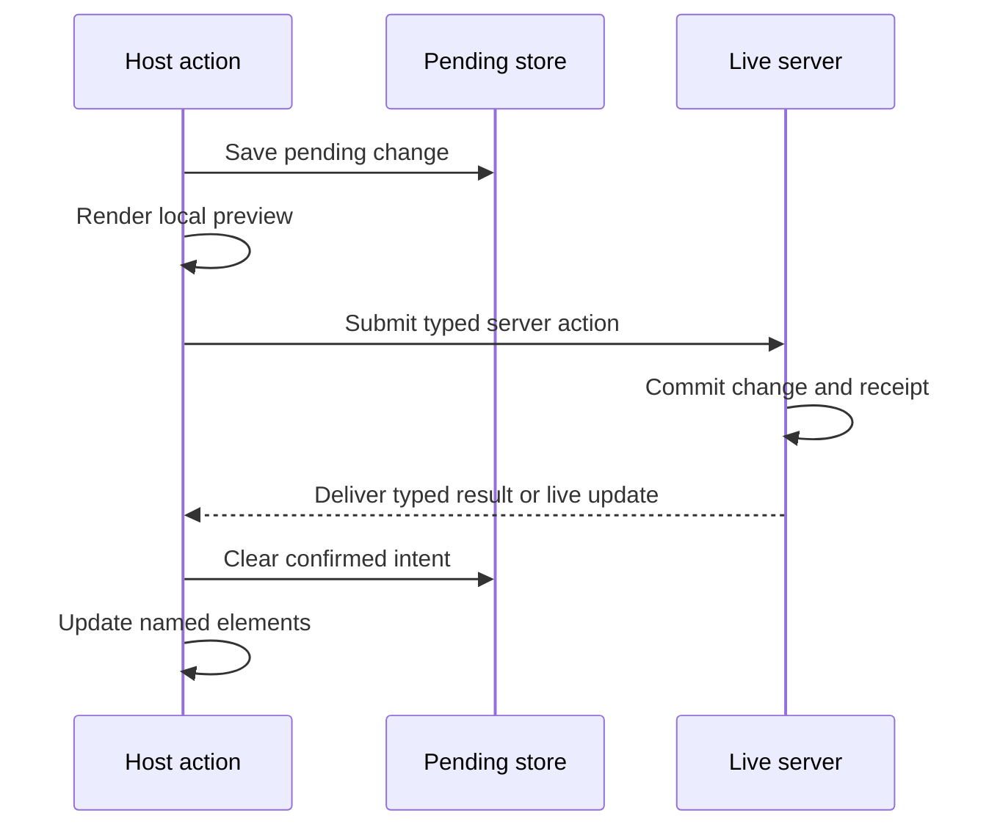

# Feature 37. Simplify Todo startup, packaging, and state

Status: Required implementation work. This document is the acceptance contract for the Todo redesign.

## Terms

A key-value (KV) store reads and writes records by key.
A universally unique identifier (UUID) identifies one Todo throughout its lifetime.
A snapshot contains confirmed records and their matching stream position.
A resource provider opens a packaged asset by its logical name.
Hypertext Transfer Protocol (HTTP) carries requests and responses.
A remote procedure call (RPC) invokes a named operation on another system.
WebSocket keeps a connection open so either endpoint can send messages.
A fixture supplies data or services for a test.

## Scope and precedence

Use this feature when changing the Todo launcher, browser packaging, shared actions, or persistence.
It consolidates Specifications 69 and 90 for the Todo application. Use this contract when older Todo startup instructions conflict.
Feature 26 requires independent native data calls. Its fixture belongs in tests.
Feature 27 supplies the single package. Feature 32 supplies named updates, local rendering, and action routing.
Feature 33 supplies replay recovery. Specification 90 Features 1 and 3 supply bundling and resources.
Existing graphics, audio, and native data contracts still apply. Feature 32 tracks its separate timed block demonstration.

## One live server

In `examples/ui_todo/src/bin/server.rs`, bind the configured address, open the configured services, construct the app once, and serve.
Expose one full server constructor that accepts the prepared Todo store and live channel. Its callers supply configuration independently.
The persistent store owns its file path and format. Opening the same store after restart makes previous writes available through KV operations.
Use the store's documented empty state for a new path. Propagate malformed contents and read failures. Preserve the original file on failure.
Keep confirmed server records and idempotency receipts durable. A delayed retry after deletion must never recreate the record.
Define a consistent recovery policy for the stream position and replay history across a restart.
A server with a fresh history must direct stale clients to a matching snapshot.
Retain account and endpoint isolation where hosts configure them.

Remove these paths from production startup:

- Remove `--data-only` and `data_app()`. Move the seeded service and its launcher under `examples/ui_todo/tests/`.
- Keep the real typed data procedure on the full server. Update the iPhone and Android test runners to launch the independent fixture.
- Remove `--restore` and backup parsing from normal startup. Put legacy import and conversion in maintenance tooling.
- Remove `app_with_todos`, `app_with_channel`, and other constructors that only select inputs for the full app.
- Remove the `EWE_TODO_HISTORY` startup branch. Configure replay capacity on the supplied channel. Replay tests construct their own channel.
- Remove `web_module()`, runtime module validation, and `EWE_TODO_MODULE`.

## Build and serve the assets

The app build script calls its service schema generator and one public framework packaging hook.
The hook uses the resource manifest, builds missing browser modules, generates Connect and resource bindings, and stages assets.
Framework providers own tool invocation, change tracking, output directories, validation, and failure reporting.
Use those same providers for command-line tasks. Retire `examples/ui_todo/build-module.sh` and migrate its callers.
A clean Cargo build must prepare the browser application without a separate script or a prebuilt module.
Produce one public JavaScript file, `/bundle.js`, including generated bindings. Preserve addresses for the required WebAssembly binaries.
Use readable JavaScript in development and minified JavaScript in release. Keep intermediate scripts outside the public tree.
Mount application routes first. Mount the resource provider once:

```rust
router.mount(StaticFileHandler::from_resources(PackagedResources))?;
```

Remove the per-file route table and registration adapter in `src/server/assets.rs`.
The provider serves development files beside the executable and embeds release bytes.
The app passes no filename index, module path, mode flag, or byte lookup callback.

## Client and server actions



The submitting host renders pending work before waiting for the server.

- Use one UUID from pending submission through deletion. The framework UUID helper accepts injected entropy.
- Keep confirmed client records in memory. Persist unresolved Add and Delete operations as separate KV entries.
- On open, fetch the server snapshot and list pending keys. Keep unresolved requests available for retry.
- Bind submission to one host action. It saves intent, renders the preview, then calls the registered server action through its context.
- Return known transport failures through Rust `Result`. Socket acceptance leaves the intent pending until confirmation.
- Send typed values and receive typed deliveries. Use `html!` for view content. The framework owns wire framing and payload decoding.
- Remove `shared/outbox.rs`, `outbox::prepare`, request interception, custom persistence, and application frame parsing.
- Remove the mobile transport wrapper and browser send overrides. Keep platform transport adapters supplied by the framework.
- Share one registration list and page declaration. Use receiving views and named elements. Keep dialog, draft, search, and filter state on the host.
- Keep the confirmed count consistent with the host cache. The independent count screen retains its server-rendered demonstration.

## Browser startup and storage

The browser runtime provides the public loader, application builder, and boot operation.
The existing Cloudflare storage providers require Worker services. Browser applications need providers for storage on the user's device.
Implement optional IndexedDB and `localStorage` providers in `foundation_db` through its existing `KeyValueStore` trait.
Keep browser bindings, serialization, and typed storage errors in those providers.
Verify a standalone browser consumer can use either provider without importing `foundation_wasm_ui` or supplying Cloudflare bindings.
During boot, `foundation_wasm_ui` installs the selected provider and namespace in the host context.
Todo uses IndexedDB for durable pending changes. Each operation has its own key, scoped to the account and server.
Use the memory provider for temporary sessions and tests. Offer `localStorage` for simple settings.
Todo actions read and write typed records through the installed service. Remove Todo-specific JavaScript storage callbacks.

Test both browser providers through `get`, `set`, `delete`, and prefix-based `list_keys`.
Reload the page and verify stored records. Check that a new memory provider starts empty.
Open two tabs in the same namespace. Write distinct pending changes concurrently and verify both survive reload.
Confirm one change in the first tab. Verify the other change remains pending in the second tab.
Check namespace isolation and propagate denied access, quota errors, and failed IndexedDB transactions to the caller.

The proposed application startup shape is:

```js
const module = await loadWasm("/module.wasm");
const app = createApp({ module, mount, initialRoute, storage });
await app.boot();
```

1. The loader checks response status before compiling. Return a typed load error for missing, malformed, or incompatible modules.
2. Boot supplies imports, attaches memory, installs the Rust host context and selected services, and registers the application's declared actions.
3. The application supplies its mount, initial route, typed delivery action, and optional capabilities through configuration.
4. Use the default transport or register a custom transport before boot. Applications supply endpoint choices through configuration.
5. The runtime owns the handshake, frames, socket acknowledgements, request correlation, disconnect handling, initial load, and recovery.
6. Accept serializable JavaScript values and typed Rust action inputs. Keep transport errors available through the public action call.
7. Dispose partial startup on failure. Repeated startup must not register duplicate handlers or leave open connections.

Remove Todo-specific storage imports, pointer callbacks, numeric scope translation, and prepared-request callbacks from `src/web.rs`.
Remove manual module instantiation, frame inspection, send overrides, and socket callback replacement from `web/app.js`.
The framework can use native browser bindings internally. Application authors use its public interfaces.

Test a missing module, a successful response containing an error page, and an invalid WebAssembly binary.
Verify that no host starts after a load failure. Preserve the request address and the available status or compiler cause.
Boot a minimal external app with the default transport. Repeat with a registered custom transport.
Verify typed local and remote actions, retry, reconnect, and view recovery without editing the transport instance.
Verify the deployed Todo entry still requests one JavaScript file.

## Native transport selection

Use one screen entry point and one Todo core factory on each platform.
Use `ServerScreen` on iPhone and `RemoteEweScreen` on Android.
On Android, replace the separate `rpcBase` and `socketEndpoint` options with one transport selection.
The app supplies the server address and an action transport setting at startup.
Support the default HTTP action endpoint, Connect RPC over HTTP, and the WebSocket action endpoint.
The framework selects the sender and negotiates its capabilities. It passes the sender to the same factory for every selection.
The factory installs the pending store, resources, and typed delivery action once per core.
Keep the initial view request on HTTP for all three selections.
Route host actions locally. Route typed server actions through the configured sender.

Expose the same independent WebSocket service to Rust callers through the iPhone and Android host contexts.
The caller supplies the endpoint, opens a connection, sends and receives application messages, and closes the connection.
The native framework owns the platform socket. Each caller owns the lifetime of its connection.
Return connection and message errors to the caller. Keep independent messages outside the action dispatcher.

Test all three transport settings on both iPhone and Android. Use the same core factory for every setting on each platform.
Verify the initial HTTP load, local dialog, remote Add, and typed confirmation for each setting.
On each platform, open a separate native WebSocket from Rust while Todo uses its action socket.
Exchange an application message and close the independent socket. Verify Todo can still send an action and receive confirmation.

## Required verification

1. Start the full server against a new store. Add a record, stop the process, and reopen the same path.
2. Verify the record through a key lookup, a list operation, and the initial page. Use no restore command.
3. Delete the record, restart, and retry its original Add. Verify it stays deleted.
4. Exercise corrupt storage, interrupted writes, and independent pending writes from two views. Verify existing records survive failure.
5. Run replay recovery with an injected bounded channel. Check the snapshot position during a concurrent mutation.
6. Run the seeded data service from test support. Verify typed success and missing-record errors from Swift and Kotlin.
7. Build from an empty target directory. Run the moved development tree and the standalone release executable outside the checkout.
8. Verify one script request, module media types, local actions, Connect calls, and native resource reads. Reject missing generated inputs during build.
9. Verify immediate pending feedback, restart recovery, retry identity, delayed confirmation, duplicate delivery, and isolation of peer drafts and filters.
10. Exercise Add, Complete, Reopen, and Delete from Chrome, iPhone, and Android. Verify each change on both peers.
11. Inspect application sources for each retired mechanism. Moving the same mechanism into another application file fails acceptance.
12. Use the existing Feature 32 screenshots for pending and retry behavior. Record the tested commit, build profiles, commands, and platform results.

Review the production diff and the acceptance evidence before marking this feature complete.
An earlier passing test for a predecessor feature does not establish completion of this redesign.
