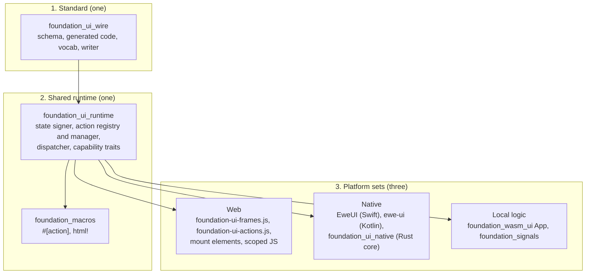
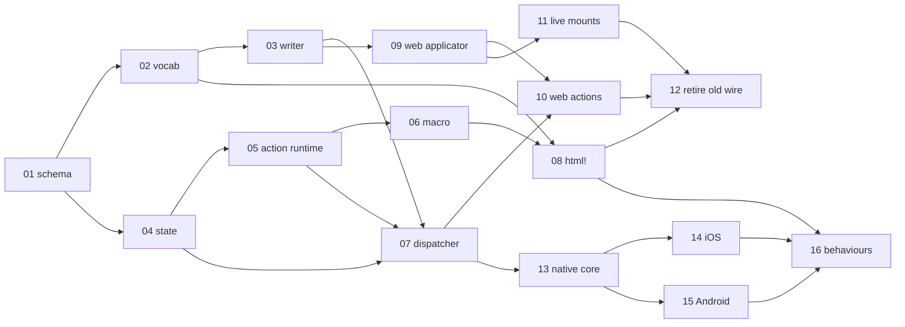

# Spec 69: foundation_ui v2

_Written in ASD-STE100 Simplified Technical English (STE). Code and identifiers stay as they
are._

## 0. Glossary and abbreviations

| Term | Meaning |
|---|---|
| ASD | AeroSpace and Defence Industries Association of Europe, the owner of the STE standard ASD-STE100 |
| UI | user interface |
| DOM | Document Object Model, the tree of elements in a browser page |
| WASM | WebAssembly |
| JS / TS | JavaScript / TypeScript |
| SSE | Server-Sent Events, a one-way HTTP stream from server to client |
| HTTP | hypertext transfer protocol |
| HMAC | hash-based message authentication code |
| AEAD | authenticated encryption with associated data |
| CI | continuous integration |
| id | identifier |
| FlatBuffers | A binary format with a schema. A reader follows offsets in the received bytes; it does not parse |
| `flatc` | The FlatBuffers schema compiler. It generates code for Rust, TS, Swift and Kotlin |
| schema | The `.fbs` files in `backends/foundation_ui_wire/schema/` |
| frame | One `Frame` table: a message from logic (server, WASM or Rust) to a renderer |
| op | One operation in a frame, for example "set the text of node 42" |
| form | One member of the `Op` union. A change has one form |
| cross-platform form | A form that every platform applies |
| platform form | A form that only the web, or only mobile, applies |
| tier | The encoding of a frame body: tier 1 `OpBatch`, tier 2 `ColumnarBatch`, tier 3 `DataTable` |
| node | One UI element. It has a `u32` node id |
| `primal-id` | The node id as an HTML attribute on the web. The `html!` macro assigns it at compile time |
| mount surface | What renders the frames: `Web` (a browser or a WebView) or `Native` (SwiftUI or Jetpack Compose) |
| action | A named function that an event triggers |
| origin | Where an action runs: `server:`, `native:` or `js:` |
| scope | Where an action exists: every platform, web only, or mobile only |
| action reference | The text `origin:name`, for example `server:increment_counter` |
| registry | A map from an action name to an action. The app builds it |
| action manager | The code that reads an action reference, checks origin and scope, and routes the call |
| signed state | The state of one component, with a tag that proves the server made it |
| component root | The node that holds the signed state of a component |
| live mount | A node region that opens a channel and applies the frames that arrive |
| stateless action | An action that needs no per-user memory on the server replica that runs it |
| live mode | The current mode: the server holds a signal graph and pushes frames |
| gate | The one code path that removes ops a mount surface must not receive |

## 1. Overview

**North star (owner decision D35).** One FlatBuffers contract carries structured UI, data and
actions across the web, mobile, WASM and compiled Rust. One action model serves every surface.
Each platform supplies the capabilities that only it can provide.

This specification is the design that follows the research in [`research/`](./research/README.md)
(pull request #157). The research holds 40 owner decisions (D1 to D40). They are fixed input.
Read `research/README.md` section 3 before you read this file.

**This is not a redesign of the parts that work (D40).** Signals, the mount islands, the HTML
morph, `primal-id`, scoped JS and the live mode stay. The work order is the web first, then
native (D4).

### 1.1 Goals

1. **One contract.** A `foundation_ui_wire` crate holds one schema. `flatc` generates Rust, TS,
   Swift and Kotlin from it (D7, D21).
2. **One action model.** An action has a name, a platform scope and an origin. A registry holds
   it. One manager routes it. The web keeps its `<script>` functions as `js:` actions (D22,
   D23, D31, D37).
3. **Reuse plus platform capabilities.** The standard and the shared runtime are written once.
   Each platform implements its capabilities behind small interfaces (D38).
4. **Live mounts everywhere.** `mount-stream` and `mount-data` have the same semantics on the
   web and on mobile (D39).

### 1.2 Out of scope

- Tauri content (D2). Stored `foundation_ai` data (D26). The native update policy (D33).
- A prescribed store, cache or session table (D15). A new transport (D25). A nonce store (D14).
- A remote procedure call layer for actions (D18).

## 2. Decisions

### 2.1 Owner decisions

D1 to D40 are in [`research/README.md`](./research/README.md) section 3. This specification
does not repeat them. Each feature names the decisions it implements.

### 2.2 Recommendations adopted (the owner confirms these at approval)

The research left eight questions open. Each had a recommendation. This design adopts the
recommendations below. Each one is isolated, so a different answer changes one place.

| # | Question | Adopted | Where it lives |
|---|---|---|---|
| A1 | Q6: tier threshold | Configuration, default 64 ops | Feature 03, `WriterConfig::columnar_threshold` |
| A2 | Q9: primitive set | Stack, Text, Image, Button, TextInput, Toggle, List, Scroll, Spacer, Overlay. The enum is append-only, so a later primitive is an addition | Feature 02, `NodeKind` |
| A3 | Q18: state expiry | Configuration, default 24 hours, with a reload on expiry | Feature 04, `StateConfig::ttl` |
| A4 | Q26: WebView mount | A whole screen and island regions | Features 14 and 15 |
| A5 | Q27: first native behaviours | Only the behaviours that the first native screens use; the build check keeps the matrix complete | Feature 16 |
| A6 | Q28: action error | One more case on the same enum: `Response::Error(ActionError)` | Feature 05 |
| A7 | Q30: `#[remote_action]` | Not added. The `server:` origin states the location. Add it only when a generated client call must differ | Feature 06 |
| A8 | Q31: scope and origin syntax | `#[action]`, `#[action(web)]`, `#[action(mobile)]`; `registry.register(Origin::Server, action)` | Features 05 and 06 |

### 2.3 Design refinements over the research (the owner confirms these at approval)

The research is not the design. Where the research left a gap or two forms of one thing, this
design makes one choice. Each row says why.

| # | Research | This design | Why |
|---|---|---|---|
| R1 | `Body.StateUpdate: SignedState`, and a dispatcher sketch that puts ops and state in one frame | State travels only as the cross-platform op `AttachState`. There is no `StateUpdate` body | A change has one form (D36). The state rides on the view (research 07). One frame holds the view and its state, so they cannot arrive apart |
| R2 | `SignedState` as a table field | `[ubyte] (nested_flatbuffer: "SignedState")` | The client returns the exact bytes. It never builds the table again (D12, "never edited") |
| R3 | The shared runtime crate has no name | `foundation_ui_runtime` | `foundation_ui_traits` stays `no_std` and dependency-free (research 02 section 4) |
| R4 | The cross-platform set has six forms | It adds `InsertBefore`, `BindAction`, `UnbindAction`, `AttachState` and `LiveMount` | A list insert, an event binding, the state and a live mount exist on every platform. Each has one form |
| R5 | The 19 `DomOp` variants "become the web subset" | Nine web forms carry them (feature 02 section 6.4) | D27 needs the same web function before the old code retires |
| R6 | `ClientHello` sends only a hash of the action names | The server keeps a table of known hashes. An unknown hash gives `UpdateRequired` | A hash alone cannot tell the server which names an old app has |
| R7 | "a struct named after the function" | The struct has the same identifier as the function | It is the literal reading of D23. The name is the tag (D31) |
| R8 | `force_align: 8` only | The schema sets `force_align: 8`, and the Rust writer has an alignment helper and a test | `flatc` does not promise the attribute for vectors in every language. The frame writer is Rust only, so one helper makes the rule true without that promise (feature 01 section 6.6) |
| R9 | The source document writes `html! { ctx, Some(&state), … }` for a view with state | The view form is `html! { view(ctx, Some(&state)), … }`, and it converts into `Response` with `.into()` | `html! { ctx, receiver, … }` is already the reactive form of spec 39, and it must keep working (D40). A leading `view(...)` is the smallest change that the macro can tell apart |

### 2.4 Owner decisions from the approval review (2026-11-13)

These decisions come from the owner's review of this specification. They override the text
below and the feature files where they differ. The feature files are revised one time, after
the review of every item is complete. Until then, this section is the rule.

| # | Decision | Replaces |
|---|---|---|
| D41 | **A frame is one list of operations.** `Frame { …, operations: [Operation] }`. Each operation says its own type, so the count (one or more) does not matter. The columnar batch of UI operations is one operation type in that list; the reader opens it and applies the operations inside. Plain Arrow data is another operation type: a user-defined data message, not a UI operation. The typed data table, the MessagePack block, the hello answer and an error are operation types in the same list. There is no `Body` union above the list, no tier choice by the framework and no threshold. A sender puts in the list what it wants; the delivery handler decides (D16). | A1 (`columnar_threshold`, default 64); the `Body` union of section 5.4; the tier choice of feature 03; the `Body` cases in features 01, 07, 09, 11, 14 and 15 |
| D42 | **The ten core elements are accepted** (Stack, Text, Image, Button, TextInput, Toggle, List, Scroll, Spacer, Overlay). **Operations are grouped by who cares.** The shared UI operations are one specific type (`UiOperation`), which every platform applies. Web needs are a separate type (`WebOperation`); mobile needs are a separate type (`MobileOperation`). The `Operation` union of a frame holds these types beside the columnar batch, the data messages, the hello answer and the error. A reader ignores a type that it does not care about. A new platform need is a new member of its own type, or a new type; it does not change the shared type. The platform of an operation is its type, so no form-to-platform table is needed. The server still removes the web type for a `Native` mount before it sends (App Store 2.5.2); the reader's "ignore" rule is the second defence. | A2 as "adopted"; the flat 24-member `Op` union of feature 01; the form-to-platform table of feature 02 |
| D43 | **If a thing can be a specific message type, make it one.** The reader then identifies it in one step from its type. It does not inspect a code, a flag or a string inside a general message. This rule applies to every part of the schema. | Any general message that carries a kind code where a type can carry the kind |
| D44 | **One list item is a unit with optional fields, one for each kind.** `table Operation { ui: UiOperation; web: WebOperation; mobile: MobileOperation; columnar: ColumnarBatch; arrow: ArrowData; table: DataTable; msgpack: MessagePackBlob; caps: ServerCaps; error: ActionError; }`, and every field can be absent. `Frame.operations: [Operation]` is the one list, and the list order is the apply order; there is no second level of lists. A unit normally has one field set. A unit can have `web` and `mobile` set together: the same step, done one way on the web and another way on mobile. Each reader reads the fields that it cares about and ignores the others. A new platform need is a new field or a new member of a platform union. | The `Operation` union with wrapper members in the D42 text; `OpRow` and `OpBatch` of feature 01 |
| D45 | **Operations, data carriers and control messages are three types.** `table Operation { ui; web; mobile; columnar }` is a change to the view. `table Data { target_node; arrow; table; msgpack }` is data for the app's own code. `table Control { caps; state_expired; update_required; error }` is about the connection or the request. `table Message { operation: Operation; data: Data; control: Control }` is one unit, with one of the three set. `Frame.messages: [Message]` is the one list, and its order is the order. `StateExpired` and `UpdateRequired` are their own types (D43); `ActionError` is for the other errors. The web-and-mobile-in-one-unit rule of D44 stays inside `Operation`. | The data and control fields on `Operation` in D44; `Frame.operations` becomes `Frame.messages`; the `ErrorCode` values `StateExpired` and `UpdateRequired` |
| D46 | **The app decides how it uses a WebView.** The framework sets no rule for where a WebView goes (a full screen, a region, or none). The framework guarantees one thing: when the web runtime is loaded in a WebView, it works as it does in a browser. It can point at a server endpoint and load the page that the app wants. The transport is free: an HTTP server, a Rust backend in the app through an inter-process communication (IPC) socket, or another way. The messages are the same frames and action requests on every transport. On HTTP, the headers mark clearly which message is ours and which is generic (the content types `application/primal-frame` and `application/primal-action`, with the existing negotiation). **How the framework supports WebViews is later work**: use Tauri for it, or learn from Tauri (D2, D34). This spec builds no WebView support; it only keeps the messages, the transport freedom and the headers that a WebView needs. | A4; the `WEB_VIEW` value of `NativeControlId` in feature 01; `WebViewControl` in features 14 and 15. Features 10 and 11 state that a transport is any object with a `send` function, with an IPC socket as an example |

**Status of the review.** Items 1 and 2 of 17 (A1, A2) are closed by D41, D42, D44 and D45. D43 is a general rule. Item 3 (A3) is closed: the owner confirmed 24 hours as the default state lifetime, as configuration. Item 4 (A4) is closed by D46. Items 5 to 17 are open.

## 3. Spec-level stories

- **S1**: "A user taps a button, and the server changes one label."
- **S2**: "A server pushes a stream of updates to a live region of a page."
- **S3**: "A web page calls a function from a scoped `<script>` when the user clicks."
- **S4**: "A mobile app renders the same server frames with native controls."
- **S5**: "A mobile app runs a compiled action on the device with no network."
- **S6**: "An old app version meets a new server."
- **S7**: "A user sends state that the server did not sign."
- **S8**: "A native client receives an op that only the web can apply."
- **S9**: "A live region loses its connection and resumes."

| # | Use case | Actor | Trigger | Result | Features |
|---|---|---|---|---|---|
| U1 | Stateless server action | User on any surface | Tap or click | One `ActionRequest`; one `Frame` with ops and a new signed state | 03, 04, 05, 06, 07, 09, 10 |
| U2 | Live stream | Server | A signal changes | Frames in `sequence_id` order to every connected client | 11 |
| U3 | Web script action | User on the web | Click on a `js:` binding | The page function runs; nothing crosses the network | 10 |
| U4 | Native render | Mobile app | A frame arrives | The node store changes; the platform recomposes the changed views | 13, 14, 15 |
| U5 | Local action | User on any surface | A `native:` binding fires | The local registry runs the action and applies its frame | 10, 13 |
| U6 | Version skew | Old client | `ClientHello` | The server adapts down or answers `UpdateRequired` | 07 |
| U7 | Forged state | Attacker | `ActionRequest` with a bad tag | A typed `Error` frame; the action does not run | 04, 07 |
| U8 | Wrong-platform op | Any renderer | A form for another platform | `UnsupportedPlatformOp` report; the batch continues | 02, 09, 14, 15 |
| U9 | Resume | Client | A gap in `sequence_id` | The client reconnects with `resume_from`; the server replays | 11 |

## 4. Context map

Each entity has one owner. Other features read it or call a verb.

| Entity | Owner (the one writer) | Feature |
|---|---|---|
| The schema and generated code | `foundation_ui_wire` | 01 |
| `NodeKind`, `PropId`, `EventId`, the web name tables, the form-to-platform table | `foundation_ui_wire::vocab` | 02 |
| Frame bytes, tier choice, the gate, `sequence_id` | `foundation_ui_wire::writer` | 03 |
| `SignedState` bytes, keys, the verification order | `foundation_ui_runtime::state` | 04 |
| `Ctx`, `Context`, `Interaction`, `Response`, `ActionRegistry`, `ActionManager` | `foundation_ui_runtime::action` | 05 |
| The `#[action]` macro output | `foundation_macros::action` | 06 |
| The stateless dispatch, the handshake, the delivery handler | `foundation_ui_runtime::dispatch` | 07 |
| The `html!` output in the core vocabulary | `foundation_macros::html_macro` | 08 |
| The web node table and the DOM | `foundation-ui-frames.js` | 09 |
| The web action manager and the JS registry | `foundation-ui-actions.js` | 10 |
| Live channels, the replay backlog | `foundation_wasm_ui::server` and the mount elements | 11 |
| Removal of the old wire | — | 12 |
| The device Rust core and `NativeCommand` | `foundation_ui_native` | 13 |
| The iOS node store and views | `EweUI` Swift package | 14 |
| The Android node store and views | `ewe-ui` Kotlin library | 15 |
| The behaviour matrix | `foundation_ui_components::behaviour` | 16 |

## 5. High-level architecture

### 5.1 Three layers



_The diagram shows one standard and one shared runtime over three platform sets. A platform
implements capabilities; it does not copy the standard._

| Layer | Rule |
|---|---|
| Standard | One definition. A platform never adds a private field to it. |
| Shared runtime | Written once, in Rust. The same code runs on the server, in WASM and on device. |
| Platform set | Each platform implements its set behind the capability traits. No shared code calls a platform API. |

### 5.2 Crates and packages

| Path | New | Role |
|---|---|---|
| `backends/foundation_ui_wire` | yes | Schema, generated Rust, `vocab`, `writer`, `reader` helpers, limits |
| `backends/foundation_ui_wire/generated/{ts,swift,kotlin}` | yes | Generated readers and builders, checked in |
| `backends/foundation_ui_runtime` | yes | State signer, action model, dispatcher, capability traits |
| `backends/foundation_ui_native` | yes | UniFFI surface for the device Rust core |
| `backends/foundation_macros` | no | Gains `#[action]`; `html!` gains the core vocabulary |
| `backends/foundation_wasm_ui` | no | Server and WASM paths emit `Frame`; new JS runtime files |
| `backends/foundation_ui_traits` | no | Stays `no_std`. Loses the old encoders in feature 12 |
| `backends/foundation_ui_components` | no | Gains the behaviour declarations |
| `native/ios/EweUI` | yes | Swift package |
| `native/android/ewe-ui` | yes | Kotlin library |

### 5.3 The action round trip (U1)

```mermaid
sequenceDiagram
    participant U as User
    participant C as Client runtime (web or native)
    participant D as Dispatcher (any replica)
    participant A as Action
    U->>C: tap on node 42 (bound to server:increment_counter)
    C->>C: harvest state bytes from the component root
    C->>D: ActionRequest(seq 5, action, node 42, input, state)
    D->>D: verify state (key, tag, expiry, session, component)
    D->>A: call(ctx, Interaction<Counter>)
    A-->>D: Response::UIUpdate(ops with AttachState)
    D->>D: seal each AttachState; gate; pick tier
    D-->>C: Frame(seq 20, ack_action 5, Ops)
    C->>C: apply ops; store the new state bytes on the root
```

_The diagram shows one stateless action. The client holds state only on the component root._

### 5.4 The schema at a glance

The full schema text is in feature 01. This is the shape.

```text
Frame        { schema_version, stream_id, sequence_id, ack_action, body: Body }
Body         = Ops: OpBatch | Columnar: ColumnarBatch | Table: DataTable
             | ArrowIpc: ArrowIpcBlob | MessagePack: MessagePackBlob
             | Capabilities: ServerCaps | Error: ActionError
Op (cross)   = CreateNode | SetText | SetProp | AppendChild | InsertBefore | Remove
             | ReplaceSubtree | BindAction | UnbindAction | AttachState | LiveMount
Op (web)     = HtmlMorph | ScriptNode | WebElement | WebText | WebAttr | WebProperty
             | WebStyle | WebClass | WebListener | WebRegistry | WebReplaceNode
Op (mobile)  = NativeControl | NativeCommand          (feature 16 appends NativeBehaviour)
ActionRequest{ schema_version, stream_id, sequence_id, action, node_id, input, state }
ClientHello  { schema_version, vocabulary_version, action_registry_hash, platform, mount,
               resume_from }
SignedState  { format_version, flags, key_id, issued_at, expires_at, component_type,
               root_node, session_binding, body, tag }
```

### 5.5 The one-form rule (D36)

1. A cross-platform form applies on every platform.
2. A platform form applies on its own platform.
3. The writer removes the forms that the mount surface of a connection must not receive (the
   gate, feature 03).
4. A reader that still meets a form for another platform reports `UnsupportedPlatformOp` with
   the row index and continues the batch. It never applies that form.
5. Do not add a cross-platform form beside a platform form of the same change.

### 5.6 Limits (CLAUDE.md rule 8)

Every limit is a field on a config type with a builder method. No limit is a `const` in a code
path.

| Limit | Config field | Default | Source of the default |
|---|---|---|---|
| Largest frame | `WireLimits::max_frame_bytes` | 4 MiB | gRPC-Go default `MaxRecvMsgSize` (4 MiB) |
| Largest `ActionRequest` | `WireLimits::max_action_request_bytes` | 1 MiB | nginx default `client_max_body_size` (1m) |
| FlatBuffers verifier depth | `WireLimits::max_depth` | 64 | `flatbuffers` verifier default `max_depth` |
| FlatBuffers verifier tables | `WireLimits::max_tables` | 1 000 000 | `flatbuffers` verifier default `max_tables` |
| Tier 1 to tier 2 threshold | `WriterConfig::columnar_threshold` | 64 ops | Owner question Q6, recommendation |
| Rows in one `DataTable` frame | `WriterConfig::max_table_rows` | 8192 | DataFusion default `batch_size` |
| State body size | `StateConfig::max_body_bytes` | 4 KiB | Owner answer Q15 |
| State lifetime | `StateConfig::ttl` | 24 hours | Owner question Q18, recommendation |
| Verification failures before a block | `FailureLimits::max_failures` | 5 | fail2ban default `maxretry` |
| Failure window | `FailureLimits::window` | 600 s | fail2ban default `findtime` |
| Block time | `FailureLimits::block_for` | 600 s | fail2ban default `bantime` |
| Replay backlog | `BacklogConfig::max_frames` | No limit | The current behaviour of `Broadcaster`: a page that is built only from the stream needs the whole history to join late. No established server default exists. Issue #548 records the snapshot frame that a limit needs |
| Gap wait before a resume | `LiveConfig::gap_timeout` | 1000 ms | No established default exists. One second is the first reconnect delay of the current JS runtime (`reconnectDelay`) |

## 6. Rules for every feature

1. Follow `CLAUDE.md` rules 1 to 17 and `.agents/AGENTS.md`.
2. Use the generated types (rule 5). Do not write a struct that copies a schema table. If a
   generated type is wrong, change the schema and generate again.
3. Tests live in `tests/` (rule 7). No `#[cfg(test)] mod tests`.
4. Read clocks and randomness from `Ctx` (rule 11). Use `foundation_compact::Instant` and
   `foundation_compact::SystemTime` (AGENTS reminder 14).
5. A public function that waits is `async` (rule 6).
6. A new dependency that two crates use goes in the root `[workspace.dependencies]` (rule 17).
7. Every new crate is tested on Linux, macOS and Windows (rule 15). Add its section to
   `ci/packages.toml` only if it differs from `[defaults]`.
8. A new public API bumps the crate version and every consumer (AGENTS reminder 12).
9. Each bug you find becomes a GitHub issue with a severity label (rule 9).
10. Update [`progress.md`](./progress.md) and [`learnings.md`](./learnings.md) before you stop
    (rule 10).
11. No Claude attribution on a commit or a pull request (rule 13).
12. Do not remove a working web path before feature 12. The old and the new wire run side by
    side until then (D27, D40).
13. Do not invent an API that this specification does not have. If a gap blocks you, stop and
    report it.

## 7. Feature index

Implement in dependency order. Features in one phase with no dependency between them can run
in parallel.

| # | Feature | Description | Depends on | Model | Phase | Status |
|---|---|---|---|---|---|---|
| 01 | [wire-schema-and-codegen](./features/01-wire-schema-and-codegen/feature.md) | The `foundation_ui_wire` crate, the schema, the pinned `flatc`, generated code for four languages, the reader and limits | none | Sonnet | Standard | ⬜ Pending |
| 02 | [vocabulary-and-platform-forms](./features/02-vocabulary-and-platform-forms/feature.md) | Core kinds and props, the web name tables, the form-to-platform table, the vocabulary version | 01 | Sonnet | Standard | ⬜ Pending |
| 03 | [frame-writer-and-tiers](./features/03-frame-writer-and-tiers/feature.md) | The frame writer, tier choice, the gate, the sequencer | 01, 02 | Sonnet | Standard | ⬜ Pending |
| 04 | [signed-state](./features/04-signed-state/feature.md) | The state signer, the key ring, the ordered checks, the failure limiter | 01 | Sonnet | Runtime | ⬜ Pending |
| 05 | [action-runtime](./features/05-action-runtime/feature.md) | `Ctx`, `Context`, `Interaction`, `Response`, the registry, the action manager | 01, 04 | Sonnet | Runtime | ⬜ Pending |
| 06 | [action-macro](./features/06-action-macro/feature.md) | The `#[action]` attribute macro | 05 | Sonnet | Runtime | ⬜ Pending |
| 07 | [dispatcher-and-handshake](./features/07-dispatcher-and-handshake/feature.md) | The stateless dispatcher, the delivery handler, `ClientHello` and `ServerCaps` | 03, 04, 05 | Sonnet | Runtime | ⬜ Pending |
| 08 | [html-macro-core-vocabulary](./features/08-html-macro-core-vocabulary/feature.md) | `html!` core elements, `on:` action bindings, the view form with state, `Html` to ops | 02, 05, 06, 07 | Sonnet | Runtime | ⬜ Pending |
| 09 | [web-frame-applicator](./features/09-web-frame-applicator/feature.md) | The generated TS reader bundle and one apply loop for every tier on the web | 01, 02, 03 | Sonnet | Web | ⬜ Pending |
| 10 | [web-action-manager](./features/10-web-action-manager/feature.md) | The web action manager, the JS registry, the state harvest, the request path | 05, 07, 09 | Sonnet | Web | ⬜ Pending |
| 11 | [live-mounts-and-server-streams](./features/11-live-mounts-and-server-streams/feature.md) | The live mount contract on the web, the server stream on `Frame`, resume, local WASM frames | 03, 09 | Sonnet | Web | ⬜ Pending |
| 12 | [legacy-wire-retirement](./features/12-legacy-wire-retirement/feature.md) | The parity gate, then removal of the old envelope, encoders and parser | 08, 09, 10, 11 | Sonnet | Web | ⬜ Pending |
| 13 | [native-core-and-commands](./features/13-native-core-and-commands/feature.md) | The UniFFI Rust core, the local registry on device, `NativeCommand` | 05, 07 | Sonnet | Native | ⬜ Pending |
| 14 | [native-ios-renderer](./features/14-native-ios-renderer/feature.md) | The Swift package: reader, node store, views, event bridge, live mounts | 02, 03, 13 | Sonnet | Native | ⬜ Pending |
| 15 | [native-android-renderer](./features/15-native-android-renderer/feature.md) | The Kotlin library: reader, node store, composables, event bridge, live mounts | 02, 03, 13 | Sonnet | Native | ⬜ Pending |
| 16 | [behaviour-matrix](./features/16-behaviour-matrix/feature.md) | Behaviour declarations, the platform forms, the build check | 08, 14, 15 | Sonnet | Native | ⬜ Pending |

Status key: ⬜ Pending | 🔄 In Progress | ✅ Complete



_The diagram shows the order of the features. The web phase ends at feature 12. The native
phase starts at feature 13._

**Phase gate (D4).** Do not start feature 13 until features 01 to 11 are complete and the
counter example of feature 10 passes in a real browser.

## 8. Verification for every feature

Run these from the repository root. A feature adds its own commands.

```bash
cargo fmt --all -- --check
cargo check  -p <crate> --profile uat
cargo clippy -p <crate> --profile uat --no-deps -- -D warnings
cargo test   -p <crate> --profile uat
python3 scripts/ci/ci.py plan            # the CI plan must still pass its guards
scripts/ci/linux.sh <crate>              # after the commit, in the Linux CI image
```

A green `cargo check` is not a pass. The executor runs the tests and reports the output
(AGENTS reminder 10).

## 9. Success criteria (spec-wide)

- All 16 features are complete and verified.
- The counter example runs on the web with a `server:` action, a `native:` action and a `js:`
  action, and on iOS and Android with a `server:` action and a `native:` action.
- One recorded frame fixture is read with the same result by Rust, TS, Swift and Kotlin.
- A `Native` mount never receives `HtmlMorph` or `ScriptNode`. A test proves it at the gate.
- `<mount-stream>` and `<mount-data>` pass their existing tests on the new wire.
- The old envelope, the hand-written columnar code and `DomOp` are gone (feature 12).
- Zero warnings from `cargo check` and `cargo clippy` on every crate that this spec touches.

## 10. Module references

- [`research/README.md`](./research/README.md) and the idea files 01 to 13: the reasons.
- `backends/foundation_ui_traits/src/dom_op.rs`: the 19 current web operations.
- `backends/foundation_wasm_ui/runtimes/foundation-wasm-ui.js`: the current web runtime.
- `backends/foundation_wasm_ui/src/server/mod.rs`: the live mode (`Broadcaster`).
- `backends/foundation_context/src/lib.rs`: `Ctx`.
- `backends/foundation_auth/src/shared/session.rs`: the current key ring and signer.
- `.agents/skills/story-driven-specification/skill.md`: the method of each feature file.

---

_Created: 2026-11-13_
_Structure: feature-based (has_features: true)_
