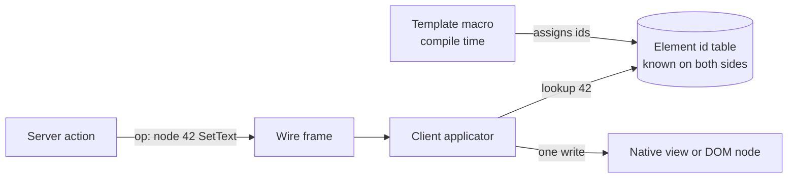
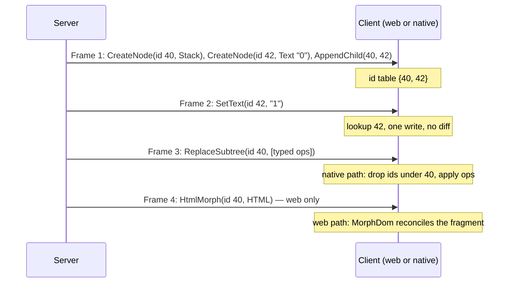

# 01. Compile-time targeting: no virtual DOM, no hydration, no client diff

_Written in ASD-STE100 Simplified Technical English (STE). Code and identifiers stay as they
are._

**Abbreviations in this file.** user interface (UI); server-driven user interface (SDUI);
Document Object Model (DOM); virtual DOM (VDOM); HyperText Markup Language (HTML);
WebAssembly (WASM); JavaScript (JS); identifier (id); AeroSpace and Defence Industries
Association of Europe (ASD), the owner of the STE standard ASD-STE100.

## 1. The idea, laid out

Source: `foundation_ui_rearchitecture.md` §1 ("Core Superpowers", first bullet) and §3.

**Every dynamic interaction targets a precise element that was registered at compile time.**
The client never builds a second tree of the page to compare. It never diffs the page. It
never "hydrates" (walks server HTML to attach behaviour and rebuild state).

The idea has three parts:

1. **Compile-time element identity.** The template macro gives every element that can change
   a stable numeric id. The id is known when the code compiles, on the server and on the
   client.
2. **Direct mutation.** An update says "node 42: set text to X". The client looks up node 42
   in a flat table and applies the change. Cost is one lookup and one write, for any size of
   page.
3. **No hydration loop.** Because the ids come from the compiler, the client does not need to
   rediscover structure at start. It reads the ids from the first frame and builds the table.

_The diagram shows that an update goes straight from the server to one element. No tree is
built or compared._

**What it buys.**

| Cost in a VDOM framework | Cost here |
|---|---|
| Render a new tree on each change, O(size of component) | Emit only the changed operations, O(changes) |
| Diff old tree against new tree | None |
| Hydrate server HTML at start | None: ids are in the first frame |
| Keep two trees in memory | One flat id table |

**One exception, kept by owner decision D8.** On the web, the HTML morph (§3, item 3) compares a
received fragment with the live subtree. The work is bounded by the size of the fragment, not
by the size of the page. Every other update follows the table above.

_North star fit: one id rule and one node table that every renderer uses
(D35, [13](./13-platform-capabilities.md))._

## 2. Current state

This idea is already true for the web (spec 39).

| Part | Where |
|---|---|
| `html!` assigns `primal-id` values at compile time | `backends/foundation_macros/src/html_macro/codegen.rs:465-481`; decision 005 in `specifications/completed/39-foundation-wasm-ui/decisions/005-element-id-and-part-granularity.md` |
| `DomOp` targets `u32` node ids | `backends/foundation_ui_traits/src/dom_op.rs:91` |
| Flat node registry semantics | `backends/foundation_ui_traits/src/dom_op.rs:13-27` |
| One place compares trees: `DomOp::MorphNode` morphs an HTML string into a live subtree | `backends/foundation_ui_traits/src/dom_op.rs:159`, decision 027 |

**Review question on PR #157: "Dont we already do this?"** Yes, on the web. There is no
hydration loop today. The mechanism is already here:

- `html!` fixes an id for every element at compile time (decision 005).
- `Part::node_id` and `DomOp` carry the id as a number. The wire does not read it from markup.
- The JS `NodeRegistry` maps the id to the DOM node. It reads `primal-id` from the initial
  markup, and `RegisterNode` adds nodes that a later frame creates. Every frame names a node
  by id, so the client never walks the markup to discover structure.

The new part is not the mechanism. The new part is one schema that owns the ids and a native
reader that uses the same rule ([02](./02-unified-wire-contract.md),
[06](./06-native-rendering.md)). Today the id lives in three places: the `html!` codegen, the
hand-written `DomOp`, and the JS registry.

## 3. The new way

The idea stays. The new way makes it **platform-neutral** and puts the id in one schema.

1. **The id is a field in the schema, not only an HTML attribute.** The id is a `uint` field
   on every operation and on every node in the FlatBuffers schema
   ([02](./02-unified-wire-contract.md)). `primal-id` stays, but only as the web marker that
   the applicator uses to find an element that the first frame did not create. Native
   renderers and the web applicator use the same ids.
2. **The id table is the only client structure.** On native, the table maps id to a node in a
   small retained tree that SwiftUI or Compose observes ([06](./06-native-rendering.md)). This
   is a retained tree, not a VDOM: nothing is diffed. The design must say this plainly.
3. **The HTML morph stays, as one schema message type.** Owner decision D8 on PR #157 keeps
   `MorphNode`: the client gets `HtmlMorph { target, action, content: string }` as one more
   member of the `Op` union ([03](./03-payload-tiers.md)). The web applicator hands `content`
   to the existing `MorphDom` algorithm (decision 027), so form preservation, move detection
   and `data-ignore-morph` keep working. The op is **web only**. The server reads `mount` from
   `ClientHello` and never sends it to a `Native` mount. A native reader that meets one
   must treat it as unsupported and report it; it must not crash
   ([11](./11-app-store-and-command-bus.md)).
4. **Native gets a typed subtree replace.** `ReplaceSubtree` carries typed schema operations.
   It is the native way to replace a region. Web still uses `HtmlMorph` where markup is the
   natural form.
5. **Ids are compile-time, not state.** The template macro pre-assigns the id (`primal-id`
   rule). A `View` or a `Div` has one specific set id. Anything else is a custom element: a
   string or a user-defined custom id. An id needs no stability rule across versions, because
   it is not part of the state (owner answer, 2026-11-11; Q1).

Why keep the morph:

- It is one more typed message, so it costs no new mechanism.
- The server-side templates write markup. A morph carries that markup as it is.
- The web already has a tested reconciler. Dropping it would remove form preservation on the
  web for no gain.
- The idea in §1 is not "no HTML". It is "no second tree of the page". The morph compares the
  received fragment against the live subtree, on the client, one time per frame. The work is
  bounded by the size of the fragment, not by the size of the page. Section 1's table holds
  for every screen that uses typed operations. A screen that uses `HtmlMorph` accepts one
  bounded compare for that subtree.

_The diagram shows the life of the id table across four frames, and the two ways to replace a
region._

## 4. What this changes for us

- `DomOp::MorphNode` and decision 027 are **kept** (D8). The morph becomes the `HtmlMorph` op
  in the schema. Its web implementation (`MorphDom` in `foundation-wasm-ui.js`) stays.
- `DomOp` retires as a Rust vocabulary (D10). Its operations become the web subset of the one
  schema vocabulary, with generated encoders and readers.
- The id comes from the template macro. The native emitter uses the same rule, so one template
  gives the same ids on both surfaces. An id is not state, so no stability rule is needed.
- A native renderer never receives `HtmlMorph`. The design spec must define the error it
  reports if one arrives anyway.

## 5. Open questions

Q1 is answered: use `primal-id`, as today. An id is built into the code and is not state, so it
needs no stability rule. A custom element uses a string or a user-defined id
([`questions.md`](./questions.md)). The morph does not change this rule: it reconciles
`primal-id` values in the fragment, as it does today.
