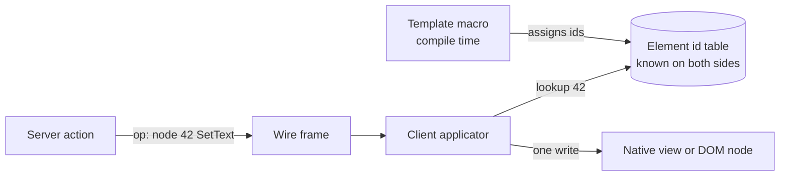
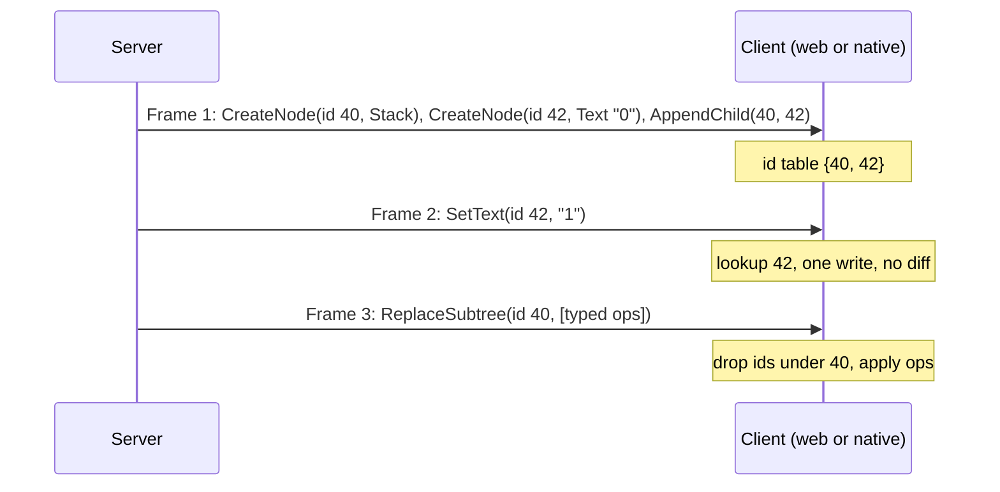

# 01. Compile-time targeting: no virtual DOM, no hydration, no client diff

_Written in ASD-STE100 Simplified Technical English (STE). Code and identifiers stay as they
are._

**Abbreviations in this file.** user interface (UI); server-driven user interface (SDUI);
Document Object Model (DOM); virtual DOM (VDOM); HyperText Markup Language (HTML);
WebAssembly (WASM); JavaScript (JS); identifier (id); AeroSpace and Defence Industries
Association of Europe (ASD), the owner of the STE standard ASD-STE100.

## 1. The idea, laid out

Source: `foundation_ui_rearchitecture.md` §1 ("Core Superpowers", first bullet) and §3.

**Every dynamic interaction targets a precise element that was registered at compile time.**
The client never builds a second tree to compare. It never diffs. It never "hydrates" (walks
server HTML to attach behaviour and rebuild state).

The idea has three parts:

1. **Compile-time element identity.** The template macro gives every element that can change
   a stable numeric id. The id is known when the code compiles, on the server and on the
   client.
2. **Direct mutation.** An update says "node 42: set text to X". The client looks up node 42
   in a flat table and applies the change. Cost is one lookup and one write, for any size of
   page.
3. **No hydration loop.** Because the ids come from the compiler, the client does not need to
   rediscover structure at start. It reads the ids from the first frame and builds the table.

_The diagram shows that an update goes straight from the server to one element. No tree is
built or compared._

**What it buys.**

| Cost in a VDOM framework | Cost here |
|---|---|
| Render a new tree on each change, O(size of component) | Emit only the changed operations, O(changes) |
| Diff old tree against new tree | None |
| Hydrate server HTML at start | None: ids are in the first frame |
| Keep two trees in memory | One flat id table |

## 2. Current state

This idea is already true for the web (spec 39).

| Part | Where |
|---|---|
| `html!` assigns `primal-id` values at compile time | `backends/foundation_macros/src/html_macro/codegen.rs:465-481`; decision 005 in `specifications/completed/39-foundation-wasm-ui/decisions/005-element-id-and-part-granularity.md` |
| `DomOp` targets `u32` node ids | `backends/foundation_ui_traits/src/dom_op.rs:91` |
| Flat node registry semantics | `backends/foundation_ui_traits/src/dom_op.rs:13-27` |
| One place compares trees: `DomOp::MorphNode` morphs an HTML string into a live subtree | `backends/foundation_ui_traits/src/dom_op.rs:159`, decision 027 |

## 3. The new way

The idea stays. The new way makes it **platform-neutral** and removes the one exception.

1. **Ids are part of the schema, not of HTML.** The id is a `uint` field in every operation of
   the FlatBuffers schema ([02](./02-unified-wire-contract.md)). Native renderers and the web
   applicator use the same ids.
2. **The id table is the only client structure.** On native, the table maps id to a node in a
   small retained tree that SwiftUI or Compose observes ([06](./06-native-rendering.md)). This
   is a retained tree, not a VDOM: nothing is diffed. The design must say this plainly.
3. **No HTML morph.** `MorphNode` takes an HTML string and diffs it into the DOM. It breaks
   the idea and cannot run natively. The new way replaces it with a typed
   "replace subtree" operation that carries schema operations, not markup.
4. **Ids are stable across versions.** An id is derived from the component type and the
   element position in its template, so a new server and an old client agree. A template
   change that moves an element gets a new id, not a reused one.

_The diagram shows the life of the id table across three frames._

## 4. What this changes for us

- `DomOp::MorphNode` and decision 027 are retired for new work.
- The id scheme moves from the `html!` codegen into a shared rule that both the web and native
  emitters use.

## 5. Open questions

See Q1 in [`questions.md`](./questions.md): how ids are derived so that they stay stable when a
template changes.
