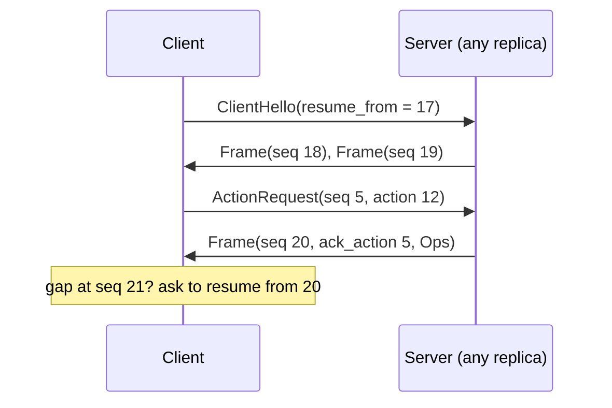

# 02. One wire contract: FlatBuffers as the top format

_Written in ASD-STE100 Simplified Technical English (STE). Code and identifiers stay as they
are._

**Abbreviations in this file.** user interface (UI); WebAssembly (WASM); JavaScript (JS);
TypeScript (TS); Hypertext Transfer Protocol (HTTP); Server-Sent Events (SSE); inter-process
communication (IPC); FlatBuffers binary schema (BFBS); identifier (id); AeroSpace and Defence
Industries Association of Europe (ASD), the owner of the STE standard ASD-STE100.

## 1. The idea, laid out

Source: `foundation_ui_rearchitecture.md` §1 ("Unified Network Contract") and §2.

**One FlatBuffers schema is the contract for every frame, in both directions, on every
platform.** The owner's review of PR #157 makes this exact: FlatBuffers is the top format,
and everything else, columnar included, is a type in that schema. The schema is
code-generated for every language we support.

The document's schema has four parts:

1. **Outbound envelope** `WireEnvelope { version, sequence_id, payload: PayloadData }`.
2. **Body union** `PayloadData = Columnar | Arrow | MessagePack | MobileLayout`. A union gives
   each body a typed tag. A reader that does not know a tag reads it as `NONE` and can skip
   it, so an old client survives a new server.
3. **Inbound envelope** `UserInteractionRequest { version, sequence_id, node_id, event_name,
   active_state, input_value }`.
4. **Typed operations** for native layout (`CreateElementOp`, `SetTextOp`, `SetAttributeOp`,
   `AppendChildOp`) in a `DomOperation` union.

Why FlatBuffers:

| Property | What it gives |
|---|---|
| Zero-copy reads | A reader follows offsets in the received buffer. No parse step, no allocation per field. |
| Schema evolution | Add fields at the end, deprecate fields, never reuse an id. Old and new readers both work. |
| Unions | Typed choice of body with a safe unknown case. |
| One schema, many languages | `flatc` generates Rust, TS, Swift, Kotlin, and more from one `.fbs` file. |
| Sequence ids | Ordering and gap detection, in both directions. |

## 2. Current state

| Part | Where |
|---|---|
| 6-byte header `[protocol:1][version:1][length:4 LE]` | `backends/foundation_ui_traits/src/envelope.rs:16-27` |
| Protocol byte table: 0 custom binary, 1 Arrow or columnar, 2 JSON; byte 1 holds two formats chosen by the version byte | `backends/foundation_ui_traits/src/encoder.rs:29-36`, `columnar_encoder.rs:8-11` |
| 14-byte `WasmEnvelope` at the WASM-to-JS boundary | `backends/foundation_wasm/src/protocol.rs:96` |
| Hand-written encoders per body, hand-written JS parser | `columnar_encoder.rs`, `foundation-wasm-ui.js:94-187` |
| No inbound typed request; spec 39 decision 025 sketches JSON | `specifications/completed/39-foundation-wasm-ui/decisions/025-server-client-state-sync.md:44-52` |
| No crate uses FlatBuffers directly (Arrow IPC uses it inside) | — |

Spec 36 decision 10 (`specifications/completed/36-agentic-api/decisions/10-serialization-format.md`)
is about how `foundation_ai` **stores conversation data** (messages, tool calls, memory
snapshots, events): always as JSON and as Arrow. It once kept FlatBuffers as a fallback if Arrow
did not build on WASM, and dropped that fallback (lines 116-118). It does not cover the UI wire.

## 3. The new way

### 3.1 The schema is the product

- `.fbs` files in one crate (for example `foundation_ui_wire`) are the single source of truth.
- `flatc`, pinned to one version, generates Rust, TS, Swift and Kotlin. A pure-Rust generator
  (`planus`) is not enough, because it generates only Rust.
- Generated code is checked in. CI regenerates and fails on any difference, so a normal build
  does not need `flatc`.
- Every body is a schema type. There are no opaque `[ubyte]` bodies, except one explicit
  escape hatch for Arrow IPC bytes when data goes to Arrow tools ([03](./03-payload-tiers.md)).

### 3.2 Outbound frame

```flatbuffers
namespace ewe.ui;

table Frame {
  schema_version: ushort;      // bumps only on a breaking change
  stream_id: ulong;            // one per mounted root or live stream
  sequence_id: ulong;          // strictly increasing per stream_id
  ack_action: ulong;           // sequence_id of the ActionRequest this answers, 0 if push
  body: Body;
}

union Body {
  Ops: OpBatch,                // tier 1: typed operations (03)
  Columnar: ColumnarBatch,     // tier 2: aligned columns (03)
  Table: DataTable,            // tier 3: typed bulk rows (03)
  ArrowIpc: ArrowIpcBlob,      // escape hatch for Arrow consumers (03)
  StateUpdate: SignedState,    // new signed state for a component (07, 08)
  Capabilities: ServerCaps,    // answer to the client hello (11)
  Error: ActionError
}
```

### 3.3 Inbound request

```flatbuffers
table ActionRequest {
  schema_version: ushort;
  stream_id: ulong;
  sequence_id: ulong;          // client counter, for ordering and duplicate detection
  action_id: uint;             // generated numeric id, not a string (10, 11)
  node_id: uint;
  input: ActionInput;          // typed, unsigned user input (10)
  state: SignedState;          // returned as received, never edited (07, 08)
}

table ClientHello {            // first message on a connection (11)
  schema_version: ushort;
  vocabulary_version: uint;
  action_registry_hash: [ubyte];
  platform: Platform;          // Web, Ios, Android, Desktop
  resume_from: ulong;          // last sequence_id seen, for reconnect
}
```

### 3.4 Ordering and resume



_The diagram shows how sequence ids let a client detect a gap and resume on any replica._

### 3.5 Improvements over the document

| Document | New way | Why |
|---|---|---|
| `MessagePack` body | Removed | No schema, so no generated reader in every language. |
| `Columnar` and `Arrow` as opaque bytes | Typed schema tables ([03](./03-payload-tiers.md)) | Generated readers; no hand-written parsers. |
| `event_name: string` | `action_id: uint` plus `node_id` | Smaller; no typo class of bug; matches the static registry ([11](./11-app-store-and-command-bus.md)). |
| `sequence_id: uint` only | `stream_id` plus 64-bit `sequence_id` plus `ack_action` | Per-stream ordering, resume after reconnect, request and response pairing. |
| No handshake | `ClientHello` / `ServerCaps` | Version skew is handled before the first frame. |
| Eight-way state union | One `SignedState` table ([07](./07-element-riding-state.md)) | The client never reads state, so its format is a server choice. |

## 4. What this changes for us

- The 6-byte `Envelope`, the protocol byte table and the hand-written body encoders are
  replaced, not extended.
- A new crate holds the schema and the generated Rust. `foundation_ui_traits` stays
  dependency-free and `no_std`.
- Frame size caps and resume backlog length are configuration with documented defaults
  (`CLAUDE.md` rule 8).

## 5. Open questions

Q2 to Q5 in [`questions.md`](./questions.md): crate layout and generation step, 8-byte vector
alignment in the generated readers, transport framing (WebSocket, SSE, HTTP/2 streams), and
whether stored `foundation_ai` data also moves to FlatBuffers.
