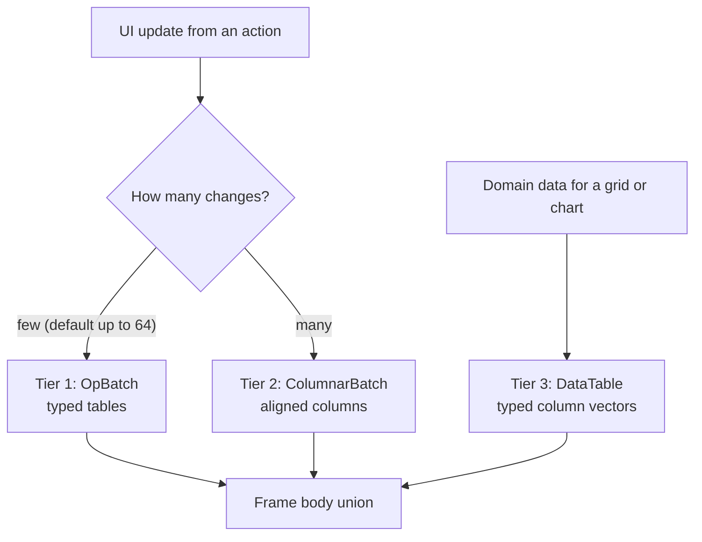

# 03. Payload tiers: typed operations, aligned columns, bulk tables

_Written in ASD-STE100 Simplified Technical English (STE). Code and identifiers stay as they
are._

**Abbreviations in this file.** user interface (UI); Document Object Model (DOM); JavaScript
(JS); TypeScript (TS); inter-process communication (IPC); identifier (id); AeroSpace and
Defence Industries Association of Europe (ASD), the owner of the STE standard ASD-STE100.

## 1. The idea, laid out

Source: `foundation_ui_rearchitecture.md` §1 ("Multi-Tier Performance Optimization"), §2
(`ColumnarPayload`, `ArrowPayload`) and §3 ("Web Browser Client Optimization").

**The size of an update decides its encoding.** The document names three tiers:

| Tier | Document's words | Shape | Best for |
|---|---|---|---|
| 1 | "lightning-fast primitive modifications via FlatBuffers" | A few typed operations | A click that changes one label |
| 2 | "direct array-buffer casting via custom 8-byte aligned Columnar blocks" | Columns of numbers (op codes, node ids, offsets) plus one string block | A list render: hundreds to thousands of operations |
| 3 | "vectorized mass data pushes powered by Apache Arrow IPC streams" | Typed columns of domain data (rows of a table, chart series) | Data grids, charts, metrics |

The trick in tier 2 is the **zero-copy cast**: the client views the received bytes as a typed
array, with no parse and no allocation per value:

```javascript
const uint32View = new Uint32Array(rawBytes.buffer, rawBytes.byteOffset, rawBytes.byteLength / 4);
```

This works only if the column starts on an aligned byte offset (4 for `Uint32Array`, 8 for
`Float64Array` and `BigUint64Array`). That is why the document insists on 8-byte alignment.



_The diagram shows how the server picks a tier for each update. The threshold is
configuration._

## 2. Current state

Tier 2 exists by hand, on the web only (spec 39 feature 19):

| Part | Where |
|---|---|
| `ColumnarBatch`, columnar v1.1, 8-byte header alignment (`RELATIVE_ALIGN_PAD = 7`) | `backends/foundation_ui_traits/src/columnar_encoder.rs:13-32`, `:49`, `:92` |
| JS `ColumnarParser`: `Uint32Array` view, alignment check, copy fallback | `backends/foundation_wasm_ui/runtimes/foundation-wasm-ui.js:94-187` (check at `:129`, view at `:148`) |
| Arrow IPC encoder for `DomOp` | `backends/foundation_arrow/src/dom_ops.rs:54`, `:164` |
| `foundation_arrow` derive macros (`ToArrow`, `FromArrow`, `ArrowSchema`) | `backends/foundation_arrow`, `backends/foundation_macros` |

Tier 1 has no typed form (operations go as JSON or as columnar). Tier 3 for domain data has
no wire path; Arrow is used for `DomOp` and for stored `foundation_ai` data.

## 3. The new way

All three tiers are **types in the one FlatBuffers schema** ([02](./02-unified-wire-contract.md)).
The hand-written formats become generated code.

### 3.1 Tier 1: `OpBatch`

```flatbuffers
union Op { CreateNode: CreateNode, SetText: SetText, SetProp: SetProp,
           AppendChild: AppendChild, Remove: Remove, ReplaceSubtree: ReplaceSubtree }
table OpRow  { op: Op; }
table OpBatch { ops: [OpRow]; }
```

The client walks the vector and reads each table through generated accessors. Cost per
operation is a few offset reads. For a handful of operations this is as fast as tier 2.

### 3.2 Tier 2: `ColumnarBatch` as a schema type

```flatbuffers
table ColumnarBatch {
  op_codes:   [ubyte];                       // one per operation
  node_ids:   [uint]   (force_align: 8);     // one per operation
  arg_a:      [uint]   (force_align: 8);     // parent id, prop id, ... by op code
  str_offset: [uint]   (force_align: 8);     // start of each string in str_bytes
  str_len:    [uint]   (force_align: 8);
  str_bytes:  [ubyte];                       // all strings, UTF-8, written once
}
```

- A FlatBuffers vector of scalars is a contiguous little-endian array. The generated TS
  reader gives a typed-array view over the received buffer for such a vector. So the zero-copy
  cast of the document still happens, but the code that does it is generated, not
  hand-written.
- Swift and Kotlin get the same columns through their generated readers (`UnsafeBufferPointer`
  on Swift, a `ByteBuffer` view on Kotlin).
- Strings stay one block. JS decodes a string only when an operation needs it
  (`TextDecoder` on a `subarray`). The document's "zero object allocation" claim is true for
  the numeric columns only. The design must say this.

### 3.3 Tier 3: `DataTable`

```flatbuffers
table Column {
  name_id: uint;                 // interned column name (04)
  data: ColumnData;              // union of typed vectors
  validity: [ubyte];             // null bitmap, optional
}
union ColumnData { I32: I32s, I64: I64s, F64: F64s, Bool: Bools, Utf8: Strings }
table I64s { values: [long] (force_align: 8); }
table F64s { values: [double] (force_align: 8); }
table DataTable { rows: ulong; columns: [Column]; }
```

This is Arrow's columnar idea, expressed in our schema, with generated readers on every
platform. A chart on iOS reads `F64s.values` straight into its drawing code.

### 3.4 The Arrow IPC escape hatch

Arrow IPC is its own format (FlatBuffers headers plus raw buffers). It is not a table in our
schema. Its value is interoperability with Arrow tools (DuckDB, Polars, DataFusion). The new
way keeps one union member, `ArrowIpc { bytes: [ubyte] (force_align: 8) }`, only for data that
goes to such a tool. UI frames do not use it.

### 3.5 Improvements over the document

- Tiers are chosen by the framework, not by the action author, from a configured threshold.
- Tier 2 and tier 3 are generated types. No hand-written parser on any platform.
- One more tier boundary is made explicit: streaming. A large table goes as a stream of
  `DataTable` frames with a row cap per frame (configuration), never as one large frame.

## 4. What this changes for us

- `ColumnarBatch` (`columnar_encoder.rs`) and the JS `ColumnarParser` retire after the generated
  form matches them in a benchmark (1, 10, 100 and 10 000 operations).
- The Arrow `DomOp` encoder (`foundation_arrow/src/dom_ops.rs`) is not needed for UI frames.

## 5. Open questions

Q6 to Q8 in [`questions.md`](./questions.md): the tier threshold default, the benchmark gate,
and the fate of Arrow IPC on the UI wire.
