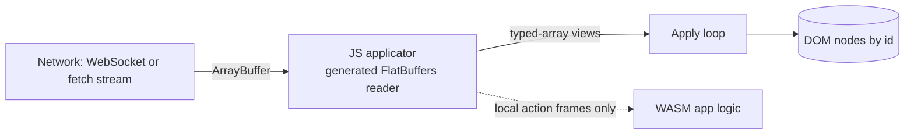
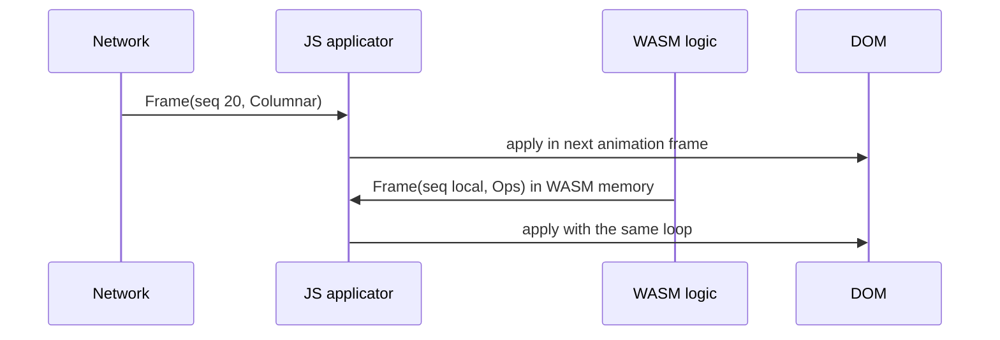

# 05. The web applicator: frames go to the DOM without WebAssembly

_Written in ASD-STE100 Simplified Technical English (STE). Code and identifiers stay as they
are._

**Abbreviations in this file.** user interface (UI); Document Object Model (DOM); WebAssembly
(WASM); JavaScript (JS); TypeScript (TS); foreign function interface (FFI); identifier (id);
AeroSpace and Defence Industries Association of Europe (ASD), the owner of the STE standard
ASD-STE100.

## 1. The idea, laid out

Source: `foundation_ui_rearchitecture.md` §3 ("Web Browser Client Optimization (FFI Zero-Copy
Loop)").

**A server frame that only changes the view does not enter WASM.** A small JS applicator:

1. reads the outer FlatBuffers frame (a few offset reads);
2. finds the columnar body;
3. views the body columns as typed arrays, with no copy;
4. loops over the numbers and writes to the DOM, with no objects made per operation.

WASM is kept for app logic (signals, local actions). It is not on the render path of server
frames. This removes two costs: copying the frame into WASM memory, and calling back out of
WASM into JS for each DOM write.

_The diagram shows that server frames go from the network to the DOM in JS. WASM gets only
what it needs for local logic._

_North star fit: this is the web platform set. It reads the same contract as native and local
logic (D35, [13](./13-platform-capabilities.md))._

## 2. Current state

| Part | Where |
|---|---|
| JS `ColumnarParser` with a zero-copy view and copy fallback | `backends/foundation_wasm_ui/runtimes/foundation-wasm-ui.js:94-187` |
| JS `columnarHandler`: parse, then apply | `foundation-wasm-ui.js:802` |
| Server frames already arrive in JS and JS applies them | the `<mount-stream>` and `<mount-data>` paths, `foundation-wasm-ui.js:2353`, `:2374` |
| The HTML morph: `MorphDom` reconciles a fragment (decision 027) | `foundation-wasm-ui.js:276-604` |
| WASM-originated ops go out through `host_apply` | `backends/foundation_wasm_ui/src/protocol/mod.rs` |
| 14-byte `WasmEnvelope` at the WASM-to-JS boundary, with an arena memory id | `backends/foundation_wasm/src/protocol.rs:96` |

So the "bypass WASM" path exists for server frames today. What is hand-written is the parser
and the envelope.

**Keep the mount primitives.** `<mount-stream>` and `<mount-data>` are the island mechanism: a
region of reactive, dynamic state that mounts and renders on its own. The new system must keep
them and must keep them working (owner review, 2026-11-11).

## 3. The new way

1. **The applicator reads generated code.** The FlatBuffers TS reader replaces the hand-written
   `ColumnarParser`. The applicator keeps only the apply loop.
2. **One apply loop for every tier.** Tier 1 (`OpBatch`) and tier 2 (`ColumnarBatch`) feed the
   same switch on the operation code ([03](./03-payload-tiers.md)). Tier 3 (`DataTable`) goes to
   the component that owns the grid or chart, as typed arrays. The switch handles `HtmlMorph`
   by passing its content to `MorphDom` (D8).
3. **WASM-originated frames use the same schema.** A local action in WASM writes a `Frame` into
   its memory. JS reads it through the same generated reader over the WASM memory buffer. The
   server, WASM and Rust all send frames, and the receiver applies them (D29). One format, one
   applicator, two sources. The 14-byte `WasmEnvelope` goes away.
4. **Frame scheduling.** The applicator applies frames in `sequence_id` order and batches the
   writes of one animation frame (`requestAnimationFrame`). A frame that arrives out of order
   waits for the gap; a gap that does not close in a configured time triggers a resume
   ([02](./02-unified-wire-contract.md)).
5. **Alignment check stays.** If a column is not aligned (for example after a proxy copies the
   buffer to an odd offset), the reader copies that column and continues. The fallback is
   counted, so a test can see when zero-copy is lost.
6. **The web runtime hosts the JS registry.** A scoped `<script>` defines functions that
   become callable once the DOM mounts; they register as `js:` actions under their action
   names (D37). The same runtime holds the client side of a `server:` action. The central
   action manager routes each reference. This is a web capability, and it stays on the web
   ([10](./10-action-model.md) §3.8).

_The diagram shows one applicator for frames from the server and from local WASM logic._

## 4. What this changes for us

- `foundation-wasm-ui.js` loses its hand-written parser and its own envelope struct. It keeps
  the apply loop, the mount primitives and the island paths. It gains the generated reader.
- **The web comes first** (D4, revised by the 2026-11-11 review). Make the web work
  consistently on the new schema, and keep the `<mount-stream>` and `<mount-data>` paths
  working as they do today. Then the native work starts ([06](./06-native-rendering.md)).
- The web runtime gains the JS registry (§3 item 6). The script functions stay web-only, and
  native never receives them (D37, [13](./13-platform-capabilities.md)).

## 5. Open questions

No open questions in this file. Q11 is answered: the native side processes frames, so the
server, WASM and Rust use the same schema and applicator (D29). Q10 is answered by D10: the
web renders the core vocabulary and maps it to HTML.
