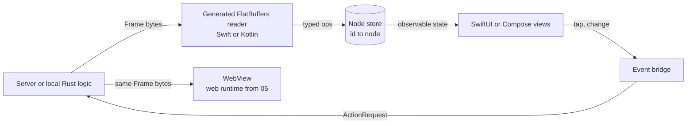
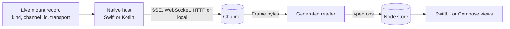

# 06. Native rendering: SwiftUI and Jetpack Compose, with an optional WebView

_Written in ASD-STE100 Simplified Technical English (STE). Code and identifiers stay as they
are._

**Abbreviations in this file.** user interface (UI); server-driven user interface (SDUI);
Document Object Model (DOM); browser view embedded in an app (WebView); Server-Sent Events
(SSE); hypertext transfer protocol (HTTP); WebAssembly (WASM);
JavaScript (JS); foreign function interface (FFI); application binary interface (ABI); Unified
Foreign Function Interface generator (UniFFI); application programming interface (API); central
processing unit (CPU); identifier (id); AeroSpace and Defence Industries Association of Europe
(ASD), the owner of the STE standard ASD-STE100.

## 1. The idea, laid out

Source: `foundation_ui_rearchitecture.md` §3 ("Mobile Engine Integration") and §6.

**A mobile app has three mount surfaces: SwiftUI, Jetpack Compose and a WebView.** The owner's
2026-11-11 review allows a WebView (D11): whatever is mounted there renders the same server
frames as a normal web page. The native surfaces are the speed target. They are not the first
target: the web comes first (D4, revised).

- The framework core (`foundation_signals`, `foundation_ui_components`) is compiled into the app
  as native `aarch64` code, through UniFFI or static C bindings.
- The app receives layout operations in a FlatBuffers frame. It loops over the typed operations
  with direct memory offsets.
- It maps each operation to a native declarative view: SwiftUI on iOS, Jetpack Compose on
  Android. The apply is synchronous. The views then recompose in the platform render pass.
- A WebView mounts the web runtime from [05](./05-web-zero-copy-applicator.md) and applies the
  same frames. The app needs no second server mode.



_The diagram shows the two mount surfaces: the native node store and the WebView web runtime.
Both read the same frames and send the same action requests._

_North star fit: this is the native platform set, with the mobile live mount (D35, D39,
[13](./13-platform-capabilities.md))._

## 2. Current state

| Part | Where | State |
|---|---|---|
| `ViewKind::Native` | `backends/foundation_ui_traits/src/platform_types.rs:175-187` | Type only; doc says "post-MVP, MVP renders everything in WebViews" |
| `foundation_signals` | `backends/foundation_signals/src/lib.rs:1-10` | Builds natively; usable on device |
| Components | `backends/foundation_ui_components/src/` | Return `Html`; behaviour in scoped JS (`machinery/mod.rs:46`) |
| UniFFI, cbindgen, Swift, Kotlin | none | Not in any `Cargo.toml` |
| iOS or Android targets in the build | none | Spec 62 covers macOS only |

## 3. The new way

### 3.1 The node store (what "no client state" really means)

SwiftUI and Compose rebuild views from state. They have no "create element, append child"
call. So the native side keeps a **node store**: a flat map from node id to a node record
(kind, typed props, child ids). Operations edit the store. The store publishes changes as
observable state, and the framework recomposes only the views whose node changed.

- This is a retained tree. It is **not** a virtual DOM: nothing is diffed, because each
  operation names its node ([01](./01-compile-time-targeting.md)).
- Each node record is observable on its own (`@Observable` class per node on iOS 17+,
  `mutableStateOf` per node on Compose). A `SetText` on node 42 recomposes only the view of
  node 42.

```swift
// sketch: one observable record per node
@Observable final class NodeRecord {
    let id: UInt32
    var kind: NodeKind
    var props: Props
    var children: [UInt32]
}
```

### 3.2 Who reads the frame

| Option | Path | Gain | Cost |
|---|---|---|---|
| A. Swift or Kotlin reads the frame | Generated FlatBuffers reader in the platform language edits the node store | No FFI call per frame; simplest render path | Rust is not on the render path; local Rust logic sends frames through the same reader |
| B. Rust reads the frame | Rust decodes and calls platform callbacks through UniFFI | One decoder | An FFI call per operation, or a callback batch; UniFFI copies most types |

Recommendation: **A** for rendering. Rust stays on device for local logic, signals and the
action registry, and talks to the view layer in frames, the same as the server does. So the
render path has one input format, whatever the source.

**How Rust triggers native behaviour.** Local Rust logic has two outputs:

| Output | Path | Example |
|---|---|---|
| View change | A `Frame` from Rust edits the node store, the same as a server frame | A counter increments after a tap |
| Platform effect | A typed `NativeCommand`, executed by the Swift or Kotlin host | Haptic pulse, camera, share sheet, permission prompt, open a URL |

The `NativeCommand` set is a generated enum from the action registry
([11](./11-app-store-and-command-bus.md), [12](./12-scoped-behaviour.md)). The app compiles it
in, so it is data and not downloaded code. Rust sends a command id and typed arguments. The
platform host switches on the id and calls the platform API. An unknown id is a typed error,
never a silent no-op. Rust never calls platform code directly.

### 3.3 Binding layer

- UniFFI generates Swift and Kotlin bindings for the Rust logic API (start, send action, receive
  frame bytes). Frames cross the boundary as one byte buffer per frame, not per operation.
- The schema readers are generated by `flatc` for Swift and Kotlin ([02](./02-unified-wire-contract.md)).
- Rule 5 (use generated types) holds on both sides of the boundary.

### 3.4 Primitives and platform look

The primitive families ([04](./04-vocabulary-and-interning.md)) map to native controls, so the
app gets accessibility, dynamic type, dark mode and platform gestures for free. The vocabulary
stays small and semantic for this reason.

### 3.5 Improvements over the document

| Document | New way |
|---|---|
| Uses HTML tag ids for mobile (`DIV`, `SPAN`) | The core vocabulary of native primitives ([04](./04-vocabulary-and-interning.md)) |
| "Synchronously at native speed" | The apply is synchronous: the reader edits the node store before it returns. The platform then recomposes in its own render pass. SwiftUI and Compose own that pass. We add no scheduler between them. |
| Core compiled in, decoding path not stated | Platform-language readers on the render path; Rust for logic |
| Components assumed to exist natively | Do not rebuild the platform. The native control provides focus, dismiss, gestures, dynamic type and accessibility. We implement only the small parts the platform does not have, for example a focus trap across a custom modal |

### 3.6 The WebView mount surface

A mobile app may mount a WebView (D11). It loads the web runtime
([05](./05-web-zero-copy-applicator.md)) and receives the same `Frame` stream as a browser. It
needs no second server mode.

- `ClientHello` carries the mount surface: `Native` or `Web`
  ([02](./02-unified-wire-contract.md)). The server uses it to decide the web-only ops. A
  `Web` surface (a browser or a WebView) can receive `HtmlMorph`. A `Native` surface cannot
  ([11](./11-app-store-and-command-bus.md)).
- A hybrid screen is allowed: native chrome, with a WebView island inside it.
- The WebView adds no new wire format. It is the web path in an app shell.

### 3.7 Live mounts on mobile

`mount-stream` and `mount-data` are not web-only ideas (D39, owner review 2026-11-12). The
core idea is a location that marks itself live and reacts to incoming changes over a channel.
The representation differs on mobile; the semantics do not
([13](./13-platform-capabilities.md) §3.4).

A native live mount is a node record with four fields: `kind` (`stream` or `data`),
`channel_id`, `transport` (`local`, `sse`, `websocket` or `http`) and `resume_from`. The
Swift or Kotlin host opens the channel and feeds frames into the node store:



_The diagram shows a native live mount. The channel and the host differ from the web; the
frames and the region semantics are the same._

- A `stream` mount keeps frames in `sequence_id` order and resumes from the last applied id.
- A `data` mount keeps the latest value and drops older values.
- A local transport connects a signal graph in `foundation_signals` to the region. No network
  is involved.
- The payload is the same `Frame` schema as the web path (D29). The native reader applies the
  `mobile` or `core` form of each op ([13](./13-platform-capabilities.md) §3.2).
- The mount closes its channel when the region unmounts.

## 4. What this changes for us

- The work order follows D4: the web first, then these native surfaces.
- New Swift and Kotlin packages: generated readers, the node store, the view layer, the event
  bridge.
- New Rust crate with the UniFFI surface for on-device logic.
- iOS and Android targets in the build and in CI.
- `ViewKind::Native` stops being "post-MVP".
- The native package gains the live mount record and its channel host (§3.7). The same
  `mount-stream` and `mount-data` semantics run on both surfaces.

## 5. Open questions

Q26 in [`questions.md`](./questions.md): when to use the WebView surface. Q12 to Q14 are
answered: the platform-language readers edit the node store, the minimum versions are iOS 17
and Android API 26, and the first spike runs before the design spec is final.
