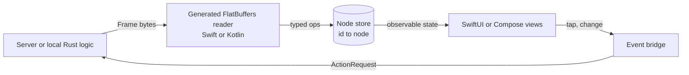

# 06. Native rendering: SwiftUI and Jetpack Compose, no WebView

_Written in ASD-STE100 Simplified Technical English (STE). Code and identifiers stay as they
are._

**Abbreviations in this file.** user interface (UI); server-driven user interface (SDUI);
Document Object Model (DOM); WebAssembly (WASM); JavaScript (JS); foreign function interface
(FFI); application binary interface (ABI); Unified Foreign Function Interface generator
(UniFFI); central processing unit (CPU); identifier (id); AeroSpace and Defence Industries
Association of Europe (ASD), the owner of the STE standard ASD-STE100.

## 1. The idea, laid out

Source: `foundation_ui_rearchitecture.md` §3 ("Mobile Engine Integration") and §6.

**Mobile apps have no WebView, no JS engine and no downloaded bytecode.** Owner decision D4
makes this the first target.

- The framework core (`foundation_signals`, `foundation_ui_components`) is compiled into the app
  as native `aarch64` code, through UniFFI or static C bindings.
- The app receives layout operations in a FlatBuffers frame. It loops over the typed operations
  with direct memory offsets.
- It maps each operation to a native declarative view: SwiftUI on iOS, Jetpack Compose on
  Android. This happens "synchronously at native machine execution speeds".



_The diagram shows the native loop: frame in, node store edited, views recompose, events go
back as action requests._

## 2. Current state

| Part | Where | State |
|---|---|---|
| `ViewKind::Native` | `backends/foundation_ui_traits/src/platform_types.rs:175-187` | Type only; doc says "post-MVP, MVP renders everything in WebViews" |
| `foundation_signals` | `backends/foundation_signals/src/lib.rs:1-10` | Builds natively; usable on device |
| Components | `backends/foundation_ui_components/src/` | Return `Html`; behaviour in scoped JS (`machinery/mod.rs:46`) |
| UniFFI, cbindgen, Swift, Kotlin | none | Not in any `Cargo.toml` |
| iOS or Android targets in the build | none | Spec 62 covers macOS only |

## 3. The new way

### 3.1 The node store (what "no client state" really means)

SwiftUI and Compose rebuild views from state. They have no "create element, append child"
call. So the native side keeps a **node store**: a flat map from node id to a node record
(kind, typed props, child ids). Operations edit the store. The store publishes changes as
observable state, and the framework recomposes only the views whose node changed.

- This is a retained tree. It is **not** a virtual DOM: nothing is diffed, because each
  operation names its node ([01](./01-compile-time-targeting.md)).
- Each node record is observable on its own (`@Observable` class per node on iOS 17+,
  `mutableStateOf` per node on Compose). A `SetText` on node 42 recomposes only the view of
  node 42.

```swift
// sketch: one observable record per node
@Observable final class NodeRecord {
    let id: UInt32
    var kind: NodeKind
    var props: Props
    var children: [UInt32]
}
```

### 3.2 Who reads the frame

| Option | Path | Gain | Cost |
|---|---|---|---|
| A. Swift or Kotlin reads the frame | Generated FlatBuffers reader in the platform language edits the node store | No FFI call per frame; simplest render path | Rust is not on the render path; local Rust logic sends frames through the same reader |
| B. Rust reads the frame | Rust decodes and calls platform callbacks through UniFFI | One decoder | An FFI call per operation, or a callback batch; UniFFI copies most types |

Recommendation: **A** for rendering. Rust stays on device for local logic, signals and the
action registry, and talks to the view layer in frames, the same as the server does. So the
render path has one input format, whatever the source.

### 3.3 Binding layer

- UniFFI generates Swift and Kotlin bindings for the Rust logic API (start, send action, receive
  frame bytes). Frames cross the boundary as one byte buffer per frame, not per operation.
- The schema readers are generated by `flatc` for Swift and Kotlin ([02](./02-unified-wire-contract.md)).
- Rule 5 (use generated types) holds on both sides of the boundary.

### 3.4 Primitives and platform look

The primitive families ([04](./04-vocabulary-and-interning.md)) map to native controls, so the
app gets accessibility, dynamic type, dark mode and platform gestures for free. The vocabulary
stays small and semantic for this reason.

### 3.5 Improvements over the document

| Document | New way |
|---|---|
| Uses HTML tag ids for mobile (`DIV`, `SPAN`) | A layout vocabulary of native primitives |
| "Synchronously at native speed" | Operations edit a node store; the platform recomposes on its own frame clock. Fast, but not synchronous. The design must say this. |
| Core compiled in, decoding path not stated | Platform-language readers on the render path; Rust for logic |
| Components assumed to exist natively | Behaviour must be rebuilt natively: focus, dismiss, gestures |

## 4. What this changes for us

- New Swift and Kotlin packages: generated readers, the node store, the view layer, the event
  bridge.
- New Rust crate with the UniFFI surface for on-device logic.
- iOS and Android targets in the build and in CI.
- `ViewKind::Native` stops being "post-MVP".

## 5. Open questions

Q12 to Q14 in [`questions.md`](./questions.md): option A or B, the minimum OS versions (they
decide the observation API), and the first spike (one screen, one button, one action round
trip on both platforms).
