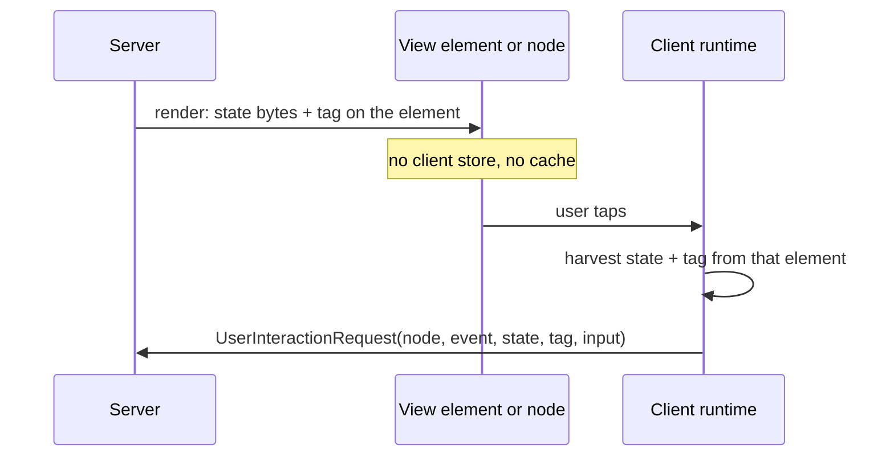

# 07. Element-riding state: the view carries its own signed state

_Written in ASD-STE100 Simplified Technical English (STE). Code and identifiers stay as they
are._

**Abbreviations in this file.** user interface (UI); Document Object Model (DOM); WebAssembly
(WASM); JavaScript (JS); hash-based message authentication code (HMAC); FlatBuffers binary
schema (BFBS); JavaScript Object Notation (JSON); identifier (id); AeroSpace and Defence
Industries Association of Europe (ASD), the owner of the STE standard ASD-STE100.

## 1. The idea, laid out

Source: `foundation_ui_rearchitecture.md` §1 ("Zero Client-Side Cache Churn"), §2
(`InlineNodeState`, `StateFormatPayload`, `FlatBufferState`) and §4.

**The state of a view rides on the view itself, signed by the server.** The client keeps no
state store, no cache map and no sync logic.

1. **Where state lives.** On the element, as two properties: `data-state` (the state bytes) and
   `data-state-token` (the HMAC tag). On native, on the node.
2. **How it gets there.** The server renders the component, encodes the state, signs it and
   attaches both properties to the element.
3. **How it comes back.** On a tap or click, the runtime **harvests** both values from that
   element and puts them into the `UserInteractionRequest`, with no parsing on the client
   ("interaction interception").
4. **Many formats.** `StateFormatPayload` allows eight encodings: integer, float, text, JSON,
   MessagePack, Arrow, FlatBuffers (with an optional `.bfbs` schema for self-description) and
   custom binary.



_The diagram shows the state round trip. The client holds state only on the element._

**What it buys.** No client store to keep in sync. No cache to invalidate. Any server replica
can handle the next request ([09](./09-stateless-execution.md)). Memory on the client is
bounded by what is on screen.

_North star fit: one state envelope for every platform (D35,
[13](./13-platform-capabilities.md))._

## 2. Current state

The current model is the opposite: the server holds state.

| Part | Where |
|---|---|
| Server `App` holds signals on one thread, broadcasts frames | `backends/foundation_wasm_ui/src/server/mod.rs:1-24`, `:71` |
| Decision: "The client never tells the server its state" | `specifications/completed/39-foundation-wasm-ui/decisions/025-server-client-state-sync.md:8` |
| Decision: "No signal values need to be synced or embedded" | same file, line 40 |
| Components put plain, unsigned `data-*` flags on elements for CSS | `backends/foundation_ui_components/src/lib.rs:7-10` |

## 3. The new way

### 3.1 One signed state per component, not per element

The document signs each element. A component usually has many elements and one state. Per
element repeats bytes and tags and makes a request ambiguous (which element's state wins?).
The new way puts **one `SignedState` on the component root node**. The runtime harvests from the
nearest component root above the element that got the event. The element's node id goes into the
request separately.

### 3.2 One format, chosen by the server

The client never reads the state. It only returns it. So the eight-way format union is a
server concern exposed on the wire for no gain. The new way uses one schema type:

```flatbuffers
table SignedState {
  format_version: ushort;      // bump when the state type changes shape
  key_id: uint;                // which server key signed it (08)
  issued_at: ulong;            // seconds
  expires_at: ulong;           // seconds
  component_type: uint;        // generated id of the component type
  root_node: uint;
  session_binding: [ubyte];    // hash of session id (08)
  body: [ubyte];               // the component's own generated FlatBuffers table
  tag: [ubyte];                // MAC over a purpose label + every field above
}
```

- `body` is a generated FlatBuffers table per component type (for example `CounterState`). The
  server decodes it only after the tag passes, into that one type. It never picks a type from
  the payload ([08](./08-state-security-and-replay.md)).
- The document's `.bfbs` self-description is not needed on the wire: both sides compile the
  schema. It stays useful for debug tools, which can load `.bfbs` files from the build.

### 3.3 Harvest without parsing

- Web: the root element holds the `SignedState` as one base64url string in a `data-` attribute
  (D12). base64url is the base64 text encoding with `+` and `/` replaced, so the text is safe
  in a URL and in an attribute. A DOM attribute holds text, so binary cannot ride it. The
  runtime copies the string into the request builder. It does not decode it; the server does.
- Native: the node record holds the bytes. The event bridge copies them into the request.
- The client never edits the state. Any change breaks the tag.

Why not a binary property: a JavaScript expando property can hold bytes, but the markup cannot
see it, it does not survive a server render or a page reload, and an HTML parser cannot copy
it. The base64url string needs 4 bytes for each 3 bytes of state. A state is small, and the
server decodes it once.

### 3.4 Secrecy and size

- HMAC proves integrity, not secrecy: the user can read the state. A component that marks its
  state private gets authenticated encryption instead (ChaCha20-Poly1305 exists in
  `backends/foundation_compact/src/crypto/chacha.rs:24`, `:50`).
- State is small: ids and view flags, not domain data. Domain data stays in the database. A
  size cap per component is configuration with a documented default (`CLAUDE.md` rule 8).

### 3.5 The server owns the truth

The signed state is a handle, not the truth. The server can ignore the content that the client
returns. It can read a key from the signed state, for example a row id, and load the
authoritative state from the backend. Owner decision D13.

So a client cannot cheat with state, even with a real tag. The tag proves that the server made
the bytes. The backend proves that the values are current and that they belong to this user.

The server has three inputs. It chooses which to use for each action (D15,
[09](./09-stateless-execution.md)):

| Input | What it proves |
|---|---|
| The signed state | The server made these bytes, and nobody changed them |
| The session | Who is asking |
| The backend data | The current, authoritative values |

A state that passes the tag but is stale is still stale. The domain check catches it. A state
that names another user's row fails authorization. This is the rule from
[08](./08-state-security-and-replay.md) §4.1: never put authority in state.

### 3.6 Improvements over the document

| Document | New way |
|---|---|
| Signed state per element | One per component root |
| Eight formats on the wire | One `SignedState` with a generated body type |
| Tag covers the state bytes only | Tag covers version, key id, times, component, node, session and body ([08](./08-state-security-and-replay.md)) |
| `data-*` string attributes | One base64url `data-` attribute on web, field on the native node record (D12) |
| No secrecy option | Authenticated encryption for private state |
| The client copy of state is the truth | The state is a handle; the server loads the truth from the backend (D13) |

## 4. What this changes for us

Per owner decision D3, decision 025 gives way: the client now returns server-signed state with
each action. Its spirit stays: the client never **authors** state.

## 5. Open questions

No open questions in this file. Q15 is answered: the default cap is 4 KiB as configuration.
Q16 is answered: HMAC by default, authenticated encryption for private state.
