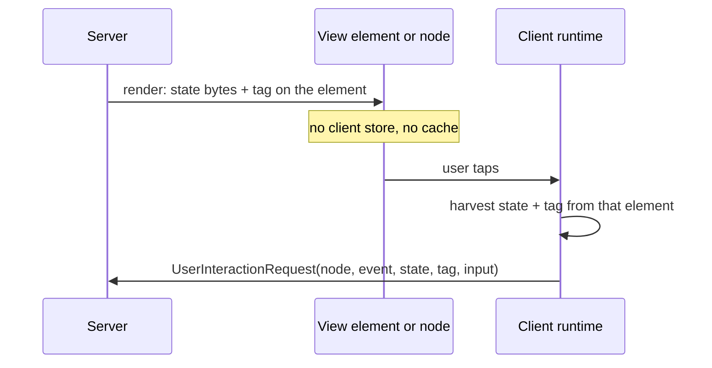

# 07. Element-riding state: the view carries its own signed state

_Written in ASD-STE100 Simplified Technical English (STE). Code and identifiers stay as they
are._

**Abbreviations in this file.** user interface (UI); Document Object Model (DOM); WebAssembly
(WASM); JavaScript (JS); hash-based message authentication code (HMAC); FlatBuffers binary
schema (BFBS); JavaScript Object Notation (JSON); identifier (id); AeroSpace and Defence
Industries Association of Europe (ASD), the owner of the STE standard ASD-STE100.

## 1. The idea, laid out

Source: `foundation_ui_rearchitecture.md` §1 ("Zero Client-Side Cache Churn"), §2
(`InlineNodeState`, `StateFormatPayload`, `FlatBufferState`) and §4.

**The state of a view rides on the view itself, signed by the server.** The client keeps no
state store, no cache map and no sync logic.

1. **Where state lives.** On the element, as two properties: `data-state` (the state bytes) and
   `data-state-token` (the HMAC tag). On native, on the node.
2. **How it gets there.** The server renders the component, encodes the state, signs it and
   attaches both properties to the element.
3. **How it comes back.** On a tap or click, the runtime **harvests** both values from that
   element and puts them into the `UserInteractionRequest`, with no parsing on the client
   ("interaction interception").
4. **Many formats.** `StateFormatPayload` allows eight encodings: integer, float, text, JSON,
   MessagePack, Arrow, FlatBuffers (with an optional `.bfbs` schema for self-description) and
   custom binary.



_The diagram shows the state round trip. The client holds state only on the element._

**What it buys.** No client store to keep in sync. No cache to invalidate. Any server replica
can handle the next request ([09](./09-stateless-execution.md)). Memory on the client is
bounded by what is on screen.

## 2. Current state

The current model is the opposite: the server holds state.

| Part | Where |
|---|---|
| Server `App` holds signals on one thread, broadcasts frames | `backends/foundation_wasm_ui/src/server/mod.rs:1-24`, `:71` |
| Decision: "The client never tells the server its state" | `specifications/completed/39-foundation-wasm-ui/decisions/025-server-client-state-sync.md:8` |
| Decision: "No signal values need to be synced or embedded" | same file, line 40 |
| Components put plain, unsigned `data-*` flags on elements for CSS | `backends/foundation_ui_components/src/lib.rs:7-10` |

## 3. The new way

### 3.1 One signed state per component, not per element

The document signs each element. A component usually has many elements and one state. Per
element repeats bytes and tags and makes a request ambiguous (which element's state wins?).
The new way puts **one `SignedState` on the component root node**. The runtime harvests from the
nearest component root above the element that got the event. The element's node id goes into the
request separately.

### 3.2 One format, chosen by the server

The client never reads the state. It only returns it. So the eight-way format union is a
server concern exposed on the wire for no gain. The new way uses one schema type:

```flatbuffers
table SignedState {
  format_version: ushort;      // bump when the state type changes shape
  key_id: uint;                // which server key signed it (08)
  issued_at: ulong;            // seconds
  expires_at: ulong;           // seconds
  component_type: uint;        // generated id of the component type
  root_node: uint;
  session_binding: [ubyte];    // hash of session id (08)
  body: [ubyte];               // the component's own generated FlatBuffers table
  tag: [ubyte];                // MAC over a purpose label + every field above
}
```

- `body` is a generated FlatBuffers table per component type (for example `CounterState`). The
  server decodes it only after the tag passes, into that one type. It never picks a type from
  the payload ([08](./08-state-security-and-replay.md)).
- The document's `.bfbs` self-description is not needed on the wire: both sides compile the
  schema. It stays useful for debug tools, which can load `.bfbs` files from the build.

### 3.3 Harvest without parsing

- Web: the root element holds the `SignedState` bytes as a binary property set by the
  applicator (a reference to an `ArrayBuffer` slice), not as a base64 `data-*` string. The
  runtime copies the slice into the request builder. No decode.
- Native: the node record holds the bytes. The event bridge copies them into the request.
- The client never edits the bytes. Any change breaks the tag.

### 3.4 Secrecy and size

- HMAC proves integrity, not secrecy: the user can read the state. A component that marks its
  state private gets authenticated encryption instead (ChaCha20-Poly1305 exists in
  `backends/foundation_compact/src/crypto/chacha.rs:24`, `:50`).
- State is small: ids and view flags, not domain data. Domain data stays in the database. A
  size cap per component is configuration with a documented default (`CLAUDE.md` rule 8).

### 3.5 Improvements over the document

| Document | New way |
|---|---|
| Signed state per element | One per component root |
| Eight formats on the wire | One `SignedState` with a generated body type |
| Tag covers the state bytes only | Tag covers version, key id, times, component, node, session and body ([08](./08-state-security-and-replay.md)) |
| `data-*` string attributes | Binary property on web, field on native node record |
| No secrecy option | Authenticated encryption for private state |

## 4. What this changes for us

Per owner decision D3, decision 025 gives way: the client now returns server-signed state with
each action. Its spirit stays: the client never **authors** state.

## 5. Open questions

Q15 and Q16 in [`questions.md`](./questions.md): the default state size cap, and whether private
state is opt-in or the default.
