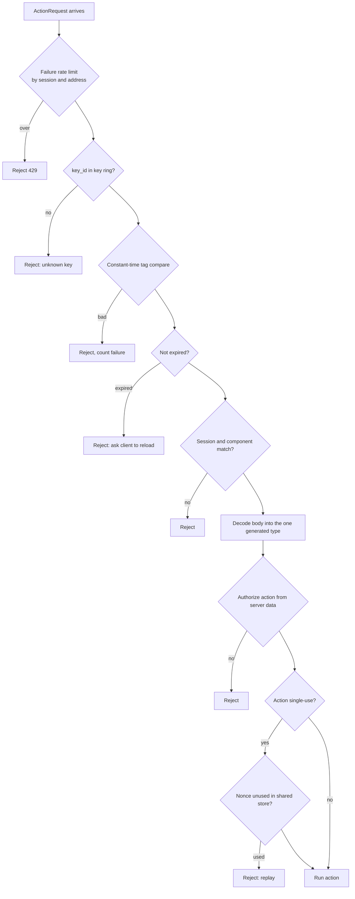

# 08. State security and replay protection

_Written in ASD-STE100 Simplified Technical English (STE). Code and identifiers stay as they
are._

**Abbreviations in this file.** user interface (UI); hash-based message authentication code
(HMAC); Secure Hash Algorithm 256 (SHA-256); authenticated encryption with associated data
(AEAD); WebAssembly (WASM); cross-site request forgery (CSRF); remote code execution (RCE);
key identifier (kid); number used once (nonce); identifier (id); AeroSpace and Defence
Industries Association of Europe (ASD), the owner of the STE standard ASD-STE100.

## 1. The idea, laid out

Source: `foundation_ui_rearchitecture.md` §4 ("The Security Lifecycle") and §2
(`security_hmac`).

**The server signs state with HMAC-SHA256 and a rotating master secret. Any replica checks the
tag before it trusts the state.** The document gives three steps: generate and sign at render,
harvest on interaction, verify on any replica.

The document is silent on four things that a real system needs: what the tag binds to, how long
it is valid, how keys rotate, and replay. Owner decision D6 asks us to learn from Livewire and the
industry. The full study is in [`08b-replay-protection-study.md`](./08b-replay-protection-study.md).

## 2. Who signs (owner decision D5)

"Client never signs, its always from the server or the wasm bundle running on the client on the
web – for on-device, this does not matter."

| Where the logic runs | Who signs | Who verifies | Trust |
|---|---|---|---|
| Remote server | Server key | Any server replica | Full: the user cannot forge tags |
| Browser WASM bundle (local logic) | The WASM runtime | The same WASM runtime only | Integrity against bugs and stale state, not against the user: a key in the browser can be read |
| On device (native, local logic) | Not needed | Not needed | No boundary: view and logic are in one signed app |

Rule: **a remote server never accepts a tag made by a client-side key.** (Q17 confirms this
reading.)

## 3. Current state

| Part | Where |
|---|---|
| HMAC-SHA256 signer for session tokens, private to `foundation_auth`, one key, no key id | `backends/foundation_auth/src/shared/session.rs:348-386` |
| Its tag compare is not constant time (recorded in `docs/bug-backlog.md`) | same file, `:384` |
| ChaCha20-Poly1305 | `backends/foundation_compact/src/crypto/chacha.rs:24`, `:50` |
| Key type that zeroes on drop | `backends/foundation_compact/src/crypto/key.rs:15` |
| No state token, no key ring, no failure counter, no nonce store | — |

## 4. The new way

### 4.1 What the tag covers

```text
tag = HMAC-SHA256(key[key_id],
        "ewe.ui.state.v1" ||            // purpose label: domain separation
        format_version || key_id ||
        issued_at || expires_at ||
        component_type || root_node ||
        session_binding || body)
```

Each field stops one attack class:

| Field | Stops |
|---|---|
| Purpose label | A tag made for another purpose (a session token) being used as a state tag |
| `format_version` | Old tokens after the state type changes shape |
| `key_id` | Nothing on its own; it makes rotation possible |
| `expires_at` | Replay of old state after a configured time window |
| `component_type`, `root_node` | State of component A sent to an action of component B |
| `session_binding` | User B replaying user A's captured state |
| `body` | Edits to the state itself |

### 4.2 Verification order on any replica



_The diagram shows the checks in order. Cheap checks run first. Decode happens only after the
tag passes._

### 4.3 Keys

- A key ring: one current key and some previous keys, each with a `key_id`. Sign with current;
  verify with any key in the ring. Rotation: add a new key, make it current, remove the old key
  after `expires_at` of the last token signed with it has passed.
- The state key is separate from every other key (session, auth). A leak of one does not forge
  the other.
- Keys come from the platform secret source, never from a config file in the repository.

### 4.4 Replay: the layered model

There is no fully stateless replay protection. Every system that stops replay keeps some state
on the server, or accepts a time window. So the new way has layers:

1. **Default, stateless, every action:** expiry window, session binding, component binding,
   constant-time compare, typed decode, authorization on every action.
2. **Stale writes:** domain data carries a row version. A write is a compare-and-swap on it. Two
   clicks with the same old state: the second write fails cleanly.
3. **Opt-in single use** (payments, deletes): the request carries a random nonce. The server
   records it in a shared store until expiry and rejects a second use. Only these actions pay
   for shared state.
4. **Web only:** a CSRF guard on the action endpoint (token or required custom header, plus
   `SameSite` cookies). Native uses bearer auth with no cookies, so CSRF does not apply.

### 4.5 What we take from the study

| From | We take |
|---|---|
| Livewire | One signed snapshot per component; constant-time compare; failure rate limit; CSRF on the endpoint; signed state is never updatable by the client |
| Phoenix LiveView | Token format version; expiry; purpose separation; authorize every event; a way to end all live connections of a user |
| ASP.NET ViewState | Bind the tag to the user or session |
| Hotwire | Keep state small: ids and flags, not domain data |
| JWT practice | `kid` for rotation; a used-id store only where single use is needed |
| Livewire CVE-2025-54068, ViewState RCE | Never decode attacker-chosen types; decode only after the tag passes, into one fixed type |

## 5. What this changes for us

- A new signer module with a key ring, constant-time compare and an AEAD mode. `foundation_auth`
  session tokens move to it later, which also fixes the timing bug.
- A failure counter and an optional nonce store, both behind traits, with limits as
  configuration.

## 6. Open questions

Q17 to Q19 in [`questions.md`](./questions.md): the D5 reading, the default expiry window, and the
store for single-use nonces.
