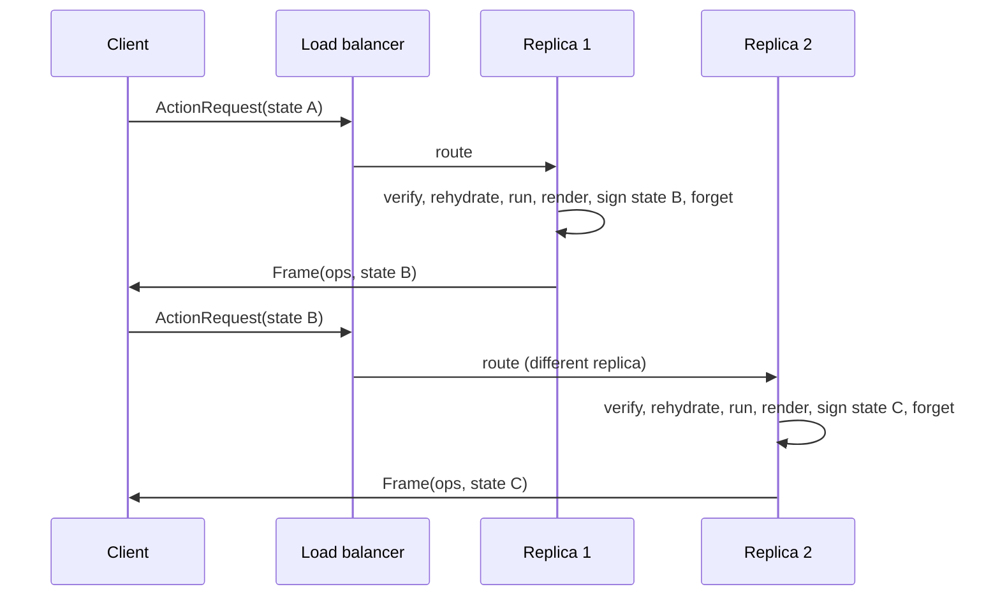

# 09. Stateless execution: any replica, rehydrate, run, forget

_Written in ASD-STE100 Simplified Technical English (STE). Code and identifiers stay as they
are._

**Abbreviations in this file.** user interface (UI); Server-Sent Events (SSE); Durable Object
(DO); identifier (id); AeroSpace and Defence Industries Association of Europe (ASD), the owner
of the STE standard ASD-STE100.

## 1. The idea, laid out

Source: `foundation_ui_rearchitecture.md` §4 ("The Stateless Execution") and §1 ("massive,
horizontal system scalability").

**An action request can land on any server replica.** The replica:

1. checks the tag ([08](./08-state-security-and-replay.md));
2. **rehydrates** the model context from the state in the request;
3. runs the action;
4. renders the result and signs the new state;
5. **clears** the memory context.

No session store. No sticky routing. Scaling is "add replicas behind a load balancer".



_The diagram shows two actions handled by two replicas with no shared session._

## 2. Current state

| Part | Where |
|---|---|
| Stateful server `App`: signals in memory on one thread; "the App never leaves its thread" | `backends/foundation_wasm_ui/src/server/mod.rs:1-24` |
| `Broadcaster` fans frames out to live clients, with a replayed backlog for late joiners | `server/mod.rs:71`, `:151` |
| `FrameTransport` for SSE and WebSocket | `server/mod.rs:38` |

So today an action needs the replica that holds the `App`. Scaling means sticky routing.

## 3. The new way

### 3.1 Two named modes

The document assumes everything is stateless. Live streams are not: a stream is a connection on
one replica. The new way names two modes and lets them live side by side.

| Mode | Holds server state? | Routing | Use |
|---|---|---|---|
| **Stateless action** | No. State rides in the request. | Any replica | Clicks, forms, navigation, most UI |
| **Live stream** | Yes, for the connection | The replica that owns the stream | Push updates, collaboration, dashboards |

A component can use both: actions are stateless; a stream pushes data frames to it. A stream
frame never changes the component's signed state; it changes data shown by the component. If a
push must change state, the server sends a new `SignedState` in a `StateUpdate` frame
([02](./02-unified-wire-contract.md)).

### 3.2 The action lifecycle as code shape

```rust
// sketch of the dispatcher, plain library code (not macro output)
pub async fn dispatch(req: ActionRequest<'_>, ctx: &RequestCtx) -> Result<Frame, ActionError> {
    let verified = ctx.signer.verify(req.state(), &ctx.session)?;          // 08
    let action = ctx.registry.get(req.action_id())?;                       // 10, 11
    let response = action.call(ctx, verified, req.input()).await?;         // rehydrate + run
    let signed = ctx.signer.sign(response.next_state(), &ctx.session)?;    // new state
    Ok(Frame::ops(req.sequence_id(), response.view(), signed))             // render
}   // every local value drops here: "clear the memory context"
```

"Clear the memory context" is not a special step in Rust: the request-scoped values drop at the
end of the async function. The design must make sure nothing request-scoped is cached in a
global, so the property holds.

### 3.3 Where the real state lives

Stateless servers move state to two places:

1. **The signed view state** (small: ids, flags) rides with the client.
2. **Domain data** stays in the database. Rehydration loads it by the ids in the state.

So "stateless" means "no per-user memory on the replica", not "no database". The database load
per action is the real cost. A read-through cache in front of the database is allowed, because it
holds shared data, not per-user sessions.

### 3.4 Improvements over the document

- Two named modes instead of "everything stateless".
- An explicit database load per action, so the cost model is honest.
- Sequence ids and `ack_action` let a client match responses to requests across replicas
  ([02](./02-unified-wire-contract.md)).
- The Cloudflare edge research in PR #158 (Durable Objects for hot state, D1 for reads) gives a
  natural home for live streams: one Durable Object per stream.

## 4. What this changes for us

- The current stateful `App` and `Broadcaster` become the **live stream** mode. They stay.
- A new dispatcher handles **stateless actions**. It is the default for actions.

## 5. Open questions

Q20 in [`questions.md`](./questions.md): where live streams run (any replica with sticky
connections, or one Durable Object per stream).
